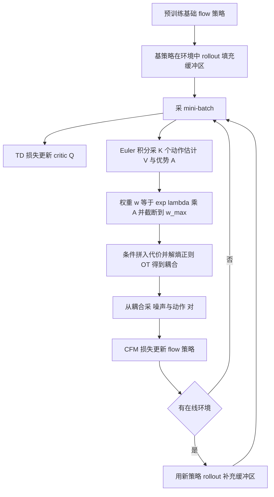

# OTQL：Optimal Transport Q-Learning（arXiv:2607.06262）

**OTQL**（*Optimal Transport Q-Learning for Flow Policy Steering and Acceleration*，[arXiv:2607.06262](https://arxiv.org/abs/2607.06262)，爱丁堡大学与 Honda Research Institute Europe）。本页依据论文 v1 全文整理，详细核对范围见 [来源归档](../../sources/papers/otql-flow-policy-steering_arxiv_2607_06262.md)。

## 一句话定义

**把 critic 算出的优势当作权重放进「条件最优传输」耦合里，再用标准条件流匹配损失训练，使 flow 策略既偏向高价值动作（steering），又因耦合接近最优传输而路径更直、只需 2 到 3 步积分（acceleration）。**（论文摘要、§3.1）

## 英文缩写速查

| 缩写 | 英文全称 | 简要说明 |
|------|----------|----------|
| OTQL | Optimal Transport Q-Learning | 本文方法 |
| OT | Optimal Transport | 最优传输，在两个分布间找代价最小的耦合 |
| COT | Conditional Optimal Transport | 条件最优传输，源与目标条件边缘需一致（§2、附录 A） |
| CFM | Conditional Flow Matching | 条件流匹配，对线性插值路径做回归（式 1） |
| wCOT-CFM | weighted-marginal COT flow matching | 目标边缘按 exp(lambda·A) 重加权的 COT 流匹配（§3.1） |
| NFE | Number of Function Evaluations | 生成一个动作所需网络前向次数，即积分步数 |
| VLA | Vision-Language-Action | 视觉语言动作模型 |
| WAM | World Action Model | 以视频或世界模型为骨干的动作模型 |
| TD | Temporal Difference | 时序差分，critic 的训练损失 |
| UTD | Update-to-Data ratio | 每步环境数据对应的梯度更新次数 |
| SFT | Supervised Fine-Tuning | 监督微调 |

## 为什么重要

- **问题：** flow 与 diffusion 策略依赖高质量演示与多步推理；演示难采，次优策略在分布偏移下易失败（摘要、§1）。
- **作者的切入点：** 已有 flow 的 RL 后训练多需多步积分，或用蒸馏得到单步策略；同时解决加速与 RL 后训练的工作少（§1，作者自述）。
- **对 VLA 的意义：** 论文在 SmolVLA 的 flow 动作头上演示了仅用 30 条机器人自己的 rollout 提升成功率（§4.3、表 2）。这是单一硬件、两个任务上的结果，见下文「局限」。

## 核心原理与流程总览

**步骤。** 训练一个 critic，从缓冲区采 mini-batch，估计优势，据此重加权目标分布，在 mini-batch 上解熵正则 OT 得到耦合，再用该耦合采出的 (噪声, 动作) 对训练 flow（§3.1、§3.2、算法 1）。

**要点（均出自论文，章节见括号）：**

- **目标分布（§2、§3.2）：** 想采样 pi~(a|s) 正比于 pi(a|s)·exp(lambda·A(s,a))，作者指出它是 KL 正则问题的闭式解。
- **条件处理（§3.1）：** 把条件向量乘系数 alpha 后拼到噪声与动作向量上（式 3、4），惩罚条件不一致的配对；源条件从倾斜后的目标条件边缘采样，以满足 COT 要求的条件边缘一致。
- **实用修正（§3.2）：** 权重截断；在 chunk 大且 Q 尖峰的任务上，推理与 Bellman 目标处取 N=5 个候选中 Q 最大者。
- **chunk 化 critic（§3.2）：** 动作是 chunk，reward 用 chunk 内折扣和，Q 与 TD 损失按 chunk 定义。

## 工程实践

- **离线 RL（附录 D.1、表 3、表 4）：** 沿用 QAM 论文的评测设置，critic 集成 K=10，悲观目标；OTQL 用 NFE=2；antmaze、humanoidmaze 的 lambda 为 2 或 5，w_max 为 3 或 1，N=1；cube、scene、puzzle 的 lambda=0.4，w_max=10，N=5。
- **在线 RL（附录 D.2、表 5、表 6）：** 先用基策略 rollout 2000 步，训练 8000 步，UTD=10；每个 batch 一半来自演示、一半来自缓冲区；OTQL 的 NFE=3，ArrangeBoxes 用 N=5，MicrowaveOpen 用 N=1。
- **真实机器人（§4.3、附录 D.3、E）：** KUKA IIWA 14 + Robotiq 2F-85，两台 RealSense D415，桌面 PC（i9-9900KF、RTX 2080）推理，6D SpaceMouse 采演示；训练基于 LeRobot。单任务策略 10 条演示、50 个 rollout（共 60 个 episode）；SmolVLA 10 条演示、30 个 rollout（共 40 个 episode）。最大 episode 长度 150 步，稀疏奖励 0 或 -1。
- **半离线协议（§4.3）：** 每 10 个 rollout 才训练一次（每次 20k 步），训练期间不控制机器人。作者称这样减少人工监督时间，并允许更高的部署频率。
- **调参提示（附录 C）：** lambda 过大使耦合集中在少数样本，有效 batch 变小、收敛慢（图 6 中 lambda=1.5）；过小则不偏向高优势样本。作者建议 chunk=10、episode 约 100 到 200 步时 lambda 取 0.4 到 1.0。
- **代码：** 项目页未见代码仓库链接，本页未写 `code:`。

## 评测证据与清单说法的对比核对

清单（Glen Berseth 的 CoRL 2026 阅读清单，P1，RL Fine-Tuning of VLAs 与 Generative Policies 组）对该文的一句话摘要为：「Advantage-weighted conditional optimal-transport flow matching to RL fine-tune and accelerate suboptimal flow policies.」（作者说明是 LLM 据摘要起草；排序由作者的兴趣模型打分得来，不是质量评价。）

| 清单说法 | 论文核对 |
|----------|----------|
| 优势加权 | 一致。权重为 exp(lambda·A)（§3.1 式 5，§3.2 算法 1），并截断到 w_max。 |
| 条件最优传输流匹配 | 一致，但是 minibatch 熵正则 OT 的近似，条件通过代价拼接实现（式 3、4），并非精确 COT 求解（§3.1、论文称 approximate COT plan）。 |
| RL fine-tune | 基本一致，但真机实验是「半离线」：多轮 rollout 之间集中训练，没有边跑边训（§4.3）；真正在线 RL 只在两个 MuJoCo 仿真任务上做（§4.2）。 |
| accelerate | 一致。2 到 3 步积分，真机单任务 NFE 从 10 降到 3，摘要称推理步数减少 70%，无蒸馏（摘要、§4.3、附录 C）。 |
| suboptimal flow policies | 一致。真机基策略仅 10 条演示、成功率不高于 50%（§4.3）；SmolVLA 先经 SFT，仍低于 50%（表 2）。 |
| （摘要未提及） | 清单摘要没有写：需要策略是 neural-ODE 型生成模型，不能黑箱使用；真机结果只在一台 KUKA 上、每个 VLA 任务 30 次试验（§5、表 2）。 |

数字核对：摘要的 36% 到 86%（单任务）与 38% 到 76%（SmolVLA）；表 2 折算为 (14+9)/60 约 38%、(24+22)/60 约 77%，与摘要一致。正文写「平均提升 37%」，按百分点算约 38，属四舍五入口径差异。

## 结论

OTQL 将流策略后训练与路径拉直结合，但需要可访问 neural-ODE 结构，不能作为任意策略的黑箱插件。

- 在相同动作维度与噪声设置下验证 minibatch OT 质量，再减少积分步数。
- 同时报告成功率、NFE 和完整训练周期，半离线停机更新成本不能省略。
- 按目标模型与任务复验，SmolVLA 和少量真机任务的收益不能代表所有 VLA 或 WAM。

## 局限

**论文自己承认的（§5）：**

- 策略必须是 neural-ODE 生成模型，不能像 DSRL、残差类方法那样当黑箱；并非所有 VLA 或 WAM 都兼容。
- 维度升高时 minibatch OT 误差更大，加速与适应效果会变弱。
- 继承真实世界 RL 的问题：手动标注 episode 成败、每个 episode 后手动复位。
- §4.3 另承认在线微调可能更有效，但每轮训练耗时会使机器人动作断续，故未采用。

**我看到的未验证之处（本页判断，与作者自述分开）：**

- 真机只有一台 KUKA IIWA 14 和 4 个任务；VLA 只在 SmolVLA、2 个任务、每个 30 次试验上验证，且 VLM 冻结、只改动作头（§4.3）。没有给置信区间或多随机种子的真机结果。
- 图 5 的成功率曲线有起伏（如 stack cups 中途回落，目视），每个点的评测 episode 数正文未说明。
- 表 1 比较基线数值沿用或对齐 QAM 论文设置（§4、附录 D.1），超参 lambda、w_max、N 按任务分别设定（表 4），不同任务调参量不同。
- 「减少 70% NFE」的基线是 10 步（§4.3 写 10 到 3）。SmolVLA 的基线 NFE 论文未单独写出，摘要把 70% 同时挂在两类策略上（推测基线同为 10 步，论文未明说）。
- 文中任务名不统一：§4.3 与图 4 写 tape in penholder、close door，附录表 8 写 pen in penholder、open door（论文内部笔误，推测指同一任务）。
- 引用的 NeurIPS 2026 等条目属论文自述，本页未逐条核对。

## 关联页面

- [Flow Matching 具身策略](../concepts/flow-matching-embodied-policy.md)：flow 作为动作生成器的背景。
- [Diffusion Policy](../methods/diffusion-policy.md)：本文的 flow 策略对应的前身路线。
- [Action Chunking](../methods/action-chunking.md)：本文 critic 与 TD 损失按 chunk 定义。
- [强化学习](../methods/reinforcement-learning.md)：TD、critic、优势函数的基础。
- [残差策略学习](../methods/residual-policy-learning.md)：论文对比的黑箱式后训练路线之一（§5 局限提及残差类方法）。
- [VLA](../methods/vla.md) 与 [SmolVLA](paper-smolvla.md)：本文真机 VLA 实验的对象。
- [RLinf-VLA](paper-rlinf-vla.md)：另一条 VLA 强化学习后训练路线，可对照。
- [监督微调](../concepts/supervised-fine-tuning.md)：论文称 SFT 是常规补救手段，需要更多演示。
- [安全的真实世界 RL 微调](../concepts/safe-real-world-rl-fine-tuning.md)：真机 RL 的人工复位与成本问题。

## 参考来源

- [OTQL 论文归档](../../sources/papers/otql-flow-policy-steering_arxiv_2607_06262.md)
- arXiv 摘要页：<https://arxiv.org/abs/2607.06262>
- 项目页：<https://ansocho.github.io/otql-flow>

## 继续阅读

- 论文内被对比的方法：Flow Q-Learning（FQL）、Q-Chunking（QC）、DSRL、QAM（论文参考文献 [25]、[23]、[16]、[24]）。
- 论文所依据的 OT 流匹配基础：Tong 等的 minibatch OT 流匹配（[10]）与 Kerrigan 等的条件 OT（[32]）。
- 同组前作：Sochopoulos 等，Fast flow-based visuomotor policies via conditional optimal transport couplings（CoRL 2025，论文 [28]）。
