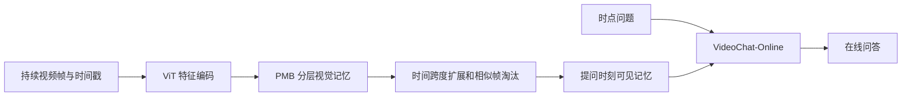
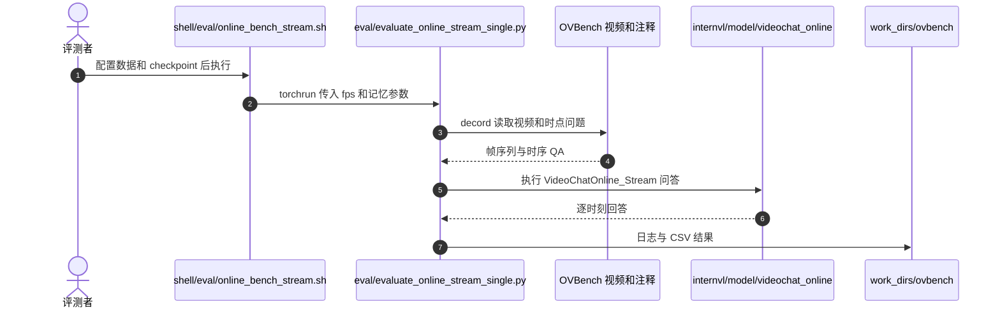

# Online Video Understanding: OVBench and VideoChat-Online｜在线视频理解：OVBench 与 VideoChat-Online

## 一句话定义

**OVBench** 以特定提问时间点考察持续视频流的过去记忆、当前感知与未来理解；**VideoChat-Online** 通过 Pyramid Memory Bank（PMB）和由离线到在线的训练减轻长视频记忆负担。

## 英文缩写速查

| 缩写 | 英文全称 | 简要说明 |
|---|---|---|
| OVBench | Online Video Understanding Benchmark | 分时间和空间问题的在线视频理解基准 |
| PMB | Pyramid Memory Bank | 不同空间分辨率、时间跨度的视觉记忆 |
| ViT | Vision Transformer | 现有官方 PMB 实现使用的特征编码器 |
| SFT | Supervised Fine-Tuning | 离线与在线混合指令训练 |
| MLLM | Multimodal Large Language Model | 视频流问题的多模态语言模型 |

## 为什么重要

- **时点因果：** 在线问题不能提前看到其后的视频帧，否则离线测试会高估实时能力。
- **容量约束：** 长视频不宜保留全部高分辨率帧；PMB 以层次化时空压缩分配记忆预算。
- **诊断边界：** 在线视觉问答不是机器人执行成功率。

## 核心信息

| 项 | 内容 |
|---|---|
| 论文 | Huang et al., CVPR 2025，3328–3338；[arXiv:2501.00584](https://arxiv.org/abs/2501.00584) |
| 开源 | [MCG-NJU/VideoChat-Online](https://github.com/MCG-NJU/VideoChat-Online)，4B 模型与数据下载入口 |
| 基准 | 在线历史、当前、未来时空任务，六类/十六子任务 |
| 官方结果 | README 报告 VideoChatOnline-4B 的 OVBench 得分 **54.9**（以相应协议为准） |

## 核心原理

将视频帧的视觉特征作为空间锚点保留在低层：时间采样稀疏但空间分辨率高；上层逐步压缩空间维度并覆盖更长的时间跨度；结合相似度冗余检测与动态移除。离线视频 SFT 之后加入在线交错视频对话训练，推理时按提问时刻使用历史累积的流式记忆。

### 流程总览

## 源码运行时序图

官方 [源码归档](../../sources/repos/videochat_online.md) 核对实际 `shell/eval/online_bench_stream.sh` → `eval/evaluate_online_stream_single.py`。

训练入口在 `shell/sft/videochat_online_4b_stage1_ft.sh` 和 `shell/sft/videochat_online_4b_stage2_ft.sh`；README 中旧的 `shell/online_4b/` 路径不对应现存文件。

## 工程实践

1. 获取 OVBench 数据、4B checkpoint，核对注释中的时间戳。
2. 修改 `shell/eval/online_bench_stream.sh` 硬编码的数据目录、checkpoint 路径及 GPU 数；单独对照 `shell/eval/online_bench_sliding_window.sh`。
3. 对实时机器人视觉应用，另外记录提问时刻/实际可见帧/策略运行延迟/动作结果；这是工程延伸，不是本文已验证的真机部署。

## 实验与评测

- **任务：** 六大类/十六子任务，区别于普通单时点离线视频 QA。
- **结果：** 官方 README 给出 OVBench **54.9**（VideoChatOnline-4B）；跨 offline/sliding-window/streaming 结果不能当作同协议比较。
- **检查轴：** 分层记忆的空间-时间取舍及离线到在线训练收益；分数仅适用原评测数据和帧预算。

### 附录核对与指标边界

- **在线与滑窗不是同一协议：** 表 2 中 VideoChat-Online 4B 的 streaming 分数为 **54.9**，32 秒滑窗为 **53.9**；§5.4 表 6 的 **53.89** 来自训练策略消融设置，不能与 streaming 结果混记。
- **PMB 记忆预算：** 补充材料 §1.1/§5 明确 `m_s`：2×256、`m_main`：2×64、`m_t`：12×16，总 **832 visual tokens**；正文 §4.1 描述相邻帧相似度淘汰与逐层下写，KV-cache 同步为**论文方案**，并非宣称官方已经开放相应实现。
- **训练增益：** 96K 在线 SFT 样本约占训练数据 6%；训练消融中仅离线为 **45.23**，渐进式混合+交错数据 **53.89**。补充材料中删去时空动作检测、时间定位分别下降 **3.3 / 2.7** 分。
- **审慎处理原文冲突：** §1 写 7 个源数据集，§3.2 写 8 个；保留差异而非推断同一数量。附录在特定 1000 帧测试下报告 **8.71 GB VRAM**，不能外推为普遍硬件需求。

## 结论

**在线视频模型评测必须同时限定提问时刻与记忆预算，不能用完整视频的离线问答分数冒充实时理解。**

1. 先核对帧可见上界和每个问题的触发时间。
2. PMB 用不同层次分别保留细节和长期上下文，不应无限保存全分辨率帧。
3. 离线 SFT 与在线交错对话训练的作用需分开比较。
4. 复现以现存 `shell/sft` / `shell/eval` 为准，修正 README 过期路径。

## 与其他工作对比

| 项 | 本文 | [S-EMBER](./paper-s-ember.md) |
|---|---|---|
| 核心问题 | 流式视频的过去/当下/未来时空理解 | 第一视角历史事件检索及证据时间定位 |
| 产出 | OVBench + PMB 模型、训练与评测 | 基准、数据、MCQ 与 grounding 实现 |
| 不覆盖 | 真机动作闭环与任务成功率 | 真机动作闭环与任务成功率 |

## 局限与风险

- 官方 README 明确：当前开源 PMB 使用 **ViT 特征**；基于 KV-cache 特征的实现计划后续开放，不能当作已发布。
- 流式评测脚本包含内部路径与 8 GPU 默认设定，不能直接在普通机器上原样复现。
- arXiv v2 正文和补充材料已核读，官方脚本入口已对照；**未运行完整训练、推理或全部本地 CI**，本节点 `complete` 表示文献解读完成，不是复现通过。

## 关联页面

- [S-EMBER](./paper-s-ember.md)
- [Ego4D 第一视角视频](./paper-ego4d.md)
- [具身评测基准选型](../overview/hub-embodied-eval-benchmark.md)
- [具身模型评测纵深 Stage 1](../../roadmap/depth-embodied-eval.md)

## 参考来源

- [论文来源归档](../../sources/papers/ovbench_videochat_online_arxiv_2501_00584.md)
- [项目主页归档](../../sources/sites/videochat-online-project.md)
- [源码入口归档](../../sources/repos/videochat_online.md)
- [CVPR 2025 正式原文](https://openaccess.thecvf.com/content/CVPR2025/html/Huang_Online_Video_Understanding_OVBench_and_VideoChat-Online_CVPR_2025_paper.html)

## 推荐继续阅读

- [arXiv 原文](https://arxiv.org/abs/2501.00584)
- [官方项目和榜单](https://videochat-online.github.io/)
- [官方源码](https://github.com/MCG-NJU/VideoChat-Online)
