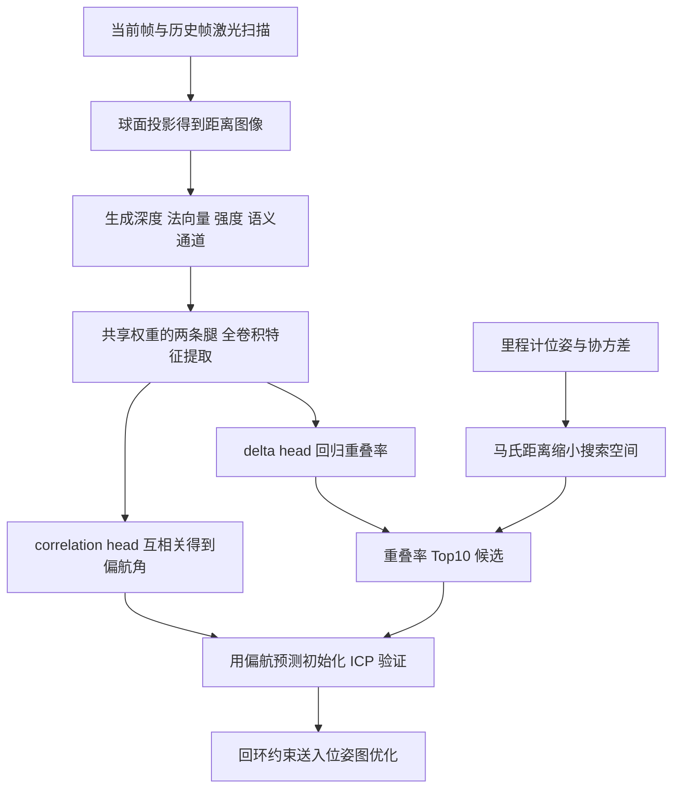

# OverlapNet：面向激光雷达 SLAM 的回环检测

## 一句话定义

OverlapNet（Xieyuanli Chen 等，波恩大学，RSS 2020，[arXiv:2105.11344](https://arxiv.org/abs/2105.11344)）是一个孪生卷积网络：输入两帧 3D 激光扫描的球面投影（距离图像）及其法向量、强度、语义等通道，输出两帧的**重叠率**和**相对偏航角**，用来找回环候选并给 ICP 提供偏航初值（摘要、§III-C）。

## 英文缩写速查

| 缩写 | 英文全称 | 简要说明 |
|------|----------|----------|
| SLAM | Simultaneous Localization and Mapping | 同时定位与建图；回环检测用来修正累积漂移（§I） |
| LiDAR | Light Detection and Ranging | 激光雷达，论文用 64 线旋转式 Velodyne HDL-64E 数据（§IV） |
| ICP | Iterative Closest Point | 迭代最近点配准，用偏航预测作初值（§I、§IV-F） |
| SuMa | Surfel-based Mapping | Behley 与 Stachniss 的面元建图 SLAM，论文在其中替换回环检测（§III-E） |
| FCN | Fully Convolutional Network | 每条腿由 11 层卷积组成的全卷积网络（§III-C） |
| RangeNet++ | RangeNet++ | 激光语义分割网络，提供 20 类概率，PCA 压缩为 3 维（§III-C） |
| PCA | Principal Component Analysis | 把 20 维语义概率压到 3 维 |
| AUC | Area Under the Curve | 精度-召回曲线下面积（Table II） |
| OREOS | Oriented Recognition of 3D Point Clouds in Outdoor Scenarios | 同样估计偏航差的对比方法（§IV-C） |

## 为什么重要

- 回环检测负责全局数据关联，修正里程计漂移得到全局一致地图（§I）。SuMa 原本取已建图中最近帧作候选，论文指出它在大回环少的场景失效，漂移大时最近帧也不对（§III-E）。
- 重叠率可以量化一对扫描匹配的质量：论文发现重叠率越大，ICP 配准结果越好、偏航误差越小（§IV-D、§IV-F，Fig. 8/9），所以它不只是「像 / 不像」的描述子相似度。
- 论文自述，网络只需球面投影而非原始点云，较为轻量（§I）。
- 对本库的激光 SLAM 节点（如 [LeGO-LOAM](../entities/lego-loam.md)、[LIO-SAM](../entities/lio-sam.md)）而言，它是「回环检测模块」这一环的一个学习式方案样例，并非完整里程计。

## 核心原理与方法

1. **重叠率定义（§III-A/B）：** 球面投影得到顶点图，用两帧位姿把一帧重投影到另一帧，统计距离差不超过 ε = 1 m 的像素占有效像素的比例（式 (1)–(3)）。该度量不对称，真值只在训练时由位姿生成。
2. **输入（§III-C）：** 64 × 900 × D 张量，可含深度（1 通道）、法向量（3）、强度（1）、语义（PCA 后 3）。
3. **网络（§III-C，Table I）：** 两条共享权重的腿各出 1 × 360 × 128 特征；delta head 对两特征体做所有像素对的绝对差，再经卷积和全连接回归重叠率；correlation head 把一个特征体当卷积核在另一个上循环滑动，得到 360 维向量，argmax 即偏航角（1 度分辨率）。依据：偏航旋转等价于距离图像的列循环平移。
4. **训练（§III-D，§IV）：** 总损失 L = L_O + α L_Y（α = 5）；偏航只在重叠率大于 30% 的样本对上训练。训练用 KITTI 03–10，验证 02，测试 00；Ford Campus 完全未参与训练。
5. **集成到 SuMa（§III-E/F）：** 候选取「重叠率前 10 名里马氏距离最近」，搜索区域由协方差传播给出（3σ），再用偏航预测初始化 ICP 做几何验证。同一框架也可不用先验做纯地点识别（§III-F，§IV-C）。

## 流程总览

说明：流程依据论文 Fig. 3 与 §III-E/F 整理，位姿图优化部分沿用 SuMa，论文未展开。

## 实验结果（论文自述）

| 项目 | 结果 | 出处 |
|------|------|------|
| KITTI 00，回环检测 | Ours AUC 0.87 / F1 0.88；M2DP 0.83 / 0.87；Histogram 0.83 / 0.83；SuMa F1 0.85；加先验 0.96 / 0.96 | Table II/III |
| Ford Campus 00（只用 KITTI 训练，仅几何） | Ours AUC 0.85 / F1 0.84；M2DP F1 0.85；SuMa F1 0.33；加先验 F1 0.88 | Table II/III |
| 偏航角误差（KITTI 00，无 ICP） | 均值 1.13 度，标准差 3.34 度；OREOS 12.67 / 15.23；FPFH+RANSAC 13.28 / 32.19 | Table IV |
| 输入模态消融 | 仅深度：偏航均值 11.67 度；加法向量 2.97 度；再加强度 2.53 度；再加语义 1.13 度；AUC 基本持平（0.86 到 0.87） | Table V |
| 单帧耗时（KITTI 全输入） | 预处理 75 ms，腿 6 ms，头 27 ms，全部候选最坏 630 ms | §IV-G |

## 工程实践

- 官方代码 [PRBonn/OverlapNet](https://github.com/PRBonn/OverlapNet)：Keras + TensorFlow，4 个 demo（生成输入、推理、回环检测、生成真值）。仓库只提供几何预处理数据和 `model_geo.weight` 几何版权重；语义、强度输入需自行生成，在线预处理可参考 SuMa++（README，已核对，未运行，未读源码）。
- 落地要点：需要自己准备带位姿的训练数据来生成重叠率与偏航真值（§III-D）；64 线车载雷达之外的传感器需要重训（推测，论文只验证 HDL-64E 两个数据集）。
- 全流程在线运行依赖先把候选限制在位姿不确定性给出的小搜索区域内（§IV-G）。
- 论文的集成对象是 SuMa 面元 SLAM；与本库的 LIO 系系统结合没有在论文中验证（推测可行，未验证）。

## 局限

论文自己承认或表明的：

- 在未见过的 Ford 数据上，F1 为 0.84，略低于 M2DP 的 0.85；论文归因于未在美国道路训练、且只有几何信息可用（§IV-A）。
- 候选数较多时 OREOS 与 LocNet++ 召回略高（§IV-C）。
- 低重叠对偏航估计差（Fig. 8），ICP 在重叠率约 30% 以下不可靠，因此阈值取 30%（§IV-A、§IV-F）。
- 作者列为后续工作：视觉 / 雷达输入，以及不同季节的数据集（§V）。

我们看到的未验证之处：

- 只在 KITTI 00 与 Ford 00 两条序列上做主要评测，没有季节、天气或结构突变的实验，因此「环境突变时表现如何」论文没有答案。
- 最好的数字（0.96 / 0.96）依赖里程计先验和协方差；纯地点识别设置只比较了候选召回（Fig. 7），没有精度-召回对比。
- 语义通道依赖 RangeNet++ 与语义标注训练，会增加预处理时间（75 ms 级，§IV-G）；官方仓库未随附语义版权重。
- 对比基线为论文中列出的 Histogram、M2DP、SuMa、OREOS、LocNet 系列（§IV），本页未核对这些基线的实现设置是否与原作一致。

## 与「激光雷达 SLAM 综述」文章说法的核对

综述原文（刘铭哲等，2026-11-11 转载）称：无需两帧相对位姿、用图像重叠率检测回环、输入深度 / 强度 / 法向量 / 语义图、输出重叠率与偏航角、环境突变时准确率降低。

- 前四点基本符合，但需补充：「无需相对位姿」只指推理；训练真值需要位姿（§III-B），主实验也用里程计先验。「图像」是激光距离图像，不是相机图像。四种输入不是必需的（Table V，Ford 仅用几何）。
- 「环境突变时准确率降低」在论文中没有出处，属于综述作者的推断；论文最接近的证据是未见环境上 F1 略低（Table II）与低重叠偏航误差大（Fig. 8）。

## 与其他工作对比

| 工作 | 关注点 | 与本文的区别 |
|------|--------|--------------|
| [Scan Context](./paper-scan-context.md) | 手工鸟瞰描述子（方位角 × 半径最大高度），列平移比较给出偏航初值 | 不需训练；OverlapNet 学习式地直接回归重叠率与偏航，并在 Ford 未见数据上评测泛化（Table II） |
| [SuMa++](./paper-suma-plus-plus.md) | 在 SuMa 上用 RangeNet++ 语义滤除动态面元、加权 ICP | 同组同框架；SuMa++ 改进的是里程计 / 建图，OverlapNet 替换的是 SuMa 的回环候选选择（§III-E） |
| [OverlapTransformer](./paper-overlaptransformer.md) | 同组后续：Transformer + NetVLAD 的偏航不变全局描述子 | OT 用单一描述子快速检索（3.28 + 0.44 ms），OverlapNet 需成对过网络、全部候选最坏 630 ms，但额外给出偏航角 |

## 结论

**OverlapNet 把回环检测重写成「预测两帧距离图像的重叠率与相对偏航」，让候选打分与 ICP 初值来自同一个网络。**

1. KITTI 00 上 AUC 0.87 / F1 0.88，略优于 M2DP、Histogram；加里程计先验后升至 0.96 / 0.96（Table II/III）。
2. 偏航均值误差 1.13 度，远小于 OREOS 的 12.67 度；法向量、强度、语义通道主要改善偏航而非检测 AUC（Table IV/V）。
3. 只用 KITTI 训练、仅几何输入时在 Ford 上 F1 0.84，泛化可用但略低于 M2DP（§IV-A）。
4. 局限：只验证 64 线车载雷达两条测试序列，最好结果依赖位姿先验，成对推理在候选多时较慢，季节 / 环境变化未测（§IV-G、§V）。

## 关联页面

- [激光雷达感知](../concepts/lidar-sensing.md)
- [状态估计](../concepts/state-estimation.md)
- [LeGO-LOAM](../entities/lego-loam.md)
- [LIO-SAM](../entities/lio-sam.md)
- [LVI-SAM](../entities/paper-lvi-sam.md)
- [Cartographer](../entities/cartographer.md)
- [KITTI 立体基准](../entities/kitti-stereo-benchmark.md)（KITTI 数据集相关背景，本论文用的是 KITTI 里程计基准）

## 参考来源

- [来源归档：OverlapNet（arXiv:2105.11344）](../../sources/papers/overlapnet_arxiv_2105_11344.md)
- 论文：<https://arxiv.org/abs/2105.11344>
- 代码：<https://github.com/PRBonn/OverlapNet>

## 继续阅读

- 同组后续工作 OverlapTransformer 与 SeqOT（README「New Version」所列，本页未读其论文）。
- 期刊扩展版：Chen 等，Autonomous Robots 2021（README 所列，未读）。
- 论文所基于的 SuMa（Behley 与 Stachniss，RSS 2018）与对比方法 OREOS、M2DP。
