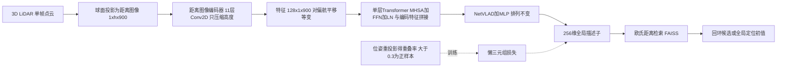

# OverlapTransformer（arXiv:2203.03397）

**OverlapTransformer（OT）**（Ma 等，*OverlapTransformer: An Efficient and Yaw-Angle-Invariant Transformer Network for LiDAR-Based Place Recognition*，IEEE RA-L 2022，[arXiv:2203.03397](https://arxiv.org/abs/2203.03397)；v1 标题写作 *Rotation-Invariant*）是 LiDAR 位置识别 / 回环检测网络。本页依据 arXiv v1 全文通读写成，归档见 [原文归档](../../sources/papers/overlaptransformer_arxiv_2203_03397.md)。作者来自北京理工大学、HAOMO.AI、波恩大学（Stachniss 组）与牛津大学。

## 一句话定义

**只把单帧 3D LiDAR 投影成距离图像，用「不压缩宽度的卷积编码器 + 一层 Transformer + NetVLAD」得到 256 维全局描述子，描述子对绕 z 轴的偏航旋转不变（忽略像素取整误差），以欧氏距离做回环 / 位置检索（论文 §I、§III）。**

## 英文缩写速查

| 缩写 | 英文全称 | 简要说明 |
|------|----------|----------|
| OT | OverlapTransformer | 本文方法 |
| LiDAR | Light Detection and Ranging | 激光雷达 |
| SLAM | Simultaneous Localization and Mapping | 同时定位与建图，回环检测是其组成部分 |
| MHSA | Multi-Head Self-Attention | 多头自注意力 |
| FFN | Feed-Forward Network | Transformer 块里的前馈网络 |
| LN | Layer Normalization | 层归一化 |
| NetVLAD | Net Vector of Locally Aggregated Descriptors | 对局部特征集合做可学习聚类聚合的描述子头，具排列不变性 |
| AUC | Area Under the Curve | 精确率—召回率曲线下面积（论文 §V-B 用作回环指标之一） |
| F1max | maximum F1 score | 曲线上最大 F1 |
| Recall@1 / @1% / @N | recall at top-1 / top-1% / top-N | 前 1 个 / 前 1% / 前 N 个候选中命中真值的比例 |
| FAISS | Facebook AI Similarity Search | 向量检索库，论文用于加速描述子检索（§V-E） |

## 为什么重要

- 回环检测是激光 SLAM 控制漂移的关键环节，本库的 [LeGO-LOAM](./lego-loam.md)、[LIO-SAM](./lio-sam.md) 等系统都依赖回环或位置识别模块；OT 提供一个仅用距离图像、速度很快的学习型候选检索方案（作者自述，§I）。
- 论文在 KITTI 序列 00 上对比表中所有无语义基线获得最高 AUC / F1max / Recall@1 / Recall@1%（§V-B 表 III），并在未训练的 Ford Campus 上保持领先（Recall@1% 与 Scan Context 接近）。
- 描述子提取 3.28 ms、检索 0.44 ms（§V-E 表 IV，i7-11700K + RTX 3070，库 2000 帧）；论文据此称可达 250 Hz。
- 同时发布 Haomo 数据集（§IV），含正反向行驶与跨月重访序列。

## 核心机制

### 流程总览

### 关键设计（均来自论文 §III）

| 环节 | 做法 | 作用 |
|------|------|------|
| 输入 | 仅距离（depth）图像，64 线为 1×64×900，Haomo 32 线为 1×32×900（§V-A） | 与 OverlapNet 的多模态输入（深度 / 法向 / 强度 / 语义）区别，更快更易泛化 |
| 偏航 ↔ 平移 | 偏航 θ 对应横向平移 s=½(1−θπ⁻¹)w（式 (2)） | 把旋转问题变成循环平移问题；有像素取整误差 |
| 编码器 | 表 I 的 11 层 Conv2D，步长 (2,1)，宽度保持 900，无 padding、无 dropout | 保持平移等变性 |
| Transformer | 一个块：MHSA + FFN + LN，d_model=256，4 头，d_ffn=1024；Q/K/V 沿通道拆分，与编码特征拼接 | 作者称增强特异性并建模特征间位置关系；论文论证其对列平移等变（式 (6)–(10)） |
| VLAD 头 | NetVLAD（K=64，中间 1024 维）+ MLP，输出 256 维 | NetVLAD 排列不变，所以列平移后描述子相同（式 (11)–(13)） |
| 训练标签 | 重叠率式 (14)，阈值 δ（KITTI 为 1，Haomo 为 1.2），重叠率 >0.3 为正 | 用 OverlapNet 的重叠率思想定义「同一地点」 |
| 损失 | 懒三元组损失，k_p=k_n=6，α=0.5（式 (15)） | 拉近最难正样本、推远全部负样本 |

注意：旋转不变性来自「等变编码 + 排列不变聚合」，不是 Transformer 本身带来的；Transformer 只是被论证为不破坏等变性。

## 实验与结果（论文 §V）

| 数据集 / 方法 | AUC | F1max | Recall@1 | Recall@1% |
|---------------|-----|-------|----------|-----------|
| KITTI 00：OverlapNet（Delta-Geo-Only） | 0.867 | 0.865 | 0.816 | 0.908 |
| KITTI 00：OT | 0.907 | 0.877 | 0.906 | 0.964 |
| Ford Campus 00：Scan Context | 0.903 | 0.842 | 0.878 | 0.958 |
| Ford Campus 00：OT（未在 Ford 上训练） | 0.923 | 0.856 | 0.914 | 0.954 |

训练 KITTI 03–10、验证 02、评测 00（§V-B）。表 III 另含 Histogram、LiDAR Iris、PointNetVLAD，数值见 [原文归档](../../sources/papers/overlaptransformer_arxiv_2203_03397.md) 所引的论文表 III。

- **偏航不变性（§V-D，图 8）：** 查询帧每 30° 旋转，OT 的 Recall@1 不变；PointNetVLAD、OverlapNet 随偏航差快速失效。
- **Haomo（§V-C，图 5–7）：** 同向、反向与跨月长期三类挑战均优于基线（论文文字描述，图中为曲线，本页未逐点读数）。
- **运行时间（§V-E，表 IV）：** 描述子 3.28 ms + 检索 0.44 ms；Scan Context 为 57.95 + 492.63 ms，OverlapNet 为 4.85 + 3233.3 ms，PointNetVLAD 为 13.87 + 1.43 ms。

## 工程实践

- 官方仓库 [haomo-ai/OverlapTransformer](https://github.com/haomo-ai/OverlapTransformer)：README 称基于 PyTorch，推荐 GPU，CPU 亦够快；Python < 4 ms/帧、C++ < 2 ms/帧（C++ 数字为 README 自述，论文 v1 无）。本页未运行代码、未读源码。
- 用法要点（README）：需先把 KITTI 点云生成 `.png` 距离图像并获取重叠率标注；提供 KITTI 的训练 / 测试教程与预训练权重，Haomo 的教程 README 称随完整数据集发布，未核实当前是否已发布。
- 输入依赖旋转式机械 LiDAR 的规则距离图像；换传感器需改 h、w 与 δ（论文对 Haomo 用 δ=1.2「取决于点云密度」，§V-A）。
- 作为前端：描述子可用于 SLAM 回环候选筛选，后续仍需几何验证与位姿图优化，见 [LIO-SAM](./lio-sam.md)、[激光里程计融合](../methods/lidar-odometry-fusion.md)；论文本身只评测检索与回环指标，没有把 OT 接入完整 SLAM 做轨迹精度实验（推测：全文未见此类实验）。

## 局限

论文自述与论文本身可见的不足：

1. 论文自述：旋转不变性仅「忽略像素取整误差」成立（§I、§III-A）；仅对偏航不变，对横滚 / 俯仰 / 位置平移无保证（作者只论证偏航，该点为本页对原文的读法）。
2. 论文自述 Haomo 数据集将持续更新（§IV）；其反向行驶检验只用同一路线的正反向，场景种类有限。
3. 论文只在 KITTI（训练 + 评测）、Ford Campus（泛化）、Haomo 上评测，均为车载机械 LiDAR 城市道路；固态 / 低线数 / 非车载场景未验证（README 邀请用户自行回报其他输入类型的结果）。
4. **缺 Transformer 消融**：v1 全文无去掉 Transformer 或增减层数的对比，「Transformer 提升特异性」「更多块不提升」均无数据支撑（§III-B 仅称基于实验）。
5. 对比基线中 OverlapNet 用的是 Delta-Geo-Only 版本且为公平比较只取相似度头（§V-B、§V-D）；Scan Context 做了「augmentation」，细节未在 v1 展开。
6. Haomo 的 Fig. 5–7 只有曲线、无数值表，难以复现核对；训练在 Haomo 上用库序列（§V-C），与 KITTI 的「未见环境」设定不同。
7. 本页只读了 v1；RA-L 正式版可能有补充（未核对）。

## 与其他工作对比

| 工作 | 关注点 | 与本文的区别 |
|------|--------|--------------|
| [OverlapNet](./paper-overlapnet.md) | 孪生网络成对预测重叠率与偏航，多模态输入 | OT 只用深度通道、输出单帧全局描述子，检索可用 FAISS；KITTI 00 上 AUC 0.907 对 0.867，检索 0.44 ms 对 3233.3 ms（表 III、表 IV），但不给偏航角 |
| [Scan Context](./paper-scan-context.md) | 手工鸟瞰描述子，列平移比较，两阶段检索 | 无需训练；Ford 上 Recall@1% 与 OT 接近（0.958 对 0.954），但描述子 + 检索耗时 57.95 + 492.63 ms（表 III、表 IV） |
| [Scan Context++](./paper-scan-context-plus-plus.md) | 极坐标 / 笛卡尔两种描述子，兼顾旋转与横向平移 | OT 只论证偏航不变，对横向平移没有专门设计 |

## 结论

**OverlapTransformer 用「只压高度的等变卷积 + Transformer + NetVLAD」得到偏航不变的全局描述子，把激光回环检索做到毫秒级，同时在 KITTI 与 Ford 上保持领先精度。**

1. 旋转不变性来自等变编码加排列不变聚合，而非 Transformer 本身（§III）。
2. KITTI 00 上 AUC 0.907 / Recall@1 0.906，未训练的 Ford 00 上 AUC 0.923（表 III）。
3. 描述子 3.28 ms + 检索 0.44 ms，比 OverlapNet、Scan Context 快两到三个数量级（表 IV）。
4. 局限：无 Transformer 消融、只在车载机械雷达城市道路上评测、未接入完整 SLAM 做轨迹精度实验。

## 关联页面

- [LiDAR 感知](../concepts/lidar-sensing.md)
- [状态估计](../concepts/state-estimation.md)
- [Transformer](../concepts/transformer.md) / [多头注意力](../concepts/multi-head-attention.md)
- [激光里程计融合](../methods/lidar-odometry-fusion.md)
- [LeGO-LOAM](./lego-loam.md)、[LIO-SAM](./lio-sam.md)、[FAST-LIO](./fast-lio.md)、[LVI-SAM](./paper-lvi-sam.md)、[Cartographer](./cartographer.md)

## 参考来源

- [overlaptransformer_arxiv_2203_03397.md](../../sources/papers/overlaptransformer_arxiv_2203_03397.md)（通读归档，含与综述文章说法的核对）
- [arXiv:2203.03397](https://arxiv.org/abs/2203.03397)
- [haomo-ai/OverlapTransformer](https://github.com/haomo-ai/OverlapTransformer)

## 继续阅读

- [arXiv PDF v1](https://arxiv.org/pdf/2203.03397v1)
- 论文所指前作 OverlapNet（Chen 等，RSS 2020 / Autonomous Robots 2021）与 NetVLAD（Arandjelovic 等，CVPR 2016）；后续工作 SeqOT、CVTNet 见官方 README（自述，未核对）。
