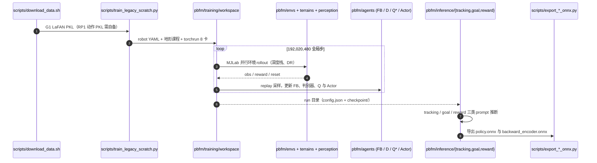

# P-BFM：感知行为基础模型的人形控制

**P-BFM**（*Perceptive Behavioral Foundation Models for Humanoid Control via Unsupervised Reinforcement Learning*，[arXiv:2610.15833](https://arxiv.org/abs/2610.15833)，[项目页](https://roboparty.github.io/P-BFM/)）由上海理工大学、清华大学、RoboPartyLab、浙江大学和哈尔滨工业大学团队提出。它希望让同一个行为意图在不同地形中诱发不同但合适的全身动作，而不是要求机器人照搬平地参考动作。

## 一句话定义

**FB latent 表达“想做什么”，深度感知策略负责“怎样在当前地形做到”，ERI 再为根运动补上朝向与水平速度约束。**

## 方法

## 英文缩写速查

| 缩写 | 全称 | 含义 |
|---|---|---|
| BFM | Behavioral Foundation Model | 行为基础模型，跨任务复用全身行为先验 |
| FB | Forward–Backward Representation | 前向–后向表征，用共享 latent 表示行为意图 |
| ERI | Explicit Root Instructions | 显式根指令，以朝向和水平速度约束全局根运动 |
| RL | Reinforcement Learning | 强化学习 |
| LaFAN | Learn to Act from Animation | 人体动作数据集，本文提供平地运动提示 |
| SOMA | Style-based Online Motion Adaptation | 论文用于未见动作评测的动作集合 |

| 模块 | 输入/职责 | 关键点 |
|---|---|---|
| 地形无关意图空间 | motion reference、target state、reward function → behavioral latent | Forward–Backward 表征；后向表征不输入地形或全局指令，使同一身体状态/奖励对应同一意图 |
| 感知执行策略 | 本体状态历史、深度视觉特征、intent latent | 在线仿真交互学习抬脚、步幅、姿态、落脚点和接触随地形变化 |
| Explicit Root Instructions（ERI） | 目标 heading 与 planar velocity | 独立提供全局移动方向和速度，减少 heading drift、障碍前原地踏步；局部垂向/全身动作仍可适应地形 |
| 多接口推理 | 参考动作、目标姿态、奖励、遥操作目标 | 一个冻结策略支持 tracking、goal reaching、reward inference、teleoperation 与恢复 |

## 训练与部署

- **仿真：** Unitree G1 + MJLab；192M 环境步；8×NVIDIA H200 约 10 小时。
- **行为先验：** 40 段平地 LaFAN 序列作为行为提示和条件判别器正样本；不提供 terrain-specific motion demonstrations。
- **地形：** 平地、粗糙地面、上下楼梯、平台、倒金字塔斜坡和箱体障碍等七类。
- **视觉：** 50 Hz 控制，深度帧历史经 CNN + GRU 编码；仿真随机化相机外参和短时延。
- **真机：** Unitree G1 + RealSense D435i；策略冻结后使用板载深度零样本迁移。训练时的特权地形/速度输入不进入部署策略。

## 评测结果

论文在见过的 LaFAN 动作及 994 段未见 SOMA 动作上比较 P-BFM、UFO、PMT。P-BFM 在表格中呈现较低的关节位置误差、足滑和较高的扰动恢复率；但 seen-motion 对比中 PMT 只有其唯一公开参考轨迹，而 P-BFM/UFO 使用 40 段 LaFAN，不能把该组直接当作严格同覆盖对照。真实机器人演示涵盖遥操作、动作跟踪、目标姿态到达、奖励推断以及推搡/踢击后的地形感知恢复。

## 源码运行时序图

关键复现路径（`Roboparty/P-BFM` main 分支 README、`docs/ARCHITECTURE.md`）：先 `uv sync --extra test`，用 `scripts/train_legacy_scratch.py` 配合 `--robot-config pbfm/configs/robots/{g1_29dof,rp1_24dof}.yaml` 训练；已保存的 run 配置携带机器人标定进入三类推理与 ONNX 导出。

## 复现与边界

- **开源状态（核查于 2026-10-27）：** `Roboparty/P-BFM` main 分支已有 `pbfm/`（算法、训练、仿真、机器人配置与推理）、`scripts/`（训练与 ONNX 导出）、`tests/`、`docs/`（TRAINING / INFERENCE / ARCHITECTURE）；最近提交为 2026-10-22「Support G1 and RP1 training, inference and calibrated export」。此前（2026-10-15）README 称代码尚未上传，该状态已过期。许可沿用 UFO 的 CC BY-NC 4.0（非商用）。
- **未随仓库提供：** G1 与 RP1 的预训练权重（README 称“Motion data and weights are external”）；RP1 重定向动作 PKL 需自备，`download_data.sh` 只下载 G1 LaFAN。
- **RP1 验证范围：** README 自述 RP1 仅通过 GPU rollout/reset、八卡短训练、三类推理入口与 ONNX 一致性检查；长程训练与真机验证待完成。G1/RP1 权重不可互换，且不能直接加载 `roboparty_train` 的 Newton 后端权重。
- 论文承认行为泛化仍受训练动作先验和探索地形范围限制；更广泛的动作数据与更复杂的全身接触是后续方向。
- P-BFM 的核心不是“任何地形都复刻原动作”，而是在保持任务/动作意图的同时，允许接触、步态和姿态根据地形重组。

## 与其他工作对比

| 工作 | 关系与区别 |
|---|---|
| [BFM-Zero](./paper-bfm-zero.md) | 同样使用 FB 表征和无监督 RL；P-BFM 的增量是把深度感知地形适配与 ERI 根运动指令纳入同一策略。 |
| [UFO](https://github.com/Roboparty/UFO) | P-BFM 以 UFO 等 FB 人形策略为近邻基线，增加环境深度感知和根运动监督；论文报告的对比需结合其动作覆盖设置阅读。 |
| [PMT](../entities/paper-perceptive-bfm.md) | 两者都研究感知条件的人形运动，但 P-BFM 依赖在线无监督 RL 学地形适应，不靠离线合成地形参考；论文说明 PMT 在见过动作比较中只提供一条参考轨迹。 |
| [I-BFM](./paper-i-bfm.md) | I-BFM 聚焦人与物体交互及接触动力学；P-BFM 聚焦地形约束下的全身行为和全局根运动。 |

## 结论

P-BFM 的核心贡献是将 BFM 的共享行为意图与地形感知执行解耦，并用 ERI 修补 FB 无监督学习对精确全局位移约束较弱的问题。论文给出仿真与 G1 真机上的多接口验证；但训练动作先验和地形覆盖仍限制泛化，官方仓库现已提供 G1/RP1 训练与推理代码，但无预训练权重，RP1 路径尚缺长程训练与真机验证。

## 关联页面

- [Behavior Foundation Model 概念页](../concepts/behavior-foundation-model.md)
- [BFM-Zero](./paper-bfm-zero.md) — FB + 无监督 RL 的近邻路线
- [Perceptive BFM](./paper-perceptive-bfm.md) — 地形感知参考运动跟踪的另一种设计
- [I-BFM](./paper-i-bfm.md) — 将对象动力学与手–物接触纳入行为 latent
- [人形 RL 运动控制身体系统栈](../overview/humanoid-rl-motion-control-body-system-stack.md)
- [BFM 纵深路线](../../roadmap/depth-bfm.md)

## 参考来源

- [论文来源归档](../../sources/papers/p_bfm_arxiv_2610_15833.md)
- [项目页与代码开放状态](../../sources/sites/p-bfm-project-page.md)
- [Roboparty/P-BFM 官方仓库](https://github.com/Roboparty/P-BFM)（README 与 docs/，核查于 2026-10-27）
