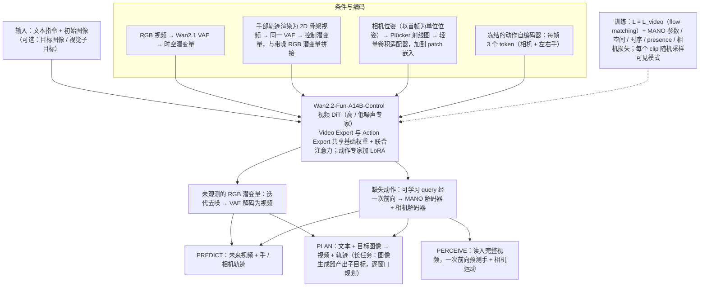

# P³-WAM：第一视角灵巧操作的统一世界动作模型

**P³-WAM 把感知、预测与规划放进同一个世界动作模型，三种模式共享基础参数，通过视觉与三维动作之间的双向注意力交换信息。**

## 英文缩写速查

| 缩写 | 英文全称 | 简要说明 |
|------|----------|----------|
| WAM | World Action Model | 世界–动作联合模型，同时预测未来与动作 |
| DiT | Diffusion Transformer | 基于 Transformer 的扩散模型骨干 |
| MoT | Mixture-of-Transformers | 按模态分支的 Transformer 结构，共享部分参数 |

## 为什么重要

灵巧操作需要同时理解三维手部运动、预测动作带来的视觉变化，并规划后续动作。摘要指出，分别训练这些模块难以共享世界动态知识。

## 流程总览

图依据：论文 §3.1–3.5 / Fig. 2、Fig. 3、Fig. 4。

## 核心信息

| 项目 | 内容 |
|------|------|
| arXiv | [2610.22363](https://arxiv.org/abs/2610.22363) |
| 作者 | Zirui Wu, Chen Guo, Tianjian Jiang, Zeren Jiang, Zeming Li, Lingchen Yang, Longteng Duan, Ying Xue, Handi Yin, Shenyuan Gao, Martin R. Oswald, Jun Zhang, Ping Tan, Jie Song |
| 机构 | 未核实（公众号标注"待核实"） |
| 开源状态 | **代码待发布**（项目页标注 “Code forthcoming”；未列公开代码仓或数据下载） |

## 核心原理

- **Perceive：** 从视频重建关节化手部运动与相机轨迹。
- **Predict：** 在给定动作下生成未来视觉状态。
- **Plan：** 以初始图像、语言指令与可选视觉目标为条件，联合生成动作轨迹及其预期视觉后果。
- **结构：** 预训练视频 DiT 上采用 MoT，共享基础权重、按模态做适配，并用随机模态可见性训练。

## 工程实践

- 官方项目页展示生成的人手轨迹经重定向后用于机器人执行，并说明演示是开环执行，运行时不使用新观测纠正轨迹。
- **源码运行时序图：不适用**（官方项目页标注代码待发布，未提供可运行仓库）。

## 评测与结果

以下数字均来自论文 HTML 版正文（arXiv:2610.22363 v1），本库未复现。

| 模式 | 评测设置 | 论文报告 |
|------|----------|----------|
| 统一 vs 单模式训练 | EgoDex / [ARCTIC](./dataset-arctic.md) / [HOT3D](./dataset-hot3d.md) / EgoLive 四数据集，其余训练变量固定 | Perceive 的相机空间、根相对、PA 关节误差分别降低 23.46%、14.23%、5.69%；Predict 与 Plan 指标同样优于单模式训练 |
| Perceive（3D 手部重建） | 四数据集，presence-aware MPJPE | 平均相机空间误差 63.05 mm（HaMeR 145.34 mm、Dyn-HaMR 231.54 mm）；根相对 22.54 mm；PA 11.79 mm |
| Predict（动作条件视频预测） | 四数据集，按各方法原生条件协议；全帧与手部区域 PSNR / SSIM / LPIPS / FVD | 作者报告在四数据集上整体优于对照基线 |
| Plan（目标导向规划） | 方法盲 VLM 评审（Qwen3.8-Max）按 1–5 分打分动作过程、指令遵循、物理交互等 | 动作过程与指令遵循得分高于视频生成基线 |
| 机器人部署 | 把生成的人手动作迁移到灵巧机器人 | 仅为演示性质，未报告成功率 |

## 与其他工作对比

| 对照 | 所在模式 | 与 P³-WAM 的差异 |
|------|----------|------------------|
| HaMeR / Dyn-HaMR（论文基线） | Perceive | 专用手部重建模型；P³-WAM 用同一视频 DiT 兼做重建，论文报告误差更低 |
| Wan2.2-Fun-Control、[DreamDojo](./paper-hrl-stack-35-dreamdojo.md)、[Hand2World](./paper-sa-2602-09600-hand2world-autoregressive-egocentric-interaction.md)、[EgoSim](./paper-sa-2604-01001-egosim-egocentric-world-simulator-for-embodied-i.md)（论文基线） | Predict | 只做动作/条件到视频；P³-WAM 额外联合建模三维手部动作与相机 |
| Wan2.2 I2V-A14B、Cosmos 3-Nano（论文基线，参见 [Cosmos 3](./cosmos-3.md)） | Plan | 纯视频生成，不输出动作轨迹；P³-WAM 同时生成动作与其视觉后果 |

基线数字来自论文同一评测协议；Plan 模式依赖 VLM 评审打分，属主观代理指标，不能等同于机器人任务成功率。

## 结论

**一句话总判：把三维手部感知与动作条件预测放进同一世界动作模型，是这篇工作的核心主张；其收益需要看三种模式各自的指标。**

1. **统一训练被作者视为收益来源** — 摘要称统一训练同时改善三维手部重建、动作条件视频预测与目标规划。
2. **三维动作表示是连接点** — 紧凑的结构化 3D 动作表示被接入视频 DiT。
3. **读数字时区分模式** — Perceive / Predict 有定量指标，Plan 依赖 VLM 评审打分，机器人部署仅为演示。

## 局限与风险

- 基于视频扩散模型的推理成本未在摘要中给出。
- 第一视角与灵巧手设定的泛化范围未知。

## 关联页面

- [世界动作模型](../concepts/world-action-models.md)
- [生成式世界模型](../methods/generative-world-models.md)
- [灵巧运动学](../concepts/dexterous-kinematics.md)

## 参考来源

- [论文归档](../../sources/papers/p3_wam_arxiv_2610_22363.md)
- [官方项目页归档](../../sources/sites/p3-wam-project-page.md)
- [公众号综述摘录（33 篇 Manipulation）](../../sources/raw/wechat_senlanke_manipulation_33_papers_2026-10-12_16.md)
- [arXiv PDF](https://arxiv.org/pdf/2610.22363)：已通读方法部分（实验与附录以略读为准）：§3.1–3.5、§4 开头

## 推荐继续阅读

- [arXiv:2610.22363](https://arxiv.org/abs/2610.22363)
