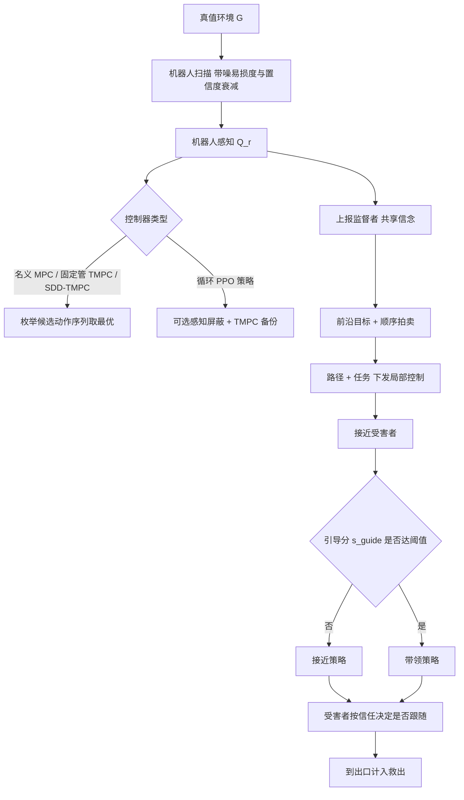

# PA-SaR：感知感知的多机器人搜救学习、控制与协调（arXiv:2611.11648）

**PA-SaR**（*Perception-Aware Learning, Control, and Coordination for Multi-Robot Search and Rescue*，[arXiv:2611.11648](https://arxiv.org/abs/2611.11648)，TU Delft，v1 于 2026-11-08）是一个数学 + 架构框架：把局部运动控制、学习式探索、集中式任务分配和受害者引导放进同一个仿真，用「救援结果」而不是单项指标来衡量各模块的改进。

## 一句话定义

**一个把「真值环境、各机器人自己的（带噪、会过期的）感知、模拟受害者行为」分开建模的多机器人搜救仿真框架，用它比较局部控制器、共享感知、任务分配和受害者引导对搜索与撤离结果的各自贡献；所有结论限于论文自建的离散网格仿真（第 3 节）。**

## 英文缩写速查

| 缩写 | 英文全称 | 简要说明 |
|------|----------|----------|
| SaR | Search and Rescue | 搜索与救援 |
| PA-SaR | Perception-Aware Search-and-Rescue | 本文框架 |
| MPC | Model Predictive Control | 滚动时域优化控制；本文 N=4 步、枚举候选序列（第 2.3.1 节，表 B1） |
| TMPC | Tube-based MPC | 管式 MPC；本文固定管 = 目标格及其一格四邻都须可行 |
| SDD-TMPC | State-Dependent Dynamic Tube-based MPC | 状态相关动态管；本文网格版：位移概率估计为正才启用一格管 |
| RL / PPO | Reinforcement Learning / Proximal Policy Optimization | 本文用循环 PPO 训练探索策略（第 2.3.2 节） |
| LSTM | Long Short-Term Memory | 循环策略与 critic 的记忆单元（第 3.3 节） |
| GT–BDI | Game Theory – Belief-Desire-Intention | 受害者行为模型来源（引用 [22]） |
| BFS | Breadth-First Search | 监督者用其在共享信念上找路径 |
| CI | Confidence Interval | 文中均为 95% |

## 为什么重要

- 作者自述的出发点（摘要、第 1 节）：提升单个机器人的能力不必然改善任务结果——更安全的运动会限制探索，更快发现会增加救援需求，引导成败取决于受害者反应。
- 该框架让「覆盖率、发现数、碰撞、救援数」可以分开测量，实验里确实出现了它们互相脱节的情形（第 3.5.2 节：监督组探索更好但救出更少）。
- 判断（本页作者）：作为「评估口径」的提醒有价值；但结论强烈依赖自建的受害者行为模型与简化火情模型，不宜外推到真实搜救。

## 核心原理与流程总览

要点（均出自论文第 2 节，括号为位置）：

- **感知模型（2.2.2）：** 可通行、受害者、机器人、火为无误差观测，仅「易损度」带均匀噪声（上界 δ）；未观测格保留旧值，置信度按式 (3) 随观测上升、随时间衰减；机器人意外位移概率随真值易损度上升、随置信度下降（式 6）。
- **局部控制（2.3.1）：** 名义 MPC 只要求命令目标可行；固定管 TMPC 额外要求其一格四邻可行；SDD-TMPC 用感知易损度与置信度估计位移概率，为正才施加一格管。论文明确未证明递归可行性，也未给出无条件的真值安全保证。
- **学习控制（2.3.2）：** 11 通道观测，循环 PPO + GAE；奖励式 (11) 含检测、步数、碰撞、成功、终端覆盖与覆盖势能塑形。屏蔽检查感知到的可通行 / 无受害者 / 非燃烧 / 易损度低于阈值，失败时调用固定管 TMPC 备份。
- **监督协调（2.3.3）：** 机器人只与监督者通信；共享信念中后到报告覆盖先到（不做融合）；顺序单项拍卖；救援任务效用奖励远大于探索（表 B1：探索 100、救援 10000）；事件包括空间冲突、低进展、路径受阻、发现受害者、任务生命周期。
- **引导（2.3.3）：** 引导分式 (15) 由机器人—受害者真值距离变化更新；低于 θ_lead 用接近策略，否则用带领策略（受害者在 leash 距离内才走）。引导使用受害者的**真值位置**（含机器人传感范围之外）。
- **受害者模型（2.2.3）：** 年龄组 × 互动策略（利他 / 利己 / 自私）；信任 θ_v 由机器人接近量与感知安全变化更新（式 7），θ ≥ θ_follow（0.4）才可能跟随。

## 论文给出的主要结果

| 研究 | 设置 | 结果（出处） |
|------|------|--------------|
| 局部 MPC 对比 | 单机器人，500 个匹配 35×35 地图，300 步 | 完成率 MPC 97.2 / TMPC 35.0 / SDD-TMPC 81.6；无碰撞完成率 50.2 / 34.4 / 81.2（表 11） |
| 易损度噪声 | 250 个地图，δ ∈ {0,0.1,0.2,0.4} | δ=0.4 时 9/250 次出现地形或受害者碰撞（3.6%），其余噪声下为 0（第 3.2.2 节，表 12） |
| 循环 vs 四帧 | 20×20，50 个留出种子，单机器人 | 覆盖 75 vs 65，成功 50 vs 12（表 13） |
| 五控制器 | 250 个留出种子 | MPC 成功 94 但 274 ms/决策；纯 RL 成功 43、碰撞 117.7、伤害 175.8；Shield+C 成功 40、碰撞 0、53 ms（表 14） |
| 共享 vs 监督 | 4 机器人，216 个 60×60 地图，20 个静止受害者 | 检测完成率 监督 91.7 / 共享 75.9 / 无监督 50.5（表 15） |
| 异构队伍 | 100 个 50×50 地图，10 个受害者 | 监督组救出 2.21 vs 无监督 2.83（p<0.001）（第 3.5.2 节） |
| 救援队规模 | 45×45，10 个动态受害者，100 个种子 | 式 (17) 二次拟合，4→6 台救出 3.08→3.35（第 3.6 节，图 9） |
| 自适应 vs 始终带领 | 4 机器人，100 个种子 | 救出 3.08 vs 2.34（+0.74，CI [0.51,0.96]）；死亡无显著差（p=0.402）；信任无检出提升（表 A2、A3） |

## 工程实践

- **环境：** 程序生成的「房间 + 走廊」网格地图，易损度取 0 / 0.6 / 1，火按元胞自动机扩散（第 2.2.1、3.1 节，表 B1）。
- **配置差异：** 不同研究的地图尺寸、传感半径（3 或 4）、距离衰减开关、火参数各不相同（表 B1），跨研究数字不可直接比较。
- **计算：** 决策时间在单个 AMD EPYC 7B13 CPU 核上测得（第 3.4 节）；监督者每任务 50.6 次干预、每次约 11 ms（第 3.5.1 节）。
- **复现：** 论文给出代码仓库地址；本次查看到仓库 README 仅一行标题，内容未核实，未运行代码。
- 补充材料中 RL 超参与网络结构在表 B1（附录 B）。

## 与文章说法的核对

文章（公众号《机器人动作块太长，什么时候该重新规划？》2026-11-11 的 53 篇速览，第 46 条）对该论文的说法逐条对照：

| 文章说法 | 核对结果 |
|----------|----------|
| 「把局部控制、探索分配与目标线索结合」 | 局部控制、探索分配（拍卖）属实；论文中没有「目标线索」这一模块，最接近的是受害者引导（接近 / 带领）与信任模型。该词无法在论文中对上，属文章措辞。 |
| 「显式考虑感知不确定性」 | 部分属实：感知不确定性体现在易损度噪声、置信度衰减和过期信息上（第 2.2.2 节）。但噪声扫描只在单机器人 SDD-TMPC 研究中做（第 3.2.2 节）；监督 / 救援研究中 δ=0（表 B1），共享信念按「后到覆盖」处理、不融合不确定性（第 2.3.3 节）。标题「把感知误差带进协同决策」比论文实际覆盖更宽。 |
| 「仿真比较」 | 属实，全部为自建网格仿真，无真机（结论明确列出物理验证为后续工作）。 |
| 「救援数量、覆盖率和碰撞应分别衡量」 | 与作者主张一致（摘要、结论）。 |
| 「更多发现并不自动意味着更低伤亡」 | 论文原话是「increased exploration does not necessarily yield more rescues」（摘要）：监督组探索更优但救出更少（2.21 vs 2.83，第 3.5.2 节）。论文没有测「伤亡」随发现数的变化；死亡数只在引导消融里报告且无显著差（表 A2）。文章把「救出数」换成了「伤亡」，是改写，不是论文结论。 |
| 未提及 | 论文还写明：自适应引导提升了救出数，但未检出信任或死亡的改善；监督者并非处处占优（救援数更低）；纯 RL 碰撞 117.7 次 / 局（表 14）。读者若只看文章，容易漏掉这些限定。 |

## 局限

论文自己承认的（第 2.3.1、3、4 节）：

- 无递归可行性证明，无无条件真值安全保证；火碰撞仍存在，SDD-TMPC 在 δ=0.4 时出现碰撞。
- RL 结果为单训练种子，尚未验证对训练随机性与更大地图的稳健性；25×25 和 30×30 的覆盖降到 53.1% 和 41.5%（表 A4）。
- 异构研究中只有一个具救援能力的机器人，且受害者「看到即跟随」，替换了信任模型（第 3.5.2 节）。
- 完整组合（局部控制 + 监督分配 + 自适应引导）尚未一起评估（第 4 节）。
- 仅仿真，物理验证留作后续。

本页作者看到的未验证之处：

- 受害者行为是人为设计的模型（概率与排序「是建模选择」，第 2.2.3 节），引导结论的外部效度未知。
- 引导使用受害者真值位置，与「感知受限」的设定不完全一致（第 2.3.3 节）。
- 异构研究里监督组救出更少的原因（只有一个救援机器人、任务分配不计救援负载）论文只提出假设，未做消融。
- 假设受害者身份可持久关联（第 2.3.3 节）。
- 多个比较的 p 值未做多重比较校正（第 3.5 节）。
- 代码仓库内容未核实，复现性无法判断。

## 与其他工作对比

| 工作 | 关注点 | 与本文的区别 |
|------|--------|--------------|
| [Situation-aware Frontier](./paper-situation-aware-frontier-quadruped-sar.md) | Go2 四足室内搜救，frontier 排序加入救援相关性等五项 | 单机器人、有真机评测；PA-SaR 是多机器人、仅网格仿真，还建模了受害者信任与引导 |
| [Safe RL via Shielding](./paper-as-1708-08611-safe-reinforcement-learning-via-shielding.md) | 运行时屏蔽 RL 策略的不安全动作 | PA-SaR 的屏蔽依据的是机器人自己带噪、会过期的感知而非真值，失败时调用固定管 TMPC 备份（第 2.3.2 节），因此不给真值安全保证 |
| [异构任务分配 RL](./paper-rl-heterogeneous-task-allocation-spatio-temporal.md) | 去中心化 RL 分配异构无人艇任务 | PA-SaR 的分配是集中式监督者 + 顺序单项拍卖 + 事件触发，RL 只用于局部探索控制 |

## 结论

**PA-SaR 的主要价值是把真值、机器人感知与受害者行为分开建模，让「覆盖、发现、碰撞、救出」可以分开测量，并在仿真中显示多探索不等于多救援。**

1. 局部控制上，SDD-TMPC 在完成率与无碰撞完成率之间取得最好平衡（81.6 / 81.2，表 11）；感知屏蔽把 RL 碰撞降到 0 但成功率也低（表 14）。
2. 监督协调提高检测完成率（91.7 对无监督 50.5，表 15），但在异构队伍中救出数反而更低（2.21 对 2.83，第 3.5.2 节）。
3. 自适应引导比始终带领多救出 0.74 人，但未检出死亡或信任的改善（表 A2、A3）。
4. 局限：仅自建网格仿真，受害者模型为人为设计，RL 单种子，完整组合未一起评估，无递归可行性证明（第 4 节）。

## 关联页面

- [模型预测控制（MPC）](../methods/model-predictive-control.md)
- [PPO](../methods/ppo.md)
- [安全强化学习](../methods/safe-rl.md)
- [安全过滤器](../concepts/safety-filter.md)
- [奖励设计](../concepts/reward-design.md)
- [人形多机器人协同](../concepts/humanoid-multi-robot-coordination.md)
- [循环神经网络](../concepts/recurrent-neural-network.md)
- [异构任务分配（时空）论文](./paper-rl-heterogeneous-task-allocation-spatio-temporal.md)
- [Safe RL via Shielding 论文](./paper-as-1708-08611-safe-reinforcement-learning-via-shielding.md)

## 参考来源

- [pa-sar_arxiv_2611_11648.md](../../sources/papers/pa-sar_arxiv_2611_11648.md)
- [arXiv:2611.11648](https://arxiv.org/abs/2611.11648)
- 代码：https://github.com/svenschoonebeek/Perception-Aware-Search-and-Rescue

## 推荐继续阅读

- [arXiv PDF](https://arxiv.org/pdf/2611.11648v1)
- [安全强化学习](../methods/safe-rl.md)
- [模型预测控制（MPC）](../methods/model-predictive-control.md)
