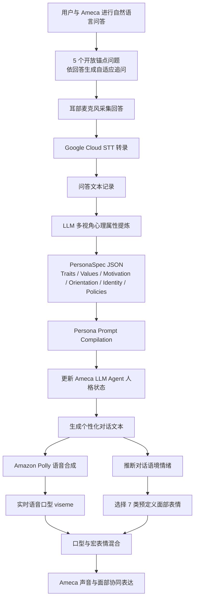

# PACE：通过对话引导实现人机交互中的人格适配

## 一句话定义

**PACE**（*Persona Adaptation through Conversational Elicitation in Human-Robot Interaction*，arXiv:2607.15579v5）由麦考瑞大学与英伟达新加坡团队提出：**让 Ameca 人形机器人用短时、多轮问答生成结构化人格 `PersonaSpec`，再将其编译成可用于对话和表情表达的动态人格配置**，区别于固定 system prompt。

## 英文缩写速查

| 缩写 | 英文全称 | 简要说明 |
|------|----------|----------|
| PACE | Persona Adaptation through Conversational Elicitation | 通过交互式引导生成和激活人机交互人格 |
| HRI | Human-Robot Interaction | 人机交互；本文聚焦社会互动与主观体验 |
| LLM | Large Language Model | 用于问答追问、人格抽取、响应与情绪推断 |
| ASR / STT | Automatic Speech Recognition / Speech-to-Text | Google Cloud 将现场发言转写为文本 |
| TTS | Text-to-Speech | Amazon Polly 将对话文本变成机器人语音 |
| HEXACO | Honesty-Humility, Emotionality, Extraversion, Agreeableness, Conscientiousness, Openness | PersonaSpec 的人格特征维度 |
| SDT | Self-Determination Theory | PersonaSpec 的内在动机表示 |
| RFT | Regulatory Focus Theory | 提升/预防导向等心理调节取向 |

## 为什么重要

- **静态人格无法因人而异。** 机器人面对不同用户时，固定角色设定可能造成说话风格、价值取向与用户情境不匹配。
- **人格并非只是一段提示词。** PACE 将心理属性结构化，再约束下游对话及面部表情，让语言与实体呈现尽可能一致。
- **可衡量人格与交互质量。** 文中分别考察文本人格保真度和 Ameca 真机用户感知，避免把“听起来更自然”当作唯一证据。

## 核心信息

| 项 | 论文原文事实 |
|----|--------------|
| 英文标题 | PACE: Persona Adaptation through Conversational Elicitation in Human-Robot Interaction |
| 作者 | Peizhen Li、Longbing Cao、Megani Rajendran、Timothy Liu、Aik Beng Ng、Simon See |
| 机构 | 麦考瑞大学（Macquarie University）、英伟达新加坡（NVIDIA Singapore） |
| 发表 | 2026-07-17 首投 arXiv；2026-10-08 v5；已被 IEEE-RAS Humanoids 2026 接收 |
| 机器人 | Engineered Arts Ameca（耳部麦克风、胸部扬声器、表情执行） |
| 关键服务 | Google Cloud Speech-to-Text、GPT-5.5-mini、OpenAI streaming API、Amazon Polly |
| 开源 | [官方 GitHub](https://github.com/lipzh5/PACE) 公开 README 与 docs；当前缺 `run_elicitation.py` / `run_pace.py` 等真实运行文件 |
| 定位 | **社交人格与多模态表达适配**；不是 VLA、RL 或关节运动策略训练 |

## 流程总览

*依据：* [arXiv v5](https://arxiv.org/html/2607.15579) `III-A–III-C 与 Fig.1–3`。图示为论文的**系统级数据流**，不是从未公开的 Python 源码反推的调用图。

## 核心原理

### 1. 从短对话中引导人格

- 以 **5 个开放式锚点问题**抽取价值观、动机、关系偏好和行为边界；LLM 按回答深度动态追问，而非逐项发放长问卷。
- 论文报告 elicitation 约 **4.5 分钟**，平均每人除固定锚点外生成约 **1 个自适应追问**；这是论文实验设置，不保证所有部署场景得到同样时长。

### 2. 以 PersonaSpec 把自然语言变成可编译配置

- **Traits：** HEXACO 人格特征；**Values：** Schwartz 价值观；**Motivation：** SDT / McClelland 动机；**Orientation：** RFT 促进/预防导向。
- **Identity / Policies：** 身份陈述、成功信号及 CAPS 风格的 IF/THEN 情境行为规则。
- LLM 被提示从社会心理学、行为经济学和社会学多视角综合问答，不应将这理解为独立专家对心理测量有效性做了人工审核。
- `PersonaSpec JSON` 经模块化 Prompt Compiler 转成下游 LLM system prompt，并激活为当前机器人对话人格。

### 3. 人格条件化语言和机器人表情

- **文本与语音：** 生成符合人格的回复，使用 Amazon Polly 发声。
- **面部与口型：** 推断语境情绪，选择 Ameca 的 **7 类预定义情绪动画**，与同步语音的 viseme 口型合成，防止宏表情遮盖发音口型。
- **实时处理：** 流式推理、独立的 ASR 暂停/恢复进程与时间戳去重缓解机器人“听到自己讲话”和用户插话问题。
- 本文“具身多模态”主要是**语音与面部表情同步**；没有呈现通用全身控制器或新学习的运动策略。

## 实验与评测

**设计：** 25 名参与者（21–54 岁）在实验室与 Ameca 面对面；每人经历通用静态提示词（Static Baseline）和动态人格（PACE）两种条件，顺序平衡；人格抽取后完成约 10 分钟协作规划任务。人格保真评价还包括与个人先前填写的人格、态度、社会推理和经济决策问卷对照。

| 指标（论文 Table II） | Static | PACE | 统计检验 |
|-----------------------|-------:|-----:|----------|
| BFI-44 五维人格 Pearson r ↑ | 0.389 | **0.939** | p < 0.001 |
| BFI-44 MAE ↓ | 1.220 | **0.128** | p < 0.001 |
| 社交情境 Top-1 对齐率 ↑ | 73.33% | **94.67%** | p = 0.001 |
| 经济博弈金钱决策 MAE ↓ | 1.800 | **0.440** | p < 0.001 |
| GSS 态度 Top-1 对齐率 ↑ | 80.00% | 88.00% | p = 0.097（不显著） |
| 经济博弈二元选择匹配率 ↑ | **88.00%** | 84.00% | p = 0.317（不显著） |

| 用户感知指标（论文 Table III，5 分制） | Static | PACE | p |
|-------------------------------------|-------:|-----:|---|
| 信任 Trust | 3.52 | **4.18** | 0.012 |
| 拟人化 Anthropomorphism | 3.28 | **4.05** | 0.008 |
| 人格一致性 Persona consistency | 3.35 | **4.32** | < 0.001 |
| 个人相关性 Persona relevance | 3.08 | **4.41** | < 0.001 |
| 总体交互质量 Overall quality | 3.46 | **4.26** | 0.004 |

这些是**作者报告的配对实验结果**；总体 HRI 主观量表提升不能外推为安全认证、长期情绪健康效益或商业化生产力提升。GSS 态度和二元经济决策结果未达统计显著性。

## 与其他工作对比

| 工作 | 核心对象 | 与 PACE 的分工 |
|------|----------|----------------|
| **PACE** | 对话引导人格 → 结构化配置 → Ameca 语音/表情 | 聚焦“机器人表现出怎样的社会人格” |
| [MistyPilot](./paper-mistypilot.md) | LLM Task Router → 物理技能 / 社交代理 | 聚焦“该调用哪种技能与状态执行通道” |
| [RealCompanion](./paper-realcompanion.md) | 长期伴侣对话中的用户记忆和 persona 重建评测 | 聚焦“长期个性化记忆及评估”，与 PACE 短访谈方式不同 |
| [人形智能语音交互](../methods/humanoid-voice-interaction.md) | ASR → LLM → 技能/VLN → TTS 与打断闭环 | PACE 在语音链路之外增加人格编译和表情驱动，不替代运动安全层 |

## 结论

**PACE 展示了短时对话生成可部署社交人格并联动语音、面部表情的可行性，但证据主要限于 Ameca 的 25 人受控 HRI 实验。**

1. **工程架构：** 把人格问答、`PersonaSpec`、提示词编译、语音/表情执行分成可检查阶段，比把用户画像直接拼入一个 prompt 更易管理。
2. **数字分层：** 不混淆 BFI-44 人格保真度、GSS/经济决策行为对齐与用户感知主观量表；其中部分指标未显著提升。
3. **具身边界：** 现有结果针对 Ameca 面部和语音输出，并没有证明可适配任意机械臂/全身动作。
4. **部署前检查：** 对 ASR 噪声、云端延迟、用户知情同意、肖像模仿风险与情境化人格偏差进行单独验证。
5. **复现缺口：** 官方 README 的启动命令无对应公开文件，目前不能按仓库运行或测延迟。

## 工程实践

- 将问答抽取和执行阶段解耦，版本化保存 `PersonaSpec`；上线前对人格规则做安全、隐私、伦理与变更边界检查。
- 在真实机器上分段测 ASR、LLM 首 token、TTS 首音频、情绪分类和表情同步延迟，并记录被打断时的麦克风回环行为。
- 交互层人格应受硬件安全和任务约束层限制；不能因为“人格表现得勇敢/冲动”解除急停或行动限幅。
- 目前开源资源仅供学习系统架构与观看演示：项目页、论文、README 和网页素材可访问，**尚无可运行的 PACE 人格执行代码**。

## 源码运行时序图

**不适用（截至 2026-11-16）。** 官方仓库仅含 README、LICENSE 与 docs 网站。README 虽列 `run_elicitation.py`、`run_pace.py`、`requirements.txt` 和 `configs/elicitation.yaml`，实际目录中不存在这些文件，且 README 有“实际入口待替换”的 TODO。无法核对真实模块/调用关系，因此只保留上述**原文级流程总览**，不伪造 Python 运行时序。

## 局限与风险

- **样本与情境：** N=25，单一 Ameca 平台，短期实验室互动；长期用户偏好漂移和跨文化表现缺真实证据。
- **云服务依赖：** ASR 转写错误、访问延迟及网络中断可能破坏动态人格与互动节奏。
- **表情有限：** 7 类预置情绪动画及口型同步是平台受限的表达，不是连续生成式全身表演模型。
- **心理有效性：** 基于短对话推断人格并非临床诊断或完整心理测量；需注意用户同意、数据留存、拟人化误导和角色扮演身份界限。
- **实现与复现：** GitHub 公开项目资料并不等于公开可执行 pipeline；[源码核验记录](../../sources/repos/lipzh5-pace.md) 记录了占位 README 与缺失入口。

## 方法关联与适用边界

- [人形智能语音交互](../methods/humanoid-voice-interaction.md)：PACE 的语音输入、对话生成和 TTS/打断需要基础交互管线，PersonaSpec 处于其上层。
- [Disney Olaf 角色机器人](../methods/disney-olaf-character-robot.md)：**角色一致性实现的对照方法**；Olaf 侧重动画参考与实体动作控制，PACE 侧重对话人格及面部表达，二者不能混为同一种控制策略。

## 关联页面

- [人形机器人智能语音交互](../methods/humanoid-voice-interaction.md) — 语音管线、打断与技能安全边界
- [MistyPilot](./paper-mistypilot.md) — 社交机器人技能路由，与人格生成互补
- [RealCompanion](./paper-realcompanion.md) — 长期伴侣人格与记忆评测的对照方向
- [Agent Planning and Feedback Loops · 智能体规划与反馈执行](../methods/agent-planning-feedback.md)：PACE 通过多轮自适应追问与用户回答反馈动态提炼并更新结构化 PersonaSpec 对话策略状态。
- [Robot Software System Integration · 机器人软件系统集成](../methods/robot-software-integration.md)：PACE 将语音识别、流式 LLM 推理、TTS 语音合成及面部口型表情控制集成为实时同步的人形交互软件闭环。

## 参考来源

- [PACE arXiv v5 原文核读归档](../../sources/papers/pace_persona_arxiv_2607_15579.md) — `I–V、Fig.1–5、Table I–III`
- [PACE 官方项目页核查](../../sources/sites/pace-persona-adaptation.md) — 视频、架构图及资源入口
- [PACE GitHub 仓库核查](../../sources/repos/lipzh5-pace.md) — README 占位命令与实际文件清单

## 推荐继续阅读

- [论文 HTML（v5）](https://arxiv.org/html/2607.15579)
- [项目页与 Ameca 演示](https://lipzh5.github.io/PACE/)
- [官方 GitHub 仓库](https://github.com/lipzh5/PACE)（当前只有展示内容，暂无可运行入口）
