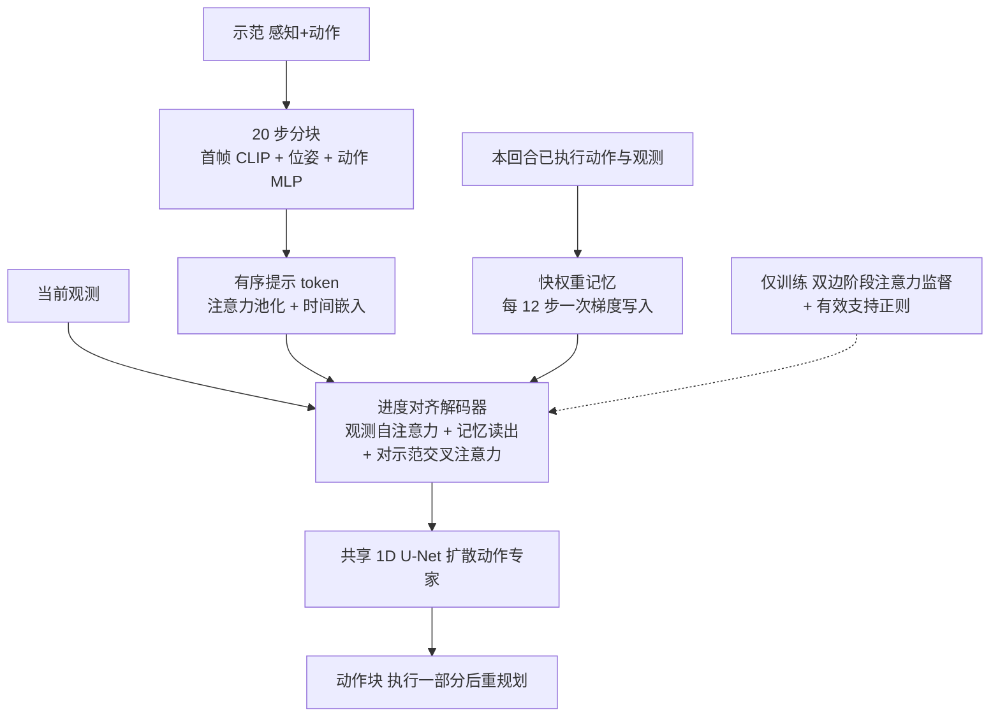

# PACE

**PACE**（*Progress-Aligned Context for Execution*，arXiv:2610.07917，浙江大学）针对示范条件长程操作中的**阶段混淆**：相似观测出现在不同阶段时，策略不知道自己做到哪一步。它把一条示范压成有序提示 token，训练期用阶段边界注意力监督暴露结构，运行期用只含本回合已发生动作与观测的快权重记忆，把注意力对齐到当前进度，再交给共享的扩散动作策略。

## 英文缩写速查

| 缩写 | 英文全称 | 简要说明 |
|------|----------|----------|
| PACE | Progress-Aligned Context for Execution | 论文方法，进度对齐的执行上下文 |
| BPP | Behavior Prompting Policy | 主基线，单条示范作行为提示 |
| FWM | Fast-Weight Memory | 本回合局部快权重记忆，权重即状态，在线更新 |
| LIBERO-Gen | LIBERO generalization splits | 评测 Goal Chain 与 Spatial Combination 两种组合泛化 |
| U-Net | 1D conditional U-Net | 论文所用扩散动作专家的骨干 |
| DP | Dynamic Programming | 用于阶段边界的单调对齐 |

## 为什么重要

- **失败模式清晰**：BPP 在两步 Block Routing 的 14 次失败（46.7% 回合）是走错阶段；PACE 只有 1 次（3.3%）。
- **不需要阶段标签**：测试时无阶段标签，也无阶段专用策略，训练期边界由动作模式变化自动检测。
- **记忆代价与回合长度无关**：核心写入约 4.1×10^4 次乘加，状态仅 16,576 个标量。
- 论文自己做了拆分：单独的阶段结构损失不涨分，增益主要来自快权重记忆。

## 流程总览

## 方法

### 示范提示编码

示范按 20 步（约 1 s、20 Hz）分块，末块补零掩码；每块只用首帧，经 CLIP ViT 的 CLS token 编码各相机；末端位姿与夹爪状态线性投影，动作展平经 MLP；可学习 query 的注意力池化 + 时间位置嵌入生成有序提示 token。

### 双边注意力监督（仅训练）

由频谱、方向、均值、速度、停顿、jerk、夹爪状态的邻窗变化检出阶段边界，动态规划做单调对齐；目标为左右阶段边界上的高斯混合（σ=0.75）；损失为平均注意力交叉熵加 γ 倍逐 query 交叉熵；另有基于熵的有效支持正则 L_sup 防止注意力摊满全示范。

### 快权重记忆与动作专家

- 记忆：两层 MLP（d_m=64、h_m=128，16,576 标量），从共享初值出发，每 12 个控制步做一次键值重建的梯度更新，训练反传最多 16 次写入。
- 解码层：观测自注意力 → 门控记忆读出调制 query → 对完整示范的交叉注意力。
- 动作：共享条件 1D U-Net 扩散策略；L = L_diff + λ_edge(u)·L_edge + λ_sup·L_sup；推理去掉边界监督，执行动作块的一部分后重规划。

## 源码运行时序图

不适用：arXiv 摘要页与 HTML 未列项目页、仓库或发布声明，截至 2026-10-12 无官方代码可对齐。

## 工程实践

| 项 | 内容 |
|----|------|
| 机构 | 浙江大学控制科学与工程学院 |
| 记忆开销 | 状态 16,576 个标量；每次写入约 4.1×10^4 次乘加 |
| 数据量 | Block Routing 仿真每任务 10 条示范，真机 15 条 |
| 开源状态 | 未见项目页、代码或权重（截至 2026-10-12） |

## 实验与评测

- **仿真整回合成功率（PACE / BPP）**：Spatial Combination 83.3% / 79.1%；Goal Chain 94.0% / 88.9%；Block Routing 两步 73.3% / 33.3%；四步 37.8% / 3.3%。π0.5 在 Block Routing 两步约 13.3%（由差值推得）、四步 0.2%。
- **真机 Block Routing**：两步 90.0% / 40.0%；四步 43.3% / 3.44%；π0.5 未评。
- **阶段混淆（两步，30 回合）**：BPP 错阶段 14 次，PACE 1 次；仅有效支持或仅双边监督的变体仍以错阶段为主。
- **注意力分析**：BPP 弥散近静止；PACE 无记忆在别名观测下来回切换；完整 PACE 近似单调。反事实历史测试里匹配历史才把注意力集中在正确阶段。
- **数据不一致提示**：原文消融段报告的增益数字与主表不一致，本页只用主表数字。
- LIBERO-Gen 每任务只有 10 次 rollout，增益 4–5 个点处于噪声量级（推测）。

## 结论

**PACE 的有效成分是因果的快权重进度记忆，而不是单独的阶段监督；它在别名观测严重的 Block Routing 上收益最大，在 LIBERO-Gen 上只是小幅领先。**

1. **看 Block Routing 而非 LIBERO-Gen** — 四步仿真 37.8% 对 3.3%，LIBERO-Gen 只涨 4–5 点。
2. **记忆比监督重要** — 论文的消融指出阶段结构损失单独不提升成功率。
3. **阶段混淆可诊断** — 统计"错阶段失败"占比，BPP 46.7% 回合 vs PACE 3.3%，可用同法评估自己的策略。
4. **适用前提是阶段单调** — 可选、重复或重排的子目标不满足对齐假设。
5. **真机样本少** — 每任务 10 次评测，四步 43.3%，离可靠部署仍远。
6. **无代码，复现需自搭** — 需自己实现分块编码、DP 边界对齐与快权重写入。

## 局限与风险

- 任务族有限、rollout 少；跨本体、环境与更长链条未验证。
- 边界检测依赖动作变化线索；固定 20 步分块会模糊更短的转换。
- 快权重适配引入状态管理与算力开销。
- 开源：无代码、数据、权重发布声明。

## 与其他工作对比

- [BPP](./paper-behavior-prompting-policy.md)：同样以单条示范为提示，但无进度对齐；本文在同输入下与其直接对比。
- [Gated Memory Policy](./paper-gated-memory-policy.md)：学习型门控记忆处理非马尔可夫任务；本文的记忆是回合局部的快权重，由键值重建在线更新。
- [π0.5](./paper-pi05-open-world-vla.md)：大规模 VLA，在 Block Routing 仿真上很低（0.2%–13.3%）；任务设置是少量示范，不代表其开放世界能力。
- [LIBERO](./libero-benchmark.md)：评测基础；Gen 两个分割继承自 BPP 协议。

## 关联页面

- [Manipulation 周报汇总（2026-10-05 至 10-09）](../overview/frontier-manipulation-2026-10-05-10-09.md)
- [操作任务](../tasks/manipulation.md)
- [模仿学习](../methods/imitation-learning.md)、[扩散策略](../methods/diffusion-policy.md)

## 参考来源

- [pace_arxiv_2610_07917.md](../../sources/papers/pace_arxiv_2610_07917.md) — 论文归档
- [frontier_manipulation_2026_10_05_10_09.md](../../sources/blogs/frontier_manipulation_2026_10_05_10_09.md) — 周报线索
- 论文：<https://arxiv.org/abs/2610.07917>

## 推荐继续阅读

- [arXiv HTML 全文](https://arxiv.org/html/2610.07917v1)
- [BPP 页](./paper-behavior-prompting-policy.md)
- [Gated Memory Policy 页](./paper-gated-memory-policy.md)
