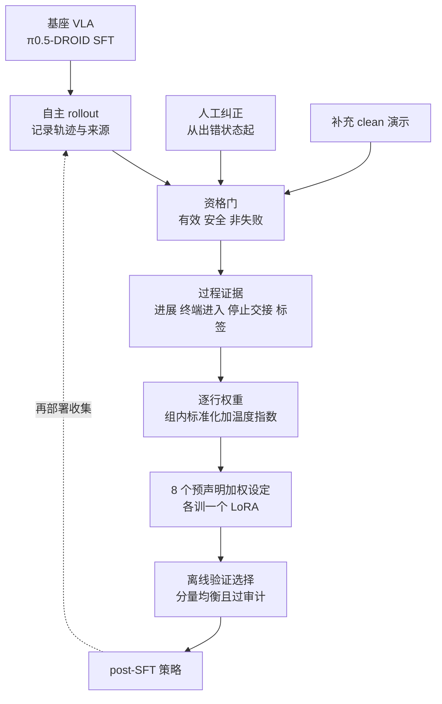
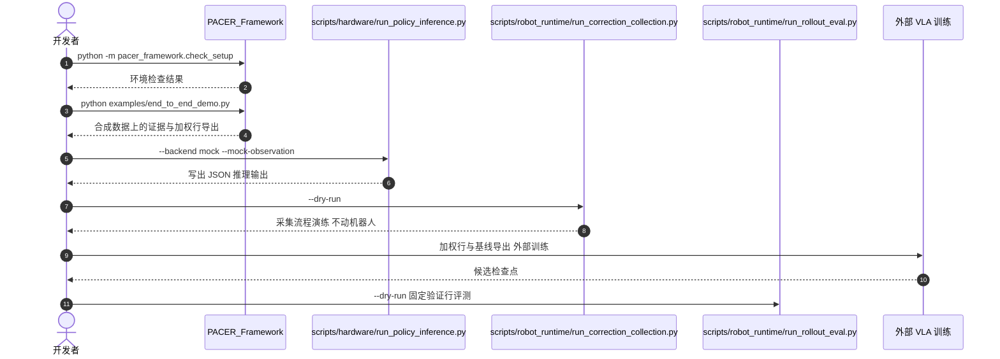

# PACER：按过程证据给人工纠正与 rollout 加权的 VLA 后训练

**PACER 在 VLA 的监督微调之上，不改骨干与损失形式，只依据每个动作块的过程证据（是否朝目标推进、是否进入终端区域、停止/交接是否一致、操作员如何标注）重新分配逐行权重，让自身 rollout、近失误与人工纠正都能被有区别地利用。**

论文 *PACER: Process-Aware VLA Policy Learning from Human Corrections for Robotic Disassembly*（[arXiv:2610.19248](https://arxiv.org/abs/2610.19248)，[代码](https://github.com/ChangChrisLiu/PACER)，[项目页](https://pacer-corl.github.io/)）。

## 英文缩写速查

| 缩写 | 英文全称 | 简要说明 |
|------|----------|----------|
| PACER | Process-Aware Correction and Evidence Reweighting | 仓库 README 给出的全称；按过程证据重加权纠正与 rollout |
| VLA | Vision-Language-Action | 被微调的策略；论文基座为 π0.5-DROID |
| SFT | Supervised Fine-Tuning | 监督微调；PACER 保持其原生 flow 回归损失，只改样本权重 |
| TCP | Tool Center Point | 工具中心点；进展与终点接近度由 TCP 轨迹计算 |
| LoRA | Low-Rank Adaptation | 每个加权设定训练一个 LoRA 适配器供验证选择 |

## 为什么重要

- 部署轨迹混杂成功、近成功与人工接管；只留成功样本（outcome-only）会丢弃近失误，论文中 Outcome only 仅 11/100，说明简单筛选可能很伤。
- 拆解需要遵守步骤顺序并做精确接触前的接近与交接，过程信号（走到哪一步）比终局二值标签更密。
- 不引入奖励模型或价值函数，也不要求反复在线 rollout-采集循环，工程门槛低于基于奖励的适应。

## 核心信息

| 项 | 内容 |
|----|------|
| **机构** | 德州农工大学（Texas A&M University）；加州大学河滨分校（UC Riverside）；佐治亚理工学院（Georgia Tech），依据 arXiv HTML 版作者单位 |
| **平台** | UR5e 机械臂，主板五类部件：CPU、GPU、CPU 风扇、RAM、连接器块 |
| **基座** | π0.5-DROID，先在 710 条遥操作轨迹上 SFT |
| **后训练数据** | 每部件 70 条自主 rollout + 人工纠正 + 补充 clean 演示；每部件 60 训练 / 10 验证配置组 |
| **开源** | **部分开源**（2026-10-17 核查）：[ChangChrisLiu/PACER](https://github.com/ChangChrisLiu/PACER)，MIT；通用框架与运行时适配层 + 合成示例，无真实数据、检查点、机器人驱动 |

## 核心原理

### 流程总览

- **资格门：** 训练划分内、掩码与来源有效、安全执行、非失败/排除的行才能提供目标；错位置与失败 rollout 模仿权重为 0，仅留作审计。
- **证据与角色：** 操作员结果 clean、correction 记 1.0，auto-success 0.8，partial 0.6；clean 与 correction 有 0.80 与 0.65 的保护下限，权重有上限裁剪。
- **加权与损失：** 每行得分在 component-phase-role 组内中心化、缩放后过温度指数；对原生 flow 回归损失做 batch 归一化的逐 horizon 加权。
- **选择：** 8 个预声明设定各训练一个策略，取离线验证分数最高且通过审计者。

## 源码运行时序图

仓库可运行入口是无硬件的 mock / dry-run；训练在仓库之外完成（README 工作流第 7 步 "train externally"）。下图按 README 命令绘制，内部模块调用未逐文件核实。

- **复现路径：** `PACER_Framework/` 下 `pip install -e '.[dev]'` → `check_setup` → `end_to_end_demo.py`；根目录 `pip install -e '.[test]'`（硬件探针加 `,robot`）→ `pytest tests -q`。
- **安全：** README 要求先 `--dry-run`，实机需显式确认、有效安全栈与物理急停。

## 工程实践

| 项 | 建议 |
|----|------|
| 先跑通 | 合成端到端 demo 验证证据计算与导出格式，再接自家日志 |
| 元数据 | 论文依赖目标几何、角色、标签、掩码、来源；先把这些字段补齐再谈加权 |
| 候选管理 | 需训练并验证多个权重候选（论文 8 个，每个 10,000 步、批 32），算力成本不可省 |
| 数据配比 | 论文每部件 70 条 rollout，其中成功仅 4/31/11/7/2；成功很少时近失误与纠正才是主要信号 |
| 源码运行时序图 | 见上；真实数据、检查点、机器人驱动均不在仓库 |

## 实验与评测

- **主结果（100 次留出硬件试验，approach-and-handoff）：** Initial SFT 12；Vanilla post-SFT 54；Uniform all-eligible 64；Fixed geometry 79；**PACER 87**（95% Wilson CI 79.0–92.2%）。
- **单一来源基线：** Outcome only 11；Clean only 24；Correction only 0。
- **分部件：** RAM 19、connector 13、CPU 15、GPU 20、CPU fan 20（各 20 次）。
- **受控 OOD（100 次/策略）：** PACER 72；Fixed geometry 51；RW-like 51；Uniform 48；Role only 39；No clean 35；No correction 13；No outcome 50。

## 结论

**PACER 的增益来自「三类数据都用、按过程证据区分对待」，而非任一单一数据源；但所有数字限于一个任务域的 approach-and-handoff 阶段。**

1. **不要只留成功** — Outcome only 11/100 低于 vanilla 54/100，论文中近失误与纠正携带关键信号。
2. **纠正最关键** — 受控 OOD 上去掉纠正降至 13/100，降幅最大；去掉自主 rollout（No outcome）也降到 50/100。
3. **过程证据优于固定规则** — 87 对固定几何 79、均匀 64（主基准），OOD 上 72 对 51。
4. **选择成本** — 需训练并验证多个权重候选，作者承认顶部候选在重采样下难区分、验证分与硬件仅部分校准。
5. **范围** — 评测仅覆盖接近与交接，不含完整拆解流程；对完整任务的收益未核实。

## 与其他工作对比

| 对照 | 差异读法 |
|------|----------|
| [DAgger](../methods/dagger.md) | 同样利用部署中的专家纠正；PACER 不重复在线聚合循环，而是对已有轨迹按过程证据加权 |
| [HIL 混合模仿学习](../methods/hil-hybrid-imitation-learning.md) | 同属人在回路；PACER 的改动落在逐行损失权重，不改策略结构 |
| [VLA](../methods/vla.md) | 被微调对象；论文用 π0.5-DROID 并配合 LoRA |
| 基于奖励的适应（项目页叙述） | 需额外奖励/价值模型与重复采集；PACER 声称两者皆无 |

## 局限与风险

- **元数据依赖：** 对错误标签、损坏元数据的鲁棒性论文未测。
- **验证校准：** 顶部候选难区分，验证分数与硬件表现仅部分校准。
- **消融粒度：** 未隔离单个证据特征、角色乘数、下限或选择规则的贡献。
- **泛化范围：** 单任务域、单机器人、单 VLA，未在标准操作基准上测。
- **开源边界：** 仓库只有框架、适配层与合成示例；论文结果不可凭仓库直接复现（2026-10-17 核查）。

## 关联页面

- [VLA](../methods/vla.md) — 被微调的策略族
- [HIL 混合模仿学习](../methods/hil-hybrid-imitation-learning.md) — 人在回路范式
- [DAgger](../methods/dagger.md) — 部署纠正的经典对照
- [模仿学习](../methods/imitation-learning.md) — SFT 的上位方法

## 参考来源

- [pacer_arxiv_2610_19248.md](../../sources/papers/pacer_arxiv_2610_19248.md) — 论文摘录与开源核查
- [pacer-project.md](../../sources/sites/pacer-project.md) — 项目页归档
- [pacer.md](../../sources/repos/pacer.md) — 官方仓库归档
- [arXiv:2610.19248](https://arxiv.org/abs/2610.19248) — 原文

## 推荐继续阅读

- [PACER 项目页](https://pacer-corl.github.io/)
- [PACER 官方仓库](https://github.com/ChangChrisLiu/PACER)
