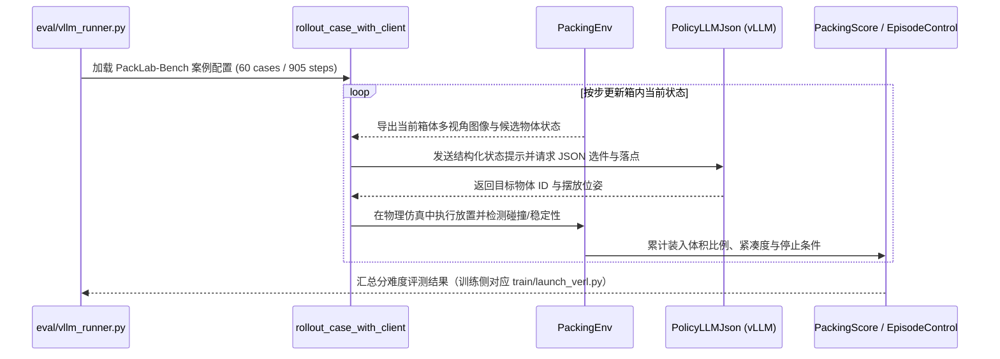

# PackLab（arXiv:2609.23784）

**PackLab**（*PackLab: A Comprehensive Framework for Developing, Training, and Evaluating MLLMs in Robotic Bin Packing*，[arXiv:2609.23784](https://arxiv.org/abs/2609.23784)，[代码](https://github.com/Correr-Zhou/PackLab)）来自 [具身智能小站 2026-10-18 盘点](../../sources/blogs/wechat_embodied_station_26_papers_embodiedswe_2026-10-18.md)，属「策略与规划」组。

## 一句话定义

**把仿真平台、专用多模态模型和分难度评测连在一起，让模型随箱内状态更新选择物体与落点。**

## 英文缩写速查

| 缩写 | 英文全称 | 简要说明 |
|------|----------|----------|
| MLLM | Multimodal Large Language Model | 多模态大语言模型 |

## 为什么重要

- 装箱不仅看单次落点，还要看后续空间；装入体积与紧凑度共同评价布局。
- 开源结论：**已开源**（步骤 2.5，2026-10-18）。仓库可达（git ls-remote）。
- 同期同组工作见 [编程智能体造数据与 VLA 闭环评测：具身智能小站 10-18 期 26 篇阅读坐标](../overview/embodied-station-2026-10-18-26-papers-technology-map.md)。

## 核心机制

| 项 | 内容 |
|----|------|
| **arXiv** | [2609.23784](https://arxiv.org/abs/2609.23784) |
| **开源** | **已开源** |
| **要点** | 仿真平台 + 专用 MLLM + 分难度评测，随箱内状态更新决策。 |
| **文内指标** | `PackLab-Bench`（60 cases / 905 steps）：`PackLab-VLM-9B` 达 `0.882 / 0.718 / 0.660`，对比 `SDF-Pack`（`0.602`）、`DBLF`（`0.554`）、`Qwen3.5-9B`（`0.209`）；含 AUBO 真机验证。 |

## 源码运行时序图

以下时序基于官方仓库 [Correr-Zhou/PackLab](https://github.com/Correr-Zhou/PackLab) 实际代码入口（评测：`eval/vllm_runner.py`；训练：`train/launch_verl.py`）：

## 工程实践

- **训练与评测解耦入口**：仓库通过 `train/launch_verl.py` 基于 `verl` 在 `PackData-20K` 语料上微调装箱 MLLM 策略；评测时通过 `eval/vllm_runner.py` 对接 vLLM 服务端并发跑完 `PackLab-Bench`。
- **闭环状态更新替代静态规划**：每步均把已放入箱内后的真实物理碰撞与堆叠状态传回下一步提示词，迫使策略考虑为后续大件/规则件保留剩余空间。
- **实体机械臂落地对齐**：作者将仿真落点与抓取流程映射到真实 **AUBO 机械臂**平台，检查物理碰撞与真实视觉反馈偏差。

## 实验与评测

- **基准规模**：`PackLab-Bench` 共包含 **60 个分难度装箱案例**、累计 **905 步序贯决策**；配套训练语料为 **`PackData-20K`**。
- **核心量化对比**：专用多模态模型 **`PackLab-VLM-9B`** 在三档/分项指标达到 **`0.882 / 0.718 / 0.660`**，显著高于几何启发式方法 **`SDF-Pack`（`0.602`）**、**`DBLF`（`0.554`）** 以及未微调基础模型 **`Qwen3.5-9B`（`0.209`）**。
- **真机验证**：除物理仿真评测外，作者报告在 AUBO 机械臂真机环境下完成闭环装箱验证，证明多步决策策略具备可迁移的物理稳定性。

## 局限与风险

- **状态漂移与视觉遮挡风险**：真机深堆叠场景下的顶部遮挡或深度噪点会破坏下一步箱内可用空间估计，从而引发碰撞或悬空失效。
- **吞吐延迟高于经典启发式**：每步通过 `PolicyLLMJson` 调用 vLLM 进行推理，节拍远慢于 `DBLF` 等纯几何算法；工业高节拍分拣线仍需模型蒸馏或加速部署。
- **物体形态覆盖有限**：基准主要验证常见规则与一般刚体货箱，极端软包变形或高摩擦嵌合装箱不在当前主评估覆盖之内。

## 与其他工作对比

- 横向索引见 [编程智能体造数据与 VLA 闭环评测：具身智能小站 10-18 期 26 篇阅读坐标](../overview/embodied-station-2026-10-18-26-papers-technology-map.md)；与仅考单次抓取或桌面重排的 [ManiSkill-HAB](./paper-notebook-maniskill-hab-a-benchmark-for-low-level-manipula.md) 相比，PackLab 突出连续空间分配与多步布局余量约束。

## 结论

**序贯装箱必须采用“每步更新物理状态后的闭环指标”，仅靠未微调 MLLM（`0.209`）或传统静态启发式（`0.554`–`0.602`）难以稳定处理分难度紧致装箱。**

1. **开源可运行入口清晰**：训练入口为 `train/launch_verl.py`，闭环评测入口为 `eval/vllm_runner.py`（含 `rollout_case_with_client`、`PackingEnv`、`PolicyLLMJson`、`PackingScore`、`EpisodeControl`）。
2. **专用闭环微调收益显著**：在 `PackLab-Bench`（60 cases / 905 steps）上，`PackLab-VLM-9B` 达到 `0.882 / 0.718 / 0.660`，较基础 `Qwen3.5-9B`（`0.209`）实现数量级跃升。
3. **工程部署需平衡推理延迟**：上线前应对真机遮挡鲁棒性与 JSON 解码耗时进行压测，并与混合启发式策略对齐控制节拍。

## 关联页面

- [manipulation](../tasks/manipulation.md)
- [simulation-evaluation-infrastructure](../concepts/simulation-evaluation-infrastructure.md)
- [embodied-station-2026-10-18-26-papers-technology-map](../overview/embodied-station-2026-10-18-26-papers-technology-map.md)
- [具身大模型评测基准选型闭环](../queries/embodied-eval-benchmark-selection-loop.md) — 本页可归入其 ③ 策略任务成功率评测层：按难度分级评测装箱任务中的物体与落点选择

## 参考来源

- [packlab_arxiv_2609_23784.md](../../sources/papers/packlab_arxiv_2609_23784.md)
- [wechat_embodied_station_26_papers_embodiedswe_2026-10-18.md](../../sources/blogs/wechat_embodied_station_26_papers_embodiedswe_2026-10-18.md)
- [arXiv:2609.23784](https://arxiv.org/abs/2609.23784)

## 推荐继续阅读

- [arXiv PDF](https://arxiv.org/pdf/2609.23784)
- [https://github.com/Correr-Zhou/PackLab](https://github.com/Correr-Zhou/PackLab)
