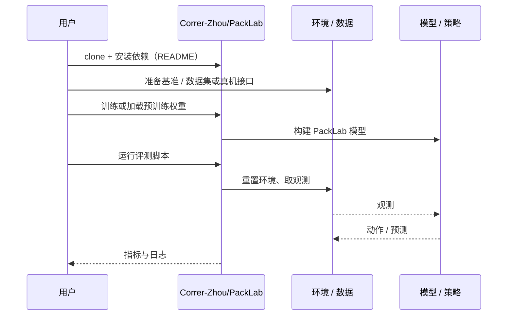

# PackLab（arXiv:2609.23784）

**PackLab**（*PackLab: A Comprehensive Framework for Developing, Training, and Evaluating MLLMs in Robotic Bin Packing*，[arXiv:2609.23784](https://arxiv.org/abs/2609.23784)，[代码](https://github.com/Correr-Zhou/PackLab)）来自 [具身智能小站 2026-10-18 盘点](../../sources/blogs/wechat_embodied_station_26_papers_embodiedswe_2026-10-18.md)，属「策略与规划」组。

## 一句话定义

**把仿真平台、专用多模态模型和分难度评测连在一起，让模型随箱内状态更新选择物体与落点。**

## 英文缩写速查

| 缩写 | 英文全称 | 简要说明 |
|------|----------|----------|
| MLLM | Multimodal Large Language Model | 多模态大语言模型 |

## 为什么重要

- 装箱不仅看单次落点，还要看后续空间；装入体积与紧凑度共同评价布局。
- 开源结论：**已开源**（步骤 2.5，2026-10-18）。仓库可达（git ls-remote）。
- 同期同组工作见 [编程智能体造数据与 VLA 闭环评测：具身智能小站 10-18 期 26 篇阅读坐标](../overview/embodied-station-2026-10-18-26-papers-technology-map.md)。

## 核心机制

| 项 | 内容 |
|----|------|
| **arXiv** | [2609.23784](https://arxiv.org/abs/2609.23784) |
| **开源** | **已开源** |
| **要点** | 仿真平台 + 专用 MLLM + 分难度评测，随箱内状态更新决策。 |
| **文内指标** | 公众号称主要证据来自物理仿真；未给具体数字。 |

## 源码运行时序图

以下为按仓库入口（`Correr-Zhou/PackLab`）推断的通用运行链路；入库日仅核实仓库可达，未逐文件阅读，具体脚本名以 README 为准。

## 实验与评测

- 公众号称主要证据来自物理仿真；未给具体数字。
- **读法：** 本页为索引级摘要，依据公众号转述的官方摘要与仓库信息整理；逐项数字与 baseline 以原文 PDF 为准。

## 与其他工作对比

- 横向索引见 [编程智能体造数据与 VLA 闭环评测：具身智能小站 10-18 期 26 篇阅读坐标](../overview/embodied-station-2026-10-18-26-papers-technology-map.md)；同 arXiv 不重复造页。

## 结论

**序贯装箱评测应同时看体积与紧凑度，且证据目前停留在仿真。**

1. 开源边界：**已开源** — 仓库可达（git ls-remote）。
2. 核心机制：仿真平台 + 专用 MLLM + 分难度评测，随箱内状态更新决策。
3. 复现与选型前核对任务协议、硬件与基准口径，勿直接横比公众号摘录数字。

## 关联页面

- [manipulation](../tasks/manipulation.md)
- [simulation-evaluation-infrastructure](../concepts/simulation-evaluation-infrastructure.md)
- [embodied-station-2026-10-18-26-papers-technology-map](../overview/embodied-station-2026-10-18-26-papers-technology-map.md)
- [具身大模型评测基准选型闭环](../queries/embodied-eval-benchmark-selection-loop.md) — 本页可归入其 ③ 策略任务成功率评测层：按难度分级评测装箱任务中的物体与落点选择

## 参考来源

- [packlab_arxiv_2609_23784.md](../../sources/papers/packlab_arxiv_2609_23784.md)
- [wechat_embodied_station_26_papers_embodiedswe_2026-10-18.md](../../sources/blogs/wechat_embodied_station_26_papers_embodiedswe_2026-10-18.md)
- [arXiv:2609.23784](https://arxiv.org/abs/2609.23784)

## 推荐继续阅读

- [arXiv PDF](https://arxiv.org/pdf/2609.23784)
- [https://github.com/Correr-Zhou/PackLab](https://github.com/Correr-Zhou/PackLab)
