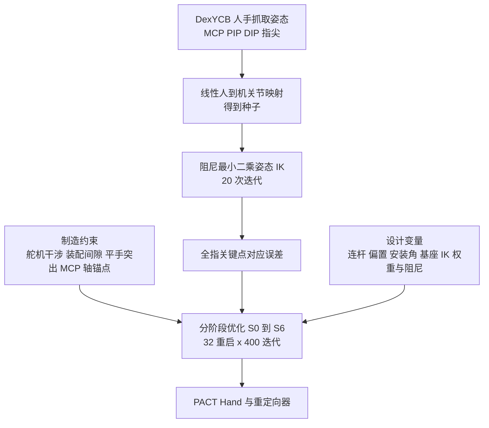

# PACT：把手的机械参数和姿态重定向一起优化

**PACT 不是先设计手再调重定向，而是在装配可行约束下，同时优化机械手的几何参数与非线性姿态重定向器，使人手抓取姿态能被机器手逐关键点复现，并让遥操作与模仿学习直接受益。**

论文 *PACT: Posture-Aligned Co-Design Technique for Hand Configuration and Retargeting in Multi-Finger Imitation Learning*（[arXiv:2610.18443](https://arxiv.org/abs/2610.18443)，[项目页](https://pact-hand-2027.github.io)），已投 ICRA 2027。

## 英文缩写速查

| 缩写 | 英文全称 | 简要说明 |
|------|----------|----------|
| IK | Inverse Kinematics | 重定向器核心，阻尼最小二乘姿态 IK 迭代 20 次 |
| HPCR | 10 mm 内命中率（指尖保持在 10 mm 内的姿态比例） | 论文衡量抓取姿态覆盖的指标，全称以论文为准（未核实） |
| ACT | Action Chunking with Transformers | 论文用的模仿学习策略 |
| MCP / PIP / DIP | Metacarpophalangeal / Proximal / Distal Interphalangeal | 手指关节，用于全指对应 |

## 为什么重要

- 只对齐指尖的设计会牺牲其余关节：仅指尖消融的全关键点 RMSE 为 23.66 mm，而全指对应为 3.90 mm。
- 设计与重定向分开做时，二者互相迁就；联合优化把「机器手能到的姿态」直接变成设计目标。
- 评价延伸到载重、物体变形、遥操作效率与模仿学习，而非只比仿真姿态误差。

## 核心信息

| 项 | 内容 |
|----|------|
| **机构** | 早稲田大学（Waseda University） |
| **硬件** | 17 舵机拟人手（食、中、无名指各 4，拇指 5），1.56x 人手，Dynamixel XC330-M288-T；UR5e 臂 + GELLO 主手 |
| **数据** | DexYCB：234 序列、10 受试者、8 物体，过滤后 5,117 姿态；训练 1,788、测试 277 |
| **开源** | **宣称待发表后发布，当前无链接**（2026-10-17 核查）：项目页的 BOM、CAD、装配指南、重定向与遥操作软件均标 "upon publication" |

## 核心原理

### 流程总览

人手关键点经线性映射得到种子，再由姿态 IK 精化；设计变量既包含机械参数，也包含 IK 的逐关键点权重与阻尼。约束分 7 个阶段逐步加入。

- 每阶段加入一条约束，warm start，并设 10% 精度守卫。
- 实现为 PyTorch float64 可微流程。

## 源码运行时序图

**不适用**：无官方代码，项目页的软件与 CAD 均为 "upon publication"（2026-10-17）。下表只给出论文的遥操作数据通路，非仓库时序：单 RGB 相机 + WiLoR 手姿估计（约 23 Hz）→ PACT 重定向器 → 手舵机；UR5e 臂由 GELLO 主手驱动。

## 与其他工作对比

| 维度 | PACT（本文） | [DexCap](./paper-notebook-dexcap-scalable-and-portable-mocap-data-collecti.md) | [TopoRetarget](../methods/toporetarget-interaction-preserving-dexterous-retargeting.md) | [SPIDER](../methods/spider-physics-informed-dexterous-retargeting.md) |
|------|------|------|------|------|
| 优化对象 | 手的几何参数 + 重定向器权重与阻尼，联合优化 | 固定 LEAP Hand，重定向不改硬件 | 固定灵巧手上的重定向参考 | 固定本体上的重定向轨迹 |
| 对应目标 | 全指关键点（MCP / PIP / DIP / 指尖） | 指尖 IK | 手–物 interaction mesh 拓扑 | 动力学可行 + 接触意图保留 |
| 是否用物体 / 物理 | 运动学 + 制造约束，不做物理仿真 | 点云 Diffusion Policy 学策略 | 距离加权 Laplacian + PPO 残差跟踪 | 并行物理仿真中的采样式轨迹优化 |
| 开放状态 | CAD 与软件待发表后发布 | MIT 代码 + HF 数据 | 见该页 | 见该页 |

- **相对 DexCap：** DexCap 在 LEAP Hand 上做指尖 IK；PACT 以 LEAP Hand 经同一 IK 管线为基线，全关键点 RMSE 12.82 对 3.90 mm，仅指尖消融为 23.66 mm，说明只对齐指尖会牺牲其余关节（DexCap 本身未在 PACT 中评测）。
- **相对 TopoRetarget / SPIDER：** 二者在给定的手上改进重定向（接触拓扑 / 物理可行性）；PACT 改的是手本身，属于互补的上游环节。
- 各文任务与指标不同，除 PACT 论文内的 LEAP 基线外不可横比。

## 工程实践

| 项 | 建议 |
|----|------|
| 源码运行时序图 | **不适用**（无官方代码） |
| 复现判断 | 暂无 CAD 与软件，无法复刻硬件；可参考分阶段约束加入的优化流程自建 |
| 遥操作栈 | 单 RGB + WiLoR（见 [WiLoR](../methods/wilor.md)）约 23 Hz，臂用 GELLO |
| 比较基线 | 用 LEAP Hand 公开运动学经同一 IK 管线，以及仅指尖消融（16 驱动） |
| 数据来源风险 | 测试姿态与训练同受试者，换操作者需重测 |

## 实验与评测

- **重定向精度：** 全关键点 RMSE 3.90 / 3.88 mm（训练 / 测试），LEAP 12.82 / 13.09，仅指尖 23.66 / 22.79。HPCR（10 mm）：PACT 100%，LEAP 21.6% / 7.9%。12 个未见物体（1,421 抓取）：4.06 mm 与 99.6%，LEAP 11.16 mm。
- **载重（力矩上限匹配）：** 0.167 N·m 下 PACT 举 2 kg，LEAP 与仅指尖约 1 kg；1300 g 时 PACT 5/5，LEAP 0/6，仅指尖 0/5。
- **杯变形（圆度，1.000 为未变形）：** PACT 0.9847，人手 0.9777，LEAP 0.8752，仅指尖 0.8272。
- **YCB 抓取（10 物体各 5 次）：** PACT 43/50（86%），LEAP 32/50（64%），仅指尖 16/50（32%）；平均遥操作用时 10.6 / 21.8 / 43.5 s。
- **模仿学习：** ACT 用 54 条罐子放托盘示范，原放置位置 94%（17/18），留出位置 75%（9/12）。

## 结论

**PACT 的证据最强的一点是：联合优化使机器手在人手抓取姿态集上几乎处处可达，并转化为更高载重和遥操作效率；模仿学习验证样本仍很小。**

1. **全指对应优于仅指尖** — 全关键点 RMSE 3.90 对 23.66 mm。
2. **姿态覆盖落到抓取成功** — YCB 86% 对 LEAP 64%，且单次遥操作更快。
3. **载重是约束与几何的共同结果** — 同力矩上限下 2 kg 对 1 kg。
4. **IL 验证是初步的** — 12 个留出位置试验、54 条示范，75% 不宜外推。
5. **可复现性待定** — CAD 与软件未发布。

## 局限与风险

- 测试姿态来自相同受试者且共享均值手形，操作者手尺寸鲁棒性未测。
- 物理评估为开环遥操作；规则族为线性种子加阻尼 IK。
- 训练集缺少的把手抓取代价最大（水壶 4.74 mm）；放大 1.56x 后细小特征精度弱。
- 模仿学习试验次数少（18 + 12）。
- 硬件、软件尚未公开；作者单位来自论文 HTML，项目页匿名。

## 关联页面

- [灵巧手运动学](../concepts/dexterous-kinematics.md) — 手部几何与关节配置的基础
- [运动重定向](../concepts/motion-retargeting.md) — 人到机姿态映射的总体框架
- [模仿学习](../methods/imitation-learning.md) — ACT 评测所属范式
- [遥操作](../tasks/teleoperation.md) — 数据采集通路
- [WiLoR](../methods/wilor.md) — 论文使用的手姿估计

## 参考来源

- [pact-hand-codesign_arxiv_2610_18443.md](../../sources/papers/pact-hand-codesign_arxiv_2610_18443.md) — 论文摘录与开源核查
- [pact-hand-codesign-project.md](../../sources/sites/pact-hand-codesign-project.md) — 项目页归档
- [arXiv:2610.18443](https://arxiv.org/abs/2610.18443) — 原文

## 推荐继续阅读

- [PACT 项目页](https://pact-hand-2027.github.io)
- [论文 HTML](https://arxiv.org/html/2610.18443v1)
