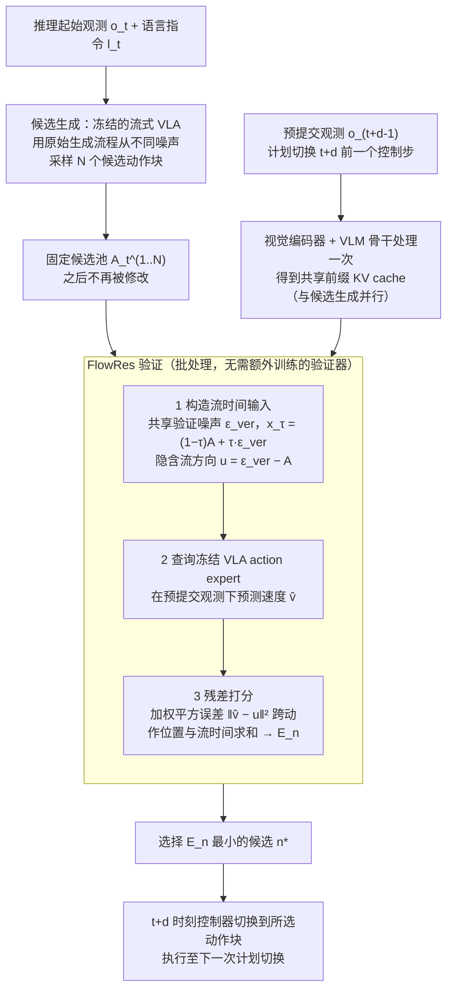

# PACT-VLA：利用执行前观测进行推测式动作块验证

**PACT-VLA**（*PACT-VLA: Speculative Action-Chunk Verification with Pre-Commit Observations*，[arXiv:2610.28019](https://arxiv.org/abs/2610.28019)）收录于 senlanke「具身运控lab」10-19–10-23 前沿论文动态（Manipulation）。本页依据**周报条目 + arXiv 摘要页**整理，流程图依据论文方法部分（见参考来源），未逐页核对实验数字；指标与结论以论文为准。

## 一句话定义

**PACT-VLA：利用执行前观测进行推测式动作块验证——将执行前观测与动作块验证结合，在提交动作之前检查候选动作与当前环境状态的一致性，研究降低动作块执行风险的方法。**

## 英文缩写速查

| 缩写 | 英文全称 | 简要说明 |
|------|----------|----------|
| VLA | Vision-Language-Action | 视觉–语言–动作模型 |
| IL | Imitation Learning | 模仿学习 |

## 为什么重要

- 周报所述待解决的问题：VLA 生成动作块后，连续执行期间的环境变化可能使后续动作失效。固定长度的开环执行难以及时处理状态偏移。

## 流程总览

图依据：论文 §2.1、§3.1–3.3 / Fig. 2–3、式 4–6。

## 核心机制

| 项 | 内容 |
|----|------|
| **arXiv** | [2610.28019](https://arxiv.org/abs/2610.28019) · [PDF](https://arxiv.org/pdf/2610.28019) |
| **作者（arXiv）** | Yixiang Zhu, Ruilong Wu, Yonghao Chen, Jiaxiang Zou, Yusong Hu, Xinyu Chen |
| **机构（周报所述，未逐条核实）** | 待核实（作者：Yixiang Zhu、Ruilong Wu、Yonghao Chen 等）。 |
| **arXiv 评论栏** | （无） |
| **开源** | arXiv 摘要页与评论未见代码或项目页链接（仅核对 arXiv 摘要页，不代表未发布）（2026-10-26） |
| **周报所述创新点** | 将执行前观测与动作块验证结合，在提交动作之前检查候选动作与当前环境状态的一致性，研究降低动作块执行风险的方法。 |

### arXiv 摘要节选（英文原文）

> Vision-language-action (VLA) policies are commonly deployed with asynchronous inference in real-world settings, where the next action chunk is generated while the robot is still executing the previous one. By the time the new chunk is committed, the robot and scene have changed, so the chunk is conditioned on a stale observation and task success drops sharply as this inference delay grows.

## 源码运行时序图

**不适用**：arXiv 摘要页与评论未见代码或项目页链接（仅核对 arXiv 摘要页，不代表未发布），无可对齐的官方代码流程。

## 实验与评测

- 周报与摘要给出的数字/场景已写入上表「创新点」与摘要节选；其余实验细节、基线与成功率定义请回到论文正文。
- 读法：先对齐任务设定、传感器与成功定义（仿真/真机），再解读 headline 数字，勿跨论文直接比较。

## 与其他工作对比

| 维度 | 读法 |
|------|------|
| **同周对照** | 见 [Manipulation周报技术地图](../overview/senlanke-weekly-2026-10-19-23-manipulation-technology-map.md)，按方向浏览同期论文 |
| **开源状态** | arXiv 摘要页与评论未见代码或项目页链接（仅核对 arXiv 摘要页，不代表未发布） |

## 结论

**PACT-VLA：利用执行前观测进行推测式动作块验证。**

1. 本页是入库级摘要，复现前请核对论文正文、附录与代码仓库。
2. 指标须连同实验条件解读。
3. 关注 arXiv 版本更新与代码发布。

## 关联页面

- [senlanke-weekly-2026-10-19-23-manipulation-technology-map](../overview/senlanke-weekly-2026-10-19-23-manipulation-technology-map.md)
- [manipulation](../tasks/manipulation.md)
- [vla](../methods/vla.md)

## 参考来源

- [pact-vla-speculative-action-chunk-verification_arxiv_2610_28019.md](../../sources/papers/pact-vla-speculative-action-chunk-verification_arxiv_2610_28019.md)
- [wechat_senlanke_weekly_manipulation_2026-10-19_23.md](../../sources/blogs/wechat_senlanke_weekly_manipulation_2026-10-19_23.md)
- [arXiv:2610.28019](https://arxiv.org/abs/2610.28019)
- [arXiv PDF](https://arxiv.org/pdf/2610.28019)：已通读方法部分（实验与附录以略读为准）：§1–3（引言、背景与动机、方法：概述、FlowRes 候选验证、流水线执行），§4 开头实验设定略读

## 推荐继续阅读

- [arXiv PDF](https://arxiv.org/pdf/2610.28019)
