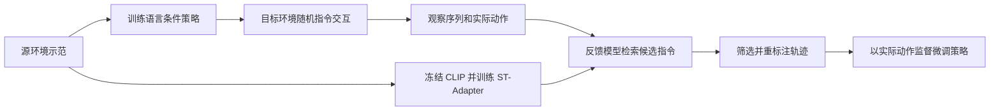
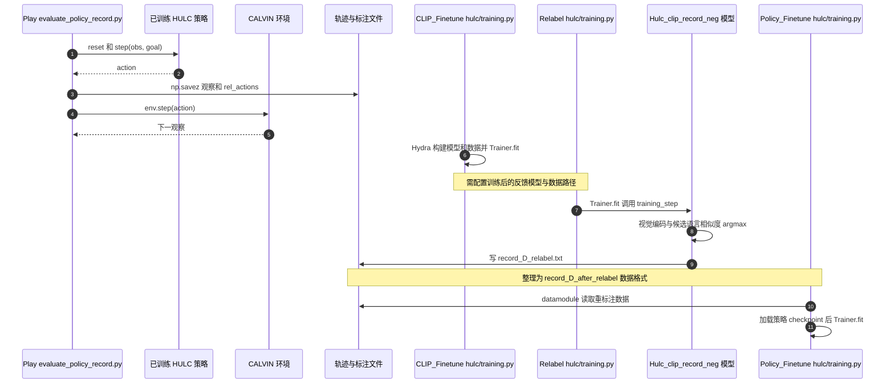

# PAFF：基于基础模型反馈的策略适应

## 一句话定义

PAFF 在新任务或环境中收集策略交互轨迹，利用视觉语言基础模型反馈重新标注数据，再用这些数据微调策略。

## 英文缩写速查

| 缩写 | 英文全称 | 简要说明 |
|---|---|---|
| PAFF | Policy Adaptation from Foundation Model Feedback | 利用基础模型反馈适应策略 |
| VLM | Vision-Language Model | 处理视觉与语言的模型 |
| OOD | Out of Distribution | 不同于训练分布的情形 |

## 为什么重要

失败轨迹仍可能包含可学习的有效动作；PAFF 将原指令与实际结果的不一致转化为重新标注的监督。部署期需要额外交互和参数更新，适合研究视觉语言反馈如何帮助适应。

## 核心信息

| 项目 | 内容 |
|---|---|
| 论文 | Policy Adaptation from Foundation Model Feedback，CVPR 2023；固定 arXiv:2212.07398v4 |
| 作者 | Yuying Ge、Annabella Macaluso、Li Erran Li、Ping Luo、Xiaolong Wang |
| 机构 | 加州大学圣迭戈分校、香港大学、亚马逊 AWS AI |
| 平台 | CLIPORT 桌面操作、CALVIN 连续控制、真机 sim-to-real |
| 开源 | 官方公开 CALVIN A/B/C → D 的适应代码；README 未提供覆盖全部真机实验的一键复现链 |
| 核读 | 已读 v4 HTML §1–5、Algorithm 1、Figure 1–5、Table 1–6；代码静态核查，未运行训练或机器人 |

## 核心原理

1. **预训练阶段**：以示范训练语言条件策略。桌面操作沿用 CLIPORT 双流结构，连续控制沿用 HULC 分层策略；实现使用 MDETR 作视觉与语言编码器。策略编码器和反馈模型职责不同。
2. **反馈模型**：CLIP 视觉 Transformer 层间插入深度可分离 3D 卷积 ST-Adapter；冻结原 CLIP，训练适配层，以 NCE 对齐时序视觉与指令表示。桌面任务用起止帧，CALVIN 从 64 帧采样 8 帧。
3. **Play**：在目标环境执行随机生成/选取的候选指令，记录观察及实际预测动作。执行错指令仍可能完成另一个动作。
4. **Relabel**：从候选指令集合检索与轨迹最相似的指令，筛选后以原动作和新指令微调策略。此处依赖候选集合覆盖实际动作及反馈识别可靠性。

## 流程总览

依据 v4 Algorithm 1 与 Figure 2：

## 源码运行时序图

静态对照官方仓库 `dc84b2021dc20f7a7463c52ccbb4d9649376a8b8` 的 README、各阶段 `hulc/training.py`、Play 的 `evaluate_policy_record.py`、Relabel 的 Hydra 配置及 `hulc_clip_record_neg.py`。各阶段需独立启动，文件交接仍需整理。

默认 Relabel 配置指向 `hulc_clip_record_neg.Hulc`，其筛选条件是 `score > 0.0 and ann_index != 34`；同目录另一个 record 模型使用 3.0 阈值。论文的 CLIPORT 阈值不能直接当作所有源码分支的默认值。Play 的 `save_dir` 与文件名直接拼接、Policy_Finetune 的历史 checkpoint 路径均需手动审查修改。详见[源码归档](../../sources/repos/paff-code.md)。

## 工程实践

先准备 CALVIN A/B/C 与 D 数据和初始策略，再依 README 分阶段启动 Play、CLIP_Finetune、Relabel 和 Policy_Finetune。检查每阶段的绝对路径、权重及样本格式，确认标注文件转换后再训练。公开代码主要覆盖 CALVIN 适应；本次仅静态阅读，没有执行训练、真机测试或数据下载。

## 实验与评测

以下为原文报告，非本库复现实测。Table 1 每任务有两种口径：每步换新指令；完成当前指令后才换。两列不能混用。

| 设定 | 对照 | PAFF | 口径 |
|---|---|---|---|
| CLIPORT put-shapes-in-bowls | MdetrORT 33.8% / 17.8% | 51.0% / 35.0% | Table 1 两种换指令协议 |
| CLIPORT pack-unseen-objects | MdetrORT 62.0% / 48.4% | 72.8% / 63.8% | 同上 |
| CALVIN A/B/C → D | MdetrLC 平均长度 1.38；五步完成 4% | 平均长度 1.73；五步完成 11% | Table 2，100 条五任务链 |
| 真机 put-shapes-in-bowls | MdetrORT 24% | 82% | Table 3，每步新指令 |

CLIPORT 按正确放置物体数 / 总物体数计算成功率，100 个评估实例、10 场景；真机每任务 10 个实例，每实例 5 条指令。CALVIN 目标域采集 500 段五子任务轨迹后微调 5 epochs。消融中 ST-Adapter 的 CALVIN 平均成功链长为 1.73，其他时序模块为 1.46–1.60；这些结果有各自数据与交互预算。

## 结论

PAFF 的价值是将基础模型对实际行为的识别能力转为部署期策略适应监督。

1. 区分动作策略与反馈检索器，分别检查泛化能力。
2. 将额外交互量和微调成本计入适应收益。
3. 报告成功率时写清换指令协议和统计单位。
4. 复现先核对默认模型、筛选阈值、数据格式和 checkpoint 路径。

## 与其他工作对比

- **对比 `CLIPORT`、`MdetrORT` 与 `AugORT`（桌面操作组合泛化与未见物体，Tables 1–2）：** 将视觉语言编码器从 CLIP 换成区域对齐的 MDETR（`MdetrORT`）及叠加图像数据增强（`AugORT`）可在已见任务分布内小幅提分，但在组合新配对与新物体上仍受限；在此之上加入「目标域 Play + VLM 反馈重标注」后，PAFF 在 `put-shapes-in-bowls`（两种换指令协议）与 `pack-unseen-objects` 上分别达到 **51.0% / 35.0%** 和 **72.8% / 63.8%**，显著高于同起点的 `MdetrORT`（33.8% / 17.8% 与 62.0% / 48.4%）；真机 `put-shapes-in-bowls` 从 24% 升至 **82%**（Table 3）。
- **对比 CALVIN 连续控制与时序反馈结构消融（Table 2 & §4.5）：** 在 CALVIN A/B/C → D 域迁移（100 条五任务链）上，PAFF 平均成功长度达 **1.73**（五步全成 11%），超过 `MdetrLC`（1.38 / 4%）；消融中基于 ST-Adapter 的反馈模型优于其他时序模块（1.46–1.60），但以目标环境额外交互采样（如 CALVIN 500 段五任务轨迹）为代价。

## 局限与风险

- 候选指令集合和反馈识别错误会限制重标注；不是自由语言下任意行为都可可靠标注。
- 需要目标域交互和参数更新；随机探索及自动复位在真实平台须另行验证可行性。
- 五步链成功率仍有限，不能从桌面单步物体比例推断长程可靠性。
- 官方实现说明代码尚未充分整理；公开 CALVIN 训练链不等于完整真机系统。没有完成训练复现。

## 关联页面

- [Towards Agentic Robots 综述](paper-towards-agentic-robots-survey.md)：Model / Adaptation 分类入口。
- [VLA](../methods/vla.md)：对照语言条件策略和部署期参数更新。
- [VLA 纵深路线](../../roadmap/depth-vla.md)：Stage 5 的自改进方向。

- [视觉表征学习](../methods/visual-representation-learning.md)：对照图像特征与下游视觉任务。

## 参考来源

- [v4 论文核读归档](../../sources/papers/paff_2212_07398.md)
- [项目页核查](../../sources/sites/paff.md)
- [官方源码核查](../../sources/repos/paff-code.md)

## 推荐继续阅读

- [固定 v4 原文](https://arxiv.org/html/2212.07398v4)
- [官方代码](https://github.com/geyuying/PAFF_code)
