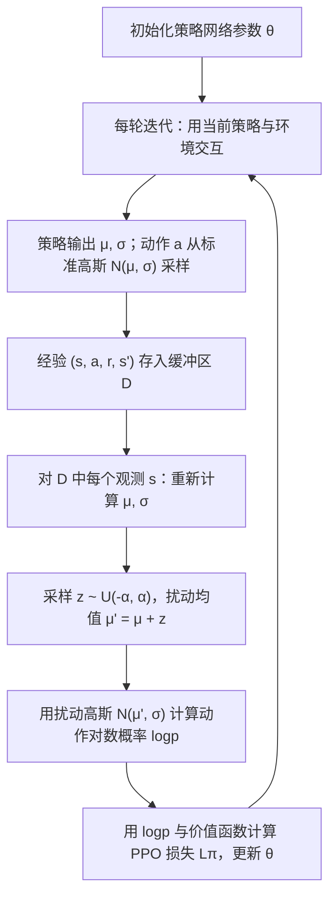

# Robust Policy Optimization

**Robust Policy Optimization** 收录于 awesome-physical-ai（natnew）**第 318/384** 条，分组 **Safety & Robustness**。本页是 **清单索引**：给出它在清单中的位置与官方入口，细节以官方文档 / 原文为准。

## 一句话定义

Robust Policy Optimization (RPO)：对 PPO 的高斯策略均值扰动以维持策略熵、改善探索的策略梯度方法（Rahman & Xue, 2022）。

## 英文缩写速查

| 缩写 | 英文全称 | 简要说明 |
|------|----------|----------|
| PAI | Physical AI | 具身/物理智能策展主题 |
| VLA | Vision-Language-Action | 视觉–语言–动作策略 |
| RFM | Robotics Foundation Model | 机器人基础模型 |
| Sim2Real | Simulation to Real | 仿真到真机迁移 |

## 为什么重要

- Robust Policy Optimization (RPO)：对 PPO 的高斯策略均值扰动以维持策略熵、改善探索的策略梯度方法（Rahman & Xue, 2022）。
- 想横向对照同一分组的其他工作，可以从 [Physical AI 技术地图](../overview/awesome-physical-ai-technology-map.md) 逐条展开。
- 两份清单合并去重：同一条目只有这一页，出处见下方「参考来源」。

## 流程总览

图依据：论文 §3 与 Algorithm 1（采集阶段第 2-10 行用标准高斯采样，更新阶段第 11-18 行用扰动均值计算 logp）。

## 核心信息

| 字段 | 内容 |
|------|------|
| 编号 | 318/384 |
| 分组 | Safety & Robustness |
| 来源清单 | natnew |
| 主链接 | <https://arxiv.org/abs/2212.07536> |
| arXiv | 2212.07536 |

## 核心机制（归纳）

### 策展导读要点

Robust Policy Optimization (RPO)：对 PPO 的高斯策略均值扰动以维持策略熵、改善探索的策略梯度方法（Rahman & Xue, 2022）。

本页不复述论文公式与完整实验表；工程落地请回到原文 / 项目页，并对照站内 VLA、Sim2Real 或任务页。

## 评测与指标

- 本页 **没有搬运** 原文的量化 benchmark 与实机指标。
- 评测口径与具体数值以 [原文 / 项目页](https://arxiv.org/abs/2212.07536) 为准。
- 横向对照请回到 [技术地图](../overview/awesome-physical-ai-technology-map.md) 同分组条目。

## 与其他工作对比

- 本页 **不做** 与具体基线的逐项数值对比，只给出清单坐标。
- 与站内 **深度论文实体** 的分界：深度页承载机构、实验表与源码运行时序；本页只承载清单导读锚点。同一 arXiv 若已存在深度页，应以深度页为准。
- 两份同名清单可能对同一工作给出不同链接（项目页 / arXiv / GitHub）；以本页主链接与技术地图为准。

## 结论

**这一页能给你的是「Robust Policy Optimization」在策展清单里的坐标与要点：够你判断要不要去读原文，但不能替代原文。**

1. **策展坐标** — 分组 **Safety & Robustness**，来源 natnew。
2. **适用边界** — 本页不能替代原文 PDF / 官方文档；开源状态以项目页实际链接为准。
3. **以深读页为准** — 若站内已有这篇的深读页，以那一页为准；本页只是清单入口。
4. **怎么深读** — 要深读这篇，建议直接从原文入手。

## 源码运行时序图

**不适用**（本页未逐仓核对 README 里的训练 / 推理入口；清单标注的仓库链接可能滞后，复现前请先打开项目页核对）。

## 局限与风险

- 不要把 Awesome 摘要当成完整方法证明或合规结论。
- 同名 GitHub 仓（natnew vs aichr）条目链接可能不同；以本页主链接与技术地图为准。
- 清单中的实验室 / 硬件 / 人物条目偶发链到错误 org，复现或引用前先打开官方页核对。

## 关联页面

- [awesome-physical-ai（natnew）](../entities/awesome-physical-ai-natnew.md)
- [awesome-physical-ai（aichr）](../entities/awesome-physical-ai-aichr.md)
- [Physical AI 技术地图](../overview/awesome-physical-ai-technology-map.md)
- [Physical AI 策展清单对比](../comparisons/awesome-physical-ai-curated-lists.md)

## 参考来源

- [`sources/papers/pai_awesome_1906_03710_robust-policy-optimization.md`](../../sources/papers/pai_awesome_1906_03710_robust-policy-optimization.md) — 本条目策展摘录
- [`sources/repos/awesome-physical-ai-union-catalog.md`](../../sources/repos/awesome-physical-ai-union-catalog.md) — 双清单并集目录
- [sources/repos/awesome-physical-ai-natnew.md](../../sources/repos/awesome-physical-ai-natnew.md)
- [sources/repos/awesome-physical-ai-aichr.md](../../sources/repos/awesome-physical-ai-aichr.md)
- 主链接：<https://arxiv.org/abs/2212.07536>
- 核对（2026-11-02）：原编号 1906.03710 对应《Curiosity-Driven Multi-Criteria Hindsight Experience Replay》，已按 arXiv 官方记录更正为 2212.07536（依据：API 标题《Robust Policy Optimization in Deep Reinforcement Learning》/作者 Md Masudur Rahman, Yexiang Xue/提交日期 2022-12-14；原一句话定义「distributional-robust」与摘要不符，已按摘要改写）
- [arXiv PDF](https://arxiv.org/pdf/2212.07536)：已通读方法部分（实验与附录以略读为准）：§1 Introduction、§2 Preliminaries and Problem Settings、§3 Robust Policy Optimization（含 Algorithm 1）、§4.1 实验设置；§4.2 结果略读

## 推荐继续阅读

- [natnew/awesome-physical-ai](https://github.com/natnew/awesome-physical-ai)
- [aichr/awesome-physical-ai](https://github.com/aichr/awesome-physical-ai)
- [原文 / 官方入口](https://arxiv.org/abs/2212.07536)
