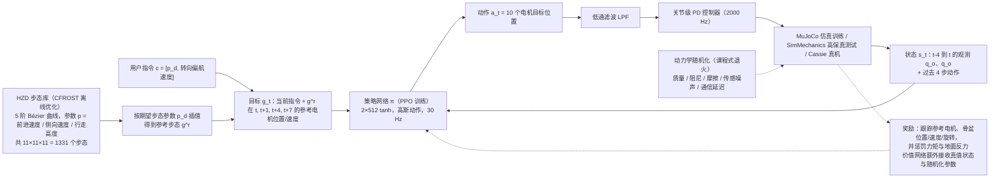

# Robust Parameterized Bipedal Locomotion (Cassie)

**Robust Parameterized Bipedal Locomotion (Cassie)** 收录于 awesome-physical-ai（natnew）**第 205/384** 条，分组 **Locomotion / Key Papers**。本页是 **清单索引**：给出它在清单中的位置与官方入口，细节以官方文档 / 原文为准。

## 一句话定义

Li et al. RL controller spanning a parameterised family of velocities and stances on Cassie (ICRA 2021).

## 英文缩写速查

| 缩写 | 英文全称 | 简要说明 |
|------|----------|----------|
| PAI | Physical AI | 具身/物理智能策展主题 |
| VLA | Vision-Language-Action | 视觉–语言–动作策略 |
| RFM | Robotics Foundation Model | 机器人基础模型 |
| Sim2Real | Simulation to Real | 仿真到真机迁移 |

## 为什么重要

- Li et al. RL controller spanning a parameterised family of velocities and stances on Cassie (ICRA 2021).
- 想横向对照同一分组的其他工作，可以从 [Physical AI 技术地图](../overview/awesome-physical-ai-technology-map.md) 逐条展开。
- 两份清单合并去重：同一条目只有这一页，出处见下方「参考来源」。

## 流程总览

图依据：论文 §II-B（步态库与参数化控制）、§III-A 至 §III-E 与 Fig.2。

## 核心信息

| 字段 | 内容 |
|------|------|
| 编号 | 205/384 |
| 分组 | Locomotion / Key Papers |
| 来源清单 | natnew |
| 主链接 | <https://arxiv.org/abs/2103.14295> |
| arXiv | 2103.14295 |

## 核心机制（归纳）

### 策展导读要点

Li et al. RL controller spanning a parameterised family of velocities and stances on Cassie (ICRA 2021).

本页不复述论文公式与完整实验表；工程落地请回到原文 / 项目页，并对照站内 VLA、Sim2Real 或任务页。

## 评测与指标

- 本页 **没有搬运** 原文的量化 benchmark 与实机指标。
- 评测口径与具体数值以 [原文 / 项目页](https://arxiv.org/abs/2103.14295) 为准。
- 横向对照请回到 [技术地图](../overview/awesome-physical-ai-technology-map.md) 同分组条目。

## 与其他工作对比

- 本页 **不做** 与具体基线的逐项数值对比，只给出清单坐标。
- 与站内 **深度论文实体** 的分界：深度页承载机构、实验表与源码运行时序；本页只承载清单导读锚点。同一 arXiv 若已存在深度页，应以深度页为准。
- 两份同名清单可能对同一工作给出不同链接（项目页 / arXiv / GitHub）；以本页主链接与技术地图为准。

## 结论

**这一页能给你的是「Robust Parameterized Bipedal Locomotion (Cassie)」在策展清单里的坐标与要点：够你判断要不要去读原文，但不能替代原文。**

1. **策展坐标** — 分组 **Locomotion / Key Papers**，来源 natnew。
2. **适用边界** — 本页不能替代原文 PDF / 官方文档；开源状态以项目页实际链接为准。
3. **以深读页为准** — 若站内已有这篇的深读页，以那一页为准；本页只是清单入口。
4. **怎么深读** — 要深读这篇，建议直接从原文入手。

## 源码运行时序图

**不适用**（本页未逐仓核对 README 里的训练 / 推理入口；清单标注的仓库链接可能滞后，复现前请先打开项目页核对）。

## 局限与风险

- 不要把 Awesome 摘要当成完整方法证明或合规结论。
- 同名 GitHub 仓（natnew vs aichr）条目链接可能不同；以本页主链接与技术地图为准。
- 清单中的实验室 / 硬件 / 人物条目偶发链到错误 org，复现或引用前先打开官方页核对。

## 关联页面

- [awesome-physical-ai（natnew）](../entities/awesome-physical-ai-natnew.md)
- [awesome-physical-ai（aichr）](../entities/awesome-physical-ai-aichr.md)
- [Physical AI 技术地图](../overview/awesome-physical-ai-technology-map.md)
- [Physical AI 策展清单对比](../comparisons/awesome-physical-ai-curated-lists.md)

## 参考来源

- [`sources/papers/pai_awesome_2103_14295_robust-parameterized-bipedal-locomot.md`](../../sources/papers/pai_awesome_2103_14295_robust-parameterized-bipedal-locomot.md) — 本条目策展摘录
- [`sources/repos/awesome-physical-ai-union-catalog.md`](../../sources/repos/awesome-physical-ai-union-catalog.md) — 双清单并集目录
- [sources/repos/awesome-physical-ai-natnew.md](../../sources/repos/awesome-physical-ai-natnew.md)
- [sources/repos/awesome-physical-ai-aichr.md](../../sources/repos/awesome-physical-ai-aichr.md)
- 主链接：<https://arxiv.org/abs/2103.14295>
- [arXiv PDF](https://arxiv.org/pdf/2103.14295)：已通读方法部分（实验与附录以略读为准）：§I 引言、§II 参数化控制与步态库、§III 学习与 sim-to-real（环境、奖励、域随机化、学习模型、训练设置）；§IV 实验略读

## 推荐继续阅读

- [natnew/awesome-physical-ai](https://github.com/natnew/awesome-physical-ai)
- [aichr/awesome-physical-ai](https://github.com/aichr/awesome-physical-ai)
- [原文 / 官方入口](https://arxiv.org/abs/2103.14295)
