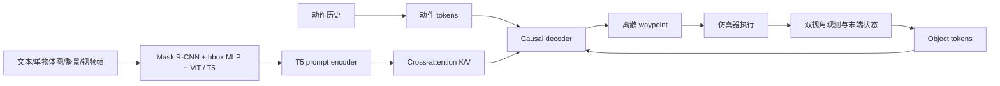
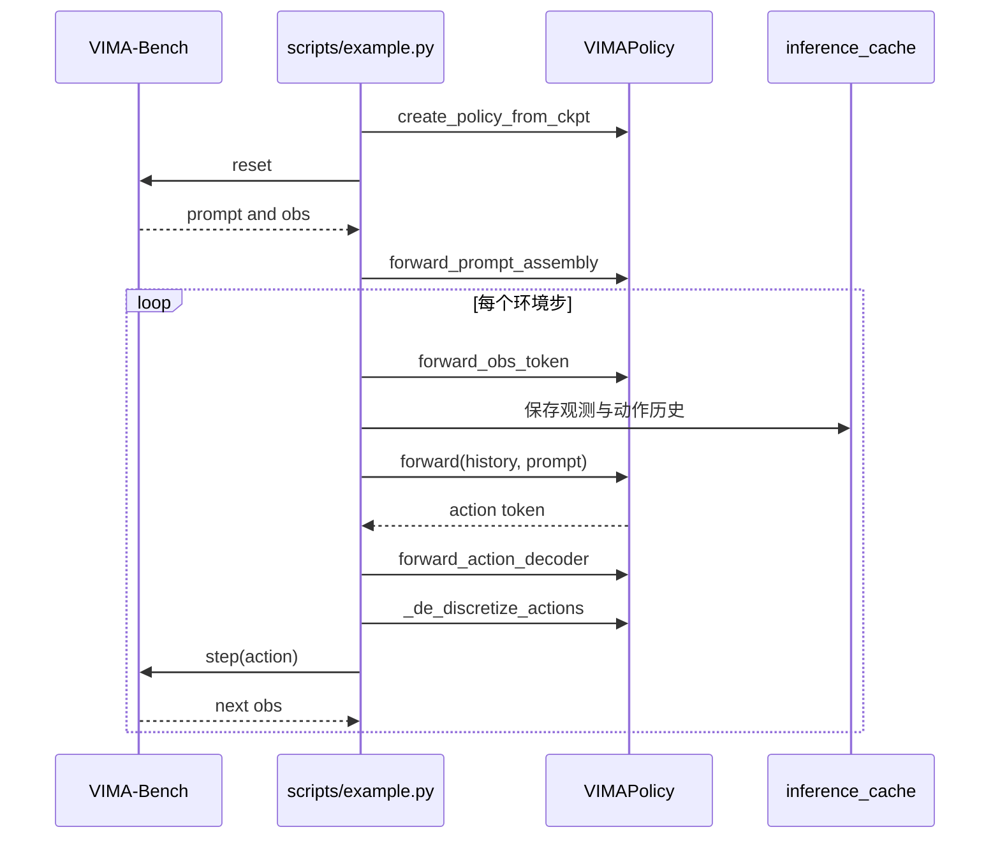

# VIMA: General Robot Manipulation with Multimodal Prompts（多模态提示的机器人操作）

VIMA（Jiang et al., [ICML 2023](https://proceedings.mlr.press/v202/jiang23b.html)，[arXiv:2210.03094](https://arxiv.org/abs/2210.03094)）将语言、图像和视频提示统一为可由单一策略接收的任务接口。对应 [官方源码](https://github.com/vimalabs/VIMA) 和 [VIMA-Bench](https://github.com/vimalabs/VIMABench)。本页沿用原策展目录条目的 canonical 路径，替换此前的摘要索引层，不另立同身份页面。

## 一句话定义

**通过对象级多模态 prompt 编码器和跨注意力因果控制器，把多种机器人桌面操作任务转成统一的离线示教动作预测任务。**

## 英文缩写速查

| 缩写 | 英文全称 | 说明 |
|---|---|---|
| VIMA | VisuoMotor Attention | 多模态提示的机器人策略 |
| VIMA-Bench | VIMA Benchmark | 17 模板桌面仿真操作基准 |
| T5 | Text-to-Text Transfer Transformer | 预训练 prompt encoder |
| BC | Behavior Cloning | 对专家示教动作进行分类监督 |
| OOD | Out of Distribution | 新物体/纹理和新任务的分布外评测 |
| ViT | Vision Transformer | 目标裁剪图的视觉特征编码 |

## 为什么重要

- 将自然语言、单个物体图、整景图和单次视频示范写成**交错提示序列**，不为每种任务另训一套网络。
- 对象中心表征让场景变化时可比较具体对象；cross-attention 在每个时刻把交互历史对齐 prompt。
- VIMA-Bench 区分 L1 位置、L2 新组合、L3 新物体、L4 新任务，避免仅报告分布内成功率。

## 核心原理

### Prompt 与观测编码

1. 使用 Mask R-CNN 将整景解析成目标实例，以 `bbox MLP + cropped ViT` 合成 object tokens；单物体图使用 dummy bbox。
2. 交错文本 token 与视觉 object tokens，经 T5-base 111M 处理，仅微调最后两层。前/俯视场景观测同样用 object tokenizer，并附末端状态。
3. 历史动作经 MLP 编码，与观测 token 序列交错组成历史 `H=(o1,a1,...,ot)`。

### 条件控制器

交替堆叠基于历史的因果自注意力与 `Q=H, K/V=Prompt` 交叉注意力，输出动作 token，并解码为抓放/擦拭等技能的离散末端 waypoint。论文附录 C.2 的位置 bins 为 x=50、y=100，旋转 bins 为 50；**不是**关节力矩或 MPC 的高频指令。

## 流程总览

## 实验与评测

- **数据**：17 个模板、6 种提示类别、650k scripted-oracle 专家轨迹，4 个任务留作 L4 新任务；训练模型扫描 2M–200M 控制器规模，T5-base 参数另计。
- **四级**：L1 位置、L2 已见视觉概念新组合、L3 新物体/纹理、L4 新任务模板。回合完成才计为成功，不是 partial reward。
- **数据规模**：92M 控制器用全部数据时 L1/L2/L3/L4 为 **79.3/80.1/81.9/49.6%**；10% 数据时为 **76.3/75.8/73.2/46.0%**（附录 E.3 Table 11），说明最高难度 L4 仍有限。
- **基线**：VIMA-Gato、VIMA-Flamingo、VIMA-GPT；摘要中的最高 2.9× 提升对应特定 L4 条件，不是所有规模都提升 2.9×。
- **消融**：object tokens 优于原图单 token / image patch；cross-attention 在小模型与 L4 更有效；T5 尺寸扩大并不总是带来额外提升。

## 与其他工作对比

- [Transformer 基础](./paper-attention-is-all-you-need.md) 解释 Q/K/V；VIMA 的区别是**历史作为 query、prompt 作为 key/value**。
- [PerAct](./paper-2209-05451-perceiver-actor.md) 侧重语言条件的三维体素关键帧，VIMA 侧重多模态任务描述和目标级 prompt。
- [Octo](./paper-octo.md) 面向多机器人观测/动作混合与扩散动作块；VIMA 面向程序化桌面操作基准上的离散 waypoint。
- [20 篇论文对照](../comparisons/attention-architectures-robotics-20-papers.md) 将其列入跨模态机器人策略路线。

## 工程实践

- 多模态 prompt 的物体检测错误会传播到策略；上机需评估遮挡、目标误检、相机视角与坐标变换。
- 原文基于 PyBullet/Ravens 的高层任务动作原语，不宜将其离散 waypoint 直接接入 1kHz 关节 PD 或力矩控制。
- **开源边界**：官方 [vimalabs/VIMA](https://github.com/vimalabs/VIMA) 是真实的算法实现，另有官方 VIMABench；模型、数据、仿真运行要严格匹配其版本。

## 源码运行时序图

核对官方仓 `scripts/example.py` 与 `vima/policy/vima_policy.py` 的推理路径：创建策略、组装 prompt、将每步 obs 编为 token、维护动作历史、解码离散动作并反馈环境。本次未运行代码或实机。

## 结论

VIMA 在其 VIMA-Bench 条件下通过对象级表示和跨注意力获得更高数据效率与零样本泛化表现，但其结果**不直接证明**真实机器人灵巧手、移动操作或力控能力。

## 局限与风险

- 依赖 Mask R-CNN，遮挡或 OOD 物体可能错检。
- 仿真任务与 scripted oracle 示教的真实度有限；只使用高层 `pick/place/wipe`，并非全身连续控制。
- 最难 L4 的成功率仍远低于已见任务；多模态 prompt 的稳健不等于物理安全闭环保证。
- **原文核对**：arXiv v2 正文与 Appendix A–H 已通读，详见 [原文精读记录](../../sources/papers/vima_arxiv_2210_03094_full_read_2026_11_20.md)。作者源码已核对推理入口，但本轮未训练/复现实验。

## 相关方法与任务

- [VLA](../methods/vla.md)：多模态条件控制架构。
- [BC with Transformer](../methods/bc-with-transformer.md)：离线示教的序列动作建模。
- [Manipulation](../tasks/manipulation.md)：桌面物体操作任务。
- [Multi-Head Attention](../concepts/multi-head-attention.md)：cross-/self-attention 机制。

## 关联页面

- [Physical AI 技术地图](../overview/awesome-physical-ai-technology-map.md)
- [VIMA/Transformer/机器人策略 20 篇](../comparisons/attention-architectures-robotics-20-papers.md)
- [PerAct](./paper-2209-05451-perceiver-actor.md)
- [Octo](./paper-octo.md)

## 参考来源

- [VIMA 官方全文与附录](https://arxiv.org/html/2210.03094)
- [VIMA 论文原文精读](../../sources/papers/vima_arxiv_2210_03094_full_read_2026_11_20.md)
- [官方算法代码](https://github.com/vimalabs/VIMA)
- [原有策展索引归档](../../sources/papers/pai_awesome_2210_03094_vima.md)

## 推荐继续阅读

- [ICML 2023 官方出版页](https://proceedings.mlr.press/v202/jiang23b.html)
- [官方 VIMA-Bench](https://github.com/vimalabs/VIMABench)
- [Octo](./paper-octo.md)
