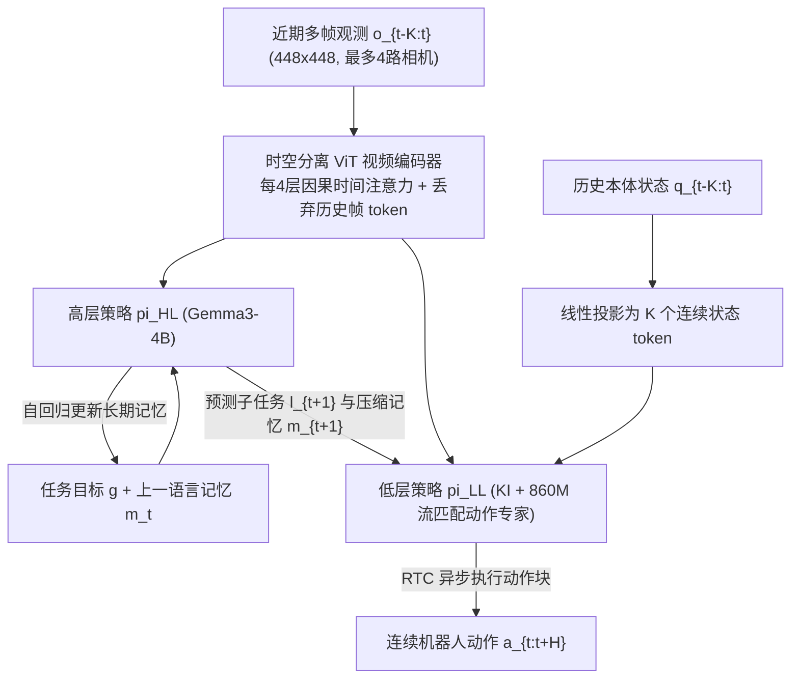

# MEM：多尺度具身记忆

## 一句话定义

MEM 用短期视频记忆保留局部动态，用长期语言记忆保留任务事件，在 VLA 延迟预算内支持分钟级长程操作。

## 英文缩写速查

| 缩写 | 英文全称 | 简要说明 |
| --- | --- | --- |
| VLA | Vision-Language-Action | 视觉和语言条件下生成动作 |
| MEM | Multi-Scale Embodied Memory | 秒级视觉与分钟级语言记忆 |
| VLM | Vision-Language Model | 高层语义理解与记忆更新模型 |
| RTC | Real-Time Chunking | 真机异步实时推理的动作块执行机制 |

## 为什么重要

- 当前观测无法回答“此前做过什么”和“物体刚才怎么动”；两类记忆需要不同分辨率。
- 把所有历史帧塞进模型会增加算力与时延，MEM 用不同尺度的表示控制成本，并保持传给 VLM 骨干的视觉 token 数量与单帧无记忆基线一致。

## 核心原理

| 记忆 | 机制 | 主要信息 |
| --- | --- | --- |
| 短期（秒级） | 在单帧 ViT 中加入固定正弦时间编码（$e(0)=0$，不新增可学习参数），每 4 层做时空分离因果注意力并在高层丢弃历史帧 token（复杂度 $\mathcal{O}(Kn^2+nK^2)$）；本体历史改用连续线性投影 | 动态、遮挡、抓取滑动与基于近期失败的上下文内自适应 |
| 长期（分钟级） | 高层策略 $\pi_{\text{HL}}(l_{t+1}, m_{t+1} \mid o_t, m_t, g)$ 更新压缩后的自然语言摘要 $m_{t+1}$（训练标注由 LLM 压缩并丢弃冗余属性及失败尝试），条件化低层策略 | 已完成步骤、配方进度、需折返关闭的柜门与跨分钟任务状态 |

论文将系统实例化为 **π₀.₆-MEM**（Gemma3-4B VLM 骨干 + 860M 流匹配动作专家，沿用 Knowledge Insulation 训练）。预训练用 6 帧（间隔 1 秒、5 秒历史）的机器人与非机器人视频字幕数据，后训练可扩展至 18 帧 / 54 秒历史；语言压缩降低历史成本与训练–推理分布偏移，但不保留精确接触几何，因此不能替代短期视频。

## 源码运行时序图

**不适用**：已通读 `arXiv:2603.03596` 全文（论文未提供 GitHub 代码或权重链接）；官网项目页 `https://pi.website/research/memory` 在本次核查时返回 HTTP 429 Vercel Security Checkpoint（反爬门禁），未尝试绕过；`Physical-Intelligence/openpi` 亦未见 MEM 训练/推理入口，故不以 `openpi` 推定 MEM 已开源。

## 工程实践

1. **评估任务设计：** 用真正需要历史的任务评估（隐藏信息、计数、计时、空间覆盖与跨分钟已完成步骤确认），同时在常规灵巧操作上检验是否受因果混淆拖累。
2. **基线与消融设置：** 比较无记忆 $\pi_{0.6}$、仅视频（去语言记忆）、仅语言（去视频记忆）、未压缩朴素语言记忆、均池化 `Pool Memory`、纯本体 `Proprio Memory` 与仅后训练引入视频编码器的 `MEM-Posttrain-Only`（论文显示记忆能力需在多样机器人+非机器人视频预训练阶段建立）。
3. **推理与数据管线：** 为防止本体历史文本 token 膨胀，改用线性投影状态 token；采用真机 RTC 异步执行并同步记录任务完成率、记忆更新错误与 H100 延迟预算。
4. **开源边界：** 原始 arXiv 论文已通读；官方训练/部署代码尚未确认公开。

## 评测与指标

论文报告最长约 **15 分钟**的厨房任务（`Recipe setup`：42 个训练配方、5 个未见厨房/物体配方评测；`Clean up kitchen`；每策略每任务 10 次 rollout），以及 `夹筷子` / `开冰箱门` 上下文内自适应与核心记忆测试集（`partial observability`、`counting`、`timing`、`spatial memory`）。实验表明：**未压缩的朴素语言记忆**会在推理反复失败时因重复指令引发训练–推理分布偏移而显著恶化；**MEM 预训练**是跨 5 秒外推到 54 秒视频记忆窗口的关键。

## 结论

**MEM 的关键是用两种模态分别保存局部动态（时空分离 ViT 视频记忆）和长期语义（经压缩的语言记忆），从而在不突破实时延迟的前提下打通分钟级任务。**

1. 用确实需要历史信息的任务测记忆价值，并用无记忆/单尺度/未压缩语言基线做逐尺度消融。
2. 记忆编码器应参与多样化的预训练，不能指望仅靠后训练临时外挂视频历史。
3. 语言记忆必须做语义压缩并丢弃冗余/失败尝试，避免推理出错时陷入分布偏移。
4. 部署时核对视觉 token 预算、本体状态编码与 RTC 异步延迟预算。

## 与其他工作对比

[Hi Robot](paper-hi-robot.md) 重点是语言指令分层和现场纠正；MEM 重点是历史状态的保留。仅靠高层拆解任务不足以证明记住已执行步骤，比较时要加入需历史信息的任务与逐尺度记忆消融。

## 局限与风险

- 长期语言记忆可能遗漏或误记事件；失误会持续影响后续动作。
- “15 分钟任务”是论文中的评测范围（视频记忆实验上限为 18 帧 / 54 秒），不代表任意跨度或跨 episode 的无限记忆。
- 当前未确认可运行官方实现，不把论文结构图当作源码运行时序图。

## 关联页面

- [π₀.₆](./paper-rcl-2511-14759-0-6-a-vla-that-learns-from-experience.md)
- [Hi Robot](./paper-hi-robot.md)
- [VLA](../methods/vla.md)
- [Knowledge Insulation](./paper-knowledge-insulation.md)

## 参考来源

- [MEM 原始论文归档（arXiv:2603.03596）](../../sources/papers/mem_arxiv_2603_03596.md)
- [PI 一手资料补核](../../sources/sites/pi-memory-rlt-fast.md)

## 推荐继续阅读

- [MEM 论文（arXiv:2603.03596）](https://arxiv.org/abs/2603.03596)
- [MEM 项目页](https://www.pi.website/research/memory)
