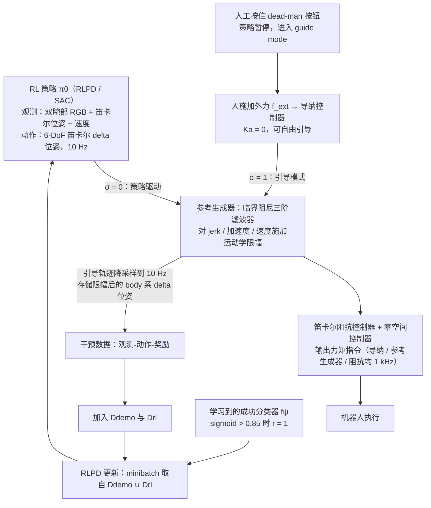

# PAKT（arXiv:2609.25630）

**PAKT**（*PAKT: Physically-Aligned Kinesthetic Teaching for Reinforcement Learning*，[arXiv:2609.25630](https://arxiv.org/abs/2609.25630)，[项目页](https://pakt-website.github.io/pakt-website)）来自 [具身智能小站 12 篇盘点](../../sources/blogs/wechat_embodied_station_12_papers_collab_wm_2026-09-23.md)。

## 一句话定义

**导纳控制把人施加力映射为动作，经与策略相同运动学限制的参考轨迹 + 1 kHz 阻抗控制执行。**

## 英文缩写速查

| 缩写 | 英文全称 | 简要说明 |
|------|----------|----------|
| PAKT | Physically-Aligned Kinesthetic Teaching | 本文物理对齐动觉示教 |
| RL | Reinforcement Learning | 强化学习 |
| HIL-SERL | Human-in-the-Loop SERL | 人机协同 SERL 基线 |
| TCP | Tool Center Point | 工具中心点 |

## 为什么重要

- 接触丰富工业装配需要可安全直观的人类引导，且示范必须与策略执行栈物理对齐。
- 开源结论：**待发布**（步骤 2.5，2026-09-23）。
- 与 [12 篇技术地图](../overview/collab-wm-12-papers-technology-map.md) 中同类工作可横向对照。

## 流程总览

图依据：论文 §3.1–3.3（Fig. 1、Eq. 3–12）

## 核心机制

| 项 | 内容 |
|----|------|
| **arXiv** | [2609.25630](https://arxiv.org/abs/2609.25630) |
| **开源** | **待发布** |
| **要点** | 约束导纳 kinesthetic teaching + 三阶参考生成器 + 1 kHz Cartesian impedance；相对 HIL-SERL 降周期与干预。 |
| **文内指标** | 四插入/装配基准：周期时间 −23%–48%，累计干预次数 −62%–86%（依据 arXiv:2609.25630v1 摘要与 §4、表 3）。 |

## 源码运行时序图

**不适用**（入库日模型/训练权重未公开，或仅有 API/CLI 封装；无可运行官方训练/推理入口。）

## 实验与评测

- 四插入/装配基准：周期时间 −23%–48%，累计干预次数 −62%–86%（依据 arXiv:2609.25630v1 摘要与 §4、表 3）。
- **读法：** 索引级摘要；逐项对照与 baseline 以原文 PDF 为准。

## 与其他工作对比

- 横向索引见 [12 篇技术地图](../overview/collab-wm-12-papers-technology-map.md)；与同 arXiv 节点不重复造页。

## 结论

**PAKT 把「人类手把手」变成与 RL 策略同构的可执行轨迹；项目页交互 demo 丰富但代码未发布。**

1. 开源边界：**待发布** — 以项目页实际链接为准（入库日 2026-09-23）。
2. 核心机制：约束导纳 kinesthetic teaching + 三阶参考生成器 + 1 kHz Cartesian impedance；相对 HIL-SERL 降周期与…
3. 部署前核对任务协议与硬件条件，勿直接横比公众号摘录数字。

## 关联页面

- [reinforcement-learning](../methods/reinforcement-learning.md)
- [imitation-learning](../methods/imitation-learning.md)
- [manipulation](../tasks/manipulation.md)
- [paper-better-curriculum](./paper-better-curriculum.md)

## 参考来源

- [pakt_arxiv_2609_25630.md](../../sources/papers/pakt_arxiv_2609_25630.md)
- [wechat_embodied_station_12_papers_collab_wm_2026-09-23.md](../../sources/blogs/wechat_embodied_station_12_papers_collab_wm_2026-09-23.md)
- [arXiv:2609.25630](https://arxiv.org/abs/2609.25630)
- [arXiv PDF](https://arxiv.org/pdf/2609.25630)：已通读方法部分（实验与附录以略读为准）：§3 Methods（3.1–3.3）、§2 相关工作
- 核对（2026-11-02）：对照 arXiv:2609.25630v1 摘要、§4 与表 3（累计干预数 62%–86%，周期 23%–48% 无误）；将「干预 −60%–85%」改为 62%–86%。

## 推荐继续阅读

- [arXiv PDF](https://arxiv.org/pdf/2609.25630)
- [项目页](https://pakt-website.github.io/pakt-website)

