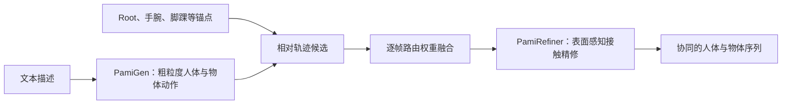

# PAMI：部位锚定的人-物交互动作生成

**PAMI**（*Part Anchored Motion for Text to Human-Object Interaction Generation*，Li 等，2026，arXiv:[2609.38466](https://arxiv.org/abs/2609.38466)，[项目页](https://coral79.github.io/pami/)）根据文本生成全身人体与物体的协同动作：多个身体部位锚点各自提出物体相对运动候选，模型逐帧融合候选，再由精修器改善局部动作和接触。

## 英文缩写速查

| 缩写 | 英文全称 | 简要说明 |
|---|---|---|
| PAMI | Part-Anchored Motion for Interaction | 用身体部位锚点生成文本条件人-物交互动作的方法 |
| HOI | Human-Object Interaction | 人体与物体之间的协同运动和接触 |
| VAE | Variational Autoencoder | 学习动作序列潜在表示的生成模型 |
| SMPL-X | SMPL eXpressive | 包含手部与面部参数的人体模型族 |
| FID | Fréchet Inception Distance | 分布相似性指标；数值越低通常越好 |

## 为什么重要

不少人-物动作生成器把人体和物体轨迹分开建模，物体即使在视觉上跟随动作，也可能漂离实际抓握或支撑位置。PAMI 把身体部位作为运动参照，直接让身体动作对物体轨迹提出候选，再学习哪些部位在不同帧更值得信任。对交互生成而言，这将接触关系带入运动表示本身，而不只在生成之后用几何损失补救。

## 流程总览

## 部位锚点为物体运动提供参照

- 物体轨迹不单独作为自由运动序列预测；锚点分别提供物体相对于自身的位移候选。
- 候选锚点涵盖身体 root、手腕和脚踝等位置。不同交互与时间帧可由不同身体部位主导。
- 学习到的逐帧路由权重将多个相对轨迹意见聚合为物体运动。这样，手持物体时手腕可成为主要参照，脚踢或脚踩物体时则可由脚踝贡献。
- “投票”是对这种多锚点候选加权融合的直观描述；它不是离散的人类标注投票机制。

## 粗到细的生成与接触精修

PAMI 的方法由表示学习、文本条件生成和局部精修组成。项目页命名的模块包括 PamiVAE、PamiGen 与 PamiRefiner。前者为动作表示提供潜在空间，PamiGen 由文本生成粗粒度的人体与物体运动，PamiRefiner 再使用表面感知线索修正局部姿态和接触质量。其重点是让初始生成既有动作语义，也保留后续接触修正的空间。

## 评测与结果读法

- 作者报告在 **InterAct** 基准上，PAMI 的接触召回率比此前最佳方法高 **14.5%**。这是相对增幅的原文式表述；没有来源依据时不应换算成 14.5 个百分点。
- 该结果支持部位锚点与精修对接触相关质量的价值，但单项接触指标不能代替动作语义、多样性、物体轨迹平滑性或真实机器人执行表现。
- 当前归档保留论文的基准结论；在官方评估脚本发布前，复现条件和指标细节仍需以论文与后续仓库版本核对。

## 与相邻路线对比

| 路线 | 任务方向 | 人-物关系表示 | 输出 |
|---|---|---|---|
| **PAMI** | 文本条件前向生成 | 身体部位锚点的物体相对轨迹 + 接触精修 | 人体与物体动作序列 |
| [COINS](./paper-coins-compositional-human-scene-interaction.md) | 场景条件交互合成 | action-object 语义组合与场景几何 | 静态 SMPL-X 交互姿态 |
| [单目 HOI 重建](./paper-notebook-efficient-and-scalable-monocular-human-object-in.md) | 视频驱动后向重建 | 稀疏接触与 4D 优化 | 人-物交互运动数据 |

PAMI 与后两者的问题设定不同：它从文字合成时序动作；COINS 聚焦场景中的静态姿态组合，单目重建则从已有视频恢复轨迹。

## 工程实践与局限

- **源码状态：** 官方仓库已建立，但截至 2026-10-15，数据预处理、权重、推理、训练和评估代码均在 README 中列为待发布。仓库目前不能支持完整复现，状态应记为“可发现官方仓库，运行实现待发布”。
- **数据与资产：** 论文围绕 InterAct 等人-物交互动捕数据及 SMPL-H / SMPL-X 表示。数据集、人体模型和物体资产的获取与许可需分别核查。
- **应用边界：** PAMI 生成的是虚拟人体与物体运动序列，不直接输出机器人关节指令、控制策略或动力学可行性保证。将动作迁移到人形机器人仍需身体映射、接触约束和闭环跟踪验证。

## 源码运行时序图

**不适用：** 截至 2026-10-15，官方仓库 README 将数据准备、模型权重、推理、训练与评估列为待发布项，尚无可辨识的运行入口。

## 结论

**PAMI 的关键选择是把物体运动绑定到身体锚点提供的相对运动候选，再用接触精修处理局部误差；其论文结果显示这条表示路线有利于提升接触召回，但当前代码状态限制了独立复现。**

- 评估方法时优先看接触召回与接触精修前后的变化；14.5% 是相对提升表述，不要误写成百分点。
- 若关心动作自然度或多样性，应同时检查完整评测表、可视化样例和失败案例，不能由单一接触指标推出全面领先。
- 复现前等待官方仓库补齐数据脚本、权重与评估入口，再核对 InterAct 访问条件及 SMPL 资产许可。
- 对机器人应用，把 PAMI 视为人-物动作先验；另行设计机器人形态映射、碰撞/接触约束及闭环运动跟踪。

## 关联页面

- [人体动作论文索引](../overview/paper-notebook-category-14-human-motion.md) — 人体动作生成与交互相关工作入口
- [COINS](./paper-coins-compositional-human-scene-interaction.md) — 基于 action-object 语义组合的静态人-场景交互生成
- [单目人-物交互动作重建](./paper-notebook-efficient-and-scalable-monocular-human-object-in.md) — 从视频恢复交互轨迹，和 PAMI 的前向生成问题互补

## 推荐继续阅读

- [PAMI 项目页](https://coral79.github.io/pami/) — 方法概览与演示
- [PAMI 论文](https://arxiv.org/abs/2609.38466) — 完整模型和评测细节
- [PAMI-Code](https://github.com/Coral79/PAMI-Code) — 官方发布状态与后续代码入口
- [InterAct 数据集仓库](https://github.com/wzyabcas/InterAct) — 数据集说明与获取入口

## 参考来源

- [论文来源归档](../../sources/papers/pami_arxiv_2609_38466.md) — 论文要点与 wiki 映射
- [项目页归档](../../sources/sites/pami-project.md) — 项目页方法与开源状态
- [官方仓库归档](../../sources/repos/pami-code.md) — 代码、权重与运行入口状态
