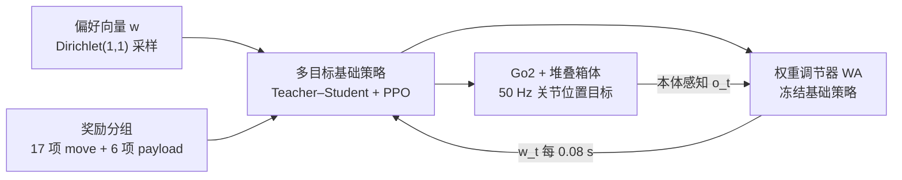

# PAMORT：用多目标强化学习运输未固定的堆叠载荷

**PAMORT**（论文 *Transporting Unsecured Stacked Payloads with a Quadrupedal Robot via Multi-Objective Reinforcement Learning*，[arXiv:2610.05819](https://arxiv.org/abs/2610.05819)）来自 **富士通（Fujitsu Limited）**：在 Unitree Go2 躯干板上堆放不固定的箱子，用“运动 vs 载荷稳定”两组奖励训练一个以偏好向量为条件的策略，再训练一个只看本体感知的权重调节器在线改变偏好。

## 一句话定义

**把“走得快”与“箱子不掉”拆成两个奖励目标，训练出一个随偏好向量连续变化的四足策略，再用一个小网络根据本体感知在线挑选偏好。**

## 英文缩写速查

| 缩写 | 英文全称 | 简要说明 |
|------|----------|----------|
| PAMORT | 论文方法名（原文给出缩写，展开未在摘要中核实） | 多目标基础策略 + 权重调节器 |
| MORL | Multi-Objective Reinforcement Learning | 多目标强化学习，奖励按目标分组而非单标量 |
| WA | Weight Adjuster | 冻结基础策略后训练的在线偏好调节网络 |
| TAR | 论文采用的 Teacher–Student 地形适应骨干（原文缩写） | 基线 TAR* 即其加载荷项的单标量版本 |
| PPO | Proximal Policy Optimization | 训练算法，优势按目标分别标准化 |

## 为什么重要

- 四足“背货”场景中，机器人稳定与载荷稳定是两件事；单一标量奖励的固定权重在不同地形上要么牺牲速度、要么掉箱子。
- 无需载荷传感器或夹持机构：调节器只读机器人自身本体感知，部署门槛低。
- 偏好向量让一个策略覆盖整条运动-载荷折中曲线，可与人手工选权重的做法比较（论文给出 oracle 对照）。

## 核心信息

| 项 | 内容 |
|----|------|
| **机构** | 富士通（Fujitsu Limited，日本川崎） |
| **平台** | Unitree Go2 + 躯干上 0.4 m × 0.4 m 刚性板 |
| **训练** | Isaac Lab；基础策略 16,384 环境 / 8 GPU；130k 迭代；50 Hz |
| **开源** | arXiv 与正文均未列项目页或仓库；截至 2026-10-12 未发布 |

## 方法栈 / 流程总览

## 方法

- **偏好向量与奖励：** w = [w_move, w_payload] 在 1-单纯形上，训练时按 Dirichlet(1,1) 采样。move 组含速度跟踪、关节/动作正则、步态与不期望接触共 17 项；payload 组含底/顶箱姿态对齐、平面加速度及掉落惩罚（底箱 −150，顶箱 −100）共 6 项。
- **基础策略：** 基于 TAR 框架的 Teacher–Student：教师 MLP [256,128,64] 读 195 维特权观测；学生 1 层 LSTM（256）从 45 维本体感知得到 64 维潜变量；另有速度估计 MLP [64,32]。actor MLP [512,256,128] 输入本体感知、潜变量、速度估计与 w，输出 12 个关节位置目标；critic 每个目标一个价值头。
- **多目标 PPO：** 各目标优势分别标准化后以 Ã = wᵀA 合成。
- **偏好感知课程：** 用偏好加权的几何平均衡量能力，≥0.8 升地形、≤0.5 或摔倒降地形；训练地形最大为 40% 坡与 15 cm 台阶。
- **权重调节器：** 冻结基础策略后训练 5,000 次迭代，输入 o_t、潜变量、速度估计与上一时刻 w，softmax 输出新 w；每 4 个低层步更新，平滑项 λ_t‖w_t − w_{t−1}‖²，λ_t∈[0.02,0.5]。
- **载荷：** 仿真中底箱 0.2–4 kg、顶箱 0.1–2 kg，训练只含两箱；真机两箱（1.24 kg + 2.33 kg）与未见的三箱堆叠（1.25/1.43/0.86 kg）。

## 源码运行时序图

**不适用** — 截至 2026-10-12，arXiv 页面与 HTML 全文均无官方代码仓库或项目页链接，无可对齐的目录与脚本。

## 实验与评测

- **仿真：** 地形等级 0–9（最高为训练最大值的 1.5 倍），每级 100 次试验，指令 1 m/s 走 10 m、限时 15 s，成功指到终点且无摔倒与掉箱。平均成功率 TAR* vs PAMORT：0 载荷 0.782 / 0.801；1 载荷 0.723 / 0.758；2 载荷（训练）0.650 / 0.687；3 载荷（未见）0.530 / 0.550。SlopeDown 与 NarrowStairsDown（两载荷）上 PAMORT 略低。
- **对 oracle：** 对每个地形与载荷条件选最优固定偏好的 oracle 均值 0.738，PAMORT 0.699（94.7%）；三载荷 0.550 vs 0.570（96.5%）。
- **真机（每任务 10 次，含上下行）：** 38% 坡两载荷 1.0 vs 0.6、三载荷 0.9 vs 0.7；44% 坡 0.9 vs 0.5、0.9 vs 0.6；16 cm 台阶 1.0 vs 0.9、0.8 vs 0.7；20 cm 台阶 0.6 vs 0.6、0.7 vs 0.8（PAMORT 在最后一格落后）。均值两载荷 0.875 vs 0.650，三载荷 0.825 vs 0.700，总计 0.850 vs 0.675。
- **推理：** 基线 0.4 ms，PAMORT 含 WA 0.5 ms，控制周期 20 ms。
- **偏好扫描：** 固定 w_payload < 0.4 时常掉载荷（论文的 MO 分析）。

## 结论

**多目标偏好 + 在线调节让同一个四足策略在坡与台阶上更少掉箱子，且零样本泛化到未见的三箱堆叠；提升主要在坡道，高台阶仍未解决。**

1. 真正的收益指标是“到达且不掉箱”的成功率，而不是速度跟踪误差；真机总体 0.850 vs 0.675。
2. 仿真收益较小（0.01–0.04 量级），真机收益更大，需注意真机每任务仅 10 次试验。
3. 20 cm 台阶、SlopeDown、NarrowStairsDown 上并无优势，说明偏好调节对大冲击事件帮助有限。
4. 调节器与基础策略分开训练、只读本体感知，推理开销 0.1 ms 量级，易并入现有 Teacher–Student 栈。
5. 与 oracle 的差距（约 95%）给出了调节器的上限参照；想进一步提升需更强的状态或载荷感知。
6. 部署前需复现载荷奖励设计与课程；原文没有代码，不能当作开箱即用方案。

## 与其他工作对比

| 对照 | 差异读法 |
|------|----------|
| [Gait-Dependent Load Carrying](./paper-gait-dependent-load-carrying-quadruped.md) | 该文用被动机构与步态选择；PAMORT 是学习式策略，载荷未固定 |
| [Legged Load Adapt](./paper-legged-load-adapt-unknown-dynamic-load.md) | 针对未知动态负载的适应；PAMORT 针对未固定且会倒的堆叠箱体，并显式折中两目标 |
| [Feeling Through the Load](./paper-feeling-through-the-load-compliant-quadruped.md) | 同周同类平台；后者关注人与载荷的力交互，PAMORT 关注地形上的载荷稳定 |
| [Teacher–Student / DAgger](../methods/teacher-student-dagger-training.md) | PAMORT 沿用 Teacher–Student 地形适应结构，新增偏好条件与调节器 |

## 局限与风险

- 仅刚性箱体、仅两个目标组；多目标扩展为开放问题（原文）。
- 真机每任务 10 次、木质托盘地形，统计力度有限；基线为作者自制的固定权重 TAR*。
- 开源状态：截至 2026-10-12 无仓库、无权重、无项目页。
- 摘要提到的“三箱”是对未见配置的零样本测试，但只涉及箱体质量与尺寸变化，未涉及柔性或液体载荷。

## 关联页面

- [人形与四足周报 2026-10-05 至 10-09](../overview/frontier-humanoid-quadruped-2026-10-05-10-09.md)
- [Locomotion 任务页](../tasks/locomotion.md)
- [四足机器人](./quadruped-robot.md)
- [Legged Load Adapt](./paper-legged-load-adapt-unknown-dynamic-load.md)
- [Gait-Dependent Load Carrying](./paper-gait-dependent-load-carrying-quadruped.md)
- [Feeling Through the Load](./paper-feeling-through-the-load-compliant-quadruped.md)

## 参考来源

- [PAMORT 论文归档](../../sources/papers/pamort_arxiv_2610_05819.md)
- [人形/四足周报来源](../../sources/blogs/frontier_humanoid_quadruped_2026_10_05_10_09.md)
- [arXiv:2610.05819](https://arxiv.org/abs/2610.05819)

## 推荐继续阅读

- [arXiv HTML 全文](https://arxiv.org/html/2610.05819v1)
- [Isaac Lab 文档](https://isaac-sim.github.io/IsaacLab/)
