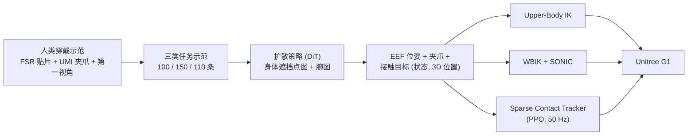

# PanTact：用可穿戴接触接口教人形机器人全身操作

**PanTact**（[arXiv:2610.12558](https://arxiv.org/abs/2610.12558)，[项目页](https://pantact.github.io/)）由 Stanford、Amazon FAR 与 CMU 的作者提出：人类穿戴接触贴片做示范，策略学“哪里、何时接触”，由机器人控制器决定用自己的哪个表面去实现这些接触，最终在 Unitree G1 上完成手臂支撑、扫入、推柜门、双臂+腿分担负载等任务。

## 一句话定义

**以接触（位置与时机）作为人机共享的任务接口：人类示范记录接触，策略预测接触目标，控制器按机器人本体选择接触面。**

## 英文缩写速查

| 缩写 | 英文全称 | 简要说明 |
|------|----------|----------|
| FSR | Force-Sensitive Resistor | 贴片内的力敏电阻，二值化后记录接触 |
| UMI | Universal Manipulation Interface | 无机器人手持夹爪式示范接口 |
| WBIK | Whole-Body Inverse Kinematics | 全身逆运动学 QP，输出稠密参考给 SONIC |
| QP | Quadratic Program | IK 所用二次规划 |
| DiT | Diffusion Transformer | 策略的去噪头 |
| PPO | Proximal Policy Optimization | 训练稀疏接触跟踪器的 RL 算法 |

## 为什么重要

- **突破“只用手”：** 把前臂、膝盖等表面纳入操作，覆盖手抓不住的大体积物体。
- **示范与本体解耦：** 人类只需记录接触，机器人本体差异在控制端消化。
- **控制器三选一有取舍数据：** 无训练的 IK、稠密跟踪、稀疏接触 RL 各有适用任务。

## 流程总览

## 方法

- **接触贴片：** 44×44 mm 模块，1 个 FSR，最多 16 路、1 kHz，RS-485 菊花链，自适应基线二值化（抗温漂）；覆盖前臂与膝盖；磁吸可挂 Vive tracker。其余传感：头戴 ZED X Mini、两路鱼眼腕相机、Vive 追踪、UMI 夹爪宽度，记录于 Jetson AGX Orin。
- **策略：** DiT 扩散策略（10 层、768 宽）、微调 DINOv3；10 Hz、H=16、历史 2；输入身体遮挡点图与腕图，输出头注视点、EEF 位姿、夹爪、各传感器接触目标。身体区域由夹爪与贴片定义的半空间交集近似，在注意力中遮挡，以缓解人机观察差异。
- **接触到本体：** 平滑最小距离（温度 0.02 m）把命令接触点与候选机器人本体对齐，并沿物体方向加虚拟位移产生按压。
- **控制器：** Upper-Body IK（EEF 500 / 姿态 200 / 接触 250 权重，腿站立）；WBIK + SONIC（QP 加步进逻辑，交 [SONIC](../methods/sonic-motion-tracking.md) 执行）；Sparse Contact Tracker（PPO 30,000 迭代、4096 环境、50 Hz、29 关节 PD 目标，用 SONIC rollout 事后标注接触训练）。
- **定位：** G1 头部 LiDAR-惯性单元 + Super Odometry。

## 源码运行时序图

**不适用。** 项目页 Code 徽章链接为空，arXiv 页未列仓库，截至 2026-10-12 无官方可运行代码，无法对齐目录或脚本。

## 实验与评测

| 任务 | 对应能力 | 方法 | 结果 |
|------|----------|------|------|
| Grasp-and-Embrace（20 次） | 臂支撑（非抓握） | Upper-Body IK | 85% |
| | | Sparse Contact Tracker | 80% |
| | | Humanoid UMI | 无法支撑大体积物体（正文无数值；项目页 0%） |
| Sweep-and-Stow（16 次） | 臂扫、腿推柜 | WBIK + SONIC | 90.63% 端到端得分 |
| | | Humanoid UMI++ | 正文无数值（项目页 0%） |
| Carry-and-Push（10 次） | 双臂分担 + 腿推 | WBIK + SONIC | 90% |
| | | Humanoid UMI++ | 正文无数值（项目页 40%） |

Sweep-and-Stow 评分为扫入物体数量得分与柜门闭合得分之积；关门未超过一半可得 50% 部分分、超过一半得 100%。因此 90.63% 是带部分分的端到端得分，不能直接解释为完整成功的试次比例。Carry-and-Push 成功要求手持箱不掉且地面箱移动超过 20 cm。

**控制器回放比较（10 条 Grasp-and-Embrace 上身轨迹 + 20 条全身轨迹）：** 加入接触目标后各控制器接触距离均降低且末端代价小；Upper-Body IK 上身末端误差最低；Sparse Tracker 接触距离最低，并在上身两项指标上胜过 WBIK+SONIC，但在全身任务上末端误差更高。数值仅在图中，未读取。

## 结论

**把接触当作人机共享接口可行，但控制器选择决定成败：上身任务用无训练 IK 就够，需要腿部接触时要用稠密跟踪，稀疏 RL 以更高末端误差换更低接触距离。**

1. 固定腿部的上身任务可先试 Upper-Body IK：该实验获得 85%，无需为控制器训练。
2. WBIK + SONIC 在两个全身任务中分别取得 90.63% 得分和 90% 成功率；稠密参考可能产生与任务无关的姿态约束。
3. 在 Grasp-and-Embrace 实验中，仅跟踪末端的 Humanoid UMI 基线无法支撑大物体；该结果不证明所有方法都必须显式预测接触目标。
4. 人机观察差异靠遮挡身体区域处理，不需要机器人外观模型。
5. 数据量不大（100–150 条/任务），但测试每条件仅 10–20 次，不要外推。
6. 复现需要自制 FSR 贴片与多相机采集，项目页尚无硬件或代码。

## 局限与风险

- **开源状态：待发布。** 项目页 Code 徽章为空链接，arXiv 页无仓库（[pantact-project.md](../../sources/sites/pantact-project.md)）。
- 无独立局限节：Upper-Body IK 仅限上身；WBIK+SONIC 可能给出动力学不可行的参考；Sparse Tracker 依赖仿真训练分布。
- 失败模式含夹爪抓空、柜门未关全、追踪死区、臂接近关节极限、累积漂移；人机比例差异使部分膝部目标难实现。
- 传感器总数、虚拟目标力/刚度参数、传感器漂移鲁棒性未报告；无多种子统计。
- 基线数值在正文与项目页之间不完全一致，上表已分别标注。

## 与其他工作对比

| 对照 | 差异读法 |
|------|----------|
| [HumanoidUMI](./paper-humanoidumi.md) | 同样用 UMI 式无机器人采集；PanTact 增加接触贴片并预测接触目标 |
| [WT-UMI](./paper-loco-manip-07-wt-umi.md) | 全身触觉接口采集接触力，侧重力监督与导纳控制 |
| [SONIC](../methods/sonic-motion-tracking.md) | 本文把它作为稠密全身跟踪器和稀疏跟踪器的数据来源 |
| [接触丰富操作](../concepts/contact-rich-manipulation.md) | 本文把接触位置/时机而非力作为接口 |

## 工程实践

| 项 | 建议 |
|----|------|
| 示范设备 | 贴片按基线自适应二值化，避免绝对阈值被温漂影响 |
| 观察对齐 | 遮挡人体区域而非仿真机器人外观 |
| 控制器选型 | 先 Upper-Body IK 验证接触目标，再上全身方案 |
| 时延 | 异步推理，丢弃过期动作 |

训练数据先对齐至 60 Hz，再以 20 Hz 采样；策略以 10 Hz 预测动作块，调度器丢弃过期步骤并重采样至跟踪器 50 Hz。接触跟踪器训练时用 SONIC 仿真轨迹事后采样可达接触目标，不能将其视为直接从人体接触数据训练的底层控制器。

## 关联页面

- [34 篇空间落地论文技术地图](../overview/embodied-station-34-papers-spatial-grounding-technology-map.md) — 本文所在盘点
- [人形 loco-manipulation](../tasks/loco-manipulation.md)
- [全身控制](../concepts/whole-body-control.md)
- [SONIC](../methods/sonic-motion-tracking.md)
- [HumanoidUMI](./paper-humanoidumi.md)

## 参考来源

- [微信盘点：具身智能小站 34 篇（2026-10-12）](../../sources/blogs/wechat_embodied_station_34_papers_spatial_grounding_2026-10-12.md)
- [pantact_arxiv_2610_12558.md](../../sources/papers/pantact_arxiv_2610_12558.md) — 论文摘录
- [pantact-project.md](../../sources/sites/pantact-project.md) — 项目页核查
- [arXiv:2610.12558](https://arxiv.org/abs/2610.12558)

## 推荐继续阅读

- [PanTact 项目页](https://pantact.github.io/)
- [arXiv HTML 全文](https://arxiv.org/html/2610.12558v1)
