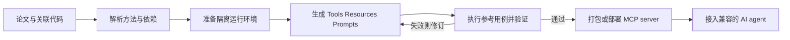
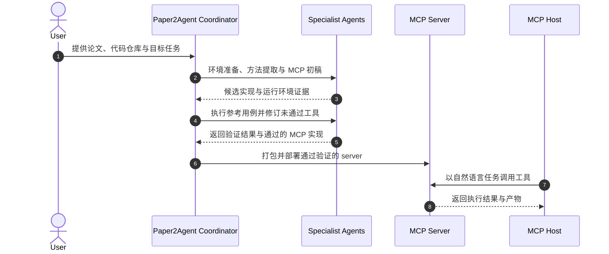

# Paper2Agent：把研究论文编译成可调用的 AI agent

**Paper2Agent**（Miao et al., Nature 2026，DOI [10.1038/s41586-026-11044-y](https://doi.org/10.1038/s41586-026-11044-y)）是一个多 agent 工作流：读取论文及其代码，将方法、数据入口和分析步骤封装为 MCP 服务与 paper-specific skill，再通过执行测试检查生成的工具是否能复现参考行为。

## 一句话定义

**Paper2Agent 把论文从供人阅读的静态资料转成能由 AI agent 用自然语言调用、并经过代码级测试的研究工具集合。**

## 英文缩写速查

| 缩写 | 英文全称 | 简要说明 |
|------|----------|----------|
| MCP | Model Context Protocol | 将论文方法、资源与工作流作为标准化工具接口暴露给 agent |
| LLM | Large Language Model | 负责理解请求、规划步骤并调用生成工具的模型 |
| API | Application Programming Interface | 被包装进 MCP 工具的原有代码接口或服务接口 |
| RAG | Retrieval-Augmented Generation | 以论文、补充材料与代码作为可检索依据；仅检索本身不等于能执行方法 |

## 为什么重要

- **减少“读懂论文后还得自己接线”的成本：** 使用者可把新数据交给 paper agent，按自然语言发起分析；底层仍调用论文关联的真实代码与资源。
- **将复现检查纳入生成流程：** 测试 agent 对照论文示例、预期文件、数值容差或图像结果检查工具，失败的工具可被修订或排除，而不是仅凭代码看起来合理就发布。
- **支持跨论文组合：** 多个 paper MCP 可连到同一个 agent，让方法论文与数据论文的工具共同参与分析，形成可审查的多论文研究流程。
- **适用于具身研究资料：** 同一模式可将机器人论文的仿真、评测或数据预处理入口包装为可询问的工具，但是否可用仍受依赖、机器人资产、数据许可与硬件门槛约束。

## 核心原理

Paper2Agent 将论文理解、环境构建、方法封装和验证分工处理。其 MCP server 可包含三类内容：

| 组件 | 用途 | 在研究流程中的例子 |
|------|------|------------------|
| **Tools** | 调用可执行的论文方法 | 输入数据路径，运行一个分析或预测函数 |
| **Resources** | 提供可查询的静态材料 | 论文、补充材料、数据说明、代码资源 |
| **Prompts** | 固化可复用的多步操作流程 | 按顺序执行质控、标准化、聚类与注释 |

### 流程总览

关键设计是把「生成」与「验证」分开：LLM 提出的接口必须绑定到现有仓库代码，测试结果需与参考行为核对。方法不存在可运行实现时，系统仍可暴露论文/材料资源，但不能把资源检索表述成已经复现了算法。

## 源码运行时序图

仓库公开 `skills/paper2agent/` 的入口，并按 Paper2Skill 与 Paper2MCP 子流程生成 skill / server。该图概括论文工作流；部署方式、模型与项目仓库特定的依赖由对应产物的 `USAGE.md` 再确认。

## 实验与评测

论文报告了若干互补评测，分别衡量工具构建、任务执行和仅资源检索时的能力：

| 评测范围 | 论文报告 | 解读 |
|---------|---------|------|
| 100 篇计算生物学论文 | 74 篇成功 agent 化；生成 599 个工具，593 个通过自动验证 | 生成成功率受代码、数据、依赖及脚本泛化能力限制 |
| 300 个教程衍生问题 | Paper2Agent 准确率 91.2±1.6% | 高于直接让 Claude Code 访问论文与仓库的基线（80.3±2.3%） |
| 10 篇非生物计算论文的 42 个执行任务 | 准确率 98.1±0.8% | 表明执行型工具路线不局限于计算生物学，样本范围仍有限 |
| 26 篇数据/发现型论文的 100 个综合题 | 资源层准确率 89.0±3.1% | 无法生成执行工具时，结构化材料仍有用，但能力属于问答与综合 |

案例包括 AlphaGenome、Scanpy 与 TISSUE。不同数据集和任务集的结果不可横向合并为单一“科学能力”分数；论文结论应按可执行工具层和资源检索层分别理解。

## 与其他工作对比

| 路线 | 主要能力 | 关键差别 |
|------|----------|----------|
| 直接让通用 coding agent 访问论文和仓库 | 按请求临时查代码、写脚本并执行 | 无预先封装与专用测试层；基线在教程衍生问题上准确率为 80.3±2.3% |
| 论文文本 RAG / 浏览问答 | 检索论文和资料并生成说明 | 可解释文本，但通常不直接执行原仓库中的方法流程 |
| Paper2Agent | 生成 paper skill 与 MCP 工具并对参考用例自动验证 | 将可执行流程持久化并提供标准接口；仍受原代码质量、依赖和测试覆盖限制 |

这一比较区分了“能解释论文”“能临时编写代码”和“能以可追溯工具调用原方法”三种能力，评测数字仅在论文各自的任务集上成立。

## 结论

**Paper2Agent 的主要价值在于把“论文理解—代码调用—结果核对”变成可复用接口；可靠性来自具体工具的验证证据，而不是 agent 对论文的流畅复述。**

1. 先确认目标论文有可运行代码、数据与明确的输入输出；它们决定是否能生成执行型工具。
2. 把工具级通过率、结果容差和产物检查与整篇论文结论分开记录，不能以少量示例通过推断全部方法均已复现。
3. 新数据分析须检查输入假设、单位、预处理和依赖版本；源论文示例验证不能保证所有外部数据有效。
4. 组合多个 paper agent 时保留每个工具的来源和输出链，避免上游不确定性被下游合成掩盖。
5. 机器人方向部署需另行验证仿真器/驱动、机器人资产、控制频率、算力和安全约束；论文中生物计算案例不构成机器人真机能力证据。

## 局限与风险

- **代码可用性决定上限：** 论文指出常见失败包括缺少可执行代码、数据或模型资产、依赖配置失败，以及只能在单个示例运行的脚本。
- **验证范围有限：** 工具验证对齐选定示例及参考输出，不能证明模型假设正确、科研结论成立或未见输入下无偏。
- **环境与凭据成本：** 生成 agent 可能需要 GPU、专有数据、API 密钥或原研究依赖；MIT 仓库许可不改变这些上游约束。
- **在线站点的职责边界：** 官方网站将工作流入口指向 GitHub；详细安装和可复现步骤以仓库中的 skill 与产物说明为准。
- **机器人迁移需实测：** 论文主要示例来自计算生物学，面向机器人代码仓的效果仍需专门的运行、数值和硬件验证。

## 关联页面

- [AI Auto-Research（学术研究自动化）](../concepts/ai-auto-research.md) — 将 Paper2Agent 放入研究全生命周期自动化与人机共治框架。
- [Model Context Protocol（MCP）](../concepts/model-context-protocol.md) — Paper2Agent 生成工具、资源和 prompt 的互操作协议。
- [ScienceDiscovery](./sciencediscovery.md) — 文献与专业工具协同的科研工作台，对照论文级工具生成路线。
- [ScientistTwo](./paper-scientisttwo.md) — 以 benchmark、消融与审稿证据评估完整研究 agent。

## 参考来源

- [Nature 论文归档](../../sources/papers/paper2agent_nature_2026.md)
- [官方项目页归档](../../sources/sites/paper2agent-ai.md)
- [官方代码仓归档](../../sources/repos/paper2agent.md)

## 推荐继续阅读

- [Nature 论文](https://www.nature.com/articles/s41586-026-11044-y)
- [Paper2Agent GitHub 仓库](https://github.com/jmiao24/Paper2Agent)
- [Paper2Agent 在线入口](https://paper2agent.ai/)
