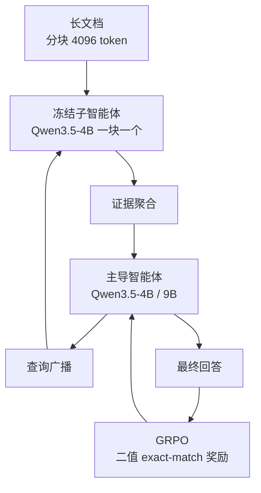

# PARSER：并行阅读、深度推理的长上下文智能体

**PARSER**（*PARSER: Read in Parallel, Reason in Depth for Long-Context LLM Agents*，[arXiv:2609.06702](https://arxiv.org/abs/2609.06702)，[项目页](https://cuhk-parser.github.io/)，[代码](https://github.com/cuhk-parser/PARSER)）来自香港中文大学：把“读文档”和“推理”拆给两类智能体，用并行阅读去除顺序记忆智能体的位置敏感与线性延迟。

## 一句话定义

**一群冻结的小模型子智能体各读一块并行作答，一个经 RL 训练的主导智能体多轮广播查询、聚合证据、追问更深。**

## 英文缩写速查

| 缩写 | 英文全称 | 简要说明 |
|------|----------|----------|
| PARSER | Parallel Read, Serial/Scatter Reasoning（题名写作 ParSer，全称论文未展开，此处仅为代称） | 本文方法名 |
| GRPO | Group Relative Policy Optimization | 主导智能体的 RL 算法，见 [GRPO](../methods/grpo.md) |
| RL | Reinforcement Learning | 仅训练主导智能体 |
| QA | Question Answering | 评测任务，多跳 HotpotQA / 2Wiki |
| EM | Exact Match | 奖励为二值 exact-match；指标 Sub_EM 为双向子串匹配 |
| KV | Key-Value cache | 子智能体借 SGLang Radix Cache 复用 |

## 为什么重要

- 顺序记忆智能体（MemAgent、ReMemR1）的推理深度被阅读进度绑定，证据位置、顺序、距离一变就掉点；PARSER 把读取变成与长度近乎无关的并行一轮。
- 在 896K token 上仍保持 85.42（HotpotQA，4B），而 Qwen3.5-4B 全上下文思考仅 31.25。
- 可用 4B 主导 + 4B 冻结子智能体达到超过 DeepSeek-V4-Pro think-max 的 9B 结果，成本结构清晰。

## 方法栈 / 流程总览



## 方法

- **输入/输出：** 主导智能体只看到问题；每轮产出对子智能体的查询，子智能体返回 JSON 证据或弃权；主导智能体最多 12 轮（训练上限 9，实测约 4 轮）。
- **分块：** 训练 512 token/块，推理 4,096 token/块。
- **子智能体：** Qwen3.5-4B 非思考、温度 0.7、生成上限 512 token；换成 2B/9B 无需重训。
- **RL：** GRPO，二值 exact-match 奖励、无格式奖励，观测 token 不进策略梯度；学习率 1e-6、组大小 5、KL β=1e-3。
- **数据：** 41,027 道 HotpotQA 题过滤后得 32,768 条，每条 200 段（约 28K token），沿用 MemAgent 配方。
- **系统：** VERL + Megatron、SGLang、全异步 RL；cache-aware router 让同一 chunk 在多轮里落到同一实例复用 KV。

## 实验与评测

HotpotQA（Sub_EM，7K–896K token 平均）：

| 方法 | 平均 | 896K |
|------|------|------|
| PARSER-4B | 84.57 | 85.42 |
| PARSER-9B | 86.79 | 85.94 |
| MemAgent-4B / 9B | 78.58 / 80.05 | 72.92 / 75.00 |
| ReMemR1-4B / 9B | 78.91 / 78.39 | 73.44 / 76.04 |
| DeepSeek-V4-Pro think-max | 80.47 | 78.91 |
| Qwen3.5-4B 全上下文思考 | 65.82 | 31.25 |

- 4B 比最强顺序基线平均高 5.7 点、896K 高 12.0 点；9B 超 DeepSeek-V4-Pro think-max 6.3 点。
- 2Wiki（域外）平均：PARSER-4B 87.04、9B 88.48，DeepSeek-V4-Pro think-max 88.18；50 段短上下文处 ReMemR1-4B（88.54）与 4B 全上下文思考（88.28）更高，优势仅在长子集。
- 鲁棒性（各 512 题）：证据位置、顺序、距离扰动下 PARSER 平稳，MemAgent / ReMemR1 明显波动。
- 延迟（896K，秒/样本）：并发 1 为 78.22 对 876.20（约 11.2 倍）；并发 32 为 58.76 对 74.96（约 1.3 倍）。引言的表述含糊，以表为准。
- 消融：RL 前后 74.42 → 84.57（4B）；分块 4,096 为 84.57、整文档 73.76；子智能体 2B/4B/9B 为 78.26/84.57/84.77。
- RULER 结果只有热力图，附录 B.2 无文字数字。

## 源码运行时序图

官方仓库 [cuhk-parser/PARSER](https://github.com/cuhk-parser/PARSER)（归档见 [sources/repos](../../sources/repos/parser-long-context-agents.md)），入口为 `train/train_4b.sh` → `run_fully_async_parser_4b.sh` 与 `eval/eval_hqa.sh`：

```mermaid
sequenceDiagram
    autonumber
    actor Dev as 开发者
    participant Env as train/env_setup.sh
    participant Router as SGLang Router + NGINX
    participant Train as train/train_4b.sh
    participant Loop as scripts/parser_agent_loop.py
    participant Sub as scripts/subagent.py
    participant Eval as eval/eval_hqa.sh
    Dev->>Env: 配置 CUDA_HOME 并安装依赖
    Dev->>Router: 启动冻结子智能体服务
    Dev->>Train: 启动全异步 RL
    Train->>Loop: rollout 工作进程生成轨迹
    Loop->>Sub: 广播查询到各 chunk
    Sub-->>Loop: JSON 证据或弃权
    Loop-->>Train: 轨迹与 exact-match 奖励
    Train->>Loop: 每 4 步同步参数
    Dev->>Eval: MODEL_PATH 指向检查点
    Eval->>Router: 调用子智能体读 chunk
```

## 工程实践

- 最短路径：下载 `inNexus/parser-qwen35-4b` 与 `inNexus/parser_dataset`，把仓库的 `chat_template.jinja` 拷进主导检查点，再跑评测脚本。
- 环境：Python 3.12、CUDA 12.8/12.9、`sglang==0.5.10.post1` 需一行 `sglang_router` 导入补丁，需安装 NGINX。
- 算力：论文训练 6 张 H100 + 10 张 H100 服务子智能体，4B 训练 180 步约 312 小时（9B 约 400 小时）。
- 分块别太大：131,072 token 块平均 80.34，4,096 为 84.57。

## 与机器人学习的关系

无直接关系；“轻量并行读取 + 中心推理器”的结构可类比多传感器/长历史的记忆读取，但论文未涉及机器人，属推测。

## 结论

**把阅读并行化、把学习集中在主导智能体上，是长上下文多跳 QA 里兼顾精度与延迟的有效结构，但目前证据限于合成训练的多跳 QA。**

1. 并行读取使精度对证据位置、顺序、距离不敏感。
2. 只训主导智能体，子智能体保持现成模型，降低训练复杂度。
3. 小分块（4,096）优于大分块与整文档。
4. 高并发下延迟优势收窄（并发 32 约 1.3 倍），预填充缓存是关键。
5. 子智能体误读同名人物 chunk 可能被主导智能体采信，需来源核对机制。
6. 复现用 4B 检查点即可；9B 检查点未见发布。

## 局限与风险

- 训练数据为 HotpotQA 合成，评测集中在多跳 QA 与 RULER。
- 上下文隔离导致无法核对子智能体来源（附录失败案例）。
- 高并发下 KV 被驱逐会使预填充上升至最多 K 倍。
- 训练需 16 张 H100 量级。
- **开源状态：** 已开源。GitHub 仓库含训练与评测脚本，MIT 许可；Hugging Face 4B 检查点与数据集均可访问；截至 2026-10-12 未见 9B 检查点。附录 B.1 之后的 limitations 小节未读到独立章节。

## 与其他工作对比

| 对照 | 差异读法 |
|------|----------|
| MemAgent / ReMemR1 | 顺序读取并更新记忆；PARSER 并行读取，长度越长越占优 |
| [检索增强生成](../concepts/retrieval-augmented-generation.md) | RAG 靠检索先筛段，PARSER 让每块都有子智能体读，不依赖检索召回 |
| [GRPO](../methods/grpo.md) | 提供 PARSER 使用的组相对策略优化 |

## 关联页面

- [WaytoAGI 本周顶级 AI 论文技术地图](../overview/waytoagi-top-ai-papers-2026-09-07-09-13-technology-map.md)
- [GRPO](../methods/grpo.md)
- [检索增强生成](../concepts/retrieval-augmented-generation.md)
- [AI 智能体评测](../concepts/ai-agent-evaluation.md)

## 参考来源

- [waytoagi_feishu_top_ai_papers_2026-09-07-09-13.md](../../sources/blogs/waytoagi_feishu_top_ai_papers_2026-09-07-09-13.md) — 周报线索
- [parser_arxiv_2609_06702.md](../../sources/papers/parser_arxiv_2609_06702.md) — 论文归档
- [parser-long-context-agents.md（sites）](../../sources/sites/parser-long-context-agents.md) — 项目页核查
- [parser-long-context-agents.md（repos）](../../sources/repos/parser-long-context-agents.md) — 仓库核查
- [arXiv:2609.06702](https://arxiv.org/abs/2609.06702)

## 推荐继续阅读

- [PARSER 项目页](https://cuhk-parser.github.io/)
- [cuhk-parser/PARSER](https://github.com/cuhk-parser/PARSER)
- [parser-qwen35-4b 检查点](https://huggingface.co/inNexus/parser-qwen35-4b)
