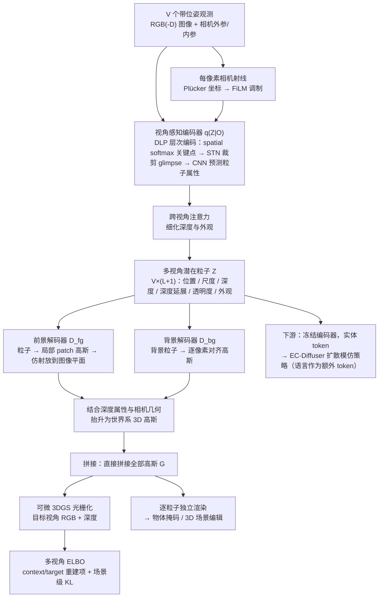

# ParticleSplat（arXiv:2609.19463）

**ParticleSplat**（*Self-supervised Object-centric Latent Particle Splatting*，[arXiv:2609.19463](https://arxiv.org/abs/2609.19463)，[项目页](https://lyuxinghe.github.io/ParticleSplat-website/)，[代码](https://github.com/lyuxinghe/ParticleSplat)）来自 [具身智能小站 10 篇盘点](../../sources/blogs/wechat_embodied_station_10_papers_contact_wm_2026-09-18.md)（策展档位：**扫读**）。

## 一句话定义

**DLP 粒子扩展到 3D Gaussian Splatting；无掩码自监督对象分解；RLBench 73% / MimicGen 56.1% 策略 SR。**

## 英文缩写速查

| 缩写 | 英文全称 | 简要说明 |
|------|----------|----------|
| WAM | World-Action Model | 联合预测未来观测与动作的策略 |
| VLA | Vision-Language-Action | 视觉–语言–动作策略 |
| SR | Success Rate | 任务成功率 |
| IL | Imitation Learning | 模仿学习 |
| GS | Gaussian Splatting | 高斯溅射三维表示 |

## 为什么重要

- 公众号将本文归入「接触时视觉之外还需预测什么」专题；扫读档位。
- **（待论文正式披露）**；开源结论：**待发布**（步骤 2.5，2026-09-18）。
- 与 tactile/WAM、主动视角、多智能体场景理解、Sim2Real、人形导航等主线交叉。

## 流程总览

图依据：论文 §4 与 Fig. 1、附录 A.1.1–A.1.4、§5.3

## 核心机制

| 项 | 内容 |
|----|------|
| **arXiv** | [2609.19463](https://arxiv.org/abs/2609.19463) |
| **开源** | **待发布** |
| **策展摘要** | DLP 粒子扩展到 3D Gaussian Splatting；无掩码自监督对象分解；RLBench 73% / MimicGen 56.1% 策略 SR。 |

## 源码运行时序图

**不适用**（截至 2026-09-18 项目页/arXiv 未发布可运行官方代码）。

## 实验与评测

- 定量指标与 baseline 协议以 arXiv PDF 与项目页为准；本页为清单级摘要。
- 读法：先确认任务设定（仿真/真机、传感器、成功定义）再对比 SR/延迟/路径长度等 headline 数字。

## 与其他工作对比

> 本页为清单级摘要，下表只做**定位对照**：RLBench 73% / MimicGen 56.1% 是各自 benchmark 协议下的数字，与下列各页不可横比。

| 对照 | 差异读法 |
|------|----------|
| [StrucPhysVideo](./paper-strucphysvideo.md) | 同为给模型加「对象/结构」先验，**消费端不同**：StrucPhysVideo 用在视频生成侧，ParticleSplat 用在策略输入侧。同一直觉的两个出口 |
| [CoRef-GS](./paper-coref-gs.md) | 同批次另一条 GS 路线，方向相反：CoRef-GS 朝多智能体场景理解发散，ParticleSplat 朝策略表征收敛 |
| [Agile-WAM](./paper-agile-wam.md) | 同批次里另一条「动作头之前先补什么」：ParticleSplat 补几何/对象结构，Agile-WAM 补触觉。对应「看不清」与「摸不出」两类失败 |
| **需要掩码监督的对象中心表征**（本文要避开的默认做法） | 同为把场景拆成对象，差别在**拆分从哪来**：多数做法依赖分割掩码，ParticleSplat 走无掩码自监督分解，省的是标注，换来的是分解质量不可控 |
| [模仿学习](../methods/imitation-learning.md) | 策略 SR 是 IL 协议下的数字；该页给协议差异读法，换 benchmark 不可直接搬 |
| [10 篇技术地图](../overview/contact-wm-10-papers-technology-map.md) | 同批次横向对照入口：本文列 **扫读** 档位 |

## 结论

**ParticleSplat 代表「扫读」档位的 gaussian-splatting 方向样本——部署前以开源状态与评测协议为准绳。**

1. 开源状态：**待发布**；勿凭 PDF 臆断可复现性。
2. 与同专辑 [Agile-WAM](./paper-agile-wam.md) / [INSPECT](./paper-inspect-view-selection.md) 等形成「触觉 WAM → 主动视角 → 系统平台」阅读链。
3. 若做工程选型，先对齐传感器栈与任务是否匹配文内设定。
4. 关注项目页/arXiv 版本更新与代码发布。

## 关联页面

- [manipulation](../tasks/manipulation.md)
- [imitation-learning](../methods/imitation-learning.md)
- ./paper-strucphysvideo.md
- [vla](../methods/vla.md)
- [10 篇技术地图](../overview/contact-wm-10-papers-technology-map.md)

## 参考来源

- [particlesplat_arxiv_2609_19463.md](../../sources/papers/particlesplat_arxiv_2609_19463.md)
- [wechat_embodied_station_10_papers_contact_wm_2026-09-18.md](../../sources/blogs/wechat_embodied_station_10_papers_contact_wm_2026-09-18.md)
- [arXiv:2609.19463](https://arxiv.org/abs/2609.19463)
- [arXiv PDF](https://arxiv.org/pdf/2609.19463)：已通读方法部分（实验与附录以略读为准）：摘要、§1 引言、§3 背景、§4 方法、§5.3 模仿学习设定、附录 A.1.1–A.1.4（A.5.2 略读）

## 推荐继续阅读

- [arXiv PDF](https://arxiv.org/pdf/2609.19463)
