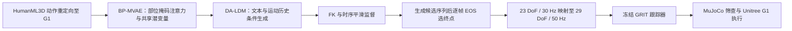

# PartiGen：部位感知的语言条件人形运动生成

**PartiGen**（*Part-Aware Representations for Language-Conditioned Humanoid Motion Generation*，[arXiv:2610.13373](https://arxiv.org/abs/2610.13373)）把语言条件动作生成、全身解剖结构和动作时长建模放进同一条人形运动参考生成管线，并用冻结的 GRIT 跟踪器验证参考能否被 Unitree G1 执行。

## 一句话定义

PartiGen 先在共享全身潜空间里按身体部位处理动作特征，再用语言与运动历史生成 G1 全身动作，并预测动作结束帧。

## 英文缩写速查

| 缩写 | 英文全称 | 简要说明 |
|------|----------|----------|
| BP-MVAE | Body-Part-Aware Motion Variational Autoencoder | 按身体部位组织注意力、编码共享全身动作潜变量的运动 VAE |
| DA-LDM | Duration-Adaptive Latent Diffusion Model | 在动作潜空间生成运动片段的时长自适应扩散模型 |
| EOS | End of Sequence | 逐帧终止概率，用于完整候选生成后的结束帧选择 |
| FK | Forward Kinematics | 将关节角映射为身体关键点，用于运动学一致性监督 |
| GRIT | General Robot Imitation Transformer | PartiGen 采用的预训练冻结运动跟踪控制器 |

## 为什么重要

- **局部结构和全身协同兼顾。** 纯全身 token 容易弱化不同肢体的局部模式；完全拆成多个身体部位潜变量又可能损害整体协调。PartiGen 的做法是在注意力输入处施加解剖分组，随后融合回单一共享表征。
- **生成器面向可执行的机器人参考。** 它不是止于人体动作的视觉质量，而是加上 FK 监督，并把输出映射为 G1 控制器可跟踪的参考序列。
- **动作时长不再只由固定窗口决定。** 逐帧 EOS 选择器允许结束点落在一个运动基元内部，适合“挥手”“走几步”等持续时间不固定的文本指令。

## 方法栈 / 流程总览

### 部位感知共享表征

输入帧是 57 维表示，涵盖根部朝向、左右脚接触、根部位移与高度、23 个关节角及其帧间变化。BP-MVAE 通过固定解剖掩码为各注意力头选取相应关节角；根部/接触特征和全部关节增量仍作为共享信息输入。各头使用独立 Q/K/V 投影，输出再融合到一个 128 维全身潜变量，而不是为每个肢体建立互不相通的 latent。

### 语言条件生成与终止帧

DA-LDM 根据文本嵌入、运动历史和噪声潜变量自回归生成运动基元；解码后的候选轨迹受 FK 与时间平滑项约束。EOS 预测器在完整候选序列生成后，对帧级终止概率做阈值选择。因此它是生成后的端点裁剪机制，不会在扩散/自回归生成过程中在线提前停止。

### 生成与执行分层

生成器输出 23 DoF、30 Hz 的参考，经过映射至 G1 的 29 DoF、50 Hz 后，由预训练且冻结的 GRIT 控制器使用机器人状态反馈跟踪。生成器训练没有使用控制器梯度，也不是生成与控制的联合优化；评测同时涉及参考质量与这一指定执行组件下的闭环跟踪表现。

## 实验与评测

- **HumanML3D-G1 参考质量：** segment-level FID 为 3.165，较 TextOp 低 16.8%；R@1 提高 1.4 个百分点。结果对应重定向至 G1 的人体动作基准，不代表真机任务成功率。
- **时长预测：** 16 帧动作基元设置下，预测端点的时长 MAE 为 3.080 帧，固定长度截断为 12.471 帧。Oracle 长度仍取得更好的 R@3 与 FID，因此 EOS 是实用估计而非最优时长保证。
- **仿真跟踪筛查：** 冻结 GRIT 在 MuJoCo 对 500 条生成参考进行姿态稳定筛查，409 条通过（81.8%）。
- **真机尝试：** 论文报告经仿真筛选并由研究者手动选择后，Unitree G1 的 27 次尝试中有 26 次判定成功。该数字不能外推为全部生成参考的无筛选成功率。
- **组合压力测试：** 多部位组合指令用于诊断组合泛化，不构成成熟的零样本组合基准。

## 结论

**PartiGen 的贡献在于把解剖结构、全身共享表示和逐帧时长选择结合起来，并对生成参考做了冻结跟踪器下的仿真及有限真机验证；结果支持可行性，但尚不足以证明普遍稳健部署。**

1. 部位掩码作用在动作特征进入注意力之前，输出仍回到共享全身潜空间；这保留了肢体局部特征与跨身体上下文。
2. FK 监督约束运动学一致性，但不能替代动力学可行性约束；真实执行还依赖下游跟踪器。
3. EOS 把固定长度截断的时长 MAE 从 12.471 降到 3.080 帧；应按时长评测指标读取，不意味着语义上的唯一正确时长。
4. 81.8% 是 MuJoCo 姿态筛查通过率；26/27 是仿真筛选、人工挑选之后的真机尝试结果，二者分母和筛选条件不同。
5. 生成器与 GRIT 分开训练，论文没有验证端到端联合优化，也没有提供公开代码供独立复现。

## 与其他工作对比

| 工作 | 生成/控制接口 | 与 PartiGen 的区别 |
|------|---------------|-------------------|
| [TextOp](https://text-op.github.io/) | 交互式文本驱动人形动作生成与控制 | PartiGen 重点验证部位感知表征及动作结束帧预测；基准结果报告相对 TextOp 的提升 |
| [PhyGile](./paper-phygile.md) | 直接在机器人骨骼空间文本生成并配合 GMT 跟踪 | 同属语言到机器人全身动作；PhyGile 强调机器人原生动作空间和生成—跟踪闭环精炼，PartiGen 强调部位掩码共享表征与时长建模 |
| [OMG](./paper-omg-omni-modal-humanoid-control.md) | 多模态输入生成全身参考并交给 HoloMotion | OMG 着重多模态控制接口和运行时切换；PartiGen 聚焦文本、运动历史、解剖结构与帧级终止预测 |

## 工程实践

- **先核验关节表示映射。** 论文采用训练侧 23 DoF / 30 Hz、执行侧 G1 29 DoF / 50 Hz；迁移到其他机器人需要重新定义骨架映射、插值和过渡姿态。
- **分别评估参考与执行。** 报告生成质量、时长误差、姿态筛查和控制器跟踪误差；不要把这些指标合并成单一“真机成功率”。
- **保留筛选与人工选择记录。** 真机评估有仿真稳定性筛选和手动选择，复现实验需明确候选总数、筛选率、选择规则与失败情况。
- **源码运行时序图：不适用。** 截至 2026-10-14，论文未链接可运行官方源码或项目页，无法核对训练/推理入口；上方流程图描述论文方法数据流，不代表代码运行时序。

## 局限与风险

- 论文的物理执行评估使用预训练冻结 GRIT；没有将生成器和执行控制器共同训练，也不应把结果理解为新控制策略本身的性能。
- 真机 26/27 的试验对象由仿真筛查和人工挑选，样本量有限；论文没有证明全部候选参考均可安全执行。
- 项目页未提供官方代码链接，训练配方、数据处理与部署细节暂时缺乏独立复现入口。
- HumanML3D 重定向后的离线基准和文本组合压力测试，不能覆盖真实环境中的接触、外力、感知误差或安全约束。

## 关联页面

- [基于扩散模型的运动生成](../methods/diffusion-motion-generation.md) — 扩散模型生成机器人全身参考的路线综述
- [通用运动重定向（GMR）](../methods/motion-retargeting-gmr.md) — 人体动作映射到机器人骨架
- [SONIC 运动跟踪](../methods/sonic-motion-tracking.md) — 参考运动到机器人控制的跟踪接口
- [全身跟踪流水线](../concepts/whole-body-tracking-pipeline.md) — 生成、重定向与控制执行的系统关系

## 参考来源

- [PartiGen 论文来源归档](../../sources/papers/partigen_arxiv_2610_13373.md)
- [arXiv HTML 全文 v1](https://arxiv.org/html/2610.13373v1)

## 推荐继续阅读

- [arXiv:2610.13373](https://arxiv.org/abs/2610.13373)
- [PhyGile 项目页](https://phy-gile.github.io/)
- [TextOp 项目页](https://text-op.github.io/)
