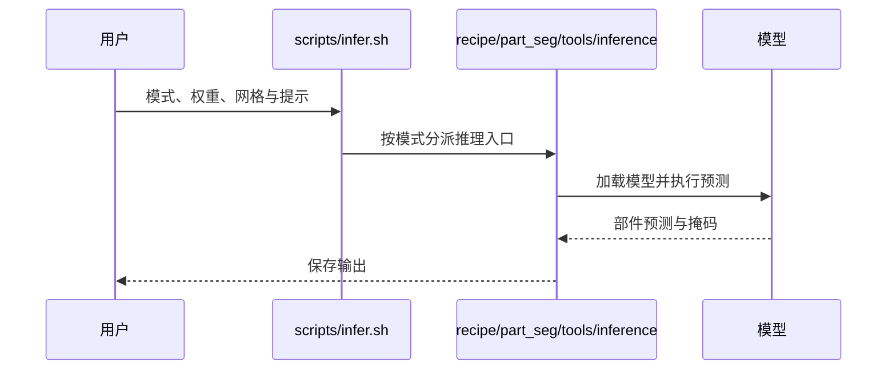

# PartLLM：统一三维部件分割

## 一句话定义

PartLLM 将形状和用户意图转换为语义部件查询，再联合预测三维部件掩码，支持文本、点提示和全形状分解。

## 英文缩写速查

| 缩写 | 英文全称 | 简要说明 |
|------|----------|----------|
| LLM | Large Language Model | 模型自回归生成语义部件假设 |
| 3D | Three-dimensional | 输入形状和部件位于三维空间 |
| SFT | Supervised Fine-Tuning | 官方训练脚本提供的监督微调路径 |

## 为什么重要

同一物体可按不同任务或细度拆解；统一提示接口让部件名查询、交互标注和整体分解共享模型。对于机器人，部件掩码可作为后续几何分析或标注的候选输入，但不能直接等同于可抓取性或动作策略。

## 核心原理与方法

给定形状与提示，模型自回归生成语义部件假设作为 mask 查询；分解感知解码器联合预测相互协调的部件掩码。提示决定期望的分解方式：部件名称指定目标，三维点指定交互位置，粒度控制整体拆分。该描述依据论文摘要，具体架构和训练损失需查论文正文。

## 源码运行时序图

默认不安装 vLLM 时走上述原始推理入口；安装可选 vLLM 后脚本切换至混合推理路径。

## 工程实践

- 安装 Python 3.11 环境并运行 `bash scripts/install.sh`，按 README 下载 checkpoint。
- `full_shape` 接受网格目录；`text_guided` 使用 `--part_names`；`interactive` 使用 `--point X Y Z`。点使用原始网格坐标并吸附到采样表面。
- `refine` 可加载同一网格按面排列的二值 `initial_mask.npy`，并接收正负点。结果与输入网格面序的对应关系需要保留。
- 训练数据转换覆盖 PartNeXt、3DCoMPaT200、PartVerse、HY3D-Bench；各数据集需自行获取并遵守各自许可。
- 项目页源码列出代码与权重链接；官方仓库提供训练和推理脚本，实际可运行性、显存需求和部署性能尚未在本次验证。

## 评测与对比

作者在摘要中称该方法在多个任务设置下优于专用基线；本次未能读取论文正文，无法核对具体数据集、指标与对照条件，因此不转写数值，也不能据此判断机器人场景表现。

## 结论

**PartLLM 的主要价值是用一个模型覆盖多种三维部件分割意图，工程可用性仍需针对输入与任务验证。**

1. 按是否已有部件名称、交互点或需要整体分解选择对应模式。
2. 用目标网格和标注协议验证部件粒度、边界质量及耗时。
3. 机器人应用还需验证传感器重建误差、坐标对齐和下游任务效果。

## 局限与风险

官方入口以网格为输入；真实场景到网格的重建不在上述示例推理命令中。文本名称可能存在歧义；点提示需要正确的网格坐标。源码与权重链接已公开，但数据许可、硬件需求与实机效果需独立核实。

## 关联页面

- [机器人视觉感知栈选型闭环](../queries/robot-perception-stack-selection-loop.md) — 本页可归入其 ③ 2D→3D 提升与语义建图层：意图条件的三维部件分割，为下游操作提供部件级语义
- [图像分割任务分类](../concepts/image-segmentation-taxonomy.md) — 对照二维语义、实例和全景任务。
- [Segment Anything](paper-segment-anything.md) — 二维可提示分割；输入和输出域不同。

## 参考来源

- [论文归档](../../sources/papers/partllm.md)
- [项目页归档](../../sources/sites/partllm.md)
- [代码仓库归档](../../sources/repos/partllm.md)

## 推荐继续阅读

- [PartLLM 论文](https://arxiv.org/abs/2609.25832)
- [官方推理文档](https://github.com/czvvd/PartLLM/blob/main/docs/INFERENCE.md)
