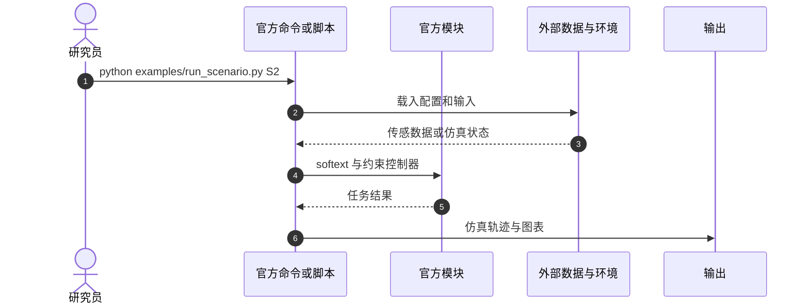

# Actuation and Control of Passive Tendon-Driven Soft Extensions Through Rigid Manipulator Motion｜用刚性机械臂驱动无源腱索软体延伸段

## 一句话定义

**用刚性机械臂驱动无源腱索软体延伸段**：软体延伸段不需要独立电机，使用机械臂冗余关节运动改变腱索张力与软体末端形态。

## 英文缩写速查

| 缩写 | 英文全称 | 简要说明 |
|---|---|---|
| EE | End Effector | 末端执行器 |
| QP | Quadratic Programming | 二次规划 |
| CBF | Control Barrier Function | 控制障碍函数 |

## 为什么重要

软体延伸段不需要独立电机，使用机械臂冗余关节运动改变腱索张力与软体末端形态。 比起单一 benchmark 排名，研究与工程落地需要分清楚是否具有动作控制闭环、是否能复现以及硬件/数据前提。

## 核心信息

| 条目 | 原始证据 |
|---|---|
| 论文 | [arXiv:2611.15386v1](https://arxiv.org/abs/2611.15386) |
| 官方项目 | [主页](https://ignaciocuiral.com/passive_soft_extension_control/) |
| 开源入口 | [官方源码](https://github.com/nachocz/passive_soft_extension_control)（详见源码归档的部分/整体边界） |

## 核心原理

软体段的腱索锚定在机械臂上游关节，外部腱索长度变化通过辨识的 span-to-deformation 映射到末端；对末端执行器位置/孔口 RCM 约束，利用零空间控制软体尖端，并以 CBF/QP 确保避障及辨识模型有效域。

### 流程总览

流程图来自一手论文方法链；与实际源码包之间的映射如下。

## 源码运行时序图

源码运行入口按 [README 和脚本核对归档](../../sources/repos/passive-soft-extensions-2611-15386.md) 标注，以下只代表已发布模块的调用范围。

## 工程实践

1. 依据原文方法核对输入传感器、控制/评估接口、样本分布及实验硬件。
2. 执行前检查[源码归档](../../sources/repos/passive-soft-extensions-2611-15386.md)提到的实际可运行入口、外部依赖与许可。
3. 将论文成绩、真机误差、系统延迟与安全要求分开验收，复现前明确失败标准。

## 实验与评测

UR10 仿真与真实系统中的局部尖端调节；有辨识误差、不可达目标与约束满足对照，不能推广至未经辨识的大形变。

## 结论

**软体延伸段不需要独立电机，使用机械臂冗余关节运动改变腱索张力与软体末端形态。**

1. 保留相同模型与数据预算下的可比口径，不跨基准简单求平均。
2. 优先复核最可能出现数据泄漏、接触失败或部署延迟的环节。
3. 对论文未检验的部署条件单列验证计划。

## 与其他工作对比

- **对比被动刚性延伸与有源混合刚软机器人（Fig. 1 & §I）：** 被动刚性延伸段在受限孔道内难以柔顺绕障、易碰撞受损；现有混合刚软方案（将微型连续体/软体臂装在刚性机械臂末端）通常需给软体段配备独立驱动电机、电源与控制线束，增大末端负载与集成复杂度。本文通过机械臂零空间冗余运动拉动锚定在上游连杆的外部肌腱，实现无电机/无传感器/低成本（演示泡沫软体管低于 10 美元）的主动末端形变控制，代价是可控形变维度与工作空间受 EE 约束及肌腱跨度域限制。
- **内部约束与肌腱构型对照（§VI–VII）：** 仿真（UR10）对比了自由 EE、位置约束 EE 与孔口支点约束（RCM），以及关闭 vs 开启 CBF 障碍屏障（穿透 18.8 mm vs 保持 >10.7 mm 净距）；真机（125 Hz）对比了平行肌腱（Exps. 1–5）与螺旋肌腱（Exp. 6）路由。需注意真机 9–14 mm 为 4 个追踪标记点联合 RMS 误差，与仿真 1.5 mm 单尖端误差口径不同，不可混比。

## 局限与风险

辨识映射只在探测过的腱索跨度范围有效，冗余度与支点约束会限制可驱动的形变方向。

## 关联页面

- [本期 29 篇具身论文选型地图](../overview/embodied-frontier-29-papers-2026-11-16.md)
- [ManiLadder：任务难度分层评测](./paper-maniladder-manipulation-benchmark.md)

## 参考来源

- [原论文核对归档](../../sources/papers/passive-soft-extensions-2611-15386.md)
- [项目页开放状态](../../sources/sites/passive-soft-extensions-2611-15386.md)
- [源码及运行入口](../../sources/repos/passive-soft-extensions-2611-15386.md)

## 推荐继续阅读

- [arXiv HTML](https://arxiv.org/html/2611.15386v1)
- [官方源码仓](https://github.com/nachocz/passive_soft_extension_control)
