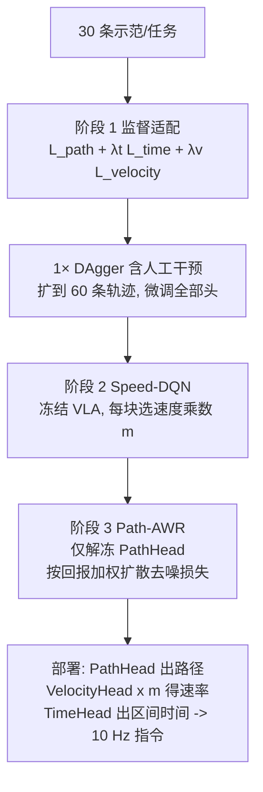

# PathTime-VLA

**PathTime-VLA**（*Path-Time Decoupling for Factorized Post-Training of Vision-Language-Action Policies*，arXiv:2610.11771，2026-10-08，浙江大学）把经典运动规划里的 **路径-时间参数化** 引进 VLA：动作块不再是固定间隔的时间序列，而是“进度索引的几何路径 + 为正的区间时间剖面”，使同一条路径可只改时间剖面以不同速度执行，并据此把后训练拆成路径学习与速度学习两条通道。

## 英文缩写速查

| 缩写 | 英文全称 | 简要说明 |
|------|----------|----------|
| VLA | Vision-Language-Action | 视觉语言动作策略；本文基于 E2VLA |
| DAgger | Dataset Aggregation | 在策略自身状态分布上请人干预、聚合数据的模仿学习 |
| DQN | Deep Q-Network | 值函数方法；此处 Speed-DQN 选执行速度乘数 |
| AWR | Advantage-Weighted Regression | 以优势加权的回归；此处 Path-AWR 加权精修路径头 |
| BC | Behavior Cloning | 行为克隆 |
| SS | Successful Samples | 论文表中的成功次数 |

## 为什么重要

- **遥操作数据的速度噪声：** 示范里的几何信息可用，但节奏被接口延迟和操作者习惯污染；固定间隔动作块把两者绑死，既难利用示范，也难单独提速。
- **提速不改几何目标：** 速度由乘数 m 单独控制（时长除以 m），路径目标不变，天然支持逐块选速。
- **提速有代价曲线：** 论文的固定乘数扫描显示某些任务 3× 就崩（胶带+抽屉 19→5/20），因而需要学习式调速而非全局加速。

## 方法栈与流程总览

## 方法

- **表示：** 运动 = 进度 s 上的路径 X(s) + 正的区间时间剖面 t(s)，指令 a(t)=X(s(t))。每块含 K 个路径节点与正的区间时长，累计时长给出进度-时间映射，反演后以 10 Hz 重采样。进度增量 δs=√(‖Δp‖²+(ρθ)²)，夹爪不计入进度、零阶保持。
- **模块（基于 E2VLA）：** PathHead 是扩散路径生成器（不看速度乘数）；VelocityHead 输出归一化对数速率分箱的有序分布，期望为基准速率，乘 m 并截断到 [v_min, v_max]；TimeHead 对上下文、历史、stop-gradient 路径与对数速率坐标做交叉注意力输出区间时间。
- **Speed-DQN：** 冻结 VLA，每执行块决策一次；状态为 q_k^v，动作为从任务相关有序集合中选乘数索引；奖励 = 偏好更快的有界项 + 成功正/失败或安全停止负的终止奖励；单步 TD、目标网络、Huber 损失。
- **Path-AWR：** 只更新 PathHead；回放存执行过的块和“机器人实际跟随的节点”掩码；Q_ψ、V_ν 拟合折扣终止回报，优势 Q−V；安全样本按秩分位数加权到 [0,1]，不安全样本权重 0；损失 = λ_sup×示范/DAgger 监督扩散损失 + λ_R×在线重加噪路径的加权去噪损失。
- **数据与平台：** 每任务 30 条示范经 DAgger 扩到 60 条；监督对比使用 RTX A6000 与 40,000 步预算；Franka Panda + 腕部/第三人称 D435，远程推理，10 Hz 笛卡尔位姿与夹爪指令经共享柔顺控制器执行。λ、γ、ρ、K、B、乘数集合、v_min/v_max、模型规模在已读部分未给出。

## 实验与评测

三任务各 20 次匹配的随机初值（60 s 上限，共 600 次真机评测）：插销（孔位 30×40×10 cm，插入≥1 cm）、开微波炉（>30°）、放胶带并关抽屉（缝隙≤5 cm，最长多阶段）。

| 训练 | 表示 | 插销 | 微波炉 | 胶带+抽屉 | 合计 |
|------|------|------|------|------|------|
| BC | Coupled（时间索引） | 9 | 14 | 17 | 40/60 |
| BC | PathTime-VLA | 9 | 15 | 19 | 43/60 |
| BC+DAgger | Coupled | 16 | 16 | 19 | 51/60 |
| BC+DAgger | PathTime-VLA | 19 | 19 | 19 | 57/60 |

- **固定乘数扫描：** BC 插销 9/20（1×）→1/20（3×）；BC 微波炉 15/20（1×）→18/20（2×）；BC+DAgger 插销 19/20/19（1×/2×/3×）；BC+DAgger 胶带+抽屉 19→5（3×）。
- **学习式调速：** Speed-DQN 55/60，用时 9.40/16.70/16.39 s，较固定 1× 约短 47%、48%、30%；完整 Path-AWR 58/60（20/20、20/20、18/20），用时 9.10/15.40/14.20 s，吞吐代理约 396/234/173 次每小时。相对 BC+DAgger 1× 的 PathTime，成功试验平均用时缩短约 39–52%。
- 对比：BC+DAgger 固定 1× 为 57/60，因此完整方法在成功率上只多 1 次，主要收益是时间。

## 源码运行时序图

不适用：论文与 arXiv 页面均未给出官方代码或项目页，无法对齐仓库目录。

## 工程实践

- 部署链路：远程 VLA 推理输出 10 Hz 笛卡尔位姿；速度乘数在每个动作块级别切换，需要控制器端对时间剖面做重采样与柔顺控制。
- 三阶段可分别复用：先在 1× 下收好 DAgger 数据，再单独训 Speed-DQN（冻结 VLA），最后才解冻 PathHead；这样速度学习不会破坏路径先验。
- 安全：奖励含“安全停止”惩罚，Path-AWR 把不安全样本权重置零；真机调速要先限定乘数集合上界（由 3× 扫描可见不同任务容忍度差异大）。

## 结论

**PathTime-VLA 的价值在于把“怎么走”和“走多快”分开学习，使后训练能把示范几何保留下来、单独优化节奏，真机上主要换来成功试验用时缩短 39–52%，成功率提升有限。**

1. **解耦在 BC 与 BC+DAgger 下都有增益** — 43/60 对 40/60、57/60 对 51/60，但试验数小。
2. **最优速度因任务而异** — 微波炉可 2×，胶带+抽屉 3× 崩到 5/20，需要逐块调速。
3. **学习式调速保住成功率** — DQN 55/60、完整方法 58/60，同时快约一半。
4. **分阶段冻结是稳定性手段** — 速度学习时冻结 VLA，路径精修时只动 PathHead。
5. **证据范围窄** — 一个平台、一种遥操作接口、三个任务；成功率差 1 次不具统计意义（推测）。
6. **无代码可复现** — 关键超参（乘数集合、λ、γ）未读到，复现风险高。

## 与其他工作对比

| 对照 | 差异读法 |
|------|----------|
| [扩散策略](../methods/diffusion-policy.md) | PathHead 即扩散路径生成器，但把时间从生成目标中剥离 |
| [DRIVE](./paper-drive-diversity-rl-vla.md) | 同属 VLA 后训练；DRIVE 改 RL 奖励提升泛化，PathTime 改动作表示提升速度 |
| [RLinf-VLA](./paper-rlinf-vla.md) | VLA 强化学习框架；PathTime 的 DQN/AWR 是针对速度与路径的小规模离散/加权更新 |
| Coupled（时间索引动作块） | 论文内主对照，固定间隔绑定路径与速度 |

## 局限与风险

- **开源状态：** 无代码、无项目页（截至 2026-10-12 未核实到）。
- **作者列出：** 固定进度离散化折中几何细节与视野；合成缩放无法复现速度相关动力学、摩擦与冲击；Speed-DQN 看不到随机路径样本；Path-AWR 结果混合了路径与时间影响；仅单平台、单接口、三任务。
- 单位取自 HTML 正文：浙江大学。

## 关联页面

- [周报汇总：Manipulation 2026-10-05 至 10-09](../overview/frontier-manipulation-2026-10-05-10-09.md)
- [VLA](../methods/vla.md)、[扩散策略](../methods/diffusion-policy.md)
- [价值型强化学习](../methods/value-based-reinforcement-learning.md)
- [机器人通用后训练](../concepts/universal-post-training-robotics.md)
- [Manipulation 任务](../tasks/manipulation.md)

## 参考来源

- [pathtime_vla_arxiv_2610_11771.md](../../sources/papers/pathtime_vla_arxiv_2610_11771.md) — 论文归档
- [frontier_manipulation_2026_10_05_10_09.md](../../sources/blogs/frontier_manipulation_2026_10_05_10_09.md) — 周报线索
- 论文：<https://arxiv.org/abs/2610.11771>

## 推荐继续阅读

- [arXiv HTML 全文](https://arxiv.org/html/2610.11771v1)
- [Advantage-Weighted Regression（Peng et al. 2019）](https://arxiv.org/abs/1910.00177)
- [DAgger（Ross et al. 2011）](https://arxiv.org/abs/1011.0686)
