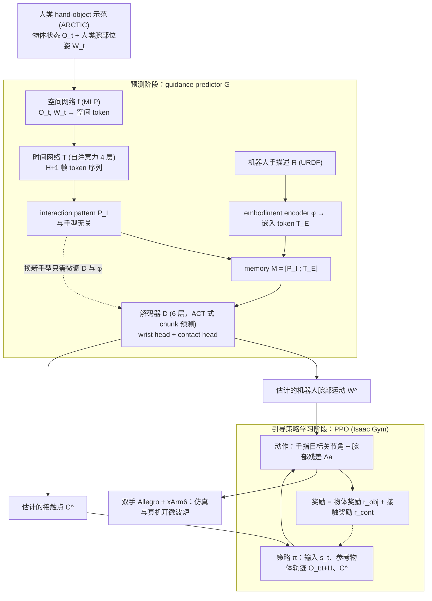

# PatternDex（arXiv:2610.04765）

**PatternDex**（*PatternDex: Learning Interaction Patterns to Guide Reinforcement Learning of Bimanual Dexterous Manipulation of Articulated Objects*，[arXiv:2610.04765](https://arxiv.org/abs/2610.04765)，[项目页](https://patterndex.github.io/PatternDex/)）来自 [具身智能小站 2026-10-13 盘点](../../sources/blogs/wechat_embodied_station_34_papers_mulligan_2026-10-13.md)，属「灵巧操作」组。

## 一句话定义

**从人类示范学习交互模式，再预测目标手型的腕部运动和接触点以指导 RL；多手型仿真与开微波炉真机。**

## 英文缩写速查

| 缩写 | 英文全称 | 简要说明 |
|------|----------|----------|
| RL | Reinforcement Learning | 强化学习 |
| Dex | Dexterous Hand | 灵巧手 |
| Articulated | Articulated Objects | 铰接物体 |

## 为什么重要

- 先学人手与物体关系，再适配机器人，可跨手型复用。
- 开源结论：**待发布**（步骤 2.5，2026-10-14）。项目页含「coming soon」字样，入库日未列 GitHub。
- 同期同组工作见 [失败导向采集与可组合世界动作模型：具身智能小站 10-13 期 34 篇阅读坐标](../overview/embodied-station-2026-10-13-34-papers-technology-map.md)。

## 流程总览

图依据：论文 §III、§IV-A/B / Fig.2

## 核心机制

| 项 | 内容 |
|----|------|
| **arXiv** | [2610.04765](https://arxiv.org/abs/2610.04765) |
| **开源** | **待发布** |
| **要点** | 模式复用。 |
| **文内指标** | 以原文为准。 |

## 源码运行时序图

**不适用（待发布）** — 项目页含「coming soon」字样，入库日未列 GitHub。 不编造运行脚本；代码公开后再补。

## 实验与评测

- 以原文为准。
- **读法：** 本页为索引级摘要，依据公众号转述的官方摘要与仓库信息整理；逐项数字与 baseline 以原文 PDF 为准。

## 与其他工作对比

- 横向索引见 [失败导向采集与可组合世界动作模型：具身智能小站 10-13 期 34 篇阅读坐标](../overview/embodied-station-2026-10-13-34-papers-technology-map.md)；同 arXiv 不重复造页。

## 结论

**交互模式是比关节轨迹更可迁移的人类先验。**

1. 开源边界：**待发布** — 项目页含「coming soon」字样，入库日未列 GitHub。
2. 核心机制：模式复用。
3. 复现与选型前核对任务协议、硬件与基准口径，勿直接横比公众号摘录数字。

## 关联页面

- [dexterous-kinematics](../concepts/dexterous-kinematics.md)
- [bimanual-manipulation](../tasks/bimanual-manipulation.md)
- [reinforcement-learning](../methods/reinforcement-learning.md)
- [paper-eigendexplore](./paper-eigendexplore.md)
- [embodied-station-2026-10-13-34-papers-technology-map](../overview/embodied-station-2026-10-13-34-papers-technology-map.md)

## 参考来源

- [patterndex_interaction_patterns_bimanual_dexterous_arxiv_2610_04765.md](../../sources/papers/patterndex_interaction_patterns_bimanual_dexterous_arxiv_2610_04765.md)
- [wechat_embodied_station_34_papers_mulligan_2026-10-13.md](../../sources/blogs/wechat_embodied_station_34_papers_mulligan_2026-10-13.md)
- [arXiv:2610.04765](https://arxiv.org/abs/2610.04765)
- [arXiv PDF](https://arxiv.org/pdf/2610.04765)：已通读方法部分（实验与附录以略读为准）：§I 引言、§III 问题定义、§IV 方法（预测阶段与引导策略学习）、§V 评测设定

## 推荐继续阅读

- [arXiv PDF](https://arxiv.org/pdf/2610.04765)
- [项目页](https://patterndex.github.io/PatternDex/)
