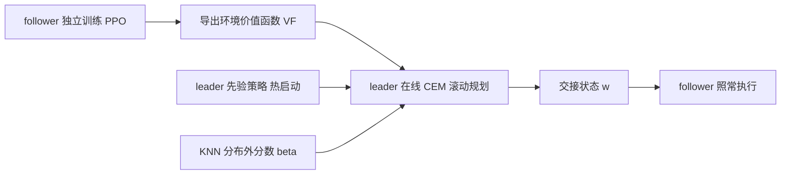

# PAVE：给下一台机器人留下更好的现场（arXiv:2611.08075）

**PAVE**（Policy Adaptation via Value Exchange，*Leave It Better Than Found: Value-Guided Cooperation in Sequential Tasks*，[arXiv:2611.08075](https://arxiv.org/abs/2611.08075)）来自剑桥大学 Prorok Lab 与 ETH Zürich Robotic Systems Lab，发表于 CoRL 2026。原文通读记录见 [来源归档](../../sources/papers/pave_arxiv_2611_08075.md)。

## 一句话定义

**两台从未一起训练过的机器人先后在同一环境里干活：后行动者一次性交出自己的环境价值函数，先行动者据此在线规划，在完成自己任务的同时把环境留成对后者有利的状态（§1、§3）。**

## 英文缩写速查

| 缩写 | 英文全称 | 简要说明 |
|------|----------|----------|
| PAVE | Policy Adaptation via Value Exchange | 本文方法（§1） |
| L / F | Leader / Follower | 先行动者 / 后行动者（§2） |
| VF(w) | Environmental value function | follower 对环境状态 w 的期望回报，由 PPO critic 聚合而来（§3） |
| PPO | Proximal Policy Optimization | 训练 leader 与 follower 的算法（附录 D） |
| CEM | Cross-Entropy Method | 零阶采样优化器，用于滚动规划（§3） |
| KNN | k-Nearest Neighbors | 用近邻距离估计交接状态是否分布外（式 4，K=5） |
| OOD | Out-Of-Distribution | 分布外，即 follower 训练中没见过的环境状态 |
| MARL | Multi-Agent Reinforcement Learning | 多智能体强化学习，通常联合训练（§1 相关工作） |
| FT | Finetuning | 用 follower 回报微调 leader 的特权基线（§4） |
| pp | percentage points | 成功率的百分点差 |

## 为什么重要

- 异构机器人会越来越多地共用同一空间；为每一种机器人组合单独联合训练，组合数会爆炸（作者论点，§1）。PAVE 的思路是：只交换强化学习智能体本来就有的价值函数，不交换策略。
- 与零样本协调、Ad Hoc 团队合作（PLASTIC、TEAMSTER）的区别：两者都假设同时行动，后者假设共享收益并靠观察推断队友；PAVE 面向顺序行动、各有任务、可一次性直接通信（§1、附录 B）。
- 作者自述：只共享 VF，leader 无法由此恢复 follower 策略（§3）。这只是作者的论述，论文未做隐私或逆推攻击实验（我的判断）。

## 核心机制

**设定（§2）：** leader 行动 T 步后留下终端环境状态 w ~ H_T(πL)；follower 策略固定。合作目标 `max JL + α·E[JF(πF,w)]`（式 1），以 VF(w) 替换 JF 得式 2；实际用归一化版本（式 3）并乘以 (1−β) 的不确定性折扣（式 5）。

**关键组件：**

- **价值函数接口（§3）：** VF(w)=VF_critic(s0,w)，固定已知初始私有状态 s0；对初始私有状态取期望的做法文中提出但未实验。
- **KNN 过滤（§3，式 4）：** β 为 0 表示在分布内，为 1 表示完全分布外；τ、d_max 取训练状态样本近邻平均距离的第 95 与 99.9 百分位（1000 个样本）；作者称其为启发式，因为常规不确定性估计需要改 follower 的架构。
- **规划（§3，式 5–6）：** CEM 滚动时域，先验策略热启动，horizon 外用 leader 自己的 VL 估计尾部；用 horizon 末端状态代替真实终端交接状态。
- **超参（附录 F，表 9）：** α=4，γ=0.99；horizon 20 至 40，样本 100 至 500，迭代 4 至 10，各场景不同。

## 实验与结果

| 场景（§4，表 1） | follower 成功率 Naive → PAVE（表 2） | 备注 |
|------|------|------|
| MOBILE ARM | 32.67 → 81.17 | 最大增幅 +48.5 pp；去 OOD 过滤反而 93.83；FT 99.50 |
| OBSTACLE ARENA | 45.78 → 83.61 | FT 仅 54.83 |
| WAREHOUSE | 99.33 → 99.78 | 基线已饱和 |
| WAREHOUSE PICKUP BLOCKED | 49.78 → 89.94 | 去 OOD 过滤降到 32.50；FT 98.11 |
| WAREHOUSE PICKUP UNSEEN | 85.44 → 98.22 | |
| HOUSEHOLD（真机，20 次） | 30 → 70 | leader 两者均 100%（§5） |

- **平均 +27.9 pp、最大 +48.5 pp**（§1、§5）。我用表 2 核对：五个仿真场景 follower 成功率增幅的算术平均恰为 27.9，即该平均不含真机。
- **去掉价值交换的对照（§5）：** Leader-only（α=0）follower 无稳定提升，至多恢复 PAVE 提升的 14.2%；作者据此认为增益来自价值交换而非在线规划本身。
- **对特权基线 FT（§5）：** 作者称"五个场景中三个持平或更好、两个落后"；表 2 与此一致（MOBILE ARM、PICKUP BLOCKED 落后）。注意 FT 用 α=1、PAVE 用 α=4（附录 D）。
- **真机（§5、附录 E）：** 两台 RoboMaster，OptiTrack 反馈 50 Hz；仿真假设无摩擦、速度匹配，真机摩擦高，leader 常需多次推动，作者归因于滚动重规划补偿了模型误差。

## 工程实践

- **代码（README，静态读、未运行）：** MIT 协议，Python 3.13 + uv；`bash reproduce.sh --from ood` 从随附 checkpoint 复现论文评测；目录含环境、PPO 训练、CEM 规划器、各场景配置与论文脚本。官方仓库：[proroklab/PAVE](https://github.com/proroklab/PAVE)。
- **前提条件：** 双方须共享同一环境状态表征 w；follower 需愿意导出 critic 并提供训练状态样本用于计算 τ、d_max（§3、§6）。
- **仿真器与策略规模：** 仿真环境为作者自写的 numpy 环境；所有策略为 SB3 MlpPolicy 两层 64 单元（附录 C、D），与真实感知管线、高维视觉输入相距甚远（我的判断）。
- **策略筛选：** 个体成功率低于 70% 的策略被剔除，作者称对所有基线统一应用（附录 D）。
- **与相邻方法：** 在线规划部分属于带价值函数尾部估计的采样式 MPC，参见 [模型预测控制](../methods/model-predictive-control.md) 与 [基于模型的强化学习](../methods/model-based-rl.md)。

## 局限

**作者自述（§6）：**

- 只有两个智能体、固定顺序；多 follower 与嵌套优化是未来工作。
- 规划时域受在线运行时间限制，交接状态只能用 horizon 末端预测近似。
- 假设双方共享同一环境表征。
- 假设 follower 如实提供价值函数与不确定性，恶意 follower 可误导 leader。
- 附录 B 与 §3 承认：VL 尾部估计假设 leader 此后自利，会高估回报。

**我看到的未验证之处（判断，非论文结论）：**

- N>2 智能体的递归推广依赖"两智能体形式保证 leader 保持 follower 基线性能"这一前提（§3 Remark），正文未给出该保证的证明，也无 N>2 实验。
- 真机仅一个场景、20 次试验、无置信区间；Naive 与 PAVE 用相同初始条件配对（附录 E）。
- 仿真为自写简化环境，策略为小型 MLP；"平均 +27.9 pp"包含 WAREHOUSE 这种基线已饱和的场景，且与场景选择有关。
- KNN 过滤是保守启发式：MOBILE ARM 上去掉它反而更好（SF 93.83 对 81.17），论文自己也承认（§5）。
- 个体成功率不足 70% 的策略被剔除，结论适用于"能力足够"的智能体。
- 价值函数与未知初始私有状态的期望形式、不同价值函数尺度的跨 follower 对齐，论文未实验（我的判断）。

## 关联页面

- [多智能体强化学习（MARL）](../methods/marl.md)
- [PPO](../methods/ppo.md)
- [模型预测控制（MPC）](../methods/model-predictive-control.md)
- [基于模型的强化学习](../methods/model-based-rl.md)
- [基于价值的强化学习](../methods/value-based-reinforcement-learning.md)
- [Sim2Real](../concepts/sim2real.md)
- [人形多机协同](../concepts/humanoid-multi-robot-coordination.md)

## 参考来源

- [pave_arxiv_2611_08075.md](../../sources/papers/pave_arxiv_2611_08075.md)（原文通读归档）
- [arXiv:2611.08075](https://arxiv.org/abs/2611.08075)
- [GitHub proroklab/PAVE](https://github.com/proroklab/PAVE)
- [项目页](https://proroklab.github.io/PAVE/)

## 推荐继续阅读

- [arXiv PDF](https://arxiv.org/pdf/2611.08075v1)
- [MARL 方法页](../methods/marl.md)
- [模型预测控制方法页](../methods/model-predictive-control.md)
