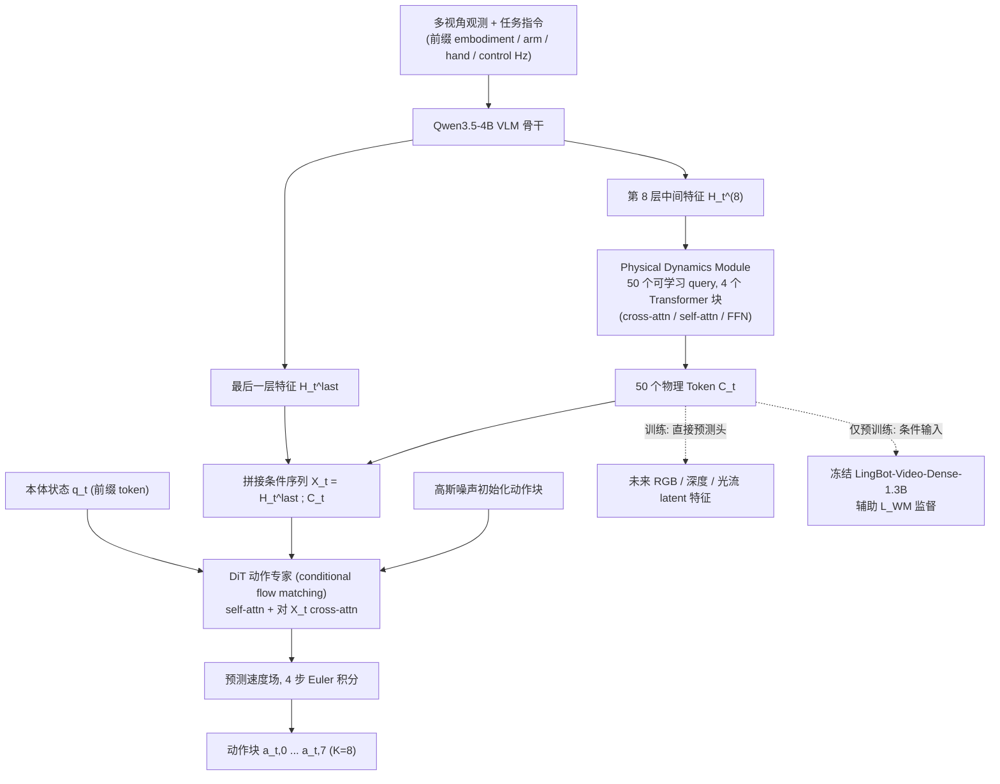

# PDRVLA：具有物理动力学表示的视觉语言动作模型

**PDRVLA**（*PDRVLA: A Vision-Language-Action Model with Physical Dynamics Representations*，[arXiv:2610.37381](https://arxiv.org/abs/2610.37381)）收录于 senlanke「具身运控lab」10-26–10-30 前沿论文动态（Manipulation）。本页依据**周报条目 + arXiv 摘要页**整理，流程图依据论文方法部分（见参考来源），未逐页核对实验数字；指标与结论以论文为准。

## 一句话定义

**PDRVLA：具有物理动力学表示的视觉语言动作模型——提出轻量化 Physical Dynamics Module，从视觉语言特征中提取物理 Token，并预测未来 RGB、深度和光流特征。训练时使用冻结的视频世界模型提供辅助监督，推理时无需生成未来视频。在 LIBERO、LIBERO-Plus、RoboTwin 2.0 和 SimplerEnv 上，成功率分别达到 **99.3%、89.9%、93.6% 和 81.5%**。**

## 英文缩写速查

| 缩写 | 英文全称 | 简要说明 |
|------|----------|----------|
| VLA | Vision-Language-Action | 视觉–语言–动作模型 |
| IL | Imitation Learning | 模仿学习 |

## 为什么重要

- 周报所述待解决的问题：VLA 缺少对环境物理变化的有效建模，而在控制循环中直接生成未来视频会增加推理延迟。

## 流程总览

图依据：论文 §3 / Fig.3、§4.1 / Fig.4

## 核心机制

| 项 | 内容 |
|----|------|
| **arXiv** | [2610.37381](https://arxiv.org/abs/2610.37381) · [PDF](https://arxiv.org/pdf/2610.37381) |
| **作者（arXiv）** | Wang, Hanqing, Cai, Zhaotian, An, Ruichuan, Zeng, Bohan, Zhang, Tao, Chen, Yilin, Jiang, Xu, Chen, Kaiquan et al. |
| **机构（周报所述，未逐条核实）** | 北京大学、京东相关研究团队。 |
| **arXiv 评论栏** | （无） |
| **开源** | arXiv 摘要页与评论未见代码或项目页链接（仅核对 arXiv 摘要页，不代表未发布）（2026-11-02） |
| **周报所述创新点** | 提出轻量化 Physical Dynamics Module，从视觉语言特征中提取物理 Token，并预测未来 RGB、深度和光流特征。训练时使用冻结的视频世界模型提供辅助监督，推理时无需生成未来视频。在 LIBERO、LIBERO-Plus、RoboTwin 2.0 和 SimplerEnv 上，成功率分别达到 **99.3%、89.9%、93.6% 和 81.5%**。 |

### arXiv 摘要节选（英文原文）

> Vision--Language--Action (VLA) models generate robot actions from visual observations and language instructions, but their understanding of physical dynamics remains limited. Video world models can capture scene dynamics, yet generating future videos introduces high latency into the control loop.

## 源码运行时序图

**不适用**：arXiv 摘要页与评论未见代码或项目页链接（仅核对 arXiv 摘要页，不代表未发布），无可对齐的官方代码流程。

## 实验与评测

- 周报与摘要给出的数字/场景已写入上表「创新点」与摘要节选；其余实验细节、基线与成功率定义请回到论文正文。
- 读法：先对齐任务设定、传感器与成功定义（仿真/真机），再解读 headline 数字，勿跨论文直接比较。

## 与其他工作对比

| 维度 | 读法 |
|------|------|
| **同周对照** | 见 [Manipulation周报技术地图](../overview/senlanke-weekly-2026-10-26-30-manipulation-technology-map.md)，按方向浏览同期论文 |
| **开源状态** | arXiv 摘要页与评论未见代码或项目页链接（仅核对 arXiv 摘要页，不代表未发布） |

## 结论

**PDRVLA：具有物理动力学表示的视觉语言动作模型。**

1. 本页是入库级摘要，复现前请核对论文正文、附录与代码仓库。
2. 指标须连同实验条件解读。
3. 关注 arXiv 版本更新与代码发布。

## 关联页面

- [senlanke-weekly-2026-10-26-30-manipulation-technology-map](../overview/senlanke-weekly-2026-10-26-30-manipulation-technology-map.md)
- [manipulation](../tasks/manipulation.md)
- [vla](../methods/vla.md)

## 参考来源

- [pdrvla-physical-dynamics-representations_arxiv_2610_37381.md](../../sources/papers/pdrvla-physical-dynamics-representations_arxiv_2610_37381.md)
- [wechat_senlanke_weekly_manipulation_2026-10-26_30.md](../../sources/blogs/wechat_senlanke_weekly_manipulation_2026-10-26_30.md)
- [arXiv:2610.37381](https://arxiv.org/abs/2610.37381)
- [arXiv PDF](https://arxiv.org/pdf/2610.37381)：已通读方法部分（实验与附录以略读为准）：§3 模型架构、§4 训练（物理预训练与联合训练）

## 推荐继续阅读

- [arXiv PDF](https://arxiv.org/pdf/2610.37381)
