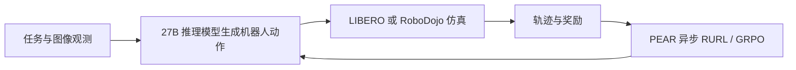
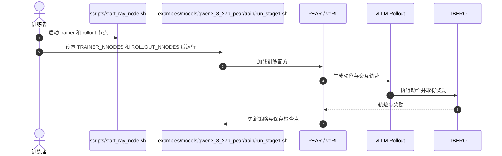

# Training Reasoning Models in Simulation to Natively Use Real Robots｜PEAR / RURL：在仿真中训练原生控制真机的推理模型

## 一句话定义

**PEAR / RURL：在仿真中训练原生控制真机的推理模型**：以 PEAR 的 Robot-Use Reinforcement Learning 在仿真交互中后训练 27B 推理模型，使模型直接输出机器人动作；实验不使用专家演示轨迹。

## 英文缩写速查

| 缩写 | 英文全称 | 简要说明 |
|---|---|---|
| PEAR | Post-training Engine for Agentic Robotics | 异步仿真强化学习后训练框架 |
| RURL | Robot-Use Reinforcement Learning | 模型直接使用机器人动作接口 |
| GRPO | Group Relative Policy Optimization | 强化学习策略优化算法 |

## 为什么重要

检验高参数量推理模型能否不依赖专家示范、只从仿真环境的交互奖励学习动作，并将能力转移到实体机器人。

## 核心信息

| 项目 | 核查来源 |
|---|---|
| 作者或机构 | 麻省理工学院等（详见论文作者与单位） |
| 原文 | [一手全文/原始新闻稿](https://arxiv.org/html/2611.18562v1) |
| 代码状态 | [已公开官方仓库](https://github.com/mit-han-lab/pear) |
| 核查版本 | arXiv:2611.18562v1 |

## 核心原理

模型观察 RGB 图像、目标文本和交互上下文，生成结构化末端动作；仿真环境执行并返回后续观测和任务奖励。PEAR 编排 Ray/veRL/vLLM 异步 rollout、GRPO 更新与分阶段 LIBERO/RoboDojo 训练课程。这里的「无演示」指机器人后训练阶段，而不是基础语言模型未经预训练。

## 流程总览

上述流程图是基于原始资料整理的方法主干，不代表已复现作者模型。

## 源码运行时序图

核对入口：[官方 quickstart](https://github.com/mit-han-lab/pear/blob/main/docs/getting_started/quickstart.md)。该时序描述训练组件职责，并非本地运行记录。

## 工程实践

1. 按官方 Quick Start 安装 LIBERO 依赖、启动 Ray trainer/rollout 节点，区分训练阶段和评估脚本。
2. 官方全配方要求多节点 GPU 和共享工作目录，先核算计算资源；再用导出 checkpoint 与独立评估脚本检查任务覆盖。
3. 真机部署前额外验证动作限幅、急停、控制周期和视觉延迟，不将仿真训练等同于实物安全认证。

## 实验与评测

论文报告 LIBERO 成功率由 1.6% 到 74.4%；真实双臂试验从基础模型的 0% 到加入仿真课程训练后的 60%（仅 LIBERO 课程的对照为 23%）。这些数值对应论文定义的任务与试验设置。

## 与其他工作对比

与 [Agentic-Teacher](./paper-agentic-teacher-2611-17394.md) 生成纠错演示再微调不同，PEAR 将仿真成功奖励用于直接更新推理模型。

## 结论

**以 PEAR 的 Robot-Use Reinforcement Learning 在仿真交互中后训练 27B 推理模型，使模型直接输出机器人动作；实验不使用专家演示轨迹。**

1. 无示教不等于无预训练；应区分 base model、仿真 RL 和实体评测。
2. 把动作接口、奖励设计、rollout 算力分别作为复现配置。
3. 对 60% 真机结果保留实验范围与控制安全条件。

## 局限与风险

高算力分布式训练要求、测试机器人及任务数量、推理延迟和仿真—真机偏差限制对结果的推广。

## 关联页面

- [paper agentic teacher 2611 17394](./paper-agentic-teacher-2611-17394.md)
- [paper wato 2611 17626](./paper-wato-2611-17626.md)
- [paper budget vln 2611 17442](./paper-budget-vln-2611-17442.md)
- [强化学习](../methods/reinforcement-learning.md)
- [GRPO](../methods/grpo.md)
- [vla 路线](../../roadmap/depth-vla.md)

## 参考来源

- [一手原文核对记录](../../sources/papers/pear-2611-18562.md)
- [源码核对记录](../../sources/repos/pear-2611-18562.md)

## 推荐继续阅读

- [一手正文](https://arxiv.org/html/2611.18562v1)
- [作者/扩展资料](https://github.com/mit-han-lab/pear)

