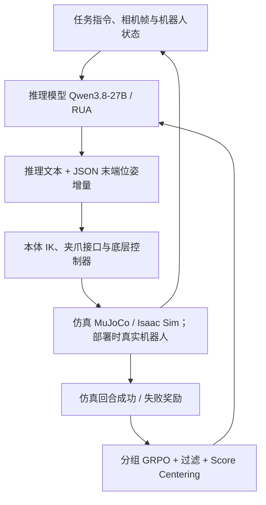
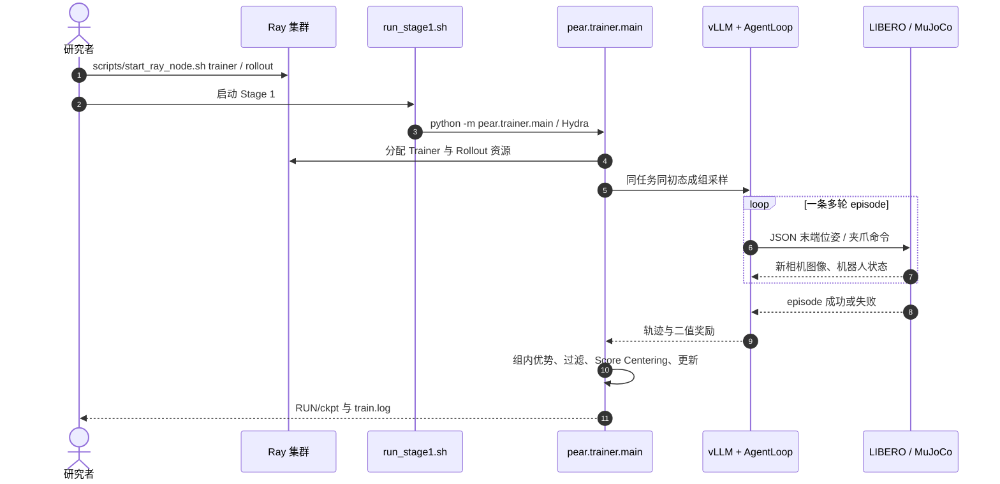

# PEAR：在仿真中训练推理模型原生使用真实机器人（Robot-Use RL）

**英文论文：** *Training Reasoning Models in Simulation to Natively Use Real Robots*。MIT HAN Lab 等团队的 **PEAR（Post-training Engine for Agentic Robotics，面向智能体机器人的后训练引擎）**，提出 **Robot-Use Reinforcement Learning（RURL，机器人使用强化学习）**，让通用推理模型在仿真中靠任务完成奖励学习与机器人的交互，而不是从示范轨迹中模仿动作。论文、[官方博客](https://mit-han-lab.github.io/pear-blog/)和[源码](https://github.com/mit-han-lab/pear)都已发布。

## 一句话定义

**PEAR 让 27B 推理模型以“看图和本体状态 → 推理 → 输出末端位姿增量 → 机器人执行 → 再观察”的多轮闭环参与仿真强化学习，再将所得模型接到真实机器人的控制接口。**

## 英文缩写速查

| 缩写 | 英文全称 | 简要说明 |
|---|---|---|
| PEAR | Post-training Engine for Agentic Robotics | 针对机器人智能体的分布式后训练引擎 |
| RURL | Robot-Use Reinforcement Learning | 在仿真中依据机器人任务完成奖励优化推理模型 |
| RUA | Robot-Use Agent | 直接处理机器人观测、推理并调用机器人动作接口的模型 |
| GRPO | Group Relative Policy Optimization | 同任务、同初态多条 rollout 的分组相对优势优化 |
| IK | Inverse Kinematics | 把目标末端位姿转换为机器人可执行关节目标 |
| VLA | Vision-Language-Action | 视觉语言动作模型；用于理解本方法与动作块策略的边界 |

## 核心信息

| 项 | 内容 |
|---|---|
| 机构 | 麻省理工学院（MIT）、加州大学伯克利分校、加州大学圣地亚哥分校、英伟达（NVIDIA）、Inco AI |
| 模型 | Qwen3.8-27B 推理模型，分三阶段做仿真 RL |
| 输入 | 任务指令、相机图像、本体状态和之前交互的上下文 |
| 输出 | 自然语言推理与 JSON 格式的各末端执行器相对位姿/夹爪命令；由 IK 和机器人控制栈执行 |
| 环境 | LIBERO / LIBERO-Plus / LIBERO-Pro（MuJoCo），RoboDojo / RoboLab-120（Isaac Sim） |
| 开源资源 | [训练及部署代码](https://github.com/mit-han-lab/pear)、[模型权重](https://huggingface.co/collections/mit-han-lab/pear)、[论文 PDF](https://mit-han-lab.github.io/pear-blog/paper.pdf) |

## 为什么重要

- **与轨迹模仿学习形成不同训练路径。** 模型不需要动作示范即可通过环境成功奖励获得机器人使用能力；但不表示不需要仿真环境、任务判定器与本体控制接口。
- **把长链推理与实体动作放进同一个强化学习闭环。** Agent 每一步既能解释当前图像/状态，也能发出下一步相对位姿变化；对接的是低层 IK/控制器，而非直接预测关节力矩。
- **在不同任务和本体上测试迁移。** 作者使用 LIBERO、RoboDojo、RoboLab-120 与真实 YAM 验证，但真机验证仅 30 次，外推必须谨慎。

## 核心原理

### Robot-Use Agent 的动作语义

每轮交互中，RUA 接收目标、相机视图与机器人状态，生成推理文本及下一步动作 JSON。动作是**相对末端位姿变化**（长度单位 cm、角度单位 rad）及夹爪状态，由本体软件用 IK、关节伺服和安全约束执行。环境返回新的观测，直到成功或达到 episode 限额。不同机器人需提供对应的工具约定、坐标定义与标定。

这与传统[动作块 VLA](../methods/vla.md) 的“给定观测直接产生固定时间窗连续动作”不同：RUA 的决策步骤依赖生成式推理，机器人底层闭环仍独立运行。论文所说的无额外外部 *harness*，指无需在模型外串接专门的感知/任务规划或技能编排模块，不应理解为去掉 IK 或控制器。

### 仿真 RL 与课程

论文将 **episode 成功/失败** 作为二值奖励；在同任务、同初始状态的组内使用 **GRPO** 计算相对优势，奖励回传给多轮文本与动作 token。对于组内全成功或全失败的无有效排序样本进行过滤；完全异步 rollout 场景引入 **score centering** 缓和数据采样时的旧策略与训练时策略偏差。

训练课程分三步：① LIBERO Goal / Spatial / Object；② 扩展到 LIBERO-Long；③ 加入 RoboDojo 的 general pickup 和 align blocks。官方配方由 veRL、vLLM、Ray、LMCache 协同完成多轮长上下文轨迹采样与更新。以上为论文描述和官方配方，不是本仓库重新训练的结果。

## 流程总览

训练时奖励更新模型参数；真机部署时沿“观测—RUA—IK/控制器—机器人—新观测”闭环执行，**不在线执行上述仿真训练步骤**。

## 源码运行时序图

以下对应官方 [Quick Start](https://github.com/mit-han-lab/pear/blob/main/docs/getting_started/quickstart.md)、[Stage 1 配方](https://github.com/mit-han-lab/pear/blob/main/examples/models/qwen3_8_27b_pear/train/run_stage1.sh)及 [PEAR 训练入口](https://github.com/mit-han-lab/pear/tree/main/pear/trainer)。图中的 episode 级奖励及 GRPO 依据论文与训练配方，未将低层控制的具体 IK 调用路径臆写为固定函数名。

**真机运行入口单独区分：** `deploy/run_server.sh` 启动 `pear.deploy.server.main` 的 vLLM OpenAI-compatible 服务；`deploy/run_station.sh` 启动 `pear.deploy.station.cli gui`，通过 `VLLMClient` 向服务器发送观测/请求，再由 YAM 或 SO-101 的 station 控制栈执行。详见[源码归档](../../sources/repos/mit_han_lab_pear.md)。

## 工程实践

1. 官方 LIBERO 路径：`bash scripts/install.sh libero_run`，再逐节点执行 `scripts/start_ray_node.sh trainer|rollout`，最终由 `examples/models/qwen3_8_27b_pear/train/run_stage1.sh` 启动 Stage 1。下一阶段从前一阶段导出的 checkpoint 开始。
2. **算力边界：** 官方复现配方使用 **32 个 GPU 节点**（例如每节点 8 张 H100，8 节点训练/24 节点 rollout），不是普通单 GPU 全量训练。使用 `scripts/export_checkpoint.sh` 导出模型后可运行 `examples/eval/eval_libero.sh`。
3. **真机路径：** 官方支持 YAM 与 SO-101 的 station；vLLM 服务配置 GB300 或 RTX 5090。单 RTX 5090 的 **NVFP4 推理**不能等同于 BF16 精度评测；不应以此推导该卡具备完整复现训练能力。
4. **安全前置：** 需配置本体型号、相机、USB-CAN/串口与标定；先执行 `pear-station ... preflight`、静态检查和人工监护下的 smoke test，YAM 文档要求紧急断电装置。不能直接把论文演示当成即插即用的真机控制保障。

## 实验与评测

下列均为**论文作者报告**，本站未独立执行模型训练、评测或真机实验。

| 设置 | 结果 | 解读边界 |
|---|---|---|
| LIBERO 四套基准整体 | 基座 **1.6%** → PEAR **74.4%** | 与同基准专门 VLA π₀.₅ 的 **96.9%** 仍有差距 |
| LIBERO-Pro 指令重定向 | PEAR **57.4%**；π₀.₅ **0.75%** | 特定“新任务/旧场景”子设定，不能当 LIBERO-Pro 总成绩 |
| 未参与初始训练的 LIBERO-Long | **0.4%** → **39.0%** | 代表任务跨套迁移而非全覆盖 |
| RoboLab-120 | 基座 **5.4%** → 最终模型 **37.3%** | 120 任务仿真测评，独立于 LIBERO |
| 真机 YAM 双臂 | 基座 **0/30**、LIBERO-only **7/30**、最终模型 **18/30（60%）** | 10 次积木对齐与 20 次抓取；总体样本量有限 |
| 通用推理/代码/视觉九项均值 | **81.64** → **81.49** | 各项差异置信区间涵盖零；不等于能力完全没有变化 |

## 对比

| 路线 | 训练与动作接口 | PEAR 的区别 |
|---|---|---|
| 示范驱动的动作块 VLA | 由机器人演示监督动作生成 | PEAR 用仿真中的任务成败奖励优化多轮视觉推理和动作 token |
| 外部规划/技能工具链 | 模型调用独立抓取、规划或技能模块 | PEAR 的模型直接生成机器人部件的相对末端位姿变化 |
| PEAR | 多轮观察、推理、动作、反馈的闭环 | 仍依赖机器人本地 IK 和控制器；“无额外 harness”不等于没有底层控制 |

比较仅针对论文的模型接口与训练信号，不能据此推断零样本适用于任意机器人；见 [论文 PDF](https://mit-han-lab.github.io/pear-blog/paper.pdf) 和 [全文核对归档](../../sources/papers/pear_robot_use_rl_mit_2026.md)。

## 结论

**PEAR 表明“仿真奖励 + 多轮推理动作接口”能够不依赖机器人示范数据学习一定的真实操作能力，但当前尚不能代替高频动作控制或成熟的任务专用 VLA。**

1. **先区分动作接口。** RUA 输出离散时刻的相对末端位姿及夹爪动作；实际机械臂仍要靠 IK/控制器完成轨迹与伺服。
2. **看清 RL 训练信号。** 任务级二值成功奖励经 GRPO 传播给多轮推理/动作，而非提供稠密人工轨迹标签。
3. **比较必须同基准。** 标准 LIBERO 上 74.4% 低于 π₀.₅ 的 96.9%；特定 LIBERO-Pro 扰动下优势不能概括为所有操作任务更强。
4. **Sim2Real 是有条件的。** 60% 来自 30 次 YAM 双臂试验，坐标约定、提示词、IK、机电标定和延迟会影响另一种机器人上的效果。
5. **训练与部署成本分开。** 多节点 GPU 训练 vs 单卡量化推理不是同一系统条件；量化版本需单独验证精度。

## 局限与风险

- **推理慢：** 作者报告一步约 **4.3 秒**，难覆盖快速、动态或连续接触控制；末端单步目标也不保证轨迹平滑。
- **仿真任务有限：** 仍需更广泛物体、物理、干扰与接触场景；真机 18/30 不构成跨本体通用成功率保证。
- **描述与控制依赖：** 各机器人坐标、相机、本体状态格式和 IK/控制器不同；发生错误可能碰倒物体或到达步数上限。
- **开源边界：** 官方 GitHub 开放训练、评估、vLLM 服务和 YAM/SO-101 station，HF 可获取模型；真实机器人硬件、专用仿真环境与依赖需另行准备。
- **同名项目辨识：** 本文 PEAR = *Post-training Engine for Agentic Robotics*，不同于仓库已有的 [PEAR：Pixel-Aligned Expressive Human Mesh Recovery](./paper-pear-pixel-aligned-expressive-hmr.md)。
- **验证范围：** 本次对原文、仓库及入口作静态核对，未运行 27B 训练、基准测试或真机控制。

## 关联页面

- [Agentic Robotics 六条研究路线对照](../comparisons/agentic-robotics-six-paths-2026.md) — 区分系统验收、推理后训练、VLA、全身跟踪、触觉与 Real2Sim 的接口和评测边界。

- [VLA 方法](../methods/vla.md) — 与视觉语言动作策略、动作块推理和动作空间对照
- [Harness VLA](./paper-harness-vla.md) — 冻结低层 VLA + 外部记忆/技能规划 vs 在模型内学习机器人使用
- [PEAR（人体网格恢复，同名不同论文）](./paper-pear-pixel-aligned-expressive-hmr.md) — 防止检索和项目身份混淆
- [VLA 纵深路线：Stage 5](../../roadmap/depth-vla.md) — RL 后训练与自改进方向
- [Sim2Real 纵深路线](../../roadmap/depth-sim2real.md) — 仿真训练到真机部署的接口与边界

## 参考来源

- [论文全文与附录核对归档](../../sources/papers/pear_robot_use_rl_mit_2026.md)
- [MIT HAN Lab 官方博客及权重资源](../../sources/sites/pear_robot_use_rl_blog.md)
- [PEAR 开源仓库与实际训练/部署入口](../../sources/repos/mit_han_lab_pear.md)

## 推荐继续阅读

- [官方论文 PDF](https://mit-han-lab.github.io/pear-blog/paper.pdf)
- [官方博客与演示](https://mit-han-lab.github.io/pear-blog/)
- [PEAR GitHub、Quick Start 和部署文档](https://github.com/mit-han-lab/pear)
- [Hugging Face 模型权重集合](https://huggingface.co/collections/mit-han-lab/pear)
