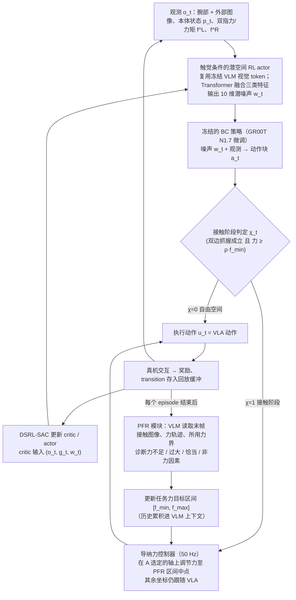

# PEARS（arXiv:2610.08784）

**PEARS**（*PEARS: Physical-Prior-Guided Efficient Adaptation via Failure Reasoning and Diffusion Steering for Tactile Manipulation*，[arXiv:2610.08784](https://arxiv.org/abs/2610.08784)，[项目页](https://song-kun.github.io/pears)）来自 [具身智能小站 2026-10-13 盘点](../../sources/blogs/wechat_embodied_station_34_papers_mulligan_2026-10-13.md)，属「灵巧操作」组。

## 一句话定义

**VLM 失败诊断转为接触力边界，再用触觉条件噪声引导冻结策略在线适配。**

## 英文缩写速查

| 缩写 | 英文全称 | 简要说明 |
|------|----------|----------|
| VLM | Vision-Language Model | 视觉语言模型 |
| DP | Diffusion Policy | 扩散策略 |
| Tactile | Tactile Sensing | 触觉感知 |

## 为什么重要

- 触觉失败信息应参与策略适配而非只报警。
- 开源结论：**项目页未列 GitHub**（步骤 2.5，2026-10-14）。项目页入库日未列 GitHub。
- 同期同组工作见 [失败导向采集与可组合世界动作模型：具身智能小站 10-13 期 34 篇阅读坐标](../overview/embodied-station-2026-10-13-34-papers-technology-map.md)。

## 流程总览

图依据：论文 §IV Methodology（A–C）、§III-B（式 1–11）。

## 核心机制

| 项 | 内容 |
|----|------|
| **arXiv** | [2610.08784](https://arxiv.org/abs/2610.08784) |
| **开源** | **项目页未列 GitHub** |
| **要点** | 仿真和两项真机实验。 |
| **文内指标** | 以原文为准。 |

## 源码运行时序图

**不适用（项目页未列 GitHub）** — 项目页入库日未列 GitHub。 不编造运行脚本；代码公开后再补。

## 实验与评测

- 以原文为准。
- **读法：** 本页为索引级摘要，依据公众号转述的官方摘要与仓库信息整理；逐项数字与 baseline 以原文 PDF 为准。

## 与其他工作对比

- 横向索引见 [失败导向采集与可组合世界动作模型：具身智能小站 10-13 期 34 篇阅读坐标](../overview/embodied-station-2026-10-13-34-papers-technology-map.md)；同 arXiv 不重复造页。

## 结论

**失败推理→物理约束→采样引导，是不重训的适配路径。**

1. 开源边界：**项目页未列 GitHub** — 项目页入库日未列 GitHub。
2. 核心机制：仿真和两项真机实验。
3. 复现与选型前核对任务协议、硬件与基准口径，勿直接横比公众号摘录数字。

## 关联页面

- [tactile-sensing](../concepts/tactile-sensing.md)
- [diffusion-policy](../methods/diffusion-policy.md)
- [visuo-tactile-fusion](../concepts/visuo-tactile-fusion.md)
- [embodied-station-2026-10-13-34-papers-technology-map](../overview/embodied-station-2026-10-13-34-papers-technology-map.md)

## 参考来源

- [pears_tactile_failure_reasoning_diffusion_steering_arxiv_2610_08784.md](../../sources/papers/pears_tactile_failure_reasoning_diffusion_steering_arxiv_2610_08784.md)
- [wechat_embodied_station_34_papers_mulligan_2026-10-13.md](../../sources/blogs/wechat_embodied_station_34_papers_mulligan_2026-10-13.md)
- [arXiv:2610.08784](https://arxiv.org/abs/2610.08784)
- [arXiv PDF](https://arxiv.org/pdf/2610.08784)：已通读方法部分（实验与附录以略读为准）：§I Introduction（略读）、§III Preliminaries、§IV Methodology（A–C）

## 推荐继续阅读

- [arXiv PDF](https://arxiv.org/pdf/2610.08784)
- [项目页](https://song-kun.github.io/pears)
