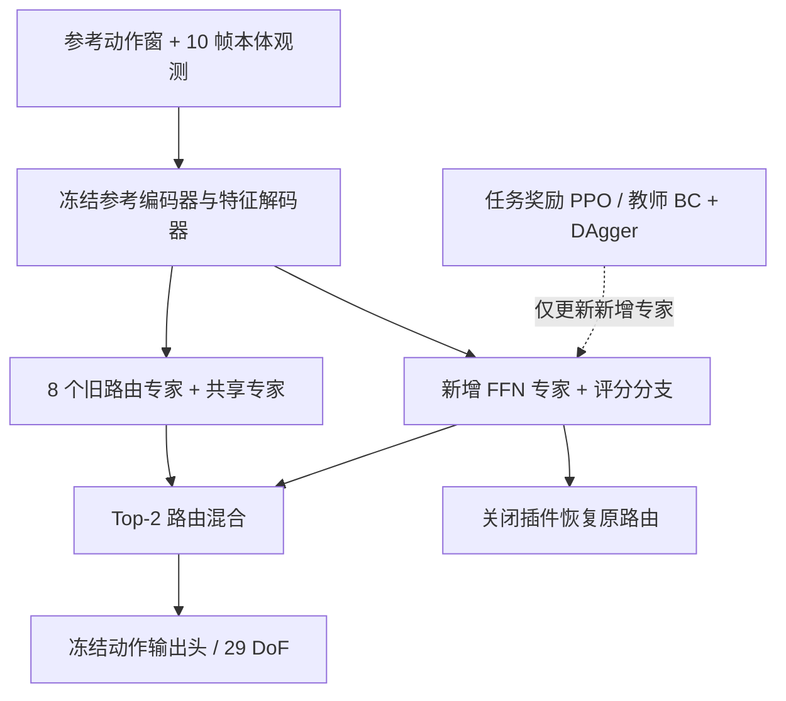

# PERA：面向持续全身控制的可插拔动作专家（PERA: Plug-in Experts for Robotic Actions in Continual Whole-Body Control）

**机构：** 原文 v1 未列出作者机构  
**论文：** [arXiv:2611.16188](https://arxiv.org/abs/2611.16188)

## 一句话定义

PERA 冻结预训练 MoE 全身动作策略，仅训练附加 FFN 专家及路由分数；G1 仿真中每插件约为 actor 参数 1.03%，关闭可恢复 126 项旧动作的原始计算路径，并在 10 项新任务上验证。

## 英文缩写速查

| 缩写 | 英文全称 | 简要说明 |
|---|---|---|
| PERA | Plug-in Experts for Robotic Actions | 本文可插拔技能专家框架 |
| MoE | Mixture of Experts | 多专家及路由器构成的基础策略 |
| FFN | Feed-Forward Network | 每个任务扩展的新专家模块 |
| PPO | Proximal Policy Optimization | 用环境奖励训练新增专家的 RL 方法 |
| DAgger | Dataset Aggregation | 在线汇总学生状态的教师动作标签 |

## 为什么重要

全模型微调容易忘掉已有动作，每技能保存完整独立策略又难以维护。PERA 以冻结骨干保留原有路径，同时把新增技能限制在轻量模块中。

## 核心原理

基础策略用参考运动编码器与最近十帧本体观测产生共享特征，并含 8 个路由专家加 1 个共享专家。新增 FFN 专家及评分分支，保持基础 encoder/decoder、路由、归一化器与动作头冻结。新专家参与 Top-2 路由：有奖励时仅用 PPO 更新新增模块；有教师时先 BC 后在线 DAgger。停用插件恢复原路由与动作输出。

### 流程总览

以下是论文方法的**概念流程**，不是未经核查的源代码调用关系。

## 实验与评测

论文仅在 Unitree G1 的 29 DoF 仿真评测。基础 actor 约 10.4M 参数，新模块约为其 1.03%。10 项新场景为翻滚/攀爬/跳坐/越障等。关闭插件时 126/126 旧动作完成；未用于插件训练的 8 段快舞完成率从 59.38% 提至 71.88%。在 HoloMotion + expert 对照里，10 任务平均末端位置误差由 173.36 cm 降为 28.51 cm；不是实体机器人指标。

## 与其他工作对比

相较全策略再训练，PERA 只增量训练专家与路由；相较独立策略切换，可在已有共享动作头内组合。但其关闭后行为相同是对同输入的**计算路径恢复**，不是证明长期实机多任务免遗忘。

## 结论

**PERA 冻结预训练 MoE 全身动作策略，仅训练附加 FFN 专家及路由分数；G1 仿真中每插件约为 actor 参数 1.03%，关闭可恢复 126 项旧动作的原始计算路径，并在 10 项新任务上验证。**

1. 1.03% 是每新增模块相对基础 actor 的参数比例，不包含完整系统训练/维护成本。
2. 126 项历史动作保持的核心机制是**冻结旧网络与归一化器、关闭插件后恢复原路由**。
3. PPO 与 BC+DAgger 是两种新技能监督路径，不能把所有任务说成纯强化学习。
4. 真机部署和大规模长期插件之间的干扰、路由稳定性仍待实证。

## 工程实践

实现时先冻结并校验原 actor 与归一化参数，记录专家选择 Top-2 分布、新模块参与频率、动作边界连续性及关闭后逐帧输出一致性；再在仿真评测旧动作集与 10 项新任务，避免仅用新任务成功率评估持续学习。

### 源码运行时序图

**不适用（未取得可核实的官方研究代码运行入口）。** 不能由论文框架图推断真实函数调用或部署数据流。

## 局限与风险

论文目前仅报告 G1 仿真；专家被开启时会更改原有专家竞争关系，历史全动作保持论证依赖**禁用插件**，不保证所有插件同时启用时同样稳健。源文未给完整的增量技能长期真机运行统计。

## 关联页面

- [全身控制](../concepts/whole-body-control.md)
- [PPO](../methods/ppo.md)
- [模仿学习纵深路线](../../roadmap/depth-imitation-learning.md)
- [11.09–11.13 人形／四足 29 篇周报](../overview/humanoid-quadruped-2026-11-09-13-29-papers.md)

## 参考来源

- [arXiv v1 原文通读归档](../../sources/papers/pera_plugin_experts_arxiv_2611_16188.md)
- [论文 HTML 全文](https://arxiv.org/html/2611.16188v1)

## 推荐继续阅读

- [论文 arXiv HTML 全文](https://arxiv.org/html/2611.16188v1)
- [论文 PDF](https://arxiv.org/pdf/2611.16188v1)
