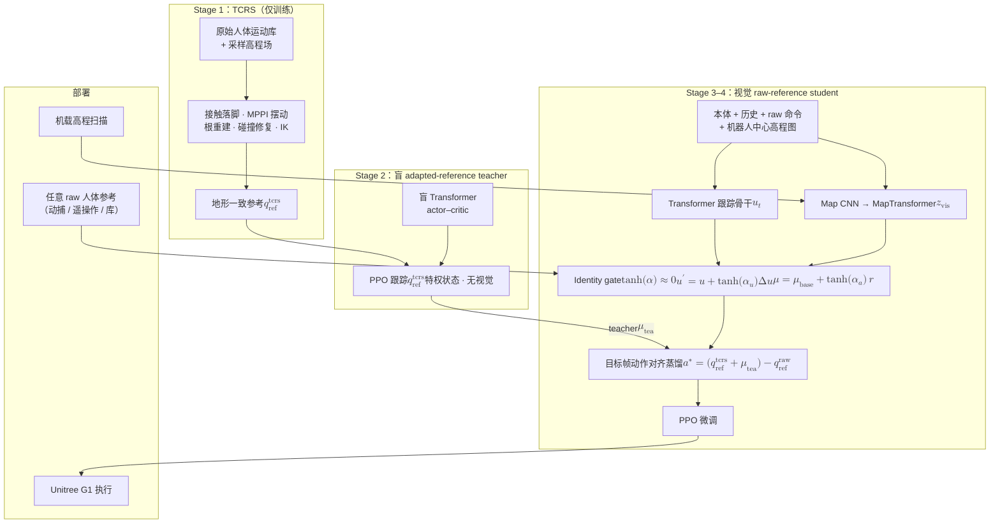
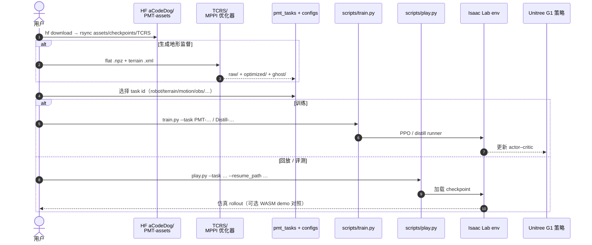

# Perceptive BFM：Adapting Human Motion Priors to Robot-Centric Terrain

**Perceptive BFM**（*Perceptive Behavior Foundation Model: Adapting Human Motion Priors to Robot-Centric Terrain*，[项目页](https://acodedog.github.io/perceptive-bfm/)，[代码](https://github.com/Mondo-Robotics/PMT)，[arXiv:2606.08059v3](https://arxiv.org/abs/2606.08059)，CoRL 2026 submission）提出 **地形感知的人形行为基础模型**：在 **16,813 段（43.3 h）** 动作语料上预训练单一策略，部署期仍接受 **任意平地人体运动参考**（动捕、遥操作或库内片段）作为行为接口，由 **机器人中心 17×11 高程扫描（1.6 m × 1.0 m，0.1 m 分辨率）** 在线决定落脚、摆动间隙、支撑高度与接触时序——把「人类先验说什么」与「机器人在哪踩」解耦。

## 一句话定义

**通过离线 TCRS 将平地动捕适配为地形一致监督给盲教师学习，再用 Target-Frame 动作对齐蒸馏与零初始化 Identity-Gated 视觉残差迁移给只接收原始平地参考和高程图的部署学生，使单个 G1 策略无需在线参考重规划即可自适应斜坡、箱体与台阶地形。**

## 英文缩写速查

| 缩写 | 英文全称 | 简要说明 |
|------|----------|----------|
| BFM | Behavior Foundation Model | 大规模人体运动先验上的可复用全身控制 |
| PMT | Perceptive Motion Tracking | 本文四阶段感知运动跟踪训练算法 |
| TCRS | Terrain-Conformal Reference Synthesis | 离线将 raw 片段+高程场合成地形一致监督 |
| PPO | Proximal Policy Optimization | 盲 teacher 与微调阶段的 RL 算法 |
| IK | Inverse Kinematics | TCRS 中多点逆解以重建全身姿态 |
| MPPI | Model Predictive Path Integral | TCRS 足端摆动轨迹采样优化 |
| MoCap | Motion Capture | 平地参考与遥操作命令来源 |

## 为什么重要

- 在 [运动小脑 64 篇技术地图](../overview/humanoid-motion-cerebellum-technology-map.md) 中归类为 **A 走路底座**（3/64）：底座：让行为基座模型看见地形。
- **补上 BFM 的地形盲区：** [SONIC](./nvidia-sonic.md)、[BFM](../entities/paper-behavior-foundation-model-humanoid.md) 等 goal-conditioned 路线多假设参考已与场景兼容；本文显式处理 **操作者–环境失配**——人类/动捕在平地给意图，机器人在楼梯、块体、草地上自行「落地」。
- **部署接口不变：** 与测试期喂 **地形一致参考** 的感知跟踪不同，**raw 参考始终是运行时命令**；TCRS 仅作 **离线 teacher 监督**，降低对在线重定向/规划栈的依赖。
- **单策略广度：** 同一 **Unitree G1** 权重覆盖 locomotion、风格舞蹈、台阶后空翻等杂技、侧向/后退步态与 **mocap 遥操作**，且项目页强调 **无 per-skill 调参**——接近 BFM「一个 checkpoint 多种行为」叙事，但核心增益来自 **感知**（无视觉消融 reward **54.6 → 3.6**）。
- **可复现工程信号：** 浏览器 **MuJoCo WASM + ONNX** demo；官方 **[PMT](https://github.com/Mondo-Robotics/PMT)** 训练/回放仓 + HF 预训练资产；训练预算与骨干消融在同任务契约下报告，便于与 [RPL](./paper-rpl-robust-humanoid-perceptive-locomotion.md)、[Hiking in the Wild](./paper-hiking-in-the-wild.md) 等感知人形路线对照。

## 流程总览

## 核心机制（归纳）

### 1）Operator–Environment Mismatch

- **命令侧：** 动捕操作员或平地录制片段提供 **风格与意图**（怎么走、怎么跳、上身怎么摆）。
- **世界侧：** 机器人面对楼梯踢面、稀疏块、坡道或户外不规则面，需要 **落脚集合、摆动净空、支撑高度、接触时刻**——参考里通常没有。
- **契约：** Perceptive BFM **不修改** 上层参考接口，把失配交给 **低层感知跟踪器** 闭合。

### 2）TCRS（Terrain-Conformal Reference Synthesis）

- **输入：** 原始 locomotion 向人体片段 + 随机/结构化 **height field**。
- **管线：** 接触感知落脚 → 足几何 **MPPI** 摆动优化（mid-foot 帧）→ 支撑感知根轨迹重建 → 碰撞修复 → 多点 **IK**。
- **角色：** 为盲 teacher 提供 **物理上更可信的跟踪目标**；相对简单 Z-lift，足-地形穿透 **−56.6%**（5.48 → 2.38 cm）。
- **边界：** **运动学合成器**——不解接触丰富动力学；假设 **静态刚体、可观测高程**（见局限）。

### 3）PMT 与 Identity-Gated 视觉融合

- **盲 teacher：** 无视觉 Transformer，PPO 跟踪 $q_{\mathrm{ref}}^{\mathrm{tcrs}}$，学「若已知地形一致目标，全身应如何动」。
- **视觉 student：** 接收 **raw** $q_{\mathrm{ref}}$ + **局部高程图**；MapTransformer 以运动 query 读地形。
- **Identity gate：** $\tanh(\alpha)$ 初值 $\approx 0$ → 网络起步为 **纯 raw-reference tracker**，仅在地形逼迫时打开残差；避免感知支路破坏已有运动先验。
- **Target-frame alignment：** teacher 动作在 adapted 帧表达；蒸馏把有效 PD 目标 **重表达到 raw 帧**：$a^* = (q_{\mathrm{ref}}^{\mathrm{tcrs}} + \mu_{\mathrm{tea}}) - q_{\mathrm{ref}}^{\mathrm{raw}}$，使跨帧蒸馏可优化（去此项 **54.6 → 50.1**）。

## 源码运行时序图

节点对齐 [`sources/repos/mondo_robotics_pmt.md`](../../sources/repos/mondo_robotics_pmt.md)。

关键复现路径：Isaac Lab 环境内 `pip install -e .` → 拉 HF 资产 → `scripts/train.py` / `play.py`；TCRS 仅训练期生成 `optimized` 片段，部署不查询。

## 开源状态（2026-07-22）

| 产物 | 状态 |
|------|------|
| arXiv | [2606.08059](https://arxiv.org/abs/2606.08059) |
| 代码 | [Mondo-Robotics/PMT](https://github.com/Mondo-Robotics/PMT) |
| 预训练 / 样例 | HF `aCodeDog/PMT-assets` |
| 浏览器 demo | 项目页 MuJoCo WASM + ONNX |

## 工程实践

| 项 | 原文配置与仓库实操建议（`arXiv:2606.08059v3` & `Mondo-Robotics/PMT`） |
|----|------------------------------------------------------------------------|
| 高程图契约 | 机载采用 LiDAR 惯性里程计与高程建图以 **50 Hz** 查询 **17×11**（1.6 m × 1.0 m，0.1 m 栅格 + validity mask）；不消费 RGB/深度图；注意依赖里程计累积，且延迟接近 200 ms 会明显降完成率（83.1% vs 94.0%） |
| 门控与微调策略 | 插入感知分支时仅初始化 $\alpha_u=\alpha_a=0$、残差 MLP 保留标准初始化以保有非零门控梯度；PPO 微调阶段须给骨干设置更低学习率比例（**0.3×**），防止破坏前置蒸馏得到的跟踪先验 |
| 阶段对齐包络 | TCRS 与 PMT 不改变全局相位；台阶后空翻等相位敏感杂技仅在起点偏移 $\Delta x\in[-0.1,+0.1]\text{ m}$ 且 $\Delta t\in[-0.1,+0.1]\text{ s}$ 时维持 ≥80% 成功率 |
| 仓库运行 | 平地任务家族可走 [mjlab](https://github.com/mujocolab/mjlab)（MuJoCo-Warp）；地形/视觉/蒸馏任务须在 Isaac Lab 中运行 `scripts/train.py`，HF `aCodeDog/PMT-assets` 提供 `walk_dance` 99 对样例及预训练 ONNX/`.pt` |

## 实验与评测

> **v3 版本勘误说明：** 初稿曾报道去视觉训练日志 reward 跌至 `3.6 vs 54.6`，因对比混淆了从零训练与蒸馏热启动；v3（2026-10-16）以 **同一已部署检查点（Table 1–2）** 及三随机种子对照基线重写了主定量评测（IsaacLab，1,650 地形试验 + 150 平地试验）。

### 仿真核心对比（Table 1–2，11 组坡/箱/金字塔台阶 × 5 行为）

| 策略 | 平地完成率 ↑ | 地形完成率 ↑ | 地形跌倒率 ↓ | 平地/上身 MPJPE (mm) ↓ | 小腿碰撞率 ↓ | 足滑 (cm) ↓ | 归一化 Jerk ↓ |
|------|-------------|-------------|-------------|-----------------------|-------------|------------|--------------|
| **Blind**（无地图从零训） | 100% | 19.5% | 64.2% | 49 / 68 | 23.7% | 3.5 | 1.21 |
| **No-TCRS**（给地图但用 raw 监督） | 100% | 23.4% | 58.7% | 46 / 72 | 34.2% | 2.6 | 1.33 |
| **No-map**（TCRS 教师无视觉蒸馏） | 100% | 21.8% | 67.3% | 47 / 88 | 33.7% | 2.2 | 1.08 |
| **PMT（本文 deployed ckpt）** | **100%** | **94.0%**（1551/1650） | **2.4%** | **42 / 55** | **12.4%** | **1.6** | **1.00** |

- **逐行为短板（Table 1）：** Walk / Dance 在 11 地形全维持 **97–100%**；Backflip 在最陡坡 S45/S60 降至 77%/83%；Run 在 20 cm 箱（**60%**）和 15 cm 台阶（**30%**）明显下滑；Cartwheel 在 15 cm 台阶降至 **43%**；迁到 **MuJoCo** sim-to-sim 总地形完成率下降 **4.9 pp**。
- **地图腐蚀探针（§4.4）：** 对冻结已部署模型做地图置零 → **69.2%**；空间随机打乱 → **58.1%**（比置零更差，证明策略真实读取地形空间结构而非当作正则噪声）；延迟 200 ms → **83.1%**；训练噪声范围内（$\sigma\le 0.04\text{ m}$、30% 丢格、$\le 100\text{ ms}$ 延迟）仅掉 ≤5 pp。
- **同观测对齐 SONIC 教师对照（Table 9）：** 在 24×GPU TCRS 教师设定下，anchor 位置误差 **0.065 vs 0.212 m**（降 3.3×），但 SONIC 在 walk/dance/cartwheel 旋转与关节精度上更优。
- **数据/源泛化（§4.6）：** 留出 100STYLE 全数据源测试完成率 **90.2%**（vs 全量 97.6%）；1/4→3/4→全量数据呈 **78.9% → 87.0% → 91.2% → 94.0%** 单调未饱和增长。
- **真机覆盖（§4.7）：** 同一 Unitree G1 checkpoint 在室内外箱体、台阶、坡地、草地与 mocap 人机环境失配下实机演示 **35 类动作**（无单动作重复试验成功统计，以行为覆盖定性证据呈现）。

## 结论

**真正重要的是：部署命令仍用平地 raw 人体参考，地形适应交给感知残差；TCRS 只做离线 teacher 监督，不是在线重定向。**

1. **Operator–Environment 失配契约** — 动捕/遥操作给风格意图；落脚、间隙、支撑高度、接触时序由机器人中心高程扫描在线闭合。
2. **去视觉伤害最大** — Full PMT vs 无视觉 reward **54.6 → 3.6**；增益主要来自感知与架构，而非单纯网络容量。
3. **TCRS 降低穿透** — 相对简单 Z-lift，足-地形穿透 **5.48 → 2.38 cm（−56.6%）**，间隙违规 −48.3%；仍是运动学合成器，不建模可变形/湿滑地面。
4. **Identity gate + 跨帧对齐** — \(\tanh(\alpha)\approx 0\) 起步为纯 raw tracker，地形逼迫才开残差；去 target-frame distillation **54.6 → 50.1**。
5. **单策略多行为** — 同一 G1 权重覆盖 locomotion、风格舞蹈、台阶后空翻、侧向/后退与 mocap 遥操作，项目页强调无 per-skill 调参。
6. **上身仍盲** — 适应以足为中心，上身命令原样跟踪，近障手臂可能撞击；与全身避障 WBC 仍不同层。

## 常见误区

1. **「Perceptive BFM = 在线 TCRS」** — TCRS **从不**在部署查询；运行时只有 **raw 参考 + 感知策略**。
2. **「等于换参考的感知跟踪」** — [RPL](./paper-rpl-robust-humanoid-perceptive-locomotion.md) 等仍可在训练/蒸馏链中使用特权地形；本文强调 **测试命令仍是平地参考**，感知做 **残差修正** 而非替换参考源。
3. **「上身也地形自适应」** — 当前适应 **以足为中心**，上身命令 **原样跟踪** → 近障时手臂可能撞击（项目页给出 mocap 失败例）；与全身障碍避让 WBC 仍不同层。
4. **「等于野外跑酷专精」** — 与 [Hiking in the Wild](./paper-hiking-in-the-wild.md) 同属感知复杂地形，但本文锚点是 **BFM 式开放 raw 参考接口 + 单策略多行为**，而非仅长途徒步技能链。

## 与其他工作对比（定性）

| 路线 | 部署参考 | 地形感知 | 预训练/跟踪叙事 | 平台 |
|------|----------|----------|-----------------|------|
| **Perceptive BFM** | **Raw 人体参考** | 高程图 + identity-gated 残差 | BFM + PMT 四阶段 | G1 |
| **[NEXUS](./nexus-humanoid.md)**（预告） | Live human motion（待论文） | **预告** terrain-aware | **Perceptive foundation policy**（无公开细节） | 待论文 |
| **SONIC / BFM** | 参考跟踪 | 通常无/弱 | 大规模 tracking 预训练 | 多具身 |
| **RPL** | 跟踪专家 + 蒸馏 | 前/后深度 | 分地形专家 + DAgger | G1 |
| **Hiking in the Wild** | 课程/技能向 | 深度跑酷 | 持续野外地形通过 | 人形 |
| **Heracles** | 原始参考 + 扩散中间件 | 状态条件改参考 | 生成式参考修正 | 多平台 |

## 局限（作者自述）

- TCRS **不建模** 可变形、颗粒或湿滑地面；依赖 **静态刚体高程**。
- **上肢碰撞**：mocap 上身命令 **无环境反应** 时可能撞障——未来需 **碰撞感知上身适应** 与更系统部署评测。

## 参考来源

- [Perceptive BFM 论文摘录（arXiv:2606.08059 / CoRL 2026）](../../sources/papers/perceptive_bfm_corl_2026.md)
- [Perceptive BFM 项目页归档](../../sources/sites/perceptive-bfm-github-io.md)
- [PMT 代码归档](../../sources/repos/mondo_robotics_pmt.md)

## 关联页面

- [Behavior Foundation Model](../concepts/behavior-foundation-model.md) — BFM 范式与 goal-conditioned 线
- [Whole-Body Tracking Pipeline](../concepts/whole-body-tracking-pipeline.md) — WBT 六阶段与感知扩展
- [楼梯与障碍 Locomotion](../tasks/stair-obstacle-perceptive-locomotion.md) — 感知楼梯/块体任务索引
- [Terrain Adaptation](../concepts/terrain-adaptation.md)、[Privileged Training](../concepts/privileged-training.md)
- [SONIC](./nvidia-sonic.md)、[BFM（CVAE）](./paper-behavior-foundation-model-humanoid.md)、[RPL](./paper-rpl-robust-humanoid-perceptive-locomotion.md)
- [人形运动跟踪方法选型](../queries/humanoid-motion-tracking-method-selection.md)
- [NEXUS（Research Preview）](./nexus-humanoid.md) — SJTU 预告：感知 foundation policy + 跨域全身 teleop；**待发布**，勿与本文混读
- [Unitree G1](./unitree-g1.md)
- [P-BFM](./paper-p-bfm.md) — 同面向感知条件全身控制；P-BFM 以地形无关意图空间、FB 学习和 ERI 为核心

## 推荐继续阅读

- [机器人论文阅读笔记：Perceptive BFM Adapting Human Motion Priors to Robot-Centric Terrain](https://imchong.github.io/Robot_Learning_Paper_Notebooks/papers/03_High_Impact_Selection/Perceptive_BFM_Adapting_Human_Motion_Priors_to_Robot-Centric_Terrain/Perceptive_BFM_Adapting_Human_Motion_Priors_to_Robot-Centric_Terrain.html)
- [Perceptive BFM 项目页](https://acodedog.github.io/perceptive-bfm/) — 真机画廊、浏览器 demo
- [arXiv:2606.08059](https://arxiv.org/abs/2606.08059) · [Mondo-Robotics/PMT](https://github.com/Mondo-Robotics/PMT)
- [A Survey of Behavior Foundation Model（arXiv:2506.20487）](https://arxiv.org/abs/2506.20487) — BFM taxonomy 背景
- [SONIC 项目页](https://sonic-motion.github.io/) — 无感知大规模 tracking 对照
- [RPL 论文（arXiv:2602.03002）](https://arxiv.org/abs/2602.03002) — G1 双向感知楼梯/垫脚石另一路线
