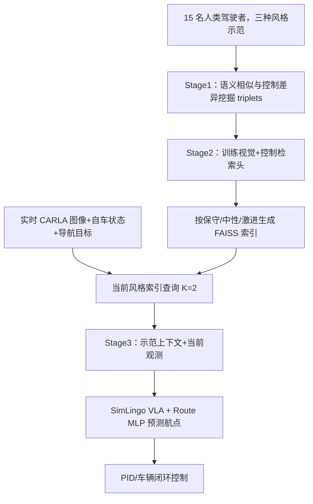
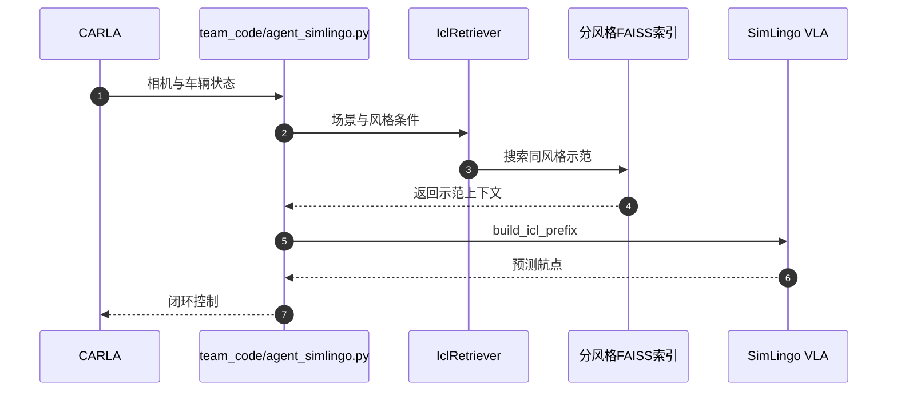

# PersonaDrive：人类驾驶风格检索增强 VLA

**英文题名：** PersonaDrive: Human-Style Retrieval-Augmented VLA Agents for Closed-Loop Driving Simulation。官方原文：[arXiv:2606.12616v2](https://arxiv.org/abs/2606.12616v2)。已核对 v2 正文与必要附录，**未独立复现训练/真机**。

## 一句话定义
PersonaDrive 用同一套 SimLingo VLA 权重，把人类**保守/中性/激进**驾驶数据按风格建检索库，在 CARLA 实时检索相似驾驶情境当作 in-context 示范，产生风格化航点。

## 英文缩写速查
| 缩写 | 英文全称 | 简要说明 |
|---|---|---|
| VLA | Vision-Language-Action | 视觉语言动作 |
| RAG | Retrieval-Augmented Generation | 检索增强生成 |
| FAISS | Facebook AI Similarity Search | 向量最近邻索引 |
| CARLA | Car Learning to Act | 闭环驾驶仿真平台 |

## 为什么重要
同一导航路线可能有保守、适中和激进等行为偏好，风格不应等同于完全独立的策略模型。 论文的价值在于将这一失败模式单独建模，而非依靠笼统的端到端指标解释。

## 核心机制
1. **风格数据**：15 位人类参与者在 CARLA 使用方向盘+踏板，55 条路线按三种风格各行驶一次，共 29,777 帧；训练路线与 Bench2Drive 220 条测试路线不重叠，但共享部分场景类型。
2. **Stage 1**：SigLIP 图像和 BGE-M3 文本按语义/行为线索挖掘正例、易/难负例 triplet；每隔五个原始帧保留一个样本，防止相邻帧构成无意义正例。
3. **Stage 2**：训练 ControlEncoder + ProjectionMLP 的检索头；FAISS 数据库按选定驾驶风格分别建立，检索输入是图像和自车控制状态，**推理检索不使用文本/未来航点字段**。
4. **Stage 3**：从目标风格的库取 K=2 个相似示范，其图像、控制历史、导航指令、两个目标点、评论和真人未来航点作为 InternVL2 / SimLingo 的前缀；VLA 预测路径航点，Route MLP/PID 执行闭环驾驶。
5. **风格切换**：更换检索数据库，不增加独立风格策略权重，检索来自人类示范而非抽象 style token。

## 流程总览
以下为论文原文中的数据/控制流程，不表示本站运行了代码。

## 工程实践
- **已开源**： [官方代码](https://github.com/PervasiveAutonomyLab/PersonaDrive) 包含数据收集、风格检索、SimLingo 训练和 CARLA agent；相关模型/数据另在 HF 链接，许可证与依赖需按仓库说明核实。
- **源码入口**：`scripts/retrieval/run_stage1_mining.sh`、`train_retrieval_head.sh`、`build_style_indices.sh`；`team_code/agent_simlingo.py` 导入 `IclRetriever` 与 `build_icl_prefix`。
- **计算/延迟（附录 G/I）**：SFT 用四张 L40S 约 12h；闭环推理 K=2 时总单步约 557.7ms（K=0 为 480.3ms），其中 RAG 搜索约 19.59ms；新增开销主要来自 prompt 前缀，而不仅是数据库搜索。

## 源码运行时序图

根据[官方仓库](../../sources/repos/personadrive-2606-12616.md)可见入口的静态调用关系整理，并未运行训练或推理。

## 实验与评测
- **Bench2Drive（Table 1）**：无风格条件情况下 Driving Score 88.95、SR 72.29%，SimLingo 基线 85.07/67.27%；**舒适度 Comfort 从 33.67 降到 28.09**，不能只引用效率收益。
- **三风格（作者报告）**：改变数据库，三种风格的 Driving Score 在 87.55–89.62 区间，平均速度/加速度可随所选风格改变。
- **检索深度（附录 I）**：K=0/1/2/3/4 的 DS 为 85.07/81.55/88.95/89.16/89.30，K=1 反而不如不检索；K=2 被作者作为质量与延迟折衷。
- **数据/协议**：训练 15 人、55 条路线、21 种场景，测试使用 Bench2Drive 独立路线；数据及所有闭环表现来自 CARLA 仿真，未进行公路实测。

**证据边界：** 指标均来自指定版本论文/官方材料，并非本站独立复现；具体基线、统计区间与硬件已按表号区分。

## 局限与风险
效果依赖人类风格库覆盖、视觉/控制检索头泛化、前缀长度和 CARLA 场景分布；Style conditioning 可以改变驾驶激进程度，不意味着现实交通安全。K 增大虽可改善部分性能，但线性增加推理开销；不应声称所有指标随 K=2 达最佳。

## 与其他工作对比
- 在[九篇研究趋势地图](../overview/embodied-trends-2026-11-h1.md)中按“技术介入层”定位，不能比较跨论文不同任务、机器人和数据集的绝对指标。
- 相关基础：[VLA](../methods/vla.md)、[机器人操作](../tasks/manipulation.md)。

## 结论
**PersonaDrive 以“切换示范库而非模型权重”实现模拟驾驶风格条件化。**
- 从真人驾驶回合构建训练数据，检索时只用图像与车辆控制状态特征。
- 训练路线与测试路段不重复，但场景类型部分重合，不意味着完全未知分布。
- 仿真驾驶 DS 88.95/成功率 72.29；应同时报告舒适性下降与 K=2 单步延迟。
- 未实测真实道路，落地须另验安全约束与传感器、计算预算。

## 关联页面
- [VLA](../methods/vla.md)
- [机器人操作](../tasks/manipulation.md)
- [2026.11 上半月九篇论文技术图](../overview/embodied-trends-2026-11-h1.md)
- [VLA 纵深路线](../../roadmap/depth-vla.md)

## 参考来源
- [论文来源核对](../../sources/papers/personadrive-2606-12616.md)
- [代码来源](../../sources/repos/personadrive-2606-12616.md)
- [官方项目主页](../../sources/sites/personadrive-2606-12616.md)
- [策展资料](../../sources/blogs/duomo_embodied_2026_11_first_half.md)
- [arXiv 指定版本](https://arxiv.org/abs/2606.12616v2)

## 推荐继续阅读
- [指定版本 arXiv HTML](https://arxiv.org/html/2606.12616v2)
- [VLA 纵深路线](../../roadmap/depth-vla.md)
