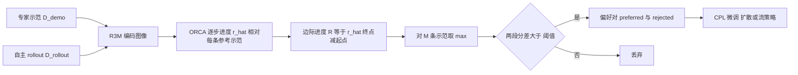

# PGPG：用示范进度自动生成偏好，对齐生成式控制策略

*Progress-Guided Preference Generation for Aligning Generative Control Policies*（[arXiv:2610.25692](https://arxiv.org/abs/2610.25692)，KAIST 等，CoRL 2026）。本页依据 arXiv v1 全文，归档见 [sources/papers/pgpg_arxiv_2610_25692.md](../../sources/papers/pgpg_arxiv_2610_25692.md)。

## 一句话定义

**PGPG 把 rollout 相对少量专家示范的「有序子目标覆盖进度」换算成片段分数来自动打偏好标签，再用对比偏好学习微调预训练的扩散 / 流匹配策略，不需要人工标注也不需要手写奖励。**

## 英文缩写速查

| 缩写 | 英文全称 | 简要说明 |
|------|----------|----------|
| PGPG | Progress-Guided Preference Generation | 本文方法：进度引导的偏好生成 |
| ORCA | Ordered Coverage Alignment | 有序覆盖对齐，沿用 Huey 等 ICML 2025 的序列匹配度量（论文 §3） |
| MPS | Marginal Progress Scoring | 边际进度打分：用进度差而非累计进度给片段打分（表 1 消融名） |
| CPL | Contrastive Preference Learning | 无奖励模型的偏好微调目标（论文式 1，引 Hejna 等 ICLR 2024） |
| PbRL | Preference-based Reinforcement Learning | 基于成对轨迹比较的强化学习 |
| BC | Behavior Cloning | 行为克隆；基线含 Mixed BC 与 Filtered BC |
| DPPO | Diffusion Policy Policy Optimization | 以 PPO 微调扩散策略的 RL 基线（论文 §5.1） |
| R3M | Reusable Representations for Robot Manipulation | 论文用来编码图像的预训练视觉表征 |
| VLA | Vision-Language-Action | 附录 A.1.8 在 GR00T N1.7 上的扩展实验 |

## 为什么重要

- 作者要解决的问题（§1）：偏好微调能利用次优 rollout，但依赖昂贵的人工偏好标注，扩散与流匹配这类生成式策略缺少在标注稀缺时的对齐手段。
- 标签来源是任务自带的示范，而不是人工或大型 VLM：作者称这样标签「落在任务的视觉与运动结构上」，并比 8B 规模的进度奖励模型快得多（附录 A.1.7，对 Robometer 约 31 倍）。
- 与本库 [进度奖励建模](../concepts/progress-reward-modeling.md) 的关系：PGPG 用无训练的动态规划度量取代学出来的进度模型，可作为另一条「进度当奖励」路线的对照。

## 核心原理与流程总览

输入是一小组专家示范 D_demo、一大批预训练策略自己收集的 rollout D_rollout 和预训练策略 π_ref。流程见论文图 1 与算法 1：

1. **ORCA 进度（式 2）：** 以每条示范的帧作为有序子目标，动态规划得到学习者在 t 时刻「按顺序覆盖了全部子目标并停在终点」的概率；该分数随时间单调不减，对执行速度差异不敏感（§3）。
2. **边际进度打分（式 3–4）：** 作者指出 ORCA 输出是累计量，直接对片段求和会时间重复计数；改取相邻差，片段分数化为 r̂_{t+L} - r̂_t。比较两段分数定优劣（式 5），分差小于 ε_σ 的对丢弃。
3. **多示范聚合（式 6）：** 对 M 条参考示范分别算分后在段级取 max，使「前半段学专家 A、后半段学专家 B」的混合轨迹也能得分。
4. **微调（式 1，A.2.2）：** 用 CPL 目标，扩散策略以去噪误差差、流策略以速度预测误差差替代对数似然比，并按动作块长度 T_p 稀疏求和以省显存。

## 工程实践

- **输入模态：** 偏好生成用 224 x 224 图像经 R3M 编码、余弦距离；被微调的策略只用低维状态（§5.1、A.2.4）。
- **数据规模（§5.1、A.2.5）：** 参考策略约 40% 成功率；每任务 500 条 rollout；保留 40% 示范（约 120 条，Tool Hang 约 80 条）；生成偏好时参考示范数 M = 10 / 20 / 40（Lift / Can / 其余），取「最短的 M 条」示范；采样对数 N = 1 万 / 2 万 / 3 万；段长 L = 100 / 200 / 300（表 9）。
- **阈值选择（A.2.5）：** 在 {0.3, 0.4, 0.6} 中选仍能保留至少 1000 对（Lift、Can）或 5000 对（其余）的最高阈值。
- **效率（A.2.5）：** 对每条 rollout 离线缓存 M 条进度序列，之后任意片段打分只需 O(M)；ORCA 本身是 O(H x H̃) 的动态规划。
- **训练超参（表 9）：** AdamW，学习率 1e-4，批大小 128，1000 epoch；去噪步数扩散 100、流 8。
- **关键数字（均为仿真，成功率 %）：**
  - 度量消融（表 1，扩散策略）：ORCA + MPS 在 Lift / Can / Square / Transport / Tool Hang 为 96.7 / 89.3 / 72.0 / 58.7 / 56.0，单用 ORCA 为 32.0 / 70.7 / 42.0 / 47.3 / 41.3。
  - 示范与阈值（§5.3、图 3）：示范数 10–20 条后饱和；ε_σ = 0.6 最佳，0.95 因数据过少而骤降。
  - 编码器（表 4）：R3M 在 Lift / Can / Square 为 96.7 / 89.3 / 72.0，SigLIP2 仅 68.7 / 58.0 / 42.7。
  - 聚合（表 6）：max 对 mean 在 Lift 为 96.7 对 90.7，Square 为 72.0 对 52.7。
  - LIBERO-10 + GR00T N1.7（A.1.8，表 8）：每任务 5 条示范与 20 条 rollout，平均 50.5%（预训练）→ 64.8%（Filtered BC）→ 72.1%（PGPG），10 个任务中 7 个最优。
- **代码：** 项目页给出 [tunglm2203/pgpg](https://github.com/tunglm2203/pgpg)；本次未能打开该仓库（代理返回 403），内容与发布状态未核对。

## 与清单说法的核对

清单（Glen Berseth 的 CoRL 2026 阅读清单，P2 档，序号 092/101；摘要由 LLM 据摘要起草）原文：「Unsupervised preference labels from progress relative to a few expert demos fine-tune generative policies without human annotation.」

| 清单说法 | 论文核对 |
|----------|----------|
| 无监督偏好标签 | 成立（摘要、§1）：标签由 ORCA 进度自动生成，无人工偏好标注。但「无监督」是指无偏好 / 奖励标注，仍需专家示范，且需任务级调参（M、N、L、ε_σ，A.2.5、表 9）。 |
| 相对「少量」专家示范的进度 | 部分成立：消融显示 10–20 条参考示范即饱和（§5.3），40 条示范仍接近全量（表 3）。但主实验保留约 120 条示范（Tool Hang 约 80 条，§5.1），生成标签用 M = 10–40 条参考示范（A.2.5）；LIBERO-10 扩展为每任务 5 条（A.1.8）。 |
| 微调生成式策略 | 成立：扩散策略与 rectified flow 策略（§5.1），另有 GR00T N1.7 的流匹配动作头（A.1.8）。 |
| 未提及的限定词 | 清单未写「仿真」。论文全部实验在仿真：Robomimic 五任务与 LIBERO-10，**没有真机实验**。主实验策略只用低维状态而非图像（§5.1），图像只用于标签生成。 |
| 未提及的前提 | 需要一个约 40% 成功率的预训练策略来采集 rollout（§5.1）；示范数据 mh 混合质量（除 Tool Hang 用 ph，A.2.3）；依赖预训练视觉编码器（§6 自述局限）。 |
| 隐含的「优于基线」 | 作者称平均成功率最高（§5.2），但平均值只画在图 2，正文无表格数值。与特权基线的关系：对 Filtered BC（用 oracle 成功判据）和 CPLKL（用真值奖励）而言，稠密奖励任务上是「持平」而非超越，稀疏奖励任务上作者称优于 CPLKL。 |

## 局限

**论文自述（§6）：**
- 依赖预训练视觉编码器的鲁棒性；跨具身、时间错位严重的情形留给未来的在线微调。
- 重遮挡下视觉序列匹配会对任务误判。
- 边际进度打分假设进度大体单调，需要策略性回退或非准静态行为的长程任务可能打不准。

**本页读后观察（非作者结论）：**
- 全部为仿真；无真机、无视觉策略微调的验证。主实验里被微调的策略只吃低维状态，离「真实场景里用视觉伺服」尚有距离。
- 编码器与度量并非即插即用：表 4 中 SigLIP2 的结果明显更差，表 1 说明 MPS 仅与 ORCA 搭配稳定，两者都说明结论对组件选择敏感。
- 超参按任务手工设定（M、N、L、ε_σ，表 9、A.2.5），阈值选择规则基于保留的偏好对数量，未见在独立验证集上调参的描述。
- 0 示范（纯 rollout）时 Lift 反而低于基座（32.7 对 44.0，表 3），说明示范并非可有可无。
- 基线对比：DPPO 被限制在与 PGPG 相近的 rollout 数（A.2.4），在较少环境交互预算下的对比，不代表 RL 在更大预算下的上限。
- 图 2、图 3 为图形，主结果无精确数值表，读者难以复核具体差距（本页未逐点读数）。
- LIBERO-10 实验（A.1.8）中 T9 三个方法均接近 0，PGPG 在 T5、T6 上不如 Filtered BC，且只用了 3 个种子。

## 关联页面

- [进度奖励建模](../concepts/progress-reward-modeling.md)：学出来的进度模型路线，PGPG 与 Robometer 在 A.1.6 直接对比
- [奖励设计](../concepts/reward-design.md)：PGPG 想绕开的手写奖励
- [Diffusion Policy](../methods/diffusion-policy.md)：被微调的基座策略之一
- [模仿学习](../methods/imitation-learning.md) 与 [行为克隆](../methods/behavior-cloning.md)：Mixed BC、Filtered BC 基线的背景
- [强化学习](../methods/reinforcement-learning.md) 与 [PPO](../methods/ppo.md)：DPPO 基线所属范式
- [VLA 方法页](../methods/vla.md)：附录扩展实验用 GR00T N1.7
- [Robomimic](./robomimic.md) 与 [LIBERO](./libero-benchmark.md)：论文使用的仿真基准
- [Freeform Preference Learning](./paper-freeform-preference-learning.md)：另一条用偏好训练机器人策略的路线，偏好来自人工自然语言轴

## 参考来源

- [sources/papers/pgpg_arxiv_2610_25692.md](../../sources/papers/pgpg_arxiv_2610_25692.md)
- [arXiv:2610.25692](https://arxiv.org/abs/2610.25692)
- [项目页 pgpg2026.github.io](https://pgpg2026.github.io)

## 继续阅读

- [arXiv PDF](https://arxiv.org/pdf/2610.25692v1)
- ORCA 原文：Huey 等，*Imitation learning from a single temporally misaligned video*（ICML 2025，论文参考文献 [56]）
- CPL 原文：Hejna 等，*Contrastive preference learning*（ICLR 2024，论文参考文献 [2]）
- [进度奖励建模](../concepts/progress-reward-modeling.md)
