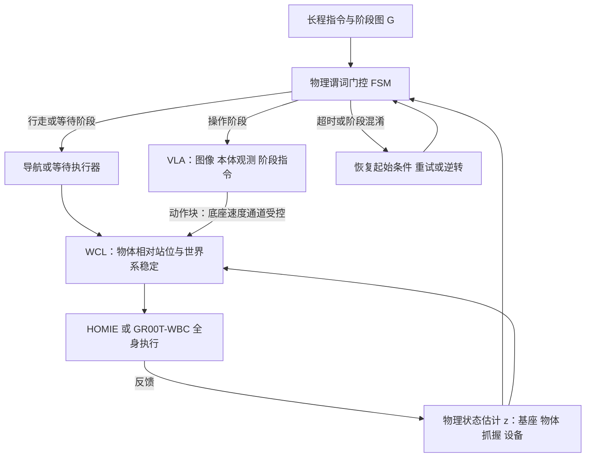

# PGX：面向人形长时程移动操作的物理接地执行 / Physically Grounded Execution for Long-Horizon Humanoid Loco-Manipulation

**论文：** *PGX: Physically Grounded Execution for Long-Horizon Humanoid Loco-Manipulation*（Kai Lu、Chenyang Ma、Ioannis Havoutis；牛津大学机器人研究所与计算机科学系；[arXiv:2611.26596v1](https://arxiv.org/abs/2611.26596)，2026-11-19）。[官方项目页](https://kl-research.github.io/pgx/)。

## 一句话定义

**PGX** 把长时程人形移动操作拆成「**物理谓词决定何时切换**」「**VLA 在操作阶段决定怎样动作**」「**世界坐标锁定（WCL）保证相对物体与接触点的位置精度**」；导航、等待与恢复不再强迫 VLA 自己学会（论文 III 节）。

## 英文缩写速查

| 缩写 | 英文全称 | 简要说明 |
|------|----------|----------|
| PGX | Physically Grounded Execution | 本文分层执行框架，不是新 VLA 主干网络 |
| FSM | Finite State Machine | 由物理事件守卫阶段转换与有限重试 |
| VLA | Vision-Language-Action | 承担有效操作阶段的局部动作块生成 |
| WCL | World-Coordinate Locking | 物体相对站位、基座保持、世界系接触目标 |
| WBC | Whole-Body Control | 将上身、手、底座指令转换为机器人动作 |
| IK | Inverse Kinematics | 世界系接触目标变换后求解关节目标 |

## 为什么重要

单个长任务里，行走、等待、抓取、精确按键混在同一示范分布，容易让 flat VLA **错过交互、跳过阶段或受骨盆漂移影响**。论文把「何时、何处行动」交给可检查的物理规则，让已有 VLA 专注「如何操作」，强调执行结构和训练权重是两个不同的可消融因素（I、III、IV-D）。

## 核心原理

### 流程总览

依据论文 Fig. 2、III-A–III-D 和 Algorithm 1：

- **状态机：** 阶段 $s_k=(\ell_k,c_k,g_k,\tau_k,\rho_k)$，分别为阶段指令、执行器、完成谓词、时限和恢复规则。导航阶段调用控制器，等待阶段读取设备状态/定时器，操作阶段调用 VLA（III-B）。
- **五个核心谓词：** grasped、placed、triggered、at-stance、dropped；grasped 不等于「手掌闭合」，还需腕—物距离和实际抬升证据。谓词含最短保持时长和迟滞；同一语义贯通离线数据切分、在线守卫和阶段级评测（III-B、式 3）。
- **学习策略：** VLA 给出 $A_t=\pi_\theta(o_t,\ell_k)$ 动作块；执行器在操作前恢复站位和 ready/carry 手姿，并可复用整段训练的 flat 权重。按谓词裁剪示范训练 stage 权重是可选配置，不是框架必须重新训练（III-A/C）。
- **WCL 三组件：** ①从物体当前姿态重算相对站位；②操作期间屏蔽策略的基座速度通道，内外阈值纠偏并复用同一世界系参考；③精密接触目标固定在世界系，每周期按 $T^B_{E,d}(t)=(T^W_B(t))^{-1}T^W_{E,d}(t)$ 重表达并做 IK（III-D、式 4–5）。
- **恢复：** 超时有限重试并恢复初始位；阶段混淆时可逆转到上一操作阶段；不应因重试而意外释放已握物，非目标区掉落则终止（Algorithm 1）。

## 实验与评测

### 三个模拟任务与真机设置（IV-A）

| 场景 | 示范 | 评测备注 |
|------|------|----------|
| 箱体搬运 | 100 条，切分 200 段 | Isaac Lab Arena / G1 / Dex-3，40 s 预算 |
| 杯放置 | 30 条，切分 60 段 | 同上，60 s 预算 |
| 咖啡取送 | 50 条，切分 250 段 | 同上，110 s 预算，必须按键再交付 |
| 真机咖啡 | 44 条，切分 176 段 | G1 + Dex-3，Vicon 状态谓词；真实任务没有按钮按压步骤 |

- 模拟 C0 为标称初始位；C1 为 $x/y$ 各自 ±0.30 m 与偏航 ±30° 扰动；每单元至少 20 个 episode。主干模型是 π₀.₅、GR00T N1.6；仿真 HOMIE 和真机 GR00T-WBC 作为下层控制（IV-A）。
- GR00T 输出 35-D、π₀.₅ 输出 32-D 动作块，长度均 16。框架接管操作阶段的 base-velocity 通道，而不是把全身控制与 VLA 混成同一模型（IV-A）。

### 最重要：保持权重和指令不变的执行消融（Table III）

| 主干与条件 | Flat VLA | PGX + 原 flat 技能 | PGX + stage 技能 |
|------------|---------:|------------------:|----------------:|
| π₀.₅ C0 | 0% | 60% | 60% |
| π₀.₅ C1 | 0% | 60% | 55% |
| GR00T N1.6 C0 | 35% | **80%** | 35% |
| GR00T N1.6 C1 | 20% | **80%** | 35% |

**读取原则：** 前两列同权重、同任务指令，真正隔离了执行结构；第三列更换了训练好的技能权重。特别是 GR00T 不能被解读为「切分示范后微调必然更好」（IV-D）。

### 空间稳定与多任务（Table I、II，IV-C/E）

- 咖啡任务的 FSM-only → PGX（同一技能模型）：π₀.₅ C0 **32%→60%**、GR00T C0 **65%→80%**；这组同时启用物体相对站位与基座保持，不能单独归因其中之一。
- 在每 3 秒持续施加扰动的实验中，操作阶段最大底座漂移 p90 **54 cm→9 cm**；世界系按钮原语在**已进入**按键阶段的 245 次机会里成功 243 次（99%），不代表端到端咖啡成功率。
- 多任务 Table II：箱搬运 PGX（GR00T）C0 **75%**、C1 **45%**；杯放置 PGX（π₀.₅）C0 **75%**、C1 **90%**。该表对不同任务选用了不同技能训练方式，不是统一的无训练权重变更消融。

## 结论

**PGX 的主要贡献是把可测的任务阶段与世界系精度从 VLA 里剥离出来；长时程成功率上升首先应归功于执行结构，不应把它误写成新的 VLA 权重或通用分阶段训练收益。**

1. **先做同权重对照：** GR00T 咖啡任务 C0 35%→80%，C1 20%→80%（Table III）。
2. **阶段守卫要验证真实物理事件：** 关手不等于抓住，必须联用物体位姿及释放/设备事件。
3. **动作接口需明确所有权：** 导航和等待不是 VLA 技能；操作阶段由执行器接管基座速度，低层 WBC 继续闭环。
4. **漂移与接触是不同精度问题：** 相对站位与保持让起始状态稳定，毫米级按钮需世界系接触原语与 IK。
5. **按场景拆指标：** 报告总体任务成功、最远阶段、生存曲线和姿态漂移，避免把 99% 的条件按键成功率当成任务成功率。
6. **真机证据按范围读：** G1 展示实机各操作阶段完成情况，但使用外部 Vicon，未提供和模拟同口径的大规模端到端结果。

## 与其他工作对比

| 路线 | 差别 |
|------|------|
| [端到端 VLA](../methods/vla.md) | 一个模型同时承担行走与操作任务进度；PGX 用固定物理事件显式分工，保留 VLA 局部技能 |
| [HITCH](./paper-hitch.md) | HITCH 用 VLM 工具调用 + 规划器/全身跟踪器；PGX 以物理谓词编排已经微调的 VLA，强调不改权重的执行消融 |
| [全身控制 WBC](../concepts/whole-body-control.md) | WBC 保证低层运动跟踪；PGX 位于其上，决定阶段、起始条件和世界系约束，不替代 WBC |

## 工程实践

- **实施顺序：** 定义状态估计与谓词阈值/迟滞 → 标注/切分示范阶段 → 准备导航/等待执行器和操控起始姿态 → 将现有 VLA 插入操作阶段 → 对接 WCL 的物体系站位、基座闭环、精确接触 IK → 分层记录阶段成功、超时/回退与漂移（根据 III 节整理，非作者发布的可运行安装指南）。
- **复现先决条件：** 需要可追踪的底座/物体位姿、抓握与设备触发信号、兼容的动作通道和全身控制器。真机使用 Vicon，论文并未证明只靠机载视觉即可提供同质量的物理谓词。
- **源码与权重状态（2026-11-22 核查）：** [官方站点](https://kl-research.github.io/pgx/)提供论文、视频与实验数据，但未列 PGX 专属可运行代码、权重或数据下载入口。论文使用的 Isaac Lab Arena 和 GR00T-WBC 的第三方开源不等同于 PGX 实现开源。

## 源码运行时序图

**不适用（截至 2026-11-22，官方项目页未提供 PGX 可执行实现与入口）**。不能凭论文算法图编造模块名、CLI 命令或代码调用时序。上方流程图仅基于论文机制。

## 局限与风险

- **论文自述（V 节）：** 阶段切换带来更长执行时间，尚需扩展到更丰富的技能与任务。
- **传感器依赖：** 物理谓词依靠准确的物体位置与设备状态；真机外部 Vicon 的使用限制了对机载自主感知的推断（IV-F）。
- **精细接触未解决所有瓶颈：** 按钮世界系原语可提高条件成功，但真实手部放置和再抓取仍有误差；运行时状态切换也无法替代精细灵巧控制。
- **比较口径：** Table II 混合不同训练方式；Table III 才是同权重结构消融。C0/C1、条件阶段率、端到端成功率不可跨表等同。

## 关联页面

- [Loco-Manipulation 任务总览](../tasks/loco-manipulation.md)
- [VLA 方法](../methods/vla.md)
- [Whole-Body Control](../concepts/whole-body-control.md)
- [HITCH：VLM 全身 harness](./paper-hitch.md)
- [Unitree G1](./unitree-g1.md)
- [移动操作纵深路线 Stage 4](../../roadmap/depth-loco-manipulation.md)
- [VLA 部署纵深路线 Stage 4](../../roadmap/depth-vla.md)

## 参考来源

- [PGX 论文全文通读归档](../../sources/papers/pgx_arxiv_2611_26596.md)
- [PGX 官方项目页核查](../../sources/sites/pgx-physically-grounded-execution.md)
- [arXiv v1 HTML 全文](https://arxiv.org/html/2611.26596)

## 推荐继续阅读

- [PGX 原文 PDF](https://arxiv.org/pdf/2611.26596)
- [官方框架、消融表与 G1 实验视频](https://kl-research.github.io/pgx/)
