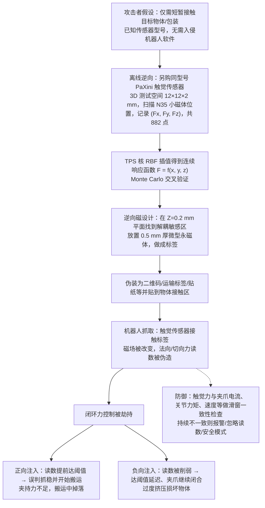

# PhantomTac（arXiv:2610.26174）

**PhantomTac**（*PhantomTac: Hijacking Robotic Tactile Systems with Deploy-and-forget Tags*，[arXiv:2610.26174](https://arxiv.org/abs/2610.26174)，[项目页](https://phantomtac.org/)）来自 [具身智能小站 2026-10-31 盘点](../../sources/blogs/wechat_embodied_station_50_papers_scenerig_photo_to_sim_2026-10-31.md)，属「触觉与精细操作」组。

## 一句话定义

**PhantomTac展示磁触觉测量受外界磁场误导后，抓取闭环可能出现异常；真机实验提示需校验视觉与触觉一致性，不能只相信单一传感通道。**

## 英文缩写速查

| 缩写 | 英文全称 | 简要说明 |
|------|----------|----------|
| PhantomTac | PhantomTac: Hijacking Robotic Tactile Systems with Deploy-and-forget Tags | 本文方法 / 基准的简称 |

## 为什么重要

- 触觉安全，也要检查传感器物理层。
- 开源结论：**项目页未列 GitHub**（步骤 2.5，2026-10-31）。公众号「代码」入口为 phantomtac.org 网站（HTTP 200），页面未见 GitHub 链接。
- 同期同组工作见 [单图重建仿真、VLA 适配评测与跨形态世界模型：具身智能小站 10-31 期 50 篇阅读坐标](../overview/embodied-station-2026-10-31-50-papers-technology-map.md)。

## 流程总览

图依据：论文 §3 / §4.1 / §5 / §6.2–6.3 / §7.1。

## 核心机制

| 项 | 内容 |
|----|------|
| **arXiv** | [2610.26174](https://arxiv.org/abs/2610.26174) |
| **开源** | **项目页未列 GitHub** |
| **要点** | PhantomTac展示磁触觉测量受外界磁场误导后，抓取闭环可能出现异常；真机实验提示需校验视觉与触觉一致性，不能只相信单一传感通道。 |
| **文内指标** | 公众号未给具体数字，本页不引用。 |

## 源码运行时序图

**不适用（项目页未列 GitHub）** — 公众号「代码」入口为 phantomtac.org 网站（HTTP 200），页面未见 GitHub 链接。 不编造运行脚本；代码公开后再补。

## 实验与评测

- 公众号未给具体数字，本页不引用。
- **读法：** 本页为索引级摘要，依据公众号转述的官方摘要与仓库信息整理；逐项数字与 baseline 以原文 PDF 为准。

## 与其他工作对比

- 横向索引见 [单图重建仿真、VLA 适配评测与跨形态世界模型：具身智能小站 10-31 期 50 篇阅读坐标](../overview/embodied-station-2026-10-31-50-papers-technology-map.md)；同 arXiv 不重复造页。

## 结论

**触觉安全，也要检查传感器物理层：PhantomTac展示磁触觉测量受外界磁场误导后，抓取闭环可能出现异常；真机实验提示需校验视觉与触觉一致性，不能只相信单一传感通道。**

1. 开源边界：**项目页未列 GitHub** — 公众号「代码」入口为 phantomtac.org 网站（HTTP 200），页面未见 GitHub 链接。
2. 核心机制：PhantomTac展示磁触觉测量受外界磁场误导后，抓取闭环可能出现异常；真机实验提示需校验视觉与触觉一致性，不能只相信单一传感通道。
3. 复现与选型前核对任务协议、硬件与基准口径，勿直接横比公众号摘录数字。

## 关联页面

- [tactile-sensing](../concepts/tactile-sensing.md)
- [contact-rich-manipulation](../concepts/contact-rich-manipulation.md)
- [manipulation](../tasks/manipulation.md)
- [embodied-station-2026-10-31-50-papers-technology-map](../overview/embodied-station-2026-10-31-50-papers-technology-map.md)

## 参考来源

- [phantomtac_arxiv_2610_26174.md](../../sources/papers/phantomtac_arxiv_2610_26174.md)
- [wechat_embodied_station_50_papers_scenerig_photo_to_sim_2026-10-31.md](../../sources/blogs/wechat_embodied_station_50_papers_scenerig_photo_to_sim_2026-10-31.md)
- [arXiv:2610.26174](https://arxiv.org/abs/2610.26174)
- [arXiv PDF](https://arxiv.org/pdf/2610.26174)：已通读全文：§3 攻击模型、§4 漏洞分析（逆向工程）、§5 标签设计与制作、§6 端到端评测、§7 防御讨论

## 推荐继续阅读

- [arXiv PDF](https://arxiv.org/pdf/2610.26174)
- [项目页](https://phantomtac.org/)
