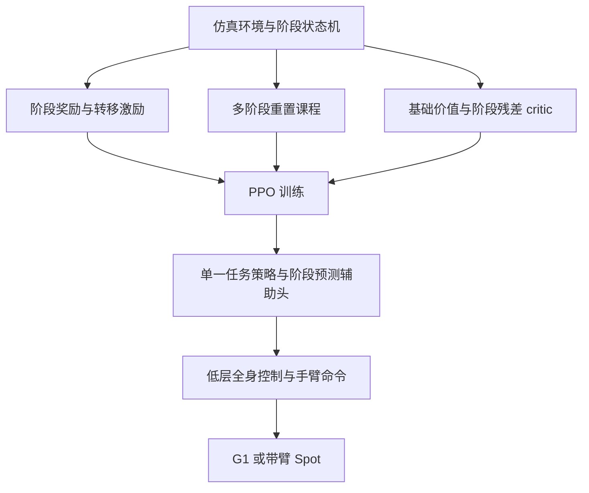

# 阶段条件策略优化：多阶段移动操作

## 一句话定义

用训练期的任务阶段结构引导 PPO，学习每个环境内贯穿多个阶段的单一高层策略；部署时无需输入阶段标签。

## 英文缩写速查

| 缩写 | 英文全称 | 简要说明 |
|------|----------|----------|
| PPO | Proximal Policy Optimization | 本文扩展的在线策略优化算法 |
| RL | Reinforcement Learning | 通过环境交互学习策略 |
| IK | Inverse Kinematics | 为低层初始化生成可行姿态关键帧 |
| WBC | Whole-Body Control | 低层协调腿和躯干运动 |
| ONNX | Open Neural Network Exchange | G1 策略导出格式 |

## 核心信息

| 项目 | 内容 |
|------|------|
| 论文 | [Learning Multi-Phase Robot Loco-Manipulation via Phase-Conditioned Policy Optimization](https://arxiv.org/abs/2610.36270)，2026-10-26 |
| 机构 | 苏黎世联邦理工机器人系统实验室（ETH Zurich RSL）；机器人与人工智能研究院（RAI Institute） |
| 平台 | Unitree G1；带机械臂的 Boston Dynamics Spot |
| 开放状态 | 截至 2026-10-29，所查论文及 arXiv 页面未列官方代码或项目页；不能据此断言不存在 |

## 方法与流程

训练期用环境状态机按局部成功条件区分阶段，并用滞回减少边界振荡；门控奖励对各阶段启用不同目标，对前进和回退分别奖励与惩罚。actor 的辅助头预测阶段，引导共享表示；真实阶段不输入 actor。critic 将全局基础价值与当前阶段残差相加。多阶段初始化先从中间阶段采样，随后逐渐回到初始阶段。测试时策略自主执行，不再使用阶段状态机。

G1 搬箱的七阶段为靠近、下蹲、夹紧、抬起、搬运、放下、起身。G1 低层控制腿和腰，跟踪平面速度、骨盆高度、躯干俯仰；手臂由高层直接控制。高层命令采用增量更新。每个环境一套策略，不应理解为一个跨平台通用权重。

## 源码运行时序图

不适用：截至入库日，已查论文和 arXiv 页面未列本工作可运行的官方实现，训练及部署入口待核实。

## 工程实践

- **仿真与部署：** mjlab 训练；G1 用 ONNX 导出及自定义 ROS 2 框架。主要真机设置依靠外部动捕；G1 推箱和抬箱另外展示机载状态估计加 ArUco，无动捕验证仅覆盖这两项。
- **双臂夹持：** 论文在 200 Hz 物理仿真中随机化最多 5 步（25 ms）执行器延迟；以高摩擦课程缓解仿真微滑。限制关节目标与当前位置偏差，以位置增益换算约 7 N·m 的隐式力矩限制；不应直接视作通用电机安全阈值。
- **维护成本：** 需要手工设计阶段、奖励和部分重置关键帧；箱形变化也可能要求更新关键帧。摩擦与接触模型差异仍是 Sim2Real 难点。

## 实验与评测

| 设定 | 论文结果及边界 |
|------|----------------|
| 真机 | Spot 扶起、滚动并放倒轮胎；G1 推单箱、推双箱、抬箱和搬箱。论文展示硬件执行，未在此报告统一真机成功率。 |
| 阶段预测消融 | 三随机种子的仿真中，移除辅助阶段预测后，Spot 滚胎成功率由 89% ± 2% 降至 44% ± 9%；G1 双箱由 92% ± 2% 降至 14% ± 6%。 |
| 重置消融 | 仅从初始阶段重置时，较复杂的 G1 双箱训练崩溃；多阶段初始化改善探索。 |
| critic 消融 | 基础价值加阶段残差比普通 MLP 或完全分离多头在标准任务上优势较小，作者报告复杂搬箱策略质量更好。 |

## 与其他工作对比

- **对 [SMPC-to-RL](./paper-smpc2rl-loco-manipulation.md)：** 同为 RAI / ETH 系列在 Spot 与 G1 上的长时程移动操作工作。SMPC-to-RL 用仿真 SMPC 专家数据启动稀疏奖励的离线到在线 FastTD3；本文不依赖专家数据，而是以训练期阶段状态机、门控奖励和多阶段重置引导在线 PPO。
- **任务覆盖：** 两者都覆盖 Spot 滚胎与 G1 推箱；本文另含 G1 抬箱、七阶段搬箱等更长序列。代价是需要手工设计阶段、奖励与重置关键帧，而 SMPC-to-RL 的成本在于构建 SMPC 专家。

## 结论

阶段结构可作为训练期监督，使单个任务策略学会较长的移动操作序列，但前提是可设计阶段和合适重置状态。

1. 先检查阶段预测和多阶段重置：论文的消融显示它们对所测长序列学习影响明显。
2. 阶段状态机只用于训练；测试无需阶段标签，避免误把它当成部署时的策略切换器。
3. 接触和执行器延迟需单独验证；论文的摩擦课程及隐式力矩限制针对具体平台与任务。
4. 多平台验证体现方法适用性，不证明同一权重可跨平台迁移。

## 关联页面

- [移动操作](../tasks/loco-manipulation.md)
- [SMPC-to-RL](./paper-smpc2rl-loco-manipulation.md) — 同样采用分层控制，但以 SMPC 专家数据启动稀疏离线到在线 RL。
- [Unitree G1](./unitree-g1.md)
- [Sim2Real](../concepts/sim2real.md)

## 参考来源

- [论文来源归档](../../sources/papers/phase_conditioned_loco_manipulation_arxiv_2610_36270.md)

## 推荐继续阅读

- [论文原文及消融](https://arxiv.org/pdf/2610.36270)
