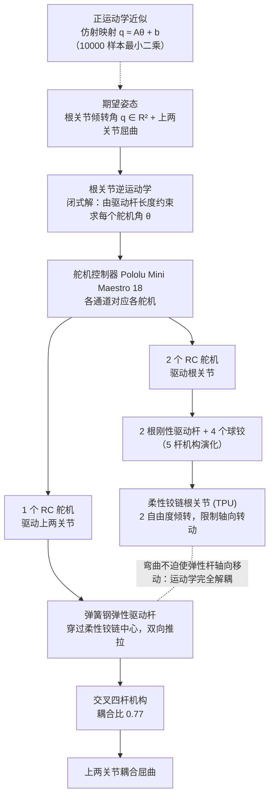

# PHD-Hand：采用三驱动自由度连杆手指的可打印人形灵巧手

**PHD-Hand**（*PHD-Hand: A Printable Humanoid Dexterous Hand with Linkage-Driven 3-DOA Digits*，[arXiv:2610.29030](https://arxiv.org/abs/2610.29030)）收录于 senlanke「具身运控lab」10-19–10-23 前沿论文动态（人形/四足）。本页依据**周报条目 + arXiv 摘要页**整理，流程图依据论文方法部分（见参考来源），未逐页核对实验数字；指标与结论以论文为准。

## 一句话定义

**PHD-Hand：采用三驱动自由度连杆手指的可打印人形灵巧手——结合柔性铰链和弹簧钢弹性推杆，减少微型运动部件；可使用普通 3D 打印机制造，并在接近人手尺寸的结构中实现每指三驱动自由度。**

## 英文缩写速查

| 缩写 | 英文全称 | 简要说明 |
|------|----------|----------|
| RL | Reinforcement Learning | 强化学习 |
| WBC | Whole-Body Control | 全身控制 |

## 为什么重要

- 周报所述待解决的问题：腱绳灵巧手成本高、维护复杂，而传统连杆手指难以在紧凑尺寸内实现多驱动自由度。

## 流程总览

图依据：论文 §II（Fig. 2）、§III 运动学（式 1–4）、§IV；属硬件传动与驱动链，非学习流程。

## 核心机制

| 项 | 内容 |
|----|------|
| **arXiv** | [2610.29030](https://arxiv.org/abs/2610.29030) · [PDF](https://arxiv.org/pdf/2610.29030) |
| **作者（arXiv）** | Neel Adwani, Muhaiminul Islam Akash, Saffia Ouali, Ethan Liu, Cong Wang |
| **机构（周报所述，未逐条核实）** | 新泽西理工学院、Union County Magnet High School |
| **arXiv 评论栏** | Submitted and Accepted at IEEE-RAS International Conference on Humanoid Robots (Humanoids 2026). 8 pages. Supplementary video: this https URL |
| **开源** | arXiv 摘要页/评论给出项目页或外链（https://lnkd.in/p/er-NRfMn）；未发现代码仓库链接（2026-10-26） |
| **周报所述创新点** | 结合柔性铰链和弹簧钢弹性推杆，减少微型运动部件；可使用普通 3D 打印机制造，并在接近人手尺寸的结构中实现每指三驱动自由度。 |

### arXiv 摘要节选（英文原文）

> Currently, dexterous humanoid robot hands are widely considered the final hardware bottleneck that hampers generalist robots from physically assisting people at home and work. As conventional tendon-driven designs suffer from high cost, demanding maintenance, poor reliability, and short durability, alternative linkage-driven designs have increasingly gained attention.

## 源码运行时序图

**不适用**：arXiv 摘要页/评论给出项目页或外链（https://lnkd.in/p/er-NRfMn）；未发现代码仓库链接，无可对齐的官方代码流程。

## 实验与评测

- 周报与摘要给出的数字/场景已写入上表「创新点」与摘要节选；其余实验细节、基线与成功率定义请回到论文正文。
- 读法：先对齐任务设定、传感器与成功定义（仿真/真机），再解读 headline 数字，勿跨论文直接比较。

## 与其他工作对比

| 维度 | 读法 |
|------|------|
| **同周对照** | 见 [人形/四足周报技术地图](../overview/senlanke-weekly-2026-10-19-23-humanoid-quadruped-technology-map.md)，按方向浏览同期论文 |
| **开源状态** | arXiv 摘要页/评论给出项目页或外链（https://lnkd.in/p/er-NRfMn）；未发现代码仓库链接 |

## 结论

**PHD-Hand：采用三驱动自由度连杆手指的可打印人形灵巧手。**

1. 本页是入库级摘要，复现前请核对论文正文、附录与代码仓库。
2. 指标须连同实验条件解读。
3. 关注 arXiv 版本更新与代码发布。

## 关联页面

- [senlanke-weekly-2026-10-19-23-humanoid-quadruped-technology-map](../overview/senlanke-weekly-2026-10-19-23-humanoid-quadruped-technology-map.md)
- [humanoid-locomotion](../tasks/humanoid-locomotion.md)
- [reinforcement-learning](../methods/reinforcement-learning.md)

## 参考来源

- [phd-hand-printable-humanoid-dexterous-hand_arxiv_2610_29030.md](../../sources/papers/phd-hand-printable-humanoid-dexterous-hand_arxiv_2610_29030.md)
- [wechat_senlanke_weekly_humanoid_quadruped_2026-10-19_23.md](../../sources/blogs/wechat_senlanke_weekly_humanoid_quadruped_2026-10-19_23.md)
- [arXiv:2610.29030](https://arxiv.org/abs/2610.29030)
- [arXiv PDF](https://arxiv.org/pdf/2610.29030)：已通读方法部分（实验与附录以略读为准）：§I–IV（引言、设计与制造、运动学分析、AI 辅助控制），§V 物理验证略读

## 推荐继续阅读

- [arXiv PDF](https://arxiv.org/pdf/2610.29030)
