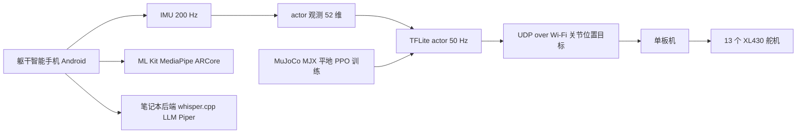
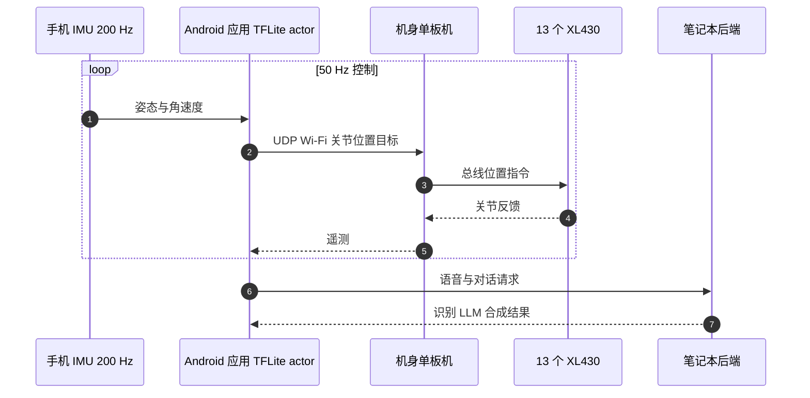

# PhoneBot：复用智能手机的低成本开源人形平台

**PhoneBot**（*A Low-Cost Open Humanoid Robot Platform Reusing Smartphones*，arXiv:2610.08737，UCLA RoMeLa 实验室，Dennis W. Hong 等）是一个 **483 mm 高、1.8 kg、13 DoF 的小型人形**：躯干上放一部普通 Android 手机，用它的 IMU、相机、Wi-Fi 和处理器完成感知、策略推理与人机交互，下肢由 13 个 DYNAMIXEL XL430 舵机驱动，面向教学与快速原型，整机约 $400（不含手机）。

## 英文缩写速查

| 缩写 | 英文全称 | 简要说明 |
|------|----------|----------|
| SBC | Single-Board Computer | 机身小型单板机，经总线驱动舵机，收手机 UDP 指令 |
| TFLite | TensorFlow Lite | 手机端运行 actor 策略的推理框架 |
| PPO | Proximal Policy Optimization | 非对称 actor–critic 训练算法 |
| MJX | MuJoCo XLA | 平地行走策略的仿真训练后端 |
| SLAM | Simultaneous Localization and Mapping | 手机端用 ARCore 做视觉惯性 SLAM |
| HRI | Human–Robot Interaction | 语音对话与交互应用，CPU 占用 2.5–5.2% |
| UDP | User Datagram Protocol | 手机到单板机的关节目标传输协议 |

## 为什么重要

- **成本与复现门槛**：舵机约 $311 为主要开销，整机约 $400（不含手机）；手机可用 $50–$90 的预付费机型甚至二手机。
- **把算力/感知“外包”给手机**：不再为小人形单独配相机、IMU、Wi-Fi 与主控，手机应用同时提供策略推理、视觉（ML Kit / MediaPipe）与 SLAM（ARCore）。
- **教学友好**：行走、人体跟随、对话、拍摄、移动远程呈现等应用均在同一手机应用栈中。

## 方法栈 / 流程总览

## 方法

### 机械与电子

- 483 × 183 × 125 mm，1.8 kg（含手机、执行器、结构、电子、电池）。
- 13 × DYNAMIXEL XL430-W250-T（$23.90/个；258.5:1 减速比；1.4 N·m 堵转扭矩；57 RPM 空载；11.1 V）。每腿 6 DoF（髋 yaw/roll/pitch、膝 pitch、踝 pitch/roll），另有躯干 yaw 关节 J13，使手机支架独立转动；髋 pitch 范围不对称（J3 −90°~123°，J9 −123°~90°）。
- 手机与机器人无线缆连接，指令/遥测/手柄输入走 Wi-Fi。

### 软件与通信

Android 应用读 200 Hz IMU，组成观测，在 CPU/GPU 上运行 TFLite actor（50 Hz）；关节位置目标经 UDP/Wi-Fi 发给单板机并转发到舵机总线。语音识别（whisper.cpp）、LLM、语音合成（Piper）跑在笔记本后端，API key 保留在笔记本上。**延迟原文未报告**。

### 运动控制

- MuJoCo/MJX 平地上训练的非对称 actor–critic PPO：actor 输入 52 维（仅手机可得信号），critic 输入 120 维（含仿真特权状态）。
- 动作为 13 维关节位置残差（50 Hz），经含饱和、速度相关扭矩衰减、回差和摩擦的 XL430 扭矩模型转换。
- 指令 vx, vy ∈ [−0.5, 0.5] m/s、ωz ∈ [−1, 1] rad/s，10% 站立指令。
- **矢状面镜像**：每批 PPO 数据左右镜像，使每个物理步样本量翻倍。
- 另有起身策略（恢复至 0.282 m 站高）与朝向策略（视线 yaw > 55° 开始迈步，< 30° 停止）。

## 源码运行时序图

**不适用**：截至 2026-10-22，项目页已提供硬件资料下载入口，但未提供可核验的软件仓库或训练/部署脚本，无法对齐真实代码模块。下图为论文描述的**运行时数据流（非仓库时序）**：

## 实验与评测

- **镜像消融（5 种子，1.5×10⁸ 环境步）**：回报上升更早、最终更高、种子方差更窄；确定性 20 s、0.5 m/s 前进展开中，关节角对称误差 0.254 → 0.003 rad，左右扭矩不平衡 0.205 → 0.034，机械功率不平衡 0.339 → 0.040（无镜像 → 有镜像）。
- **手机 CPU 占用（空闲/IMU/策略/视觉/SLAM/HRI，%）**：Honor 9：1.1/12.1/9.8/17.9/未运行/2.5；moto g 2025：0.4/13.4/10.3/15.6/34.3/3.6；Galaxy A16 5G：0.8/8.5/7.1/17.6/28.3/5.2；moto g 2024：0.8/9.1/6.3/16.7/25.2/4.3。Honor 9 因无 Google 服务未跑 SLAM。
- **真机**：行走、人体跟随、俯卧起身、对话、拍摄、远程呈现均有演示，**无定量指标**；ARCore SLAM 行走时稳定仅为定性观察。
- 文内数字不一致：确定性评估步数文中 5×10⁸，图 5 题注约 4.5×10⁸；Table I 高度 0.48 m 与正文 483 mm。

## 结论

**PhoneBot 的价值在“把手机当作人形的大脑与传感器”这一低成本系统设计，运动性能证据主要是对称性指标而非真机量化。**

1. **单一手机能承担推理 + 视觉 + SLAM** — 策略仅占 6.3–10.3% CPU，叠加 SLAM 后约 25–34%。
2. **镜像训练对对称性极其有效** — 关节对称误差下降两个数量级，是简单可迁移的 RL 技巧。
3. **真机性能无数据** — 行走/跟随只有演示，没有速度、成功率或延迟数字。
4. **只可站在平地上** — 仅平地训练，舵机扭矩限制负载与动态动作。
5. **对话依赖外部笔记本** — 不是纯手机自洽系统。
6. **区分硬件和软件开放状态** — 硬件资料可按 CC BY-NC 4.0 获取；软件源码仓库尚未核实。

## 工程实践

- 选机型：手机需 Android + IMU + Wi-Fi；ARCore SLAM 依赖 Google 服务，Honor 9 因此无法运行。
- 复现路径：先在 MJX 训平地行走，actor 输入限定为手机可得的 52 维，critic 保留特权；开镜像；导出 TFLite。
- **开源状态（核查日 2026-10-22）**：项目页现提供 CAD、BOM、STEP、打印部件及装配教程；硬件资料为 CC BY-NC 4.0，商业使用需另行许可。页面仍未提供可核验的软件源码仓库链接，因此软件开源状态待核实，暂无 `sources/repos/` 条目。

## 局限与风险

- 无手臂，无法操作；仅平地；舵机扭矩限制动态能力。
- 对话依赖外部后端；当前栈 CPU 受限。
- 无延迟、跟随精度等量化数据；整机成本表无完整 BOM。
- 项目页已开放硬件设计资料，但 CC BY-NC 4.0 不授予商业使用权；软件代码入口仍未核实。

## 与其他工作对比

- [自然人形运动 AMP 条目](./paper-amp-survey-06-natural_humanoid_robot_locomotion_wi.md)：高端人形用 AMP 追求自然步态；PhoneBot 走低成本舵机路线，只做基础行走。
- [人形硬件 101 技术地图](../overview/humanoid-hardware-101-technology-map.md)：对照典型人形的执行器/算力/传感方案，PhoneBot 以消费电子替代专用算力与传感。
- 其它周报条目（如 [DAMP](./paper-damp-humanoid-denoised-belief-amp.md)）属于中型人形高性能运动控制，成本与能力量级差异大。

## 关联页面

- [人形/四足周报汇总（2026-10-05~10-09）](../overview/frontier-humanoid-quadruped-2026-10-05-10-09.md)
- [人形运动控制任务页](../tasks/humanoid-locomotion.md)
- [PPO](../methods/ppo.md)
- [Sim2Real](../concepts/sim2real.md)
- [人形硬件 101 技术地图](../overview/humanoid-hardware-101-technology-map.md)

## 参考来源

- [PhoneBot 论文归档](../../sources/papers/phonebot_arxiv_2610_08737.md)
- [PhoneBot 项目页归档](../../sources/sites/phonebot-project.md)
- [人形/四足周报来源](../../sources/blogs/frontier_humanoid_quadruped_2026_10_05_10_09.md)
- 论文：<https://arxiv.org/abs/2610.08737>

## 推荐继续阅读

- [PhoneBot 项目页](https://phonebot.dev)
- [arXiv HTML 全文](https://arxiv.org/html/2610.08737v1)
