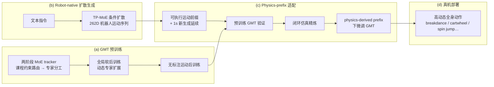
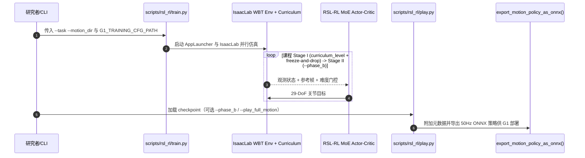

# PhyGile（Physics-Prefix Guided Motion Generation for Agile General Humanoid Motion Tracking）

**PhyGile** 是西北工业大学、上海 AI Lab、中科大、清华、复旦、字节与东北大学等团队的 **文本驱动人形敏捷全身控制** 工作（[arXiv:2603.19305v3](https://arxiv.org/abs/2603.19305)）：在 **262 维机器人原生骨骼空间** 做 **physics-prefix 引导的扩散生成**，并与 **General Motion Tracking (GMT)** 通才跟踪器形成 **生成–验证–微调–部署** 闭环，避免传统「人体 text-to-motion → 重定向」在真机上的 **物理不可行** 与 **生成–执行鸿沟**。

## 一句话定义

在 **262D 机器人原生空间** 训练文本条件 **TP-MoE 扩散生成器**，推理时以仿真物理可行前缀引导 1 秒延续生成，并与 **12 级课程 MoE GMT 跟踪器**（`29 DoF` Unitree G1 @ `50 Hz` ONNX）闭环协同适配，使纯文本输入可在真机直接驱动 breakdance、侧手翻与旋跳等高动态全身敏捷运动。

## 英文缩写速查

| 缩写 | 英文全称 | 简要说明 |
|------|----------|----------|
| GMT | General Motion Tracking | 通用人形全身参考运动跟踪控制器 |
| MoE | Mixture of Experts | 多专家混合，按路由将样本分给不同子网络 |
| TP-MoE | Text-Prefix MoE（论文命名） | 文本条件扩散生成侧的专家混合结构（以项目页图示为准） |
| RL | Reinforcement Learning | 跟踪器训练常用的策略优化范式 |
| WBT | Whole-Body Tracking | 全身参考运动跟踪任务总称 |
| T2M | Text-to-Motion | 文本条件人体/机器人运动生成 |
| PD | Proportional–Derivative | 底层关节阻抗/位置控制，tracker 常输出其 setpoint |
| Sim2Real | Simulation to Real | 仿真精炼与策略上真机的迁移考量 |

## 为什么重要

- **直击 text-to-motion 落地痛点**：人体动捕先验经重定向后常只剩 **运动学合理**，却在扭矩、接触与质量分布上 **物理不可行**；PhyGile 把生成空间改到 **机器人原生 262D**，并用 **physics-derived prefix** 约束推理。
- **生成与执行不再割裂**：不是「先生成再 hope retarget」，而是 **预训练 GMT 验证生成延续**、**闭环仿真精炼**、再 **physics-prefix 阶段微调 GMT**——与 [Heracles](../entities/paper-heracles-humanoid-diffusion.md) 的 middleware 思路不同，这里是 **统一框架内的生成–跟踪共训**。
- **敏捷动作真机证据**：项目页展示 **breakdance spin、前后侧手翻、高踢、180°/360° 空中旋跳** 等，明确对标「仅行走/低动态」的既有 text-driven 人形控制。
- **GMT 作为可复用执行底座**：课程式 **MoE tracker + 无标注后训练 + 动态专家扩展**，为大规模机器人运动与后续 prefix 适配提供 **鲁棒跟踪器**；与原始 [GMT（Chen et al.）](paper-gmt.md) 同族（Adaptive Sampling / MoE 跟踪范式）但本工作给出 **与生成闭环耦合** 的完整栈。

## 流程总览

## 核心机制（归纳）

### 问题：人体先验 vs 机器人执行

| 路线 | 典型流程 | 主要风险 |
|------|----------|----------|
| **Human T2M + retarget** | 人体数据集训练 → GMR/NMR → tracker | 几何可行但 **动力学/接触不可行** |
| **PhyGile** | 文本 → **262D robot-native** 扩散 + **physics prefix** | 生成与 tracker **同空间、同闭环验证** |

### GMT 跟踪器（执行层）

| 阶段 | 机制 | 论文实测规格 |
|------|------|--------------|
| **MoE 课程路由** | 12 级难度课程（Levels 1–10 覆盖主要训练动作，freeze-and-drop 巩固） | 45 小时高动态+通用混合动作；Phase A/B |
| **全局软后训练** | Stage II 动态新增专家并全局软路由，吸收极难动作（Levels 11–12 等） | GMT 整体跟踪成功率 **94.01%** |
| **真机控制器形式** | 50 Hz ONNX 推理驱动 29 DoF Unitree G1 | 支持高层参考微调对齐 |

### 生成与 physics-prefix 适配（生成层）

| 组件 | 作用 |
|------|------|
| **TP-MoE 扩散策略** | DistilBERT 文本编码 + **AdaLN Diffusion** + **TP-MoE**（`K=12` 专家、`top-k=6`、`ASFO`），在 **262D** 机器人空间生成动作 |
| **Physics-prefix 引导** | 推理时采用 **1 s 滑动窗口（receding-horizon）**，以物理仿真可执行的真实历史前缀条件续写 |
| **1s 延续拼接** | 可执行前缀 + 新生成短段 → 预训练 GMT 检验与仿真 rollout |
| **GMT 微调** | 在 physics-derived prefix 目标下进一步适配跟踪器，将文本生成动作落到真机敏捷执行 |

## 工程实践与开源范围

| 组件 | 开源状态（2026-11-20 复核） | 实测入口 / 说明 |
|------|-----------------------------|----------------|
| **GMT MoE 跟踪器** | **已开源** — [Baojch/phygile_tracking](https://github.com/Baojch/phygile_tracking) | 基于 `HybridRobotics/whole_body_tracking` / IsaacLab 2.1.0；训练 `scripts/rsl_rl/train.py`、回放与 ONNX 导出 `scripts/rsl_rl/play.py`（支持 `--phase_b`） |
| **TP-MoE 生成器 & prefix 微调** | **未开源** | 截至 2026-11-20 未包含于 `phygile_tracking`，亦无独立生成器仓库 |

## 源码运行时序图

对齐实测已开源的 **GMT MoE 跟踪器子系统**（`Baojch/phygile_tracking` 的 `scripts/rsl_rl/train.py` 与 `play.py`）：

> **边界提示**：上述时序图覆盖 `Baojch/phygile_tracking` 已开源的跟踪器训推链路；论文前序的 `TP-MoE` 262D 扩散生成器与 `physics-prefix` 闭环微调脚本尚未开源，暂无法在源码层核验。

## 与其他工作对比

| 工作 | 生成空间 | 执行层 | 文本入口 | PhyGile 差异 |
|------|----------|--------|----------|--------------|
| [Harmon](paper-loco-manip-161-097-harmon.md)（计划） | 人形机器人（语言→全身） | 待深读 | ✓ | PhyGile 强调 **physics prefix + GMT 闭环** 与 **262D native** |
| [Humanoid-GPT](paper-humanoid-gpt.md) | 重定向参考跟踪 | 规模化 Transformer tracker | ✗（跟踪为主） | PhyGile 主贡献在 **T2M 生成–GMT 共闭环**，非纯 tracker scaling |
| [Heracles](../entities/paper-heracles-humanoid-diffusion.md) | 状态条件 flow 中间件 | 通用 tracker | ✗ | Heracles **改参考缓冲**；PhyGile **从头生成 robot-native 轨迹** |
| [MoLingo](./paper-molingo.md) | 人体/SMPL 系（263/272D） | PHC 类 tracker（retarget 后） | ✓ | 人体 T2M SOTA + 语义对齐 latent；**非** robot-native |
| 人体 T2M + GMR | 人体/SMPL | 任意 tracker | ✓ | PhyGile 避免 **推理期人体→机 retarget** |
| [GenTrack](./paper-gentrack.md) | 38D G1 robot-native | 后训练 SONIC / ProtoMotions | ✓ | **对已有 tracker 做互训**，无真机；PhyGile 冲高动态真机闭环 |

## 实验与评测

- **平台**：仿真（IsaacLab）与 **Unitree G1 29-DoF 真机（50 Hz ONNX 部署）**。
- **生成与微调量化指标（`arXiv:2603.19305v3` 全文实测）**：262D 原生文本生成达到 **R@3 = 0.6176**、**FID = 0.1823**；经 **physics-prefix 闭环精炼**后，足部打滑（Skating）降至 **1.58%**、穿地（Penetration）降至 **0 mm**；12 级课程 MoE GMT 整体跟踪成功率达 **94.01%**。
- **定性高动态真机案例**：
  - **生成 → 微调 → 真机** 三段对比：breakdance spin、前后侧手翻（cartwheel）、高踢（high kick）、180°/360° 旋跳（spin jump）。
  - **更多高动态敏捷运动**：crawl、frog jump、monkey、jump、spin kick、hop、punch、kneel、wave 等。

## 结论

**文本驱动人形敏捷控制要先在机器人原生 262D 里生成，并用 1s physics-prefix 滑动预测 + MoE GMT 闭环验证，而不是「人体 T2M → 重定向 → hope tracker」。**

1. **生成空间改到 robot-native** — `262D` 机器人骨骼扩散结合 `TP-MoE (K=12, top-k=6)` 与 DistilBERT（R@3 `0.6176` / FID `0.1823`），避开人体→机 retarget 的动力学失配。
2. **Physics-prefix 压缩生成–执行失真** — 1 s receding-horizon 物理可行前缀 + 仿真精炼将足滑与穿地分别压至 `1.58%` 与 `0 mm`。
3. **12 级课程 MoE GMT 是敏捷执行底座** — Levels 1–10 课程与动态增专家训练实现 `94.01%` 跟踪成功率，并以 `50 Hz` ONNX 上机。
4. **部分开源需分模块复现** — [Baojch/phygile_tracking](https://github.com/Baojch/phygile_tracking) 已开源 GMT 跟踪器，但 TP-MoE 生成器与闭环适配尚未释放。
5. **与独立 GMT / Heracles 勿混读** — 复用 GMT 命名与跟踪范式但扩展为课程 MoE 生成闭环；Heracles 侧重平衡恢复中间件，PhyGile 主攻高动态文本生成。

## 局限与风险

- **部分开源缺口**：截至 2026-11-20 仅 GMT 课程跟踪器仓（`Baojch/phygile_tracking`）开源，上游 262D TP-MoE 生成器与 physics-prefix 闭环微调实现仍未公开，端到端复现受限。
- **GMT 仍需 45h 规模数据预训练与两阶段扩展**：敏捷真机高度依赖厚实的跟踪器底座；prefix 适配是附加阶段，并非单一模型零样本泛化。
- **与独立 GMT 论文关系**：本库已沉淀 [GMT（arXiv:2506.14770）](paper-gmt.md)；PhyGile 扩展了课程 MoE 与生成闭环，二者勿混淆。
- **任务域偏高动态全身技能**：演示集中在高动态空翻/舞蹈/踢腿类动作；复杂物体抓取、移动操作（loco-manipulation）或未知地形感知未在原文强调。

## 关联页面

- [扩散运动生成](../methods/diffusion-motion-generation.md) — PhyGile 属 **控制环内 robot-native 扩散 + tracker** 家族
- [Diffusion Policy](../methods/diffusion-policy.md)
- [人形运动跟踪方法选型](../queries/humanoid-motion-tracking-method-selection.md) — 文本驱动场景下的 **生成–GMT 闭环** 分支
- [Motion Retargeting（GMR）](../methods/motion-retargeting-gmr.md) — 对比「为何跳过推理期人体重定向」
- [Whole-Body Tracking Pipeline](../concepts/whole-body-tracking-pipeline.md) — retarget→tracker 经典管线上下文
- [Whole-Body Control](../concepts/whole-body-control.md)
- [GMT（Chen et al., arXiv:2506.14770）](paper-gmt.md) — 原始统一全身跟踪方法锚点
- [MoLingo](./paper-molingo.md) — 人体 T2M + PHC 跟踪对照（非 robot-native）
- [Harmon（计划实体）](paper-loco-manip-161-097-harmon.md)
- [Humanoid-GPT](paper-humanoid-gpt.md) — 同任务 **规模化 tracker** 前沿；正交互补（跟踪 vs 生成闭环）
- [GenTrack](./paper-gentrack.md) — 已有 SONIC/ProtoMotions 上的在线互训，非从头敏捷生成

## 推荐继续阅读

- 论文：<https://arxiv.org/abs/2603.19305>
- 项目页：<https://baojch.github.io/phygile-page/>
- 跟踪器官方仓：<https://github.com/Baojch/phygile_tracking>
- 人体 text-to-motion 综述入口：[Awesome Text-to-Motion](../entities/awesome-text-to-motion-zilize.md)
- 对照：[Humanoid-GPT 项目页](https://qizekun.github.io/Humanoid-GPT/)（规模化 tracker）

## 参考来源

- [phygile_arxiv_2603_19305.md](../../sources/papers/phygile_arxiv_2603_19305.md) — arXiv 全文精读与指标核对
- [phygile-page.md](../../sources/sites/phygile-page.md) — 官方项目页方法图、跟踪器链接与真机视频索引
- [phygile_tracking.md](../../sources/repos/phygile_tracking.md) — `Baojch/phygile_tracking` 官方跟踪器仓库代码结构与入口核查
