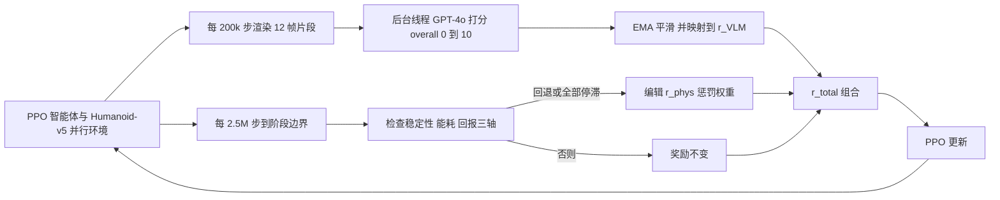

# PhySA：人形运动中审美奖励与物理奖励的解耦（arXiv:2611.07679）

**PhySA**（*Physical Smoothness and Aesthetics*）出自 [arXiv:2611.07679](https://arxiv.org/abs/2611.07679)（Yunwan Fu，上海交通大学；Sicheng He、Jiageng Mao、Yue Wang，南加州大学；CoRL 2026 Workshop R2RL）。归档与核对范围见 [来源归档](../../sources/papers/physa-humanoid-locomotion_arxiv_2611_07679.md)。

## 一句话定义

**一个人形运动奖励工程框架：把 VLM 审美打分（稀疏、异步、固定权重）和基于仿真器状态的物理平滑修正（阶段边界触发、编辑惩罚权重）放在互不共享奖励项的两条通道里；论文的核心发现是 VLM 审美分与关节加速度正相关，不能当平滑度代理，且 MuJoCo 上的增益主要来自修正通道，并未迁移到 IsaacLab 与 Unitree G1。**

## 英文缩写速查

| 缩写 | 英文全称 | 简要说明 |
|------|----------|----------|
| PhySA | Physical Smoothness and Aesthetics | 本文框架名 |
| VLM | Vision-Language Model | 视觉语言模型，本文用 GPT-4o 对渲染片段打 0–10 分 |
| PPO | Proximal Policy Optimization | 本文唯一的 RL 算法（SB3 实现） |
| EMA | Exponential Moving Average | 对稀疏 VLM 分数做 0.8/0.2 指数平滑 |
| GMP | Gaussian Motion Prior | 用 AMASS 动捕拟合的高斯运动先验奖励，各条件保持不变 |
| P2P | Prompt2Policy | 主要基线，每次更新同步查询 VLM 的奖励方法 |
| T2R | Text2Reward | 一次性由 LLM 写奖励代码的基线 |
| SAGE | Structured Agent for Goal Elicitation | 生成初始 r_task 模板的三阶段 LLM 代理（附录 A.2，不影响头条数字） |
| BH | Benjamini-Hochberg | 论文用于多重比较的 FDR 校正 |
| G1 | Unitree G1 | 论文中 23 关节人形，用于本体迁移负结果 |

## 为什么重要

- 用 VLM 当奖励源已经很常见，这篇给出一条反面数据：四个商用 VLM 对粗糙（高关节加速度）片段给分更高（论文摘要、表 7，均值 r=+0.66）。如果把审美分直接当平滑信号，梯度方向会反。
- 它是少见的把负结果写全的奖励工程论文：单次运行 −59.5% 与三种子 −7.2%（不显著）、Isaac 与 G1 零迁移、G1 的 alive 阈值 bug 都在正文或附录里（§4.2、§4.4、附录 G）。
- 给出一个可复用的诊断思路：同一奖励在不同仿真器里的逐步量级会随积分步长漂移（§4.4 的 Δt 实验），迁移前先看惩罚项的实际量级。

## 核心机制

式 1（§3）：`r_total = r_task + α·r_VLM + r_phys + r_GMP`。

**论文自述的设计（§3、附录 A）：**

| 组成 | 内容 | 出处 |
|------|------|------|
| 任务奖励 | 沿用 Prompt2Policy 的 r_task：v*=0.5 m/s 高斯速度跟踪、站高 alive bonus、二次高度惩罚、L2 执行器代价 | §3.1 |
| 审美通道 | 每 200k 步一次，GPT-4o-2024-05-13，温度 0，三个子维度（膝使用、摆动对称、质心跟踪）加一个 overall，仅 overall 进奖励；`r_VLM = vlm_ema/10 − 0.5`，α=0.5 | §3.2、附录 A.1 |
| 物理通道 | 4 个各 2.5M 步的阶段，每阶段从上一 checkpoint 热启动；阶段边界读最近 30 行日志，Δstability < −0.04 或无指标提升 ≥ 0.01 即触发；动作是抬高某些关节执行器代价、移除一项适得其反的惩罚，或不改 | §3.3、附录 A.1 与 A.1.1 |
| 触发频率 | 两次生产运行共 8 个阶段边界触发 3 次（37.5%） | §3.3 |
| 训练设置 | SB3 PPO，8 个并行环境，MLP [256,256]，lr 3e-4，单张 RTX 4090，PhySA 10M 步约 3.45±0.57 h | 附录 A.3，表 3 |

**机制解释（作者）：** 修正模块抬高高速关节的惩罚，策略把运动集中到少数关节、其余几乎不动：每关节动作标准差 0.353 → 0.144，与粗糙度在四个消融条件间相关 r=+0.949（§4.2、附录 B.2）。因此功率降低靠速度降低而非力矩降低（速度范数 −35%、力矩范数 +6%，表 12）。

**作者对审美通道作用方式的自评（§3.2）：** `r_VLM` 每 200k 步才更新一次且与状态无关，在 Humanoid-v5 终止规则下只相当于调节 alive bonus，不能直接奖励某种姿态或步态。

## 实验结果（论文数字，均带出处）

| 实验 | 结果 | 出处 |
|------|------|------|
| 对 P2P，单条 4 阶段训练链（10M） | 关节加速度 423.8 → 171.4（−59.5%），回合长度 78.5 → 123.5，功率 −43.1%，单回合功 −13.1% | §4.2，表 1，表 12 |
| 同上，三种子从零复现 | −7.2%，p=0.45，不显著 | §4.2，图 1，表 10 |
| 对 PPO / T2R / Eureka（2.6M，3 种子 × 50 回合） | 关节加速度 −25.7 / −26.6 / −31.7%；回合长度与回报显著更低（−37% 到 −63%） | 附录 B.4，表 6 |
| vanilla PPO（四项标准奖励，10M，N=8） | 关节加速度 1054.4±20.5，PhySA 为 171.4；vanilla 回合更长（243.8 对 123.5） | 附录 D |
| 模块隔离 | 仅审美通道 +136%（N=8），仅修正模块 −29.8%（N=50） | §4.3，图 4 |
| α 敏感性（N=30 配对，3M 步） | α=0.2 与 0.8 在 5 项指标上均无显著差，粗糙度差 −2.0（p=0.863） | 附录 B.3，表 5 |
| Isaac（仅换物理引擎） | 直接迁移 −2.2%（p=0.71）；平滑项 ×50 / ×60：−1.0% / −1.1% | §4.4，表 10 |
| MuJoCo 内 Δt 改为 1/60 s（N=3） | 关节加速度恶化近 5 倍 | §4.4 |
| Unitree G1（23 关节，N=3） | alive 阈值修正前 +3.4%，修正后 −1.7%，38 组超参搜索最佳 −4.8%，均不显著 | §4.4，附录 G，表 10、11 |
| 审美分与粗糙度相关 | 四个 VLM 的 Pearson r：+0.82 / +0.49 / +0.63 / +0.71，均值 +0.66 | 附录 B.6，表 7 |
| 成本 | 每 10M 步 50 次调用约 $0.85；同步方案约 1,220 次，约 24 倍（估算） | §2，附录 B.7 |

## 与周报说法的核对

对照「具身运控lab」周报对本篇的概括（原文未入库，周报属二手资料，故不列入 `original`）：

- **机构：** 周报写「上海交通大学、南加州大学」，与论文首页一致。
- **解决的问题：** 周报写 VLM 动作自然度奖励可能偏爱幅度大、速度快但关节抖动明显的动作，与论文发现一致，但论文的措辞是「审美分与关节加速度正相关」，证据是跨四个 VLM 的相关性（r=+0.66）。**需要提醒：** 该相关性是把 PhySA 与 Prompt2Policy 两个条件的片段合并算出来的，条件间差异也贡献了相关（附录 B.6），论文自己也提示了这一点。
- **创新点「解耦成两条独立通道」：** 与论文一致（式 1 与图 2）。周报未提的关键细节：物理通道是「阶段触发的惩罚权重编辑」，审美通道是「每 200k 步异步一次」。
- **「方法在 Humanoid-v5 中有效」：** 需要加限定。头条的 −59.5% 来自单次训练链，三种子复现仅 −7.2% 且不显著（p=0.45）；对 PPO / T2R / Eureka 的 26 到 32% 改善是以更短回合、更低回报为代价（附录 B.4）。论文还指出 VLM 通道在组合栈中对结果没有可测影响，增益归于修正通道（§4.3）。
- **「未能迁移到 IsaacLab 的 Unitree G1」：** 论文把这写成两个独立实验：IsaacLab 上是同一个人形仅换物理引擎（−2.2%、重标度后 −1.0%）；Unitree G1 实验同时换了仿真器和本体，因此失败无法归因（§4.4、附录 G）。论文正文没有明确说 G1 实验用的是 IsaacLab，把两者合写成「IsaacLab 的 G1」不符合论文表述（推测：G1 实验的仿真器应是非 MuJoCo 的，但原文未点明名称）。
- 周报未出现具体数字，因此无数字需校对。

## 工程实践

- **复现要点（均来自论文）：** SB3 PPO + Gymnasium Humanoid-v5，固定超参（表 3），固定 α=0.5，VLM 调用放后台线程并设 EMA，实测对墙钟无影响（1M 步对照 −4.1%，附录 B.7）。
- **早期训练护栏：** 回合平均长度 < 100 步时把 α 缩到 0.2α，起因是 α=0.8 的 1M 步试验里 VLM 对仍在摔倒的人形给近零分，策略追着分数学会了坐下（附录 A.1）。
- **换本体前先校准常量：** Humanoid-v5 的 alive 阈值 z≥1.1 m 照搬到站高 0.793 m 的 G1 上会永不触发；论文的补丁是按站高乘 0.769（附录 G）。
- **注意（我的判断）：** 论文未给出代码或项目页链接，复现需要自行实现奖励编辑器的细节；论文只描述了触发规则与受影响的奖励项，具体编辑幅度没有给出。

## 局限

**论文自己承认的：**
- 最大效果（−59.5%）来自单次训练，三种子复现不显著（§5）。
- 回合很短（PhySA 123.5 步约 1.9 s），测的是早期运动而非长时程步态（§4.2）。
- VLM 通道只通过生存价值起作用，片段级或状态条件化的 VLM 奖励留作未来工作（§3.2、§5）。
- 增益不迁移到 IsaacLab 与 G1；G1 实验同时变了仿真器与本体，MuJoCo 内的 G1 实验没做（§4.4、附录 C）；推球恢复实验也无显著提升（附录 C）。
- bait 诊断只训练 5M 步，无法排除更长训练后诱饵策略获得 VLM 优势（附录 E）；单片段层面的 VLM 评分者间一致性极低（Krippendorff α=−0.008，附录 B.6）。

**我看到的未验证之处（判断，非作者原话）：**
- 表 1 的 VLM 分数来自 α 扫描且在高种子数下统计上不可分（表 1 注），不应当作 PhySA 提升审美的证据；同时表 4 中去掉 VLM 通道的 VLM 分数（6.43）还高于完整系统（5.87，N=3 对 N=10）。
- 不同表之间的粗糙度绝对值不可比（表 1 为 171.4，表 5 为 1139.7，表 9 为 213±19，表 12 为 213.4；论文已说明评估协议不同，只能比 Δ%），读者容易误比。
- 图 2 标注 rollout 缓冲 T=2048、分数区间 [0,1]，而正文与表 3 为 rollout 长度 1024、分数 [0,10]（图内标注与正文不一致，推测为示意图未同步）。
- 表 11 中 H3 的最佳格 p=0.04 却被称作不显著，论文未在该表注明是否做了多重比较校正。
- 与 Eureka / T2R 的对比用的是 3 种子、2.6M 步，且 PhySA 回合长度与回报明显更低；这个比较更像「用生存换平滑」的取舍（作者以 η=0.61 到 0.73 描述，附录 B.4）。
- 基线 P2P 的实现来自其 GitHub 仓库，未在论文中说明与原作者设置是否完全一致（推测，原文未讨论）。

## 关联页面

- [奖励设计](../concepts/reward-design.md)
- [人形策略奖励函数](../concepts/humanoid-policy-reward-functions.md)
- [物理保真度与 Sim2Real 差距](../concepts/physics-fidelity-sim2real-gap.md)
- [Sim2Real](../concepts/sim2real.md)
- [PPO](../methods/ppo.md)
- [Eureka：LLM 奖励设计](../entities/paper-eureka-llm-reward-design.md)
- [Reward Design with Language Models](../entities/paper-as-2303-00001-reward-design-with-language-models.md)
- [运动平滑约束论文页](../entities/paper-smoothness-constraint-locomotion.md)
- [MuJoCo](../entities/mujoco.md)
- [Isaac Lab](../entities/isaac-lab.md)
- [Unitree G1](../entities/unitree-g1.md)
- [Stable-Baselines3](../entities/stable-baselines3.md)

## 参考来源

- [sources/papers/physa-humanoid-locomotion_arxiv_2611_07679.md](../../sources/papers/physa-humanoid-locomotion_arxiv_2611_07679.md)
- [arXiv:2611.07679](https://arxiv.org/abs/2611.07679)

## 推荐继续阅读

- [arXiv PDF](https://arxiv.org/pdf/2611.07679)
- [奖励设计总览](../concepts/reward-design.md)
- [Eureka 论文页](../entities/paper-eureka-llm-reward-design.md)
- [Prompt2Policy 仓库（论文基线）](https://github.com/krafton-ai/Prompt2Policy)
