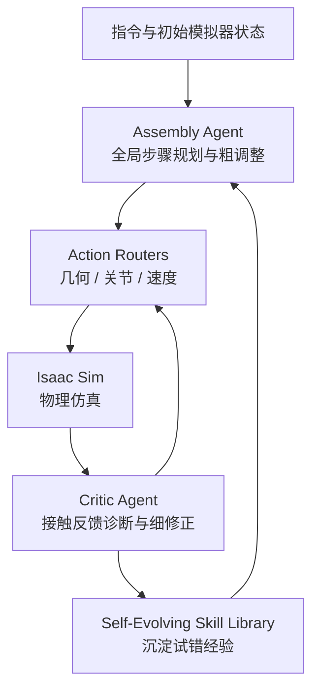

# PhySGA：物理空间中的智能体式 3D 组合

**PhySGA**（*Physics-Space Grounded Agentic Framework*；论文 *PhySGA: A Physics-Space Grounded Agentic Framework for Generalizable and Interactive 3D Composition*，[arXiv:2610.20560](https://arxiv.org/abs/2610.20560)，[项目页](https://agenticei.github.io/PhySGA-page/)）把 3D 物体组合从"一次性预测最终位姿"改为在仿真器中的交互式装配过程：智能体逐步放置、仿真、观察、修正，直到形成指令要求的稳定关系。

## 英文缩写速查

| 缩写 | 英文全称 | 简要说明 |
|------|----------|----------|
| PhySGA | Physics-Space Grounded Agentic Framework | 本文框架：在物理空间中落地的智能体式组合 |
| VLM | Vision-Language Model | 文中对比的直接使用大模型预测坐标的路线 |
| Isaac Sim | NVIDIA Isaac Sim | 论文的物理仿真环境，用于执行与检验组合结果 |
| SGA | Self-Evolving Skill Library（技能库缩写沿用项目命名） | 从历史试错中沉淀可复用技能的模块 |

> 注：上表 SGA 为便于阅读的简称，论文正文以 *Self-Evolving Skill Library* 为准。

## 为什么重要

- **组合是数字内容与机器人仿真的共同基础：** 场景搭建需要处理悬挂、重力沉降、隐藏容纳等接触密集的关系。
- **静态先验不够：** 直接让 LLM 预测坐标或用扩散先验合成图像，缺少物理交互过程。
- **可作为物理智能的测试床：** 论文把组合任务当作检验基础模型物理理解能力的环境。

## 核心信息

| 项 | 内容 |
|----|------|
| **机构** | 清华大学（Tsinghua University）；浙江大学（Zhejiang University） |
| **平台 / 数据** | Isaac Sim 内的刚体、铰接与可变形物体组合任务 |
| **开源** | **待发布**：项目页与论文均指向 `AgenticEI/PhySGA`（Apache-2.0）；2026-10-15 浅克隆仓库，仅含 README、LICENSE 与两张方法图，**无训练或仿真代码** |

## 核心原理

### 流程总览

- **输入：** 自然语言组合指令、初始仿真状态与物体资产。
- **关键机制：** 前馈的 Assembly Agent 负责全局计划；反馈的 Critic Agent 读取接触与运动信号做闭环修正；Action Router 把语义目标翻译为可执行的几何变换、关节运动与释放速度；技能库在任务前检索、任务后写入。
- **输出：** 满足指令关系且物理稳定的场景状态。

## 工程实践

| 项 | 建议 |
|----|------|
| 复现路径 | 截至 2026-10-15 仓库无代码，只能按论文描述实现；关注仓库后续是否落库训练与仿真脚本 |
| 仿真环境 | 物理结果依赖 Isaac Sim 的接触与刚体设置，迁移到其他仿真器前需重新验证 |
| 评测 | 用组合关系保真度、物理合理性与渲染质量三类指标，而非单一成功率 |
| 源码运行时序图 | **不适用**（官方仓库仅含 README 与许可证，未发布可运行入口；已在本页说明，待代码发布后补充） |

## 实验与评测

- **设定：** 在 Isaac Sim 中对比已有方法，覆盖悬挂、沉降与容纳等难任务，以及刚体、铰接、可变形三类物体。
- **摘要结论：** 在 relation fidelity、physical plausibility 与 visual quality 上相对已有方法有显著提升。
- **未核实项：** 摘要与项目页未给出具体指标数字；本页未读取到表格数值，需以论文正文为准。

## 结论

**PhySGA 的主张是：组合任务要靠仿真中的交互迭代完成，而不是一次性的位姿预测。**

1. **闭环比一次性预测更适合接触密集的组合** — 悬挂、沉降与容纳都依赖仿真反馈，单步预测无法保证稳定。
2. **分工是关键设计** — 粗规划与细修正由不同智能体承担，降低了单一 VLM 同时做规划与物理推理的负担。
3. **技能库带来跨任务迁移的希望** — 经验蒸馏能减少后续任务的试错次数，但效果需要在多任务上验证。
4. **代码未发布，结论暂不可独立复核** — 目前只能依据论文与项目页判断方法价值。

## 与其他工作对比

| 维度 | PhySGA | 直接 LLM / VLM 预测坐标 | 扩散先验合成图像对齐 |
|------|--------|--------------------------|----------------------|
| 物理交互 | 仿真中逐步执行与修正 | 无 | 无 |
| 经验积累 | 技能库 | 通常无 | 通常无 |
| 对象类型 | 刚体、铰接、可变形 | 多为刚体位置 | 多为图像层面对齐 |

与 [接触动力学](../concepts/contact-dynamics.md) 中的接触建模直接相关；与 [Isaac Sim](../entities/isaac-sim.md) 的仿真流程配合使用。

## 局限与风险

- **依赖仿真器精度：** 接触与摩擦参数的偏差会改变组合结果，与真实物理之间存在 [物理保真度差距](../concepts/physics-fidelity-sim2real-gap.md)。
- **代码未发布：** 仓库仅有 README，复现成本高，结果难以独立检验。
- **智能体开销：** 闭环迭代需要多次 VLM 调用与仿真步进，延迟与成本随任务复杂度增长。
- **泛化边界未明：** 技能库的迁移范围需要更多跨场景实验支撑。

## 关联页面

- [接触动力学](../concepts/contact-dynamics.md) — 组合任务中接触关系的物理基础
- [Isaac Sim](../entities/isaac-sim.md) — 论文所用的仿真平台
- [物理保真度与 sim2real 差距](../concepts/physics-fidelity-sim2real-gap.md) — 仿真结果外推的边界
- [SceneAgent：Real2Sim 与物理捕获](./paper-sceneagent-real2sim-capture-physics.md) — 同样利用仿真物理的场景构建工作
- [SimFoundry：Real2Sim 场景生成](./paper-simfoundry-real2sim-scene-generation.md) — 面向仿真场景生成的相关路线

## 参考来源

- [PhySGA 论文归档](../../sources/papers/physga_arxiv_2610_20560.md) — 摘要、项目页与代码仓库的核查记录
- [微信图文：31 篇具身论文速览（2026-10-15）](../../sources/raw/wechat_embodied_station_robot_31_papers_2026-10-15.md) — 文章中的一句话转述

## 推荐继续阅读

- [PhySGA 项目页](https://agenticei.github.io/PhySGA-page/) — 方法视频与组合示例
- [arXiv:2610.20560](https://arxiv.org/abs/2610.20560) — 完整论文与实验设置
