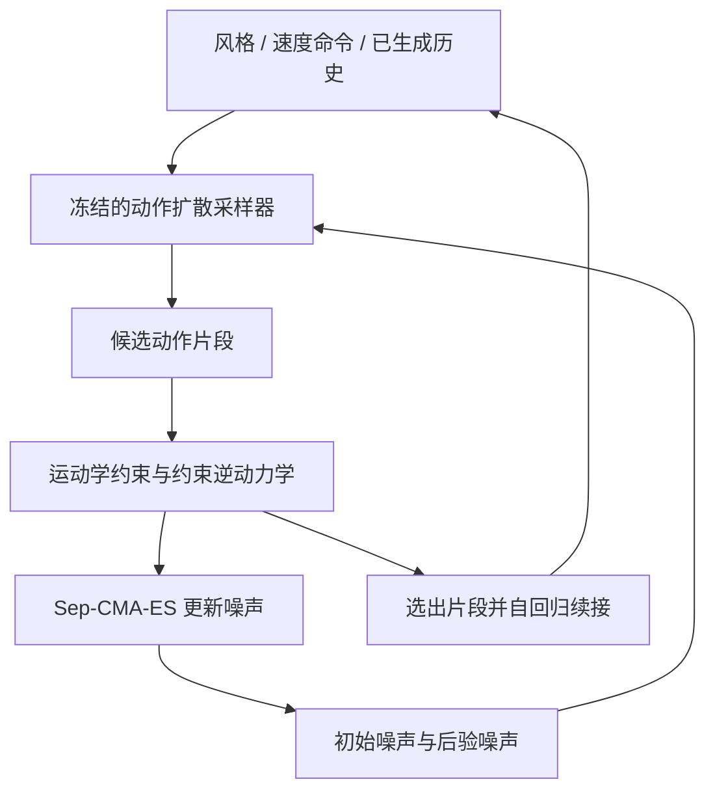

# PhysibleMDM：推理时优化动作扩散噪声以提升物理可行性

**PhysibleMDM**（*PhysibleMDM: Enforcing Inference-Time Physical Feasibility Constraints on Motion Diffusion Models via Noise Optimization*，[arXiv:2610.30500](https://arxiv.org/abs/2610.30500)）由 Disney Research 团队提出：冻结动作扩散生成器，在推理阶段直接优化扩散噪声，让输出动作更符合运动学与动力学约束。

## 一句话定义

**PhysibleMDM 把动作物理修正转化为扩散噪声搜索：在不重训生成器的条件下，让候选动作同时靠近生成先验并降低物理不可行性。**

## 英文缩写速查

| 缩写 | 英文全称 | 简要说明 |
|------|----------|----------|
| MDM | Motion Diffusion Model | 生成条件动作序列的扩散模型 |
| Sep-CMA-ES | Separable Covariance Matrix Adaptation Evolution Strategy | 论文用于搜索扩散噪声的无梯度进化策略 |
| SMPL | Skinned Multi-Person Linear | 论文评测所用的人体参数化模型 |
| ID | Inverse Dynamics | 由期望运动反推接触力与关节力矩的可行性检查 |

## 为什么重要

- **把生成质量与可执行性放到同一个推理环节处理：** 视觉自然的动作仍可能穿地、滑步或需要不可实现的关节力矩。
- **不必重训已有生成器：** 优化发生在推理噪声上，可复用冻结的动作扩散模型。
- **面向机器人跟踪数据：** 更可行的参考动作有望减少下游跟踪策略需要应对的物理伪影；论文也比较了用优化与未优化动作训练 RL 跟踪器的结果。
- **与物理投影路线互补：** [PhysDiff](./paper-notebook-physdiff-physics-guided-human-motion-diffusion-m.md) 在去噪过程中调用仿真跟踪策略投影动作；PhysibleMDM 直接搜索噪声，并以运动学与逆动力学代理约束评价候选。

## 核心原理（方法栈）

### 流程总览

### 1. 优化对象是噪声

论文联合参数化扩散初始噪声与采样过程中的后验噪声，优化后再通过冻结采样器生成动作。标准化噪声用于保持搜索尺度与采样分布可控；方法不对生成器参数做梯度更新。

### 2. 约束覆盖运动学与动力学

运动学项包括地面穿透、地面滑动、自碰撞及接触模式保持。动态可行性通过约束逆动力学内循环评估，相关优化问题写成锥规划；这比对每个候选动作运行完整轨迹仿真更便于批量筛选，但仍有重复求解成本。

### 3. 无梯度候选搜索与长动作串接

Sep-CMA-ES 并行采样噪声候选，生成对应动作并按目标函数排序，再更新搜索分布。长动作采用自回归片段：优化后提交一段动作，重规划时把已提交历史作为条件，并保留片段重叠来维持连续性。

## 工程实践

| 项 | 论文给出的信息 |
|----|----------------|
| **生成器训练** | 优化阶段冻结生成器，不需要为约束重新训练该生成器 |
| **搜索方法** | Sep-CMA-ES；论文同时比较动作空间优化、引导扩散、Best-of-N 与噪声梯度等基线 |
| **物理评估** | 运动学代理约束 + 约束逆动力学锥规划；不以完整轨迹仿真作为每次打分的必要步骤 |
| **长动作** | 自回归分段生成，历史片段作为后续条件 |
| **源码状态** | 截至 2026-10-24，arXiv 页面未列项目页或官方代码仓库；没有可核对的安装、训练或推理入口 |
| **实时部署判断** | 论文指出重复候选评估和逆动力学求解会增加计算开销；不能仅凭物理指标改善推断可实时部署 |

**源码运行时序图：不适用。** 截至入库日未发现作者公开的可运行仓库或命令行入口，无法把论文方法映射到实际源码模块；上方流程图表示论文算法而非源码运行路径。

## 实验与评测

- **SMPL 人体模型，100 种动作风格：** 相对未优化扩散输出，平均地面穿透、自碰撞穿透、地面滑动分别降低 **75%、92%、74%**。
- **自定义双足机器人，11 段动作序列：** 平均加速度重建误差的逐序列中位降幅为 **89.5%**；平均逆动力学残差的中位降幅为 **79.5%**。
- 论文还评估了用优化动作训练 RL 跟踪控制器的下游效果。应结合原文实验协议读取结果，不能把代理约束下降直接等同于真机任务成功率。

## 与其他工作对比

| 方法 | 物理约束如何进入生成 | 约束评价方式 | 读法 |
|------|--------------------|------------|------|
| [PhysDiff](./paper-notebook-physdiff-physics-guided-human-motion-diffusion-m.md) | 在扩散采样的若干步调用物理仿真跟踪投影 | 仿真器与 motion-imitation policy | 直接借助执行器投影，但有仿真与策略成本 |
| **PhysibleMDM** | 推理时搜索初始及后验扩散噪声 | 运动学代理约束与约束逆动力学 | 不重训生成器；需承担反复采样和优化开销 |
| [Guided Motion Diffusion](./paper-notebook-guided-motion-diffusion-for-controllable-human-m.md) | 用空间目标梯度引导去噪 | 可微空间约束目标 | 侧重空间可控性，目标不同于本文的动态可行性检查 |

## 结论

**PhysibleMDM 展示了推理时噪声优化改善动作物理可行性的路径；收益需要与优化计算、接触假设和动作风格保持一起评估。**

1. **修正发生在噪声空间** — 生成器保持冻结，避免针对约束重新训练主模型。
2. **运动学与动力学指标要分开读** — SMPL 的穿地、碰撞、滑动改善不能替代机器人逆动力学残差或任务成功率。
3. **双足结果有明确范围** — 自定义双足模型的 11 段序列支持可行性趋势判断，尚不足以证明跨机器人泛化。
4. **约束设定会影响行为分布** — 接触模式和多目标权重会限制优化空间，过度优化可能损害动作风格。
5. **在线部署需先量算力预算** — 每轮要生成并评估多组候选，论文指出重复评估成本可能妨碍实时应用。

## 局限与风险

- 评测限于双足形体，并采用粘着地面接触假设；有意滑动的动作不在该接触设定覆盖范围内。
- 论文明确指出，优化噪声未必留在生成器训练分布内；可能出现约束满足但动作风格塌缩。
- 多个目标与约束之间需要权重折中，严格约束可能需要更多搜索迭代并增加分布外风险。
- 物理代理指标变好不代表真机控制闭环稳定；需另行评估执行器限幅、延迟、接触估计、跟踪误差与任务成功率。
- 截至 2026-10-24，arXiv 页未提供作者项目页或代码链接，源码复现状态无法核实。

## 关联页面

- [PhysDiff：物理仿真投影动作扩散](./paper-notebook-physdiff-physics-guided-human-motion-diffusion-m.md)
- [Diffusion-based Motion Generation](../methods/diffusion-motion-generation.md)
- [Guided Motion Diffusion](./paper-notebook-guided-motion-diffusion-for-controllable-human-m.md)

## 参考来源

- [PhysibleMDM 论文来源归档](../../sources/papers/physiblemdm_arxiv_2610_30500.md)
- [arXiv:2610.30500](https://arxiv.org/abs/2610.30500)
- [arXiv HTML 全文](https://arxiv.org/html/2610.30500)

## 推荐继续阅读

- [论文 PDF](https://arxiv.org/pdf/2610.30500)
- [PhysDiff](./paper-notebook-physdiff-physics-guided-human-motion-diffusion-m.md)
- [动作扩散生成方法](../methods/diffusion-motion-generation.md)
