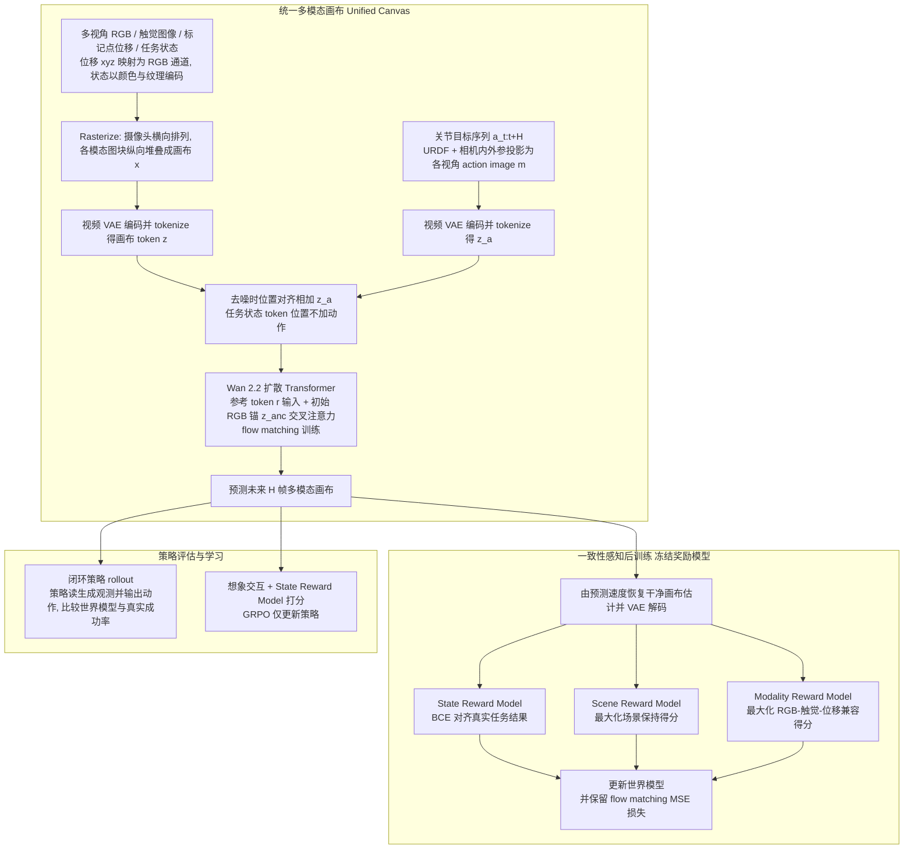

# Physical Canvas：面向机器人策略评估与学习的视觉触觉世界模型

**Physical Canvas**（*Physical Canvas: A Vision Tactile World Model For Robot Policy Evaluation And Learning*，[arXiv:2610.28613](https://arxiv.org/abs/2610.28613)）收录于 senlanke「具身运控lab」10-19–10-23 前沿论文动态（Manipulation）。本页依据**周报条目 + arXiv 摘要页**整理，流程图依据论文方法部分（见参考来源），未逐页核对实验数字；指标与结论以论文为准。

## 一句话定义

**Physical Canvas：面向机器人策略评估与学习的视觉触觉世界模型——Physical Canvas 将视觉与触觉共同用于世界建模，研究通过多模态物理预测支持机器人策略评估和策略学习。**

## 英文缩写速查

| 缩写 | 英文全称 | 简要说明 |
|------|----------|----------|
| WAM | World Action Model | 世界–动作联合建模 |
| VLA | Vision-Language-Action | 视觉–语言–动作模型 |

## 为什么重要

- 周报所述待解决的问题：仅根据视觉预测操作结果，难以完整表达接触丰富任务中的物理交互。机器人策略评估还需要考虑接触状态及其变化。

## 流程总览

图依据：论文 §3.2–3.4 / Fig.3

## 核心机制

| 项 | 内容 |
|----|------|
| **arXiv** | [2610.28613](https://arxiv.org/abs/2610.28613) · [PDF](https://arxiv.org/pdf/2610.28613) |
| **作者（arXiv）** | Zebin Xing, Yuhang Zheng, Yupeng Zheng, Yichen Zhang, Zichen Li, Shangqing Zhou, Yujie Zang, Yuchen Liu, Zhongpu Xia, Haoran Li, Qichao Zhang |
| **机构（周报所述，未逐条核实）** | 待核实（作者：Zebin Xing、Yuhang Zheng、Yichen Zhang 等）。 |
| **arXiv 评论栏** | （无） |
| **开源** | arXiv 摘要页/评论给出项目页或外链（https://zebinx.github.io/PhysCanvas_HomePage/）；未发现代码仓库链接（2026-10-26） |
| **周报所述创新点** | Physical Canvas 将视觉与触觉共同用于世界建模，研究通过多模态物理预测支持机器人策略评估和策略学习。 |

### arXiv 摘要节选（英文原文）

> Evaluating and post-training robot policies through physical interaction is costly and difficult to scale, motivating action-conditioned world models as interactive simulators. However, visually plausible predictions can misrepresent contact dynamics, providing unreliable feedback for policy evaluation and learning.

## 源码运行时序图

**不适用**：arXiv 摘要页/评论给出项目页或外链（https://zebinx.github.io/PhysCanvas_HomePage/）；未发现代码仓库链接，无可对齐的官方代码流程。

## 实验与评测

- 周报与摘要给出的数字/场景已写入上表「创新点」与摘要节选；其余实验细节、基线与成功率定义请回到论文正文。
- 读法：先对齐任务设定、传感器与成功定义（仿真/真机），再解读 headline 数字，勿跨论文直接比较。

## 与其他工作对比

| 维度 | 读法 |
|------|------|
| **同周对照** | 见 [Manipulation周报技术地图](../overview/senlanke-weekly-2026-10-19-23-manipulation-technology-map.md)，按方向浏览同期论文 |
| **开源状态** | arXiv 摘要页/评论给出项目页或外链（https://zebinx.github.io/PhysCanvas_HomePage/）；未发现代码仓库链接 |

## 结论

**Physical Canvas：面向机器人策略评估与学习的视觉触觉世界模型。**

1. 本页是入库级摘要，复现前请核对论文正文、附录与代码仓库。
2. 指标须连同实验条件解读。
3. 关注 arXiv 版本更新与代码发布。

## 关联页面

- [senlanke-weekly-2026-10-19-23-manipulation-technology-map](../overview/senlanke-weekly-2026-10-19-23-manipulation-technology-map.md)
- [manipulation](../tasks/manipulation.md)
- [vla](../methods/vla.md)

## 参考来源

- [physical-canvas-vision-tactile-world-model_arxiv_2610_28613.md](../../sources/papers/physical-canvas-vision-tactile-world-model_arxiv_2610_28613.md)
- [wechat_senlanke_weekly_manipulation_2026-10-19_23.md](../../sources/blogs/wechat_senlanke_weekly_manipulation_2026-10-19_23.md)
- [arXiv:2610.28613](https://arxiv.org/abs/2610.28613)
- [arXiv PDF](https://arxiv.org/pdf/2610.28613)：已通读方法部分（实验与附录以略读为准）：摘要、§1 引言、§3 方法（3.1–3.4）、§4.1 实验设定

## 推荐继续阅读

- [arXiv PDF](https://arxiv.org/pdf/2610.28613)
